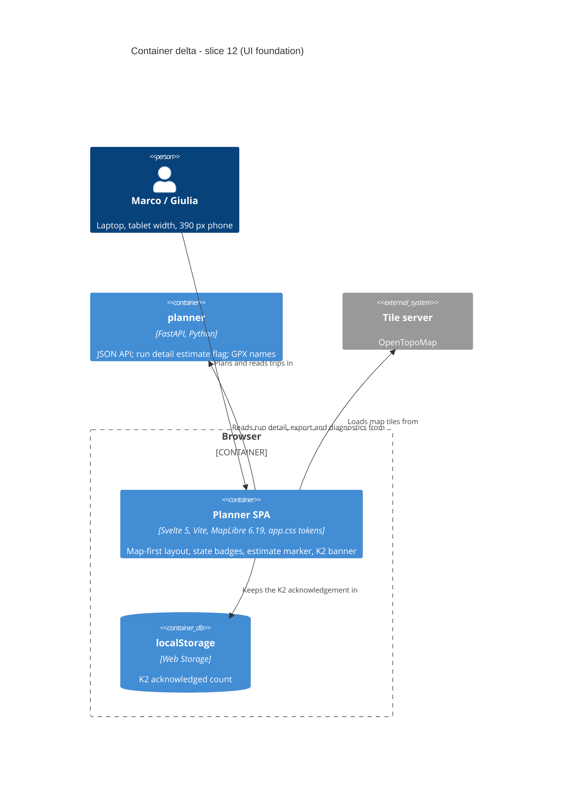
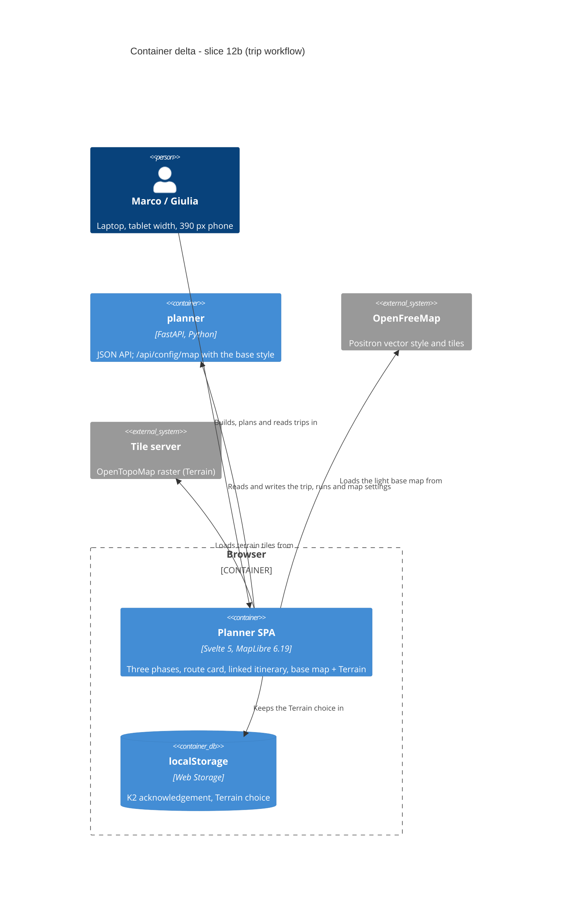

<!-- markdownlint-disable MD024 -->
# Feature Delta: overland-route-planner-mvp

Wave: DISCUSS (2 of 6) | Date: 2026-11-01 | Author: nw-product-owner (Luna) | Density: FULL | Revision: 7 (final review gate 2026-11-02, D140-D159; earlier: 6.2 post-DESIGN back-propagation, U1-U46)

Source of truth: `REQUIREMENTS.md` (as updated 2026-11-01). SSOT bootstrapped: `docs/product/jobs.yaml`, `docs/product/personas/overland-planner.yaml`, `docs/product/journeys/plan-overland-trip.yaml`. Gherkin: `discuss/journey-plan-overland-trip.feature` (Revision 6.1 snapshot, SUPERSEDED by `tests/acceptance/overland_route_planner_mvp/*.feature`, D140). Slice briefs: `slices/slice-00a`, `slice-00b`, `slice-01a`, `slice-01b`, `slice-02`, `slice-03`, `slice-03b`, `slice-04`, `slice-05`, `slice-06a`, `slice-06b`, `slice-07` .. `slice-11`, `slice-12` (UI foundation, D232).

## Wave: DISCUSS / [REF] Read-confirmation checklist

- ✓ `REQUIREMENTS.md` (read in full)
- ⊘ `docs/product/journeys/*` - not found (bootstrapped by this wave)
- ⊘ `docs/product/jobs.yaml` - not found (bootstrapped by this wave)
- ⊘ `docs/product/vision.md` - not found
- ⊘ `docs/project-brief.md` - not found
- ⊘ `docs/stakeholders.yaml` - not found
- ⊘ `docs/feature/overland-route-planner-mvp/discover/` - not found
- ⊘ `docs/feature/overland-route-planner-mvp/diverge/` - not found (risk: jobs are requirements-doc derived, unvalidated)

## Wave: DISCUSS / [REF] Persona ID

- Primary: `overland-planner` - Marco Ferri, Defender 90 owner, Torino. Plans 1-3 week Alpine trips (5-40 tracks, 5-30 POIs), self-hosts on a home Raspberry Pi, uses a desktop browser.
- Secondary: `household-viewer` - Giulia Ferri. Reads the results on an iPhone (~390 px) over the home LAN and never edits.

## Wave: DISCUSS / [REF] JTBD one-liner

When I have collected the trails and places for an overlanding holiday, I want one drivable itinerary between my fixed start and end that drives every trail whole and in its recorded direction with minimal road driving, so I can spend my days on trails and load the trip straight onto my navigation device.

Evidence level: requirements-doc derived, unvalidated (no interviews, no DISCOVER/DIVERGE).

## Wave: DISCUSS / [REF] Locked decisions

| ID | Decision | Source |
|----|----------|--------|
| D1 | Feature type: user-facing full-stack web app (backend + browser UI) | User |
| D2 | Walking skeleton: YES (greenfield), slices 01a + 01b | User |
| D3 | UX research depth: Comprehensive. One primary persona plus a household secondary viewer (phone only) | User |
| D4 | JTBD: YES. Every story has one primary `job_id` in `docs/product/jobs.yaml` | User |
| D5 | Scope: ONE feature for the Phase 1 MVP, split into thin slices; Phase 2/3 go to the backlog | User |
| D6 | Open Decision #2 resolved: Tracks CANNOT be Start/End anchors in v1; anchors are POIs only | User |
| D7 | Open Decision #3 resolved: default objective = minimise road distance; time selectable per project | User |
| D8 | Walking skeleton strategy WS-B (real storage and container, MockProvider for routing) | Luna |
| D9 | Driving ports for the MVP: HTTP API + browser UI. CLI is Phase 2 | Orchestrator |
| D10 | GPX waypoints: one waypoint per POI item. A round-trip Start=End POI is ONE waypoint, named with an "(S/E)" marker | Orchestrator (rev 1, B5) |
| D11 | Itinerary "cumulative" column = total km (road + off-road) driven up to the end of that stop (defines FR-6.1) | Orchestrator (rev 1, B14) |
| D12 | FR-6.3 and FR-6.7 stay in the MVP: the GPX export carries the consideration report (DESIGN picks the mechanism), and Results has a "Warnings" section showing unresolved import warnings for the run | Orchestrator (rev 1, B3) |
| D13 | Size rule: <= 1 day per slice is the project standard | Orchestrator (rev 1, S12) |
| D14 | The Pi solver spike is a MANDATORY gate before slice 03; amended in Revision 6 to SPIKE-1R (kill criterion in Pre-requisites). SPIKE-2R (Valhalla on the Pi) is a MANDATORY gate before slice 06a | Orchestrator/reviewer (rev 1, B9); DESIGN D40, D41 (rev 6, U12, U13) |
| D15 | Determinism (amended rev 6, U1): tests and production stop the solver on a deterministic search budget. The FR-5.5 limits (10 min feasibility, 30 min optimisation) and the Stop action are safety ends; a run ended by them is labelled "not fully optimised" and recorded as not reproducible. A Recalculate whose solver inputs equal a stored run with a valid route (including a not fully optimised one, D73) reuses that run's order; "Re-optimise (ignore previous result)" bypasses this (D74) | Reviewer S2 (rev 1); DESIGN D42, ADR-014 |
| D16 | Assumptions A1-A10 (Wave Decisions) confirmed by the user; A8 and A9 amended in rev 6 | User (rev 1) |
| D69 | US-19 (retrace) goes in its own optimizer slice 03b, right after slice 03. U31's S4 (Warnings, map, GPX presentation) is split across US-14 S7, US-15 S6 and US-18b S4; US-19 S4 covers the itinerary leg and totals | Luna (rev 6), per user decision "US-19 joins the optimizer slices" (DESIGN D63) |
| D70 | Story splits to keep 3-7 scenarios: US-06 -> US-06a (time budget) + US-06b (Stop and limits); US-10 -> US-10a (Valhalla + Confirmed, slice 06a) + US-10b (Unconfirmed ladder, slice 06b); US-18 -> US-18a (device-ready file) + US-18b (what to trust) | Luna (rev 6) |
| D71 | UI vocabulary keeps "Optimize" (first run) and "Recalculate" (later runs); "Calculate" in FR-5.5 means either | Luna (rev 6, U41 option) |
| D72 | Slice 06 is split into 06a (Valhalla adapter + Confirmed legs + US-06a S1b) and 06b (confidence ladder, US-10b) | User decision (U26), recorded by Luna (rev 6) |
| D73 | Q-U8 confirmed: after a stopped or time-limited run, Optimize/Recalculate with unchanged inputs returns the same "not fully optimised" plan instantly, and a separate "Re-optimise (ignore previous result)" action starts a fresh search (US-06b S5, S6) | User (Q-U8), recorded by Luna (rev 6.1, U45; DESIGN D74, ADR-014 §5) |
| D140 | Scenario SSOT: `discuss/journey-plan-overland-trip.feature` is a superseded Revision 6.1 snapshot (header note); the executable SSOT is `tests/acceptance/overland_route_planner_mvp/*.feature` (SSOT-1) | Luna (final gate, 2026-11-02) |
| D141 | DoR story-size rule (UD-2): DISTILL scenarios derived from DESIGN/DEVOPS decisions (contract checks, caps/limits and threshold calibration, start-up refusals, crash consistency, concurrency guards, diagnostics/KPI instruments, golden order) carry `@technical` and do not count toward the 3-7 UAT band. A scenario tagged with several stories counts for its first-listed (primary) story only. 39 of 193 scenarios are `@technical` (list in "Definition of Ready validation") | User UD-2; rule by Luna |
| D142 | US-02a (8 user-facing) split into US-02a "Load my first trail file" and US-02c "Add my places and set where the trip starts and ends" (US-02b was taken). Both J-01, slice 01a | Luna (UD-2) |
| D143 | US-09 (10 user-facing) split into US-09a "Recalculate without re-fetching what is already known" and US-09b "Make the planner forget known roads when I no longer trust them". Both J-03, slice 05 | Luna (UD-2) |
| D144 | Verified, no split: US-10a has exactly 7 user-facing scenarios (10 `@technical`: contract suite, partial-failure leg keeping); US-14 7 (jump-threshold calibration is `@technical`); US-02b, US-05, US-15 also at 7 | Luna (UD-2) |
| D145 | Slice split (OD-1, SLICE-1). New enabler slices: `00a ci-and-image` (no story; enables US-01a, the WS in CI), `03-ops perf-tooling` (golden-order fixtures + check, `make perf-pi`; enables US-06a S1a/S3), `06a-ops valhalla-service` (Valhalla service, tileset seeding, contract-live, acceptance-pi; enables US-10a, US-06a S1b). New user slice `00b planner-on-the-pi` = US-01a + compose/deploy/rollback. 01a keeps US-01b, US-02a, US-02c. An enabler slice has no release value of its own: it precedes its paired user slice and is demoed with it (exception to the slice-level @infrastructure check, accepted as orchestrator default OD-1). Every slice re-estimated <= 1 d (D13 kept) | Orchestrator OD-1; names/estimates by Luna **Enabler exception ratified by the user (2026-11-02):** a slice without a user story is allowed when it is demoed together with the user slice it unblocks (00a with 00b, 03-ops with 03, 06a-ops with 06a). |
| D146 | Item ceiling (OD-2, SCOPE-1): the 180 s claim covers up to 60 non-anchor items + Start/End (62 stops, as measured). 61-70 items allowed (REQUIREMENTS §4) with the notice "Large project - calculation may take longer than 3 minutes"; no refusal. Slice 03 re-calibrates at 70 before the claim is extended | Orchestrator OD-2 |
| D147 | K5 population (UD-3, KPI-1): p95 <= 180 s counts every cold 60-item plan, retried jobs and second-pass P2 > 700 included; those counts are reported separately, never excluded. K5 baseline wording (KPI-2): "sum of stage p95s (estimate); K5 unverified until perf-pi" | User UD-3 |
| D148 | Optimizer ordering (UD-4, OBJ-1): (1) fewest Unconfirmed legs, (2) fewest retraces, (3) objective (road km or road time, FR-5.1). Any retrace penalty is a tie-break only; reported km/time = real road + retrace. Recorded as a clarification of FR-5.8/FR-5.1 | User UD-4 |
| D149 | Multi-file import with a bad file (OD-3): valid files imported, each refused file named with its reason, nothing partial from a bad file | Orchestrator OD-3 |
| D150 | A plan with only Start and End Included is valid: a Start -> End road route with totals (OD-4) | Orchestrator OD-4 |
| D151 | Messages (OD-5, DISTILL-1/MSG-1): solver-side limit "No valid route found within the time limit - plan run #N failed"; look-up-side limit "No valid route found within the time limit - nothing was changed"; valid GPX without a usable track "X has no usable track" (an empty or non-GPX file keeps "X is not a valid GPX file"). The other UI-9 messages are accepted verbatim. Caps 25 MB/file, 100 MB/request, 50 files are configurable. Separator " - " (hyphen) as in all other messages | Orchestrator OD-5; style by Luna |
| D152 | Entry/exit labels (OD-6, PO-1/UI-4): direction text uses the GPX track name/description when present, else "entry"/"exit" with coordinates; no reverse geocoding in the MVP | Orchestrator OD-6 |
| D153 | No backups (OD-8, REQ-1): recorded in REQUIREMENTS as an accepted-risk note against NFR-3 and J-06 (device/NVMe loss loses all data; rollback snapshots only, DEVOPS D91) | Orchestrator OD-8 / User OQ-4 |
| D154 | PO decisions on UI-9/UI-10: difficulty is a whole number 1-5 (or empty); only segments of the same file can be merged | Luna |
| D155 | UI-11 confirmed: "one structured line" = exactly one `app.started` line per start; other lines (warnings) are allowed (D110) | Luna |
| D156 | Action vocabulary (L-04): the plan action is "Calculate" (first run) and "Recalculate" (later runs), matching FR-5.5. Supersedes D71's "Optimize". DISCUSS story text keeps "Optimize" as a historical synonym; DISTILL applies the labels in the executable files | Luna (L-04) |
| D157 | Run-numbering (UI-5, D116): the feasibility limit reached while solving creates a numbered Failed run; reached during the road look-up it creates no run, keeps the legs found and changes nothing | Luna (adopts D116) |
| D158 | Demo precondition (DEMO-1, UI-14): Marco's real `assietta.gpx` replaces the synthetic stand-in before the slice-01a demo; slices 07/08 need the full 10-file corpus | Luna |
| D159 | Statistic wording (STAT-1): "p95 of 10 runs" is stated as "the slowest of the 10 runs" in US-06a S1a/S1b | Luna (NB7) |

Resolved (rev 6, U14): #1 self-hosted Valhalla on the Pi, with no key and a hosted adapter possible later (DESIGN D40); #4 Svelte 5 + MapLibre GL JS (D19); #5 Raspberry Pi 5 16 GB, `pi.example` (D38); #6 Nominatim (port only, Phase 2) (D31). No open decisions remain (REQUIREMENTS §10).

## Wave: DISCUSS / [REF] Scope Assessment

Scope Assessment: OVERSIZED as a monolith -> SPLIT APPROVED (D5). 28 stories (final gate: + US-02c, US-09a/b replace US-09), 5 domain areas (import, items/selection, optimization, routing + cache, export). The walking skeleton touches 6 integration points. Resolution: one feature, 15 user slices (00b, 01a, 01b, 02, 03, 03b, 04, 05, 06a, 06b, 07-11) plus 3 enabler slices (00a, 03-ops, 06a-ops, D145), each <= 1 day (D13); every user slice is verifiable end to end by the user. Estimate: about 18 days. Phase 2/3 are deferred to Out-of-scope.

## Wave: DISCUSS / [REF] System Constraints

These apply to every story:

- HC-1 Tracks are directional: driven only entry -> exit and never reversed by the optimizer. The direction changes only through the explicit "Reverse track direction" action (confirmation + history + canonical update). Direction is visible: in the itinerary text row (from slice 02) and on the map (slice 09). Automated tests assert that no plan has a reversed traversal. Exit-side retrace only, as a last resort (revised HC-1): if no road leg at any confidence level leaves a track's exit but one leaves its entry towards the next stop, the track is driven in full and then retraced exit -> entry as a separate leg, always Unconfirmed; the mirror case is never proposed (US-19, A-7).
- HC-2 Fixed Start/End: exactly one of each, first and last stop, may be the same POI (round trip, shown as one S/E item), POIs only (D6). The run is refused with a clear message if either is missing.
- HC-3 Consideration list: every run lists every project item as Included (with position), Excluded or Failed (with reason). Items are never silently dropped.
- HC-4 Incremental recalculation: toggle/add/remove -> Recalculate; nothing has to be re-entered; only new legs are computed; each Recalculate creates a new plan run with a diff.
- HC-5 Tracks are driven in full: never cut, shortened or partially driven.
- FR-5.5 (revised): 60 items -> route on screen within 180 s (p95) end to end; feasibility limit 10 min; optimisation limit 30 min from pressing Optimize/Recalculate; "Stop and use best so far" always available (US-06a, US-06b).
- FR-5.8 road-leg confidence: Confirmed (legal roads, forest tracks included) -> Unconfirmed (restrictions ignored, off-network link <= 1,500 m, or retrace), each with a reason, listed under Warnings as "check on the ground", marked in the GPX, never blocking export -> None. Fewer Unconfirmed legs beat shorter distance. A run fails only for an item unreachable at every level in every order (FR-8.2).
- Platform: ARM64 Pi + amd64 PC; `docker compose up -d`; configuration in `.env`; data on a volume (NFR-1, NFR-2). `<pi-host>:<port>` = `pi.example:8080` by default (DESIGN, U39).
- Persistence across restarts; original track files kept (NFR-3).
- Security: LAN-only by default; optional basic auth; no secrets in images; secrets in `.env` (NFR-4). The MVP has no routing API key (self-hosted Valhalla).
- Idle RAM < 300 MB (NFR-5). Resilience: clear errors, no corruption (NFR-6). Observability: structured logs + health check (NFR-7).
- Testing: offline suite with the MockProvider (haversine x 1.3) (NFR-8); HC-1..HC-4 tests are written before or alongside the optimizer.
- Routing: every story works offline with the MockProvider; the real provider is self-hosted Valhalla on the Pi (OD#1 resolved). OpenRouteService is Phase 3, or the last-resort fallback.

## Wave: DISCUSS / [REF] Driving ports

- Browser UI at `<pi-host>:<port>` (desktop primary; results readable at 390 px).
- HTTP API (JSON). The paths are indicative; DESIGN owns the naming: `GET /healthz`, `POST /api/projects`, `POST /api/projects/{project_id}/tracks`, `POST /api/projects/{project_id}/tracks/merge`, `POST /api/projects/{project_id}/tracks/{track_id}/reverse`, `POST /api/projects/{project_id}/pois`, `PUT /api/projects/{project_id}/anchors`, `PATCH|DELETE /api/projects/{project_id}/items/{item_id}`, `POST /api/projects/{project_id}/items/bulk`, `POST /api/projects/{project_id}/plan-runs` (returns 202 with a job id; progress via `GET /api/plan-jobs/{job_id}` every 500 ms; `POST /api/plan-jobs/{job_id}/stop`; refusals return an error with the message and create no run), `GET /api/projects/{project_id}/plan-runs`, `GET /api/plan-runs/{plan_run_id}`, `GET /api/plan-runs/{plan_run_id}/geometry`, `GET /api/plan-runs/{plan_run_id}/diff`, `GET /api/plan-runs/{plan_run_id}/export.gpx`, `GET /api/projects/{project_id}/items`, `GET|PATCH /api/projects/{project_id}`, `GET /api/projects/{project_id}/history`, `GET /api/config/map`, `DELETE /api/projects/{project_id}/leg-cache`, `DELETE /api/leg-cache` (U39; DESIGN D25, D43). `<pi-host>:<port>` = `pi.example:8080` by default.
- Not a driving port in the MVP: CLI (Phase 2).

## Wave: DISCUSS / [REF] Walking Skeleton strategy

Options: WS-A = thin vertical slice with all production adapters; WS-B = real container, storage and files, with routing replaced by the MockProvider; WS-C = backend-only; WS-D = UI prototype on a stubbed backend.

Chosen: WS-B, split into 01a (items on the Pi) and 01b (plan + GPX) to respect D13. WS-A was blocked by OD#1 at the time; Valhalla now arrives in slice 06a. WS-C contradicts D1. WS-D validates nothing about the Pi, storage or GPX.

## Wave: DISCUSS / [REF] Pre-requisites

- All open decisions are resolved by DESIGN (U14): OD#4 Svelte 5 + MapLibre (slice 01a), OD#1 self-hosted Valhalla (slice 06a), OD#5 Raspberry Pi 5 16 GB `pi.example` (slice 03 measured there).
- MANDATORY gate before slice 03 (D14 amended): **SPIKE-1R**, `/nw-spike` on Marco's Pi with the slice-02 model and a synthetic 60-node asymmetric matrix, including a sparse instance. **Kill criterion:** no search budget gives solve-stage p95 <= 55 s **and** road km within 10% of a 30-minute PC reference, OR no valid route within 10 min on the sparse instance. Either outcome -> stop and switch to the pre-named fallback `HeuristicTourSolver` (DESIGN D41, D42) or escalate to the user (U12, U13).
- MANDATORY gate before slice 06a: **SPIKE-2R**, Valhalla on the Pi (tile build and cold 60-item matrix). It must show the 180 s end-to-end budget is reachable (DESIGN's K4 criterion). Fallbacks: PC-built tiles, then a hosted adapter (user decision) (U13, U25, U26; DESIGN D40).
- Real GPX corpus from Marco (10 files): assietta, jafferau-loop, jafferau-descent (recorded uphill), maira-varaita (no elevation), via-del-sale (2 segments), lombarda-glitch (14.8 km jump), sommeiller-stub (1 point), plus others. Needed before 01a (assietta only) and slice 07.
- GPX 1.1 XSD for automated validation; OsmAnd, Locus Map and a Garmin for the manual A-5 check.
- The MockProvider is configured per pair (Confirmed / Unconfirmed with reason / none) and per point (on road / near road with distance / far), plus unreachable points and scripted faults (slices 03b, 04; U30), and has a request counter (slice 05).

## Wave: DISCUSS / [REF] Story map

User: Marco Ferri. Goal: a direction-safe full-trip itinerary on his navigation device.

| Set up | Collect items | Define trip edges | Choose what counts | Plan | Review | Iterate | Take it along |
|--------|---------------|-------------------|--------------------|------|--------|---------|---------------|
| Stack on Pi (US-01a); project persists (US-01b) | One GPX (US-02a) + POI by coords (US-02c) | Start/End, S/E row (US-02c) | - | Mock Optimize (US-02b) | Ordered stops, entry->exit text (US-02b) | - | Minimal GPX (US-02b) |
| ......... | ......... | ......... | ......... | ......... | ......... | ......... | ......... |
| | | Refusal without anchors, POI-only (US-04) | | No reverse/cut (US-03); fixed anchors (US-04); deterministic (US-05) | Itinerary + totals (US-05) | | |
| | | | | 60 items within 3 min (US-06a); Stop and limits (US-06b) | | | |
| | | | | Dead-end trail retraced, never reversed (US-19) | Retrace leg in itinerary + totals (US-19) | | |
| | | | List, toggles, Stale, remove (US-07a) | Unreachable item named; missing pairs routed around (US-08) | Consideration report (US-07b) | | |
| | | | | | | Reuse legs (US-09a); forget legs (US-09b) | |
| | | | | Valhalla + objective + Confirmed legs (US-10a) | | | |
| | | | | Unconfirmed compromise legs (US-10b) | | | |
| | Multi-file import + stats (US-11a); merge + loops (US-11b); details (US-12) | | | | | | |
| | Reverse direction (US-13); broken/duplicate warnings (US-14) | | | | Warnings section incl. Unconfirmed legs (US-14) | | |
| | POI by map click (US-16) | | | | Direction map, compromise styles (US-15) | | |
| | | | | | | Diff + history (US-17) | |
| | | | | | | | Device-ready GPX + report (US-18a); stale/failed/Unconfirmed marks (US-18b) |

Walking skeleton (above the dotted line) = slices 00b + 01a + 01b, on the pipeline of enabler slice 00a (D145). "Choose what counts" and "Iterate" only mean something once a first plan exists, so they arrive in slices 04-05.

Releases by outcome:

- R0 "It works on my Pi": slices (00a), 00b, 01a, 01b.
- R1 "I can trust the plan": slices 02, (03-ops), 03, 03b, 04. R1 is internal-only (Marco dogfoods it); direction is shown in the itinerary text row ("Pian dell'Alpe -> Sestriere") until the map arrives in slice 09 (S5).
- R2 "I can iterate cheaply on real roads": slices 05, (06a-ops), 06a, 06b, 10. Slices in parentheses are enablers (D145).
- R3 "My real data goes in clean and comes out on the device": slices 07, 08, 09, 11.

## Wave: DISCUSS / [REF] Plan run timeline

Revision 2 (N1). There is ONE canonical sequence of numbered plan runs per project, and every run number used in FD, FEAT and JY follows it. Reference-project items (12) = tracks Strada dell'Assietta, Jafferau loop, Maira-Varaita ridge, Via del Sale, Colle del Sommeiller + POIs Casa Marco Torino (S/E), Briancon, Parco Orsiera visitor centre, Camping Gran Bosco, Fuel Oulx, Forte di Fenestrelle, Sacra di San Michele. Lago del Moncenisio, Isola del Giglio, Colle della Lombarda and "Strada dell'Assietta (2)" are NOT reference items; they are added later in the journey, as shown below.

Project "Alpi Occidentali giugno 2027":

| Run | Trigger | Item set delta (Included count) | Outcome | Referenced by |
|-----|---------|-------------------------------|---------|---------------|
| #1 | First Optimize (walking skeleton) | Assietta, Casa Marco (S/E), Briancon (3) | Success | US-02b S1-S3 |
| #2 | Recalculate after importing the other tracks and POIs | all 12 reference items (12) | Success | US-17 S4 |
| #3 | Recalculate | Colle del Sommeiller Excluded (11) | Success | US-07a S1; US-09 S1; US-17 S1 |
| #4 | Recalculate | + Via del Sale Excluded (10 Included: 11 stops, 10 road legs, 3 tracks, 7 POI items) | Success; REFERENCE run (Stale once anything changes) | US-05 S2, S3, S5; US-07a S6; US-07b S1, S3, S4; US-08 S5 (branch); US-09 S2-S6; US-10a S4, S5; US-12 S3; US-15 S1, S2, S4, S5; US-16 S4; US-17 S1, S5; US-18a S1-S5; US-18b S1, S3, S5; JY steps 6-8 |
| #5 | Recalculate | + POI Lago del Moncenisio added (11) | Success | US-09 S2; US-08 S1, S3 (latest successful before #6); US-08 S4 (branch) |
| #6 | Recalculate | + POI Isola del Giglio added (12) | FAILED ("'Isola del Giglio' cannot be connected to any other stop"; MockProvider fixture: unreachable at every level) | US-08 S1, S2, S3; US-18b S2; JY step 6, step 8 |
| #7 | Recalculate | Isola del Giglio Excluded (11) | Success | US-08 S2; US-14 S1 (Given) |
| #8 | Recalculate | + track Colle della Lombarda (lombarda-glitch.gpx) + duplicate "Strada dell'Assietta (2)", both Included (13) | Success, WITH Warnings (jump + duplicate) | US-14 Elevator Pitch, S5, S6; JY step 7 |
| #9 | Recalculate | "Strada dell'Assietta (2)" removed (12) | Success; Warnings list only the Lombarda jump | US-14 S6 |

Project "Dolomiti 2028" is a test fixture project, independent of slice order. US-10a S3 only checks the default objective of a newly created project with that name. Fixture item set, unchanged across runs, all Included: POI "Cortina d'Ampezzo" (Start and End, one item), POI "Lago di Braies", track "Malga Ra Stua" (malga-ra-stua.gpx). That gives 4 stops and 3 road legs.

| Run | Trigger | Item set delta | Outcome | Referenced by |
|-----|---------|----------------|---------|---------------|
| #1 | First Optimize | fixture set | Success; diff "No previous run" | US-05 S1; US-17 S3 |
| #2 | Recalculate, no change | none | Success, identical to #1 | US-05 S1 |
| #3 | Recalculate after stack restart, no change | none | Success, identical to #1 | US-05 S1; US-17 S2 |
| #4 | Recalculate, no change | none | Success; diff vs #3 "No changes" | US-17 S2 |

Default-project rule (iteration 3, item 2): a plan run number with no project named ("plan run #N") ALWAYS means project "Alpi Occidentali giugno 2027". Dolomiti 2028 runs are ALWAYS written with the project name ("plan run #N of \"Dolomiti 2028\"").

Run-numbering rules (iterations 3-4). In the product, every Optimize or Recalculate that reaches the optimizer creates a new plan run with the next number of its project (HC-4). That includes runs that fail because an item is unreachable (e.g. #6), runs stopped before a valid route (US-06b S2) and runs that hit the feasibility limit while solving (US-06b S4). A request refused or ended before optimizing creates NO run and changes nothing: a missing anchor (US-04 S2), the routing engine unreachable or not ready (US-10a S4-S5), the optimizer unavailable (US-01b Technical Notes), Stop pressed while legs are still being fetched (US-06b S3), or the feasibility limit reached while legs are still being looked up (look-up-side limit, D116/D157: "No valid route found within the time limit - nothing was changed"). A no-change Recalculate creates a new run that reuses the identical stored order (D15 amended). The rules below say only which numbers the SCENARIOS assert.
1. First run: the first Optimize of a project with no runs creates that project's #1 (Alpi: US-02b S1; Dolomiti: US-17 S3).
2. Main line: Alpi runs #5-#9 are created in table order. US-09 S2 creates #5. US-08 S1 creates #6 and US-08 S2 creates #7 (S3 only inspects). US-14 creates #8 and #9.
3. Branch fixtures: any OTHER scenario that Optimizes or Recalculates is a branch fixture. Examples: starting from Alpi plan run #4, from #3 (US-09 S1), or from no named run (US-02b S2, US-05 S4, US-10a S1, US-15 S3), or the Revision 6 fixtures US-08 S4-S5, US-10a S7, US-10b S1-S3, US-14 S7, US-15 S6, US-18b S4, US-19 S4. It may or may not change items (e.g. US-09 S3-S6, including the no-change Recalculates in S5-S6). It runs on its own copy of the project as of its starting state. Its new run takes the next number in that copy, and the scenario does not assert that number. A branch never affects the main-line #5-#9.
4. No new run: scenarios that make a non-recalculating edit and then open or inspect an existing run create no run. Example: US-17 S4 removes an item, which only marks the plan Stale, and then opens #2.
5. Other fixtures: scenarios outside these two projects use no run numbers. These are US-03 S1 Sestriere/Pian dell'Alpe, US-04 random projects, the US-06a/US-06b 60-item project, the US-19 S1-S3 and S5 fixtures, and the property tests. US-09 S7 refers to both projects after their latest runs.

## Wave: DISCUSS / [REF] Prioritization

Score = Value x Urgency / Effort (1-5). Tie-break order: walking skeleton > riskiest assumption > value.

| Prio | Slice | Stories | Outcome | V | U | E | Score | Rationale |
|------|-------|---------|---------|---|---|---|-------|-----------|
| 0a | 00a ci-and-image (enabler) | - (enables US-01a, WS) | A CI-green, published planner image | - | - | - | - | Enabler (D145); 1.0 d |
| 0b | 00b planner-on-the-pi | US-01a | Planner on the Pi, home only | 5 | 5 | 3 | 8.3 | ARM64 + deploy/rollback risk; 1.0 d |
| 1 | 01a skeleton-items-on-pi | US-01b, US-02a, US-02c | Data lives on the Pi | 5 | 5 | 3 | 8.3 | WS; persistence risk; 0.85 d |
| 2 | 01b skeleton-plan-and-gpx | US-02b | Browser -> GPX flow works | 5 | 5 | 3 | 8.3 | WS; HC-1 guard from day 1 |
| 3 | 02 directional-optimizer | US-03, US-04, US-05 | Plans honour HC-1/2/5 | 5 | 5 | 3 | 8.3 | Core uncertain model; HC tests first |
| 4a | 03-ops perf-tooling (enabler) | - (enables US-06a S1a, S3) | Golden order + `make perf-pi` | - | - | - | - | Enabler (D145, OD-7); 0.9 d |
| 4 | 03 pi-performance | US-06a, US-06b | 60 items within budget; Stop | 4 | 5 | 3 | 6.7 | Could kill Pi viability; SPIKE-1R done; 1.0 d at risk |
| 5 | 03b out-and-back-retrace | US-19 | Dead-end trails planned, never reversed | 5 | 5 | 3 | 8.3 | HC-1 / A-7 is the highest-stakes new rule; optimizer slice (D69) |
| 6 | 04 consideration-list | US-07a, US-07b, US-08 | Nothing dropped | 5 | 4 | 3 | 6.7 | HC-3; FR-8.2 revised |
| 7 | 05 incremental-recalc | US-09a, US-09b | Cheap iteration | 5 | 4 | 3 | 6.7 | HC-4/A-4; protects Pi routing time |
| 8a | 06a-ops valhalla-service (enabler) | - (enables US-10a, US-06a S1b) | Valhalla serving on the Pi | - | - | - | - | Enabler (D145); 1.0 d |
| 8 | 06a valhalla-on-the-pi | US-10a (+ US-06a S1b) | Real road km, Confirmed legs | 4 | 4 | 3 | 5.3 | Phase 1 item 4; SPIKE-2R done; 1.0 d at risk |
| 9 | 06b compromise-legs | US-10b | Unconfirmed legs, explained | 4 | 4 | 3 | 5.3 | FR-5.8 ladder |
| 10 | 07 real-gpx-import | US-11a, US-11b, US-12 | Real files import clean | 4 | 3 | 3 | 4.0 | Needed for real trips |
| 11 | 08 input-data-hygiene | US-13, US-14 | Bad data fixed/flagged | 4 | 3 | 3 | 4.0 | HC-1 explicit reverse; FR-6.7 |
| 12 | 09 directional-map | US-15, US-16 | Direction visible; map POIs | 4 | 3 | 3 | 4.0 | HC-1 visual; Phase 1 item 2 |
| 13 | 10 run-diff-history | US-17 | See what changed | 3 | 3 | 2 | 4.5 | Low risk; after cache |
| 14 | 11 device-ready-gpx | US-18a, US-18b | Loads on devices; marks what to trust | 5 | 2 | 2 | 5.0 | Needs real geometry (06a), report (04), compromise legs (06b, 03b) |

Slice 03b scores 8.3 but stays after 03, because it builds on the solver budget proven there (tie-break: riskiest assumption first, after the skeleton and core model). Slices 10 and 11 score higher than 07-09 but come later: they depend on 05/06a/06b, and 07-09 retire more uncertainty about real data.

## Wave: DISCUSS / [REF] User stories

Notation: each AC is tagged with the scenario it is derived from (S1, S2, ...). Every scenario below is also in the .feature file with the same title.

### US-01a: Planner running on my home Pi, reachable from home only

- job_id: J-06 | Slice: 00b (moved from 01a at the final review gate, D145) | MoSCoW: Must | NFR-1, 2, 4, 5, 7 | Size: 0.4 d

#### Problem

Marco Ferri, a Defender 90 owner, keeps his trail collection at home. Cloud planners frustrate him because they need accounts and keep his curated trails. Today he plans in a spreadsheet on one laptop that the household cannot open.

#### Who

- Marco | home network, Raspberry Pi | wants the planner to answer from any home device (health check reports healthy) without hogging the Pi (idle memory < 300 MB), and his data kept private
- Giulia | iPhone on the home Wi-Fi | wants to open it without installing anything

#### Solution

The planner starts on Marco's home Pi, and on his PC, from the same setup with one command. It opens only on the home network, says whether it is healthy, can ask household members for a shared password, never carries Marco's keys or passwords inside it, and stays small when idle.

#### Elevator Pitch

- Before: Marco has no planner on the LAN; his trail list lives in a spreadsheet on one laptop.
- After: Marco runs `docker compose up -d` on the Pi and opens `<pi-host>:<port>` -> sees the "Projects" home page; `GET /healthz` returns `{"status":"ok"}`.
- Decision enabled: Marco decides the Pi is a viable home for all his trip planning.

#### Domain Examples

1. Happy: Marco copies the compose file and `.env` to his Pi, runs one command and opens the planner from his desktop.
2. Edge: Marco sets basic auth user "ferri" in `.env`; Giulia's iPhone is asked to log in.
3. Boundary: after 10 minutes idle the planner uses under 300 MB on the Pi (the routing engine is not counted, NFR-5); nobody inspecting the image finds Marco's basic-auth password.

#### UAT Scenarios (BDD)

```gherkin
Scenario: S1 Marco brings the planner up on his Pi with one command
  Given Marco has copied the compose file and his ".env" to his Raspberry Pi
  When he runs "docker compose up -d"
  Then the planner home page opens at "<pi-host>:<port>" in his desktop browser
  And the health check reports the planner as healthy
  And the start-up is written to the log as one structured line

Scenario: S2 The same setup runs on Marco's PC
  Given Marco uses the same compose file and ".env" on his amd64 PC
  When he runs "docker compose up -d"
  Then the planner home page opens on the PC

Scenario: S3 Household members are asked for the shared password when basic auth is enabled
  Given basic auth is enabled in ".env" with user "ferri"
  When Giulia opens the planner from her iPhone without credentials
  Then she is asked to log in
  And no project data is shown

Scenario: S4 The planner stays on the home network by default
  Given the planner runs with the default configuration
  When Giulia opens "<pi-host>:<port>" from her iPhone on the home Wi-Fi
  Then the planner opens
  And the planner has opened no tunnel and no router port towards the internet

Scenario: S5 Sharing the planner image never shares Marco's secrets
  Given Marco's ".env" contains his basic-auth password
  When anyone inspects the planner image
  Then the password is not found in it

Scenario: S6 The idle planner leaves room on the Pi
  Given the planner has been idle for 10 minutes on the Pi
  When Marco checks the planner's memory use, not counting the routing engine
  Then it uses less than 300 MB
```

#### Acceptance Criteria

- [ ] Marco brings the planner up on his Pi with one command and sees it healthy; the start-up is logged as a structured line (S1)
- [ ] The same compose file and `.env` bring the planner up on his PC (S2)
- [ ] With basic auth on, nobody without credentials sees project data (S3)
- [ ] Household devices on the LAN reach the planner, and the planner exposes nothing to the internet by default (S4)
- [ ] Inspecting the image does not reveal the password; the MVP has no routing API key (S5, U21)
- [ ] Idle memory use < 300 MB after 10 min on the Pi, routing engine excluded (S6)

#### Outcome KPIs

- Who: Marco | Does what: reaches a working planner on the Pi from a clean checkout | By how much: <= 15 min, no steps beyond editing `.env` and one command | Measured by: timed dogfood run against the README checklist | Baseline: no tool.

#### Technical Notes

- Delivered as a Docker compose stack; images built for `linux/arm64` (Pi) and `linux/amd64` (PC) (NFR-1, NFR-2); secrets read only from `.env` at runtime (NFR-4); health-check endpoint and structured logs to stdout (NFR-7); idle RAM < 300 MB (NFR-5). Port, volume and log format are DESIGN decisions. (Jargon moved here from Solution, S17.)

#### Dependencies

- OD#4 frontend framework: RESOLVED (Svelte 5 + MapLibre GL JS, DESIGN D19). OD#5 Pi model/RAM: RESOLVED (Raspberry Pi 5 16 GB, `pi.example`, DESIGN D38) (B10, U14).

### US-01b: My trip projects survive restarts

- job_id: J-06 | Slice: 01a | MoSCoW: Must | FR-1.1 (create), FR-1.2 | Size: 0.3 d

#### Problem

Marco plans over several evenings and the Pi restarts after updates. Losing a project that holds 30 curated trails would end his trust in the tool.

#### Who

- Marco | creates one project per trip and returns to it over weeks

#### Solution

Create a named project; projects and their items persist across restarts; a non-persistent data location is reported loudly.

#### Elevator Pitch

- Before: Marco's planning state is scattered across spreadsheet copies.
- After: Marco clicks "New project" (`POST /api/projects`) and names it "Alpi Occidentali giugno 2027" -> sees the empty workspace with that title; after `docker compose restart` the project is still listed.
- Decision enabled: Marco decides it is safe to invest planning evenings in this project.

#### Domain Examples

1. Happy: "Alpi Occidentali giugno 2027" is created and survives a restart with "Strada dell'Assietta" inside it.
2. Error: an empty name -> "Give the project a name".
3. Error: started without a persistent volume -> the home page warns "Data directory is not persistent - projects would be lost on restart".

#### UAT Scenarios (BDD)

```gherkin
Scenario: S1 Marco creates a trip project
  Given the planner is running on Marco's Pi
  When Marco creates the project "Alpi Occidentali giugno 2027"
  Then he sees an empty workspace titled "Alpi Occidentali giugno 2027"

Scenario: S2 A project without a name is not created
  Given the planner is running on Marco's Pi
  When Marco creates a project with an empty name
  Then he sees "Give the project a name"
  And no project is created

Scenario: S3 A trip project survives a restart
  Given the project "Alpi Occidentali giugno 2027" exists with track "Strada dell'Assietta"
  When the planner stack is restarted
  Then the project "Alpi Occidentali giugno 2027" is still listed
  And it still contains "Strada dell'Assietta"

Scenario: S4 Missing persistent storage is reported instead of losing projects silently
  Given the planner was started without a persistent data volume
  When Marco opens the planner home page
  Then he sees "Data directory is not persistent - projects would be lost on restart"
  And the health check reports unhealthy with the same reason
```

#### Acceptance Criteria

- [ ] A named project is created and opened (S1)
- [ ] An empty name is rejected with a message (S2)
- [ ] The project and its items survive a restart (S3)
- [ ] A non-persistent data location is shown on the home page and in the health check (S4)

#### Outcome KPIs

- Who: Marco | Does what: loses project data across restarts | By how much: 0 occurrences over the planning season | Measured by: dogfood log of restarts vs project counts | Baseline: N/A.

#### Technical Notes

- Storage technology per NFR-3 (DESIGN confirms). Rename/duplicate/delete are backlog (A1).
- Without a persistent data volume the planner starts in degraded mode (banner; `/healthz` 503 with the S4 reason). If the optimizer cannot start it also runs degraded and refuses plans with "Optimizer unavailable - nothing was changed". Unwritable database or files stop the planner at start-up with a structured log line (U38; DESIGN D30, D51).

#### Dependencies

- US-01a.

### US-02a: Load my first trail file

- job_id: J-01 | Slice: 01a | MoSCoW: Must | FR-2.1 (one GPX), FR-2.3, FR-2.4 | Size: 0.25 d

Final review gate (D142): the Revision 6 US-02a "Load my first trail and places" had 8 user-facing scenarios in DISTILL, so it is split into US-02a (the trail file) and US-02c (places and trip edges). Old S1 and S4 stay here; old S2, S3, S5 and S6 move to US-02c.

#### Problem

Marco has a real GPX of the Strada dell'Assietta. Today he opens each file in a desktop viewer just to learn where the trail starts and ends and how long it is.

#### Who

- Marco | first use, one real trail file

#### Solution

Import one single-track GPX (original kept) and show its length, entry and exit. Files that are not GPX, or GPX files with no usable track, are refused with a reason and change nothing.

#### Elevator Pitch

- Before: Marco checks trail ends in a separate GPX viewer.
- After: Marco uploads `assietta.gpx` (`POST /api/projects/{project_id}/tracks`) -> sees the row "Strada dell'Assietta 34.2 km Pian dell'Alpe -> Sestriere" in the item list.
- Decision enabled: Marco decides whether his file was read correctly or must be re-exported.

#### Domain Examples

1. Happy: `assietta.gpx` -> 34.2 km, Pian dell'Alpe -> Sestriere.
2. Edge: `waypoints-only.gpx` (valid GPX with places but no track) -> "waypoints-only.gpx has no usable track".
3. Error: `notes.gpx` (renamed text file) -> "notes.gpx is not a valid GPX file".

#### UAT Scenarios (BDD)

```gherkin
Scenario: S1 Marco imports his Assietta trail
  Given project "Alpi Occidentali giugno 2027" exists
  When Marco imports "assietta.gpx"
  Then he sees track "Strada dell'Assietta" from Pian dell'Alpe to Sestriere
  And its length matches the 34.2 km reported by Marco's GPX viewer within 1%

Scenario: S2 A file that is not GPX is rejected
  Given project "Alpi Occidentali giugno 2027" exists
  When Marco imports "notes.gpx" which is a renamed text file
  Then he sees "notes.gpx is not a valid GPX file"
  And no track is added

Scenario: S3 A GPX file without a usable track is rejected
  Given project "Alpi Occidentali giugno 2027" exists
  When Marco imports "waypoints-only.gpx" which contains places but no track
  Then he sees "waypoints-only.gpx has no usable track"
  And no track is added
```

#### Acceptance Criteria

- [ ] Track imported with entry -> exit and a length within 1% of the file's own (S1)
- [ ] Non-GPX files rejected; the project is unchanged (S2)
- [ ] A valid GPX with no usable track is rejected with "X has no usable track"; the project is unchanged (S3, D151)

#### Outcome KPIs

- Who: Marco | Does what: loads his first real trail and checks it | By how much: <= 2 min | Measured by: dogfood timing | Baseline: ~10 min with a separate viewer (estimate).

#### Technical Notes

- Original stored unmodified (FR-2.3). Multi-track files arrive in slice 07.
- Entry/exit labels (D152, OD-6): the direction text uses place names from the GPX track name or description when present (the Assietta fixture describes "Pian dell'Alpe - Sestriere"); otherwise it reads "entry <lat, lon> -> exit <lat, lon>". No reverse geocoding in the MVP. Tests check "from A to B" by coordinates (D109).
- Technical scenarios in DISTILL (not counted in the UAT band, D141): XXE-style file read attempt refused; upload size cap (25 MB default, configurable, D151).

#### Dependencies

- US-01b.

### US-02c: Add my places and set where the trip starts and ends

- job_id: J-01 | Slice: 01a | MoSCoW: Must | FR-3.1 (coords), FR-3.3, HC-2 | Size: 0.2 d

Split from US-02a at the final review gate (D142). US-02b already existed, so the new story is US-02c.

#### Problem

Marco knows his home in Torino and a few places by their coordinates. Without a way to enter them and to say where the trip begins and ends, no plan can be made.

#### Who

- Marco | first use, a few POIs from his notes, home as the usual Start and End

#### Solution

Add POIs by decimal degrees with range validation, and set Start/End. A round trip shows as one S/E row; a one-way trip shows separate Start and End badges.

#### Elevator Pitch

- Before: Marco keeps his places in a notes file with no link to the trails.
- After: Marco adds "Briancon" at 44.8990, 6.6430 (`POST /api/projects/{project_id}/pois`) and sets "Casa Marco, Torino" as Start and End (`PUT /api/projects/{project_id}/anchors`) -> sees the rows "Briancon POI" and "S/E Casa Marco, Torino".
- Decision enabled: Marco decides which places anchor his trip (round trip from home or one-way).

#### Domain Examples

1. Happy: Briancon at 44.8990, 6.6430 is added as an Included POI.
2. Edge: one-way trip Casa Marco, Torino (45.0703, 7.6869) -> Aosta (45.7370, 7.3200) shows separate Start and End badges.
3. Error: 144.8990, 6.6430 -> "Latitude must be between -90 and 90", nothing added.

#### UAT Scenarios (BDD)

```gherkin
Scenario: S1 Marco adds Briancon by coordinates
  Given project "Alpi Occidentali giugno 2027" exists
  When Marco adds POI "Briancon" at 44.8990, 6.6430
  Then "Briancon" appears in the item list as an Included POI at 44.8990, 6.6430

Scenario: S2 Coordinates out of range are rejected with a reason
  Given project "Alpi Occidentali giugno 2027" exists
  When Marco adds POI "Briancon" at 144.8990, 6.6430
  Then he sees "Latitude must be between -90 and 90"
  And no POI is added

Scenario: S3 Home is both Start and End of a round trip
  Given POI "Casa Marco, Torino" at 45.0703, 7.6869 exists
  When Marco sets "Casa Marco, Torino" as Start and as End
  Then the item list shows one row "Casa Marco, Torino" with an S/E badge

Scenario: S4 A one-way trip has a different Start and End
  Given POIs "Casa Marco, Torino" at 45.0703, 7.6869 and "Aosta" at 45.7370, 7.3200 exist
  When Marco sets "Casa Marco, Torino" as Start and "Aosta" as End
  Then "Casa Marco, Torino" shows a Start badge
  And "Aosta" shows an End badge
```

DISTILL also has "Coordinates on the edge of the valid range are accepted" (user-facing boundary of S2).

#### Acceptance Criteria

- [ ] POI added by decimal degrees (S1); out-of-range values rejected with a reason, boundary values accepted (S2)
- [ ] Round trip shown as one S/E row (S3); one-way trip shows separate Start and End badges (S4)

#### Outcome KPIs

- Who: Marco | Does what: adds 2 POIs and sets the anchors | By how much: <= 3 min | Measured by: dogfood timing | Baseline: ~10 min copying from notes (estimate).

#### Technical Notes

- Anchors are POIs only (D6); the refusal for tracks is in US-04.

#### Dependencies

- US-01b.

### US-02b: Get a first ordered itinerary and GPX from my own data

- job_id: J-01 | Slice: 01b | MoSCoW: Must | Phase 1 items 4 (mock), 7 (minimal) | Size: 0.6 d

#### Problem

Working out by hand which order to drive his trails and places from Torino, then rebuilding the route on his tablet, is tedious for Marco.

#### Who

- Marco | wants proof that the whole flow works before committing his 40-trail collection

#### Solution

Optimize with the MockProvider, show the ordered stops with road leg km and entry -> exit text for tracks, and download a minimal GPX that keeps the track's stored order.

#### Elevator Pitch

- Before: Marco orders trails by eye on a paper map and re-creates the route in OsmAnd.
- After: Marco presses Optimize (`POST /api/projects/{project_id}/plan-runs`) -> sees "1 S/E Casa Marco, Torino | 2 Strada dell'Assietta (Pian dell'Alpe -> Sestriere) | 3 Briancon | 4 S/E Casa Marco, Torino" with leg km; "Export GPX" (`GET /api/plan-runs/{plan_run_id}/export.gpx`) downloads `alpi-occidentali-giugno-2027-run1.gpx`.
- Decision enabled: Marco decides whether the order is sensible enough to commit his real collection to the tool.

#### Domain Examples

1. Happy: round trip Casa Marco -> Assietta -> Briancon -> Casa Marco (MockProvider ~154 km x 1.3 against ~193 km x 1.3 for the alternative order).
2. Edge: one-way trip ending in Aosta.
3. HC-1 guard: the Assietta is driven and exported Pian dell'Alpe -> Sestriere, never the other way.

#### UAT Scenarios (BDD)

```gherkin
Scenario: S1 Marco gets a first ordered itinerary
  Given project "Alpi Occidentali giugno 2027" has track "Strada dell'Assietta" and POIs "Casa Marco, Torino" and "Briancon"
  And "Casa Marco, Torino" is Start and End
  When Marco presses Optimize
  Then he sees the stops in the order "Casa Marco, Torino", "Strada dell'Assietta", "Briancon", "Casa Marco, Torino"
  And each stop after the first shows its road leg in km

Scenario: S2 Even the first plan drives the trail the way it was recorded
  Given project "Alpi Occidentali giugno 2027" has track "Strada dell'Assietta" from Pian dell'Alpe to Sestriere
  And "Casa Marco, Torino" is Start and End
  When Marco presses Optimize and exports GPX
  Then the itinerary shows "Strada dell'Assietta" driven from Pian dell'Alpe to Sestriere
  And the exported file contains its points from Pian dell'Alpe to Sestriere in stored order

Scenario: S3 Marco downloads the first plan as GPX
  Given plan run #1 of "Alpi Occidentali giugno 2027" exists
  When Marco presses "Export GPX"
  Then he downloads "alpi-occidentali-giugno-2027-run1.gpx"
  And it opens in OsmAnd showing "Strada dell'Assietta" and waypoints "Casa Marco, Torino (S/E)" and "Briancon"

Scenario: S4 A one-way trip ends at its End
  Given Start is "Casa Marco, Torino" and End is "Aosta"
  And "Strada dell'Assietta" and "Briancon" are Included
  When Marco presses Optimize
  Then the first stop is "Casa Marco, Torino"
  And the last stop is "Aosta"
```

#### Acceptance Criteria

- [ ] Ordered stops with road leg km; Start first, End last, others once (S1, S4)
- [ ] The one-track plan drives entry -> exit, and the export keeps the stored point order (S2, HC-1 guard)
- [ ] A GPX download opens in OsmAnd with one waypoint per POI item (S3, D10)

#### Outcome KPIs

- Who: Marco | Does what: goes from loaded items to a GPX on his tablet | By how much: <= 5 min | Measured by: plan-run and export events in the logs | Baseline: ~45 min by hand (estimate).

#### Technical Notes

- MockProvider legs are straight lines; real geometry comes in slices 06/11.

#### Dependencies

- US-02a.

### US-03: Trails are always driven as recorded - whole and never reversed

- job_id: J-02 | Slice: 02 | MoSCoW: Must | HC-1, HC-5, A-1 | Size: 0.4 d

#### Problem

Some Alpine trails are much harder, or impossible, in the other direction. Generic planners reverse or clip tracks to save km, so Marco re-checks every trail direction by hand.

#### Who

- Marco | short-wheelbase Defender 90 on steep, loose terrain | needs a guarantee, not a best effort

#### Solution

Each track is one directional node (arrive at the entry, leave from the exit) with no reverse variant; the whole track is always included.

#### Elevator Pitch

- Before: Marco cannot trust any planner not to send him up a descent he cannot climb.
- After: Marco presses Optimize (`POST /api/projects/{project_id}/plan-runs`) with Start Hotel Sestriere and End Rifugio Pian dell'Alpe -> sees the row "Strada dell'Assietta  Pian dell'Alpe -> Sestriere, 34.2 km", preceded by a road leg Sestriere -> Pian dell'Alpe of about 21.8 km and followed by about 21.8 km back (MockProvider: haversine 16.8 km x 1.3), i.e. about 43.6 km of road where a reversed trail would need 0 km.
- Decision enabled: Marco decides to follow the plan's trail directions without re-checking them against forum reports.

#### Domain Examples

1. Happy (A-1): Start Sestriere, End Pian dell'Alpe. The plan drives road -> Pian dell'Alpe, then the trail -> Sestriere, then road back, even though a reversed trail would need 0 road km.
2. Edge: the loop "Jafferau loop" (jafferau-loop.gpx) is driven in its stored order.
3. Property: across 1,000 random projects no track is ever driven exit -> entry or partially.

#### UAT Scenarios (BDD)

```gherkin
Scenario: S1 The Assietta is driven from Pian dell'Alpe to Sestriere even when reversing would be shorter
  Given track "Strada dell'Assietta" runs from Pian dell'Alpe (45.0560, 7.0410) to Sestriere (44.9580, 6.8790)
  And Start is "Hotel Sestriere" at 44.9580, 6.8790
  And End is "Rifugio Pian dell'Alpe" at 45.0560, 7.0410
  When Marco presses Optimize
  Then the itinerary row reads "Strada dell'Assietta  Pian dell'Alpe -> Sestriere"
  And the plan has about 43.6 km of road (two MockProvider legs of about 21.8 km) although a reversed trail would need none

Scenario: S2 No generated plan ever drives a track in reverse
  Given 1000 randomly generated projects with 2 to 60 included items
  When a plan is generated for each
  Then every track in every plan is driven from its stored entry to its stored exit

Scenario: S3 Tracks are always driven in full
  Given 1000 randomly generated projects with 2 to 60 included items
  When a plan is generated for each
  Then every included track appears exactly once with all its stored points from entry to exit

Scenario: S4 A loop trail is driven in its recorded order
  Given track "Jafferau loop" from "jafferau-loop.gpx" starts and ends at Bardonecchia
  When Marco presses Optimize
  Then "Jafferau loop" is driven in its stored point order
```

#### Acceptance Criteria

- [ ] A-1: driven Pian dell'Alpe -> Sestriere, with the direction shown in the row and about 43.6 km of road (S1)
- [ ] No reversed traversal in 1,000 random cases (S2, HC-1 automated test)
- [ ] Each included track appears once and whole (S3, HC-5)
- [ ] Loops are driven in stored order (S4)

#### Outcome KPIs

- Who: all plan runs | Does what: drive tracks in canonical direction and in full | By how much: 100% (0 violations) | Measured by: property tests in CI + a per-run invariant check in the logs | Baseline: N/A.

#### Technical Notes

- Cost(i->j) = leg from exit(i) to entry(j); the asymmetric matrix is expected. Track length does not influence the order (FR-5.3).
- The 1,000-case property generators include missing pairs, Unconfirmed pairs and retrace situations; the property is still that no track item is ever driven exit -> entry or partially (U42; DESIGN D45, D46). The out-and-back retrace allowed by HC-1 is a separate leg, never a reversed track item (US-19).

#### Dependencies

- US-02b.

### US-04: My trip always starts and ends where I said

- job_id: J-01 | Slice: 02 | MoSCoW: Must | HC-2, A-2, D6 | Size: 0.3 d

#### Problem

Marco leaves from and returns to Torino, or ends in Aosta. A planner that moves the start or end produces plans he cannot use.

#### Who

- Marco | round trips from home, or one-way trips

#### Solution

Exactly one Start and one End, both POIs, fixed as the first and last stops. Optimize is refused while either is missing.

#### Elevator Pitch

- Before: Marco pins home at both ends of every route by hand.
- After: Marco presses Optimize -> row 1 and the last row are "S/E Casa Marco, Torino"; without a Start he sees "Set the Start before optimizing".
- Decision enabled: Marco decides which anchors to plan around and compares round-trip against one-way variants.

#### Domain Examples

1. Happy: a round trip from Casa Marco with 23 items.
2. Edge: one-way Cuneo -> Briancon with 60 items.
3. Error: the Start POI is removed -> no Start, the plan is Stale, Optimize is refused.

#### UAT Scenarios (BDD)

```gherkin
Scenario Outline: S1 The trip always starts at Start and ends at End
  Given a random project of <items> included items generated with seed <seed>
  And Start is "<start>" and End is "<end>"
  When a plan is generated
  Then the first stop is "<start>"
  And the last stop is "<end>"
  Examples:
    | items | seed | start              | end                |
    | 5     | 11   | Casa Marco, Torino | Casa Marco, Torino |
    | 23    | 42   | Casa Marco, Torino | Aosta              |
    | 60    | 7    | Cuneo              | Briancon           |

Scenario Outline: S2 Optimize is refused while an anchor is missing
  Given project "Alpi Occidentali giugno 2027" has no <anchor>
  When Marco presses Optimize
  Then he sees "Set the <anchor> before optimizing"
  And no plan run is created
  Examples:
    | anchor |
    | Start  |
    | End    |

Scenario: S3 Only POIs can be chosen as Start or End
  Given project "Alpi Occidentali giugno 2027" contains track "Strada dell'Assietta" and POI "Briancon"
  When Marco opens the Start choices
  Then "Briancon" is offered
  And "Strada dell'Assietta" is not offered

Scenario: S4 Removing the Start POI clears the Start
  Given "Casa Marco, Torino" is Start and End
  When Marco removes "Casa Marco, Torino" from the project and confirms
  Then the project has no Start and no End
  And the plan is marked Stale
  And Optimize is refused with "Set the Start before optimizing"
```

#### Acceptance Criteria

- [ ] First stop = Start and last stop = End, round trips included; the property also runs over 1,000 random cases (S1, A-2)
- [ ] A missing anchor is named and no run is created (S2)
- [ ] Only POIs can be anchors (S3, D6)
- [ ] Removing an anchor POI clears the anchor and marks the plan Stale (S4)

#### Outcome KPIs

- Who: all plan runs | Does what: start at Start and end at End | By how much: 100% | Measured by: property tests + run invariant | Baseline: N/A.

#### Technical Notes

- Explicit start/end nodes in the solver (section 7). Anchors are always Included.
- A plan with only Start and End Included is valid (D150, OD-4): the result is the Start -> End road route with its totals (a round trip from one S/E POI gives a 0 km plan).

#### Dependencies

- US-02b.

### US-05: The same choices give the same plan, with honest totals

- job_id: J-03 | Slice: 02 | MoSCoW: Must | A-6, FR-6.1, FR-6.2, FR-4.6 | Size: 0.3 d

#### Problem

If the plan changes when nothing changed, Marco cannot tell whether a difference comes from his edit or from chance. Without road vs off-road totals he cannot judge whether a variant is worth it.

#### Who

- Marco | evaluating variants | Giulia | reads the totals on her phone

#### Solution

Deterministic plans for identical inputs; an itinerary table with cumulative km = road + off-road (D11); six totals; off-road time = length / speed (default 15 km/h).

#### Elevator Pitch

- Before: Marco adds up road km by hand for each variant.
- After: Marco opens plan run #4 (`GET /api/plan-runs/{plan_run_id}`) -> sees row "2 Strada dell'Assietta Track 86.1 km 120.3 km 34.2 km 2h17" and "Totals: road 612.3 km | off-road 122.6 km | total 734.9 km; road 9h40 | off-road 8h10 | total 17h50"; recalculating with no change gives identical numbers.
- Decision enabled: Marco decides whether a variant's road-km cost is worth the trails it adds.

#### Domain Examples

1. Happy: run #1 of "Dolomiti 2028" recalculated unchanged, before and after a restart -> runs #2 and #3 identical.
2. Edge: Assietta 34.2 km at 15 km/h = 2h17; at 12 km/h = 2h51.
3. Edge: Giulia reads run #4 on a 390 px iPhone.

#### UAT Scenarios (BDD)

```gherkin
Scenario: S1 Identical inputs produce identical plans
  Given plan run #1 of "Dolomiti 2028" has been computed
  When Marco recalculates without changing anything, once before and once after a stack restart
  Then plan runs #2 and #3 of "Dolomiti 2028" have the same order, legs and totals as plan run #1

Scenario: S2 Totals separate road and off-road driving
  Given plan run #4 has road legs totalling 612.3 km and 9h40 (fixture)
  And it includes tracks "Strada dell'Assietta" 34.2 km, "Jafferau loop" 18.9 km and "Maira-Varaita ridge" 69.5 km
  When Marco opens the results of plan run #4
  Then the totals show road 612.3 km, off-road 122.6 km and total 734.9 km
  And road 9h40, off-road 8h10 and total 17h50

Scenario: S3 The itinerary shows each stop with legs and cumulative distance
  Given in plan run #4 the leg from "Casa Marco, Torino" to the entry of "Strada dell'Assietta" is 86.1 km (fixture)
  When Marco opens the itinerary of plan run #4
  Then row 2 shows "Strada dell'Assietta", type Track, leg 86.1 km, cumulative 120.3 km, track 34.2 km and 2h17
  And cumulative distance is road plus off-road km driven up to the end of that stop

Scenario: S4 The off-road speed setting changes track durations
  Given project "Alpi Occidentali giugno 2027" has off-road speed 12 km/h
  When Marco recalculates
  Then "Strada dell'Assietta" shows an off-road duration of 2h51

Scenario: S5 Giulia reads the itinerary on her phone
  Given plan run #4 of "Alpi Occidentali giugno 2027"
  When Giulia opens the results on a 390 px wide phone screen
  Then she can read every stop and the totals without horizontal scrolling
```

#### Acceptance Criteria

- [ ] Identical inputs give an identical plan, across restarts (S1, A-6)
- [ ] The six totals are shown (S2)
- [ ] The itinerary has every FR-6.1 column, with cumulative = road + off-road (S3, D11)
- [ ] Off-road duration = length / configurable speed (S4)
- [ ] Readable at 390 px without horizontal scroll (S5)

#### Outcome KPIs

- Who: Marco | Does what: gets the same plan from no-change recalculations | By how much: 100% | Measured by: A-6 test + "No changes" diffs in the logs | Baseline: N/A.

#### Technical Notes

- A-6 tests and production use the deterministic search budget; the time limits and Stop are safety ends; identical solver inputs reuse the stored order (D15 as amended; DESIGN D42, ADR-014) (U2). Arithmetic: 34.2 + 18.9 + 69.5 = 122.6; 122.6 / 15 = 8h10; 86.1 + 34.2 = 120.3.
- A retrace leg counts as ordinary off-road km and time in the totals, with no separate breakdown (FR-5.3 amended). The leg itself is still flagged Unconfirmed in the itinerary, Warnings, map and GPX (U32; DESIGN D46, D57).

#### Dependencies

- US-03, US-04.

### US-06a: A full-size trip is planned within 3 minutes on my Pi

- job_id: J-01 | Slice: 03 (S1b in slice 06a) | MoSCoW: Must | FR-5.5 (revised), FR-5.6 | Size: 0.4 d (+ S1b inside slice 06a)

Revision 6: U4's story "A full-size trip is planned within 3 minutes on my Pi, and I can stop early" is split into US-06a (time budget) and US-06b (Stop and limits), so each stays within 3-7 scenarios (D70).

#### Problem

Marco's "everything" trip has 40 trails and 20 places. If the Pi makes him wait much longer than a coffee, he will stop iterating and go back to the spreadsheet.

#### Who

- Marco | a 60-item project on his Raspberry Pi 5 (16 GB)

#### Solution

The planner finds a good order for 60 items and shows the route within 3 minutes on the Pi, including working out any road connections it does not yet know. It says how long planning took.

#### Elevator Pitch

- Before: Marco has no idea whether a Pi can plan his full collection.
- After: Marco presses Recalculate on the 60-item project (`POST /api/projects/{project_id}/plan-runs`, progress via `GET /api/plan-jobs/{job_id}`) -> within 3 minutes sees the plan with "Planned 60 items in 2 min 41 s".
- Decision enabled: Marco decides whether to plan the whole collection at once or in regional sub-projects.

#### Domain Examples

1. Happy: 60 items + 2 anchors = 62 stops: 40 tracks + 20 POIs, plus Start "Casa Marco, Torino" and End "Briancon" (D146). With the road connections already known, the solve stage takes at most 55 s (the slowest of 10 runs).
2. Edge: no road connections known yet, Valhalla on the Pi -> route on screen within 180 s (the slowest of 10 runs), end to end. A 65-item project still plans, with the notice "Large project - calculation may take longer than 3 minutes" (D146).
3. Boundary: limits set to 10 s to find a route and 20 s to improve it -> a complete plan within 25 s, labelled "not fully optimised (time limit)"; the default-budget plan is within 10% road km of a 30-minute PC search.

#### UAT Scenarios (BDD)

```gherkin
Scenario: S1a The solve stage for 60 items fits the budget on the Pi
  Given a project of 60 items: 40 tracks and 20 POIs, plus the Start "Casa Marco, Torino" and the End "Briancon"
  And its road matrix is supplied precomputed in memory
  And reuse of identical earlier plans is disabled for the measurement
  When Marco presses Optimize 10 times on his Raspberry Pi
  Then the slowest of the 10 solve stages (the 95th percentile of 10 runs) is at most 55 seconds

Scenario: S1b A 60-item trip with no known roads is on screen within 3 minutes
  Given the 60-item project with no road legs known yet and Valhalla running on the Pi, overriding the Background
  And reuse of identical earlier plans is disabled for the measurement
  When Marco presses Recalculate 10 times, the known legs being forgotten before each run
  Then the slowest of the 10 times from pressing Recalculate to the route on screen (the 95th percentile of 10 runs) is at most 180 seconds

Scenario: S2 The best plan found is returned when the optimisation limit is reached
  Given the limits are set to 10 seconds to find a route and 20 seconds to improve it, and the search budget would need longer
  When Marco optimizes the 60-item project
  Then a complete plan is shown within 25 seconds
  And it is labelled "not fully optimised (time limit)"

Scenario: S3 A plan found on the Pi is nearly as good as a long search
  Given a reference plan of the 60-item project found with a 30-minute search on a PC
  When Marco optimizes the same project on the Pi with the default search budget
  Then its road km is within 10% of the reference plan

Scenario: S4 Marco sees how long planning took
  Given the 60-item project with its precomputed road matrix is on Marco's Raspberry Pi
  When Marco optimizes the 60-item project
  Then the results show "Planned 60 items in" followed by the run time
```

#### Acceptance Criteria

- [ ] Solve stage: the slowest of 10 runs on the Pi with a precomputed matrix is <= 55 s (p95 of 10 = max) (S1a)
- [ ] End to end, with no legs known and Valhalla on the Pi, the slowest of 10 runs from pressing Recalculate to the route on screen is <= 180 s (S1b, FR-5.5)
- [ ] When the optimisation limit is hit, a complete plan is returned, labelled "not fully optimised (time limit)" (S2)
- [ ] The default-budget plan is within 10% road km of a 30-minute PC reference (S3)
- [ ] Run time shown (S4)

#### Outcome KPIs

- Who: Marco | Does what: gets a 60-item plan (60 items + Start + End = 62 stops) on the Pi | By how much: p95 <= 180 s end to end (cold legs); solve stage p95 <= 55 s | Measured by: stage timings recorded with each plan run; `make perf-pi` is authoritative | Population (D147, UD-3): EVERY cold 60-item plan counts, including retried jobs and plans whose matrix needed a second pass with more than 700 pairs; those two counts are reported separately for visibility, never excluded | Baseline: about 74 s end to end = sum of stage p95s (estimate, SPIKE-1R/2R, U46); K5 unverified until perf-pi (U11).

#### Technical Notes

- S1a uses an in-memory precomputed matrix, so there is no dependency on slice 05 (B7). The mandatory gate SPIKE-1R comes first.
- S1b depends on slice 06a (Valhalla) and on SPIKE-2R. When the solver inputs equal a stored run, the results say "Reused the identical plan of run #N"; S1a/S1b must vary the input or disable reuse so they measure real solves (U10; DESIGN D41, D42).
- Limits (FR-5.5): feasibility 10 min, optimisation 30 min counted from pressing Calculate/Recalculate (DESIGN D58), all configurable. The feasibility limit may not exceed the optimisation limit, so S2 sets both (D116, UI-6). UI vocabulary: "Calculate" (first run) and "Recalculate" (D156, supersedes D71's "Optimize"; "Optimize" in DISCUSS story text reads as "Calculate").
- Item ceiling (D146, OD-2): the 180 s claim covers up to 60 non-anchor items + Start/End (62 stops, measured by the spike). 61-70 items are allowed (REQUIREMENTS §4) and plan normally, with the notice "Large project - calculation may take longer than 3 minutes"; no refusal. Slice 03 re-calibrates at 70 items before the claim is extended.
- Technical scenarios in DISTILL (D141): "The 60-item plan is the same on every machine" (golden order, slice 03-ops) and "Marco's diagnostics show how planning went".

#### Dependencies

- US-03, US-04, US-05; SPIKE-1R (D14 as amended); S1b: US-10a and SPIKE-2R. OD#5 resolved: Raspberry Pi 5 16 GB (DESIGN D38) (U14).

### US-06b: I can stop a long plan early and keep the best so far

- job_id: J-01 | Slice: 03 | MoSCoW: Must | FR-5.5 (limits, Stop) | Size: 0.6 d

#### Problem

A sparse or very large trip may keep the Pi searching for a long time. Marco wants to stop and look at the best plan so far, and to be told clearly when no valid route can be found in reasonable time.

#### Who

- Marco | large or awkward projects, impatient after a long day

#### Solution

While a plan is being worked out, a "Stop and use best so far" button is always available. Stopping shows the best plan found so far, clearly labelled. If no valid route exists yet, the run says so. Stopping while roads are still being looked up changes nothing. A run that finds no valid route within the feasibility limit fails with a clear message.

#### Elevator Pitch

- Before: Marco would have to wait for a run of unknown length, or kill the Pi.
- After: Marco presses "Stop and use best so far" (`POST /api/plan-jobs/{job_id}/stop`) -> sees the best route found so far, labelled "not fully optimised (stopped)".
- Decision enabled: Marco decides whether the plan so far is good enough, or whether to simplify the project and try again.

#### Domain Examples

1. Happy: the 60-item project has a valid route after 40 s; Marco stops at 70 s and sees it labelled "not fully optimised (stopped)".
2. Error: Marco stops before any valid route exists -> the run fails with "stopped before a valid route was found"; stopping while legs are being fetched creates no run and changes nothing.
3. Boundary: with the feasibility limit set to 30 s and an optimizer that finds nothing in time -> "No valid route found within the time limit - plan run #N failed"; if the limit is reached while roads are still being looked up -> "No valid route found within the time limit - nothing was changed" and no run (D151, D157).

#### UAT Scenarios (BDD)

```gherkin
Scenario: S1 Marco stops a long optimisation and keeps the best route so far
  Given a plan run of the 60-item project is being optimised and a valid route has been found
  When Marco presses "Stop and use best so far"
  Then the best route found so far is shown
  And it is labelled "not fully optimised (stopped)"

Scenario: S2 Stopping before any valid route fails the run with a reason
  Given a plan run of the 60-item project is being optimised and no valid route has been found yet
  When Marco presses "Stop and use best so far"
  Then the plan run fails with "stopped before a valid route was found"

Scenario: S3 Stopping while roads are still being looked up changes nothing
  Given Marco pressed Recalculate and road legs are still being fetched
  When Marco presses "Stop and use best so far"
  Then no plan run is created
  And he sees "Stopped - nothing was changed"

Scenario: S4 No valid route within the feasibility limit
  Given the feasibility limit is set to 30 seconds and the optimizer finds no valid route within it
  When Marco optimizes the 60-item project
  Then the run fails with "No valid route found within the time limit - plan run #N failed"

Scenario: S5 A later no-change Recalculate returns the same plan as a stopped run
  Given a plan run was stopped and labelled "not fully optimised (stopped)"
  When Marco recalculates without changing anything
  Then he sees the identical plan at once, labelled "not fully optimised (stopped)"
  And it says "Reused the identical plan of run" followed by the stopped run's number
  And "Re-optimise (ignore previous result)" is offered

Scenario: S6 Re-optimise starts a fresh search
  Given the latest plan run reused a stopped run's plan and offers "Re-optimise (ignore previous result)"
  When Marco chooses "Re-optimise (ignore previous result)"
  Then a fresh search runs and creates a new plan run
  And the new run does not say "Reused the identical plan of run"
```

#### Acceptance Criteria

- [ ] Stop with a valid route shows the best so far, labelled "not fully optimised (stopped)" (S1)
- [ ] Stop before a valid route fails the run with the reason (S2)
- [ ] Stop during leg fetching creates no run and changes nothing (S3)
- [ ] The feasibility limit reached while solving fails the numbered run with "No valid route found within the time limit - plan run #N failed" (S4, D151)
- [ ] Runs ended by Stop or a limit are marked not reproducible, but a no-change Recalculate returns the identical "not fully optimised" plan at once and offers "Re-optimise (ignore previous result)" (S5, A9 amended, D73)
- [ ] "Re-optimise (ignore previous result)" starts a fresh search instead of reusing the stored plan (S6, D73)

#### Outcome KPIs

- Who: Marco | Does what: ends long runs himself instead of killing the planner | By how much: 100% of Stops return within 5 s with a labelled result or a clear message | Measured by: Stop events and outcomes in the run logs | Baseline: N/A.

#### Technical Notes

- Stop is `POST /api/plan-jobs/{job_id}/stop` (DESIGN D43, ADR-015). The feasibility default is 10 min; it is configured short in S4, and S4 makes the optimizer slow (not the road look-up), D116. Runs ended by Stop or a limit are recorded as not reproducible (D15 amended). Run-numbering (D157): S2 and S4 create failed runs; S3 creates no run; the feasibility limit reached during the road look-up creates no run, keeps the legs found and says "No valid route found within the time limit - nothing was changed" (DISTILL `@technical` scenario, D141).
- Technical scenarios in DISTILL (D141): limit during the look-up; closing the planner during a long optimisation; one plan per project at a time ("A plan is already being calculated for this project").

#### Dependencies

- US-06a. The failure message is shown as the run's status line; the Failed rows of the consideration report arrive later with US-07b/US-08 (slice 04).

### US-07a: Choose which items count, without triggering a run

- job_id: J-03 | Slice: 04 | MoSCoW: Must | HC-4 (stale), FR-4.1-4.5 | Size: 0.4 d

#### Problem

Marco keeps changing his mind about which of his 40 items to keep. He needs to flip items in and out cheaply without the planner running after every click.

#### Who

- Marco | managing 12-40 items

#### Solution

One unified item list: type filter, Included toggle, bulk toggle, removal with confirmation, and anchors locked (one S/E row). Every change marks the plan Stale.

#### Elevator Pitch

- Before: Marco keeps a spreadsheet column "in/out" and rebuilds the route.
- After: Marco unticks "Via del Sale" (`PATCH /api/projects/{project_id}/items/{item_id}` `{"included": false}`) -> sees the badge "Plan: STALE" and an enabled Recalculate button; no run starts.
- Decision enabled: Marco decides when he has finished choosing and is ready to recalculate.

#### Domain Examples

1. Happy: exclude Via del Sale -> Stale, no run.
2. Edge: bulk-exclude Sommeiller, Maira-Varaita ridge and Jafferau loop.
3. Error: the S/E row "Casa Marco, Torino" has no toggle; a removal is cancelled at the confirmation step.

#### UAT Scenarios (BDD)

```gherkin
Scenario: S1 Excluding a trail marks the plan stale without recalculating
  Given plan run #3 of "Alpi Occidentali giugno 2027" is up to date
  When Marco excludes "Via del Sale"
  Then the plan is marked Stale and Recalculate is enabled
  And no new plan run has been created

Scenario: S2 Start and End cannot be excluded
  Given "Casa Marco, Torino" is Start and End
  When Marco looks at the row "Casa Marco, Torino"
  Then it has no Included toggle
  And he sees "Start and End are always included - reassign them instead"

Scenario: S3 Marco excludes three tracks at once
  Given "Colle del Sommeiller", "Maira-Varaita ridge" and "Jafferau loop" are selected
  When Marco chooses "Exclude selected"
  Then exactly those 3 tracks are Excluded
  And the plan is marked Stale

Scenario: S4 Marco filters the list to tracks only
  Given project "Alpi Occidentali giugno 2027" has 5 tracks and 7 POIs
  When Marco filters the item list by Tracks
  Then he sees the 5 tracks and no POI

Scenario: S5 Cancelling a removal keeps the item
  Given "Colle del Sommeiller" is in the item list of "Alpi Occidentali giugno 2027"
  When Marco removes "Colle del Sommeiller" and cancels the confirmation
  Then "Colle del Sommeiller" is still in the item list

Scenario: S6 Confirming a removal deletes the item and marks the plan stale
  Given "Colle del Sommeiller" is in the item list of "Alpi Occidentali giugno 2027"
  And plan run #4 is up to date
  When Marco removes "Colle del Sommeiller" and confirms
  Then "Colle del Sommeiller" is no longer in the item list
  And the plan is marked Stale
```

#### Acceptance Criteria

- [ ] A toggle marks the plan Stale and never starts a run (S1)
- [ ] Anchors cannot be toggled off (S2)
- [ ] Bulk exclude affects exactly the selected items (S3)
- [ ] Filter by type (S4)
- [ ] Removal requires confirmation; cancel keeps the item; confirm removes it and marks Stale (S5, S6)

#### Outcome KPIs

- Who: Marco | Does what: toggles items per planning evening without losing work | By how much: >= 10 toggles per session with 0 unintended runs | Measured by: toggle and run events in the logs | Baseline: spreadsheet.

#### Technical Notes

- The round-trip anchor is one item (A7).

#### Dependencies

- US-04.

### US-07b: See exactly what each plan considered

- job_id: J-05 | Slice: 04 | MoSCoW: Must | HC-3, A-3, FR-6.3 | Size: 0.3 d

#### Problem

Marco worries a planner will quietly leave out a place or trail. With 40 items he cannot spot an omission by scanning a map.

#### Who

- Marco | before committing to a plan | Giulia | asks "did we keep the lake?"

#### Solution

Every plan run carries a consideration report: every project item, Included with its position or Excluded, frozen at run time. A Failed item carries its reason: `unreachable`, or for a failed run `timeout`, `stopped before a valid route was found`, or `internal invariant violation`. The report header shows "not fully optimised (stopped / time limit)" when it applies, and a line "Unconfirmed legs: N" (U43).

#### Elevator Pitch

- Before: Marco ticks items off a printed list after every session.
- After: Marco opens plan run #4 (`GET /api/plan-runs/{plan_run_id}`) -> sees "Consideration report: 12 items | 10 Included (Casa Marco at 1 and 11) | 2 Excluded: Via del Sale, Colle del Sommeiller".
- Decision enabled: Marco decides the plan is complete enough to commit to, or which item to bring back.

#### Domain Examples

1. Happy: 12 items, 2 Excluded -> 12 listed.
2. Edge: Via del Sale is re-included after run #4 -> run #4 still shows it Excluded.
3. Edge: Casa Marco (S/E) is listed once, at positions 1 and 11.

#### UAT Scenarios (BDD)

```gherkin
Scenario: S1 Every project item is accounted for in the results
  Given project "Alpi Occidentali giugno 2027" has 12 items
  And "Via del Sale" and "Colle del Sommeiller" are Excluded
  When Marco opens plan run #4
  Then the consideration report lists all 12 items
  And 10 are Included with their route position
  And "Via del Sale" and "Colle del Sommeiller" are Excluded

Scenario: S2 The report is complete for any project
  Given 1000 randomly generated projects with random Included flags
  When a plan is generated for each
  Then each consideration report lists every project item once
  And each status matches the item's Included flag at the time of the run

Scenario: S3 A past report keeps the selection it was computed with
  Given plan run #4 was computed with "Via del Sale" Excluded
  When Marco includes "Via del Sale" again without recalculating
  Then the report of plan run #4 still shows "Via del Sale" as Excluded
  And the plan is marked Stale

Scenario: S4 Home in a round trip is listed once
  Given "Casa Marco, Torino" is Start and End of plan run #4
  When Marco opens the consideration report of plan run #4
  Then "Casa Marco, Torino" appears once, Included at positions 1 and 11

Scenario: S5 The report states how far a plan was optimised and how many legs are Unconfirmed
  Given a plan run of "Alpi Occidentali giugno 2027" was stopped after a valid route was found
  And that route uses 2 Unconfirmed legs
  When Marco opens its consideration report
  Then the report header shows "not fully optimised (stopped)"
  And it shows the line "Unconfirmed legs: 2"

Scenario: S6 The report states why a run failed
  Given a plan run of the 60-item project failed because no valid route was found within the feasibility limit
  When Marco opens its consideration report
  Then the report shows the run as Failed with reason "timeout"
  And every item is still listed with its status
```

#### Acceptance Criteria

- [ ] The report lists 100% of items with the correct status (S1, S2, A-3)
- [ ] The report is frozen at run time (S3)
- [ ] The round-trip anchor is listed once, with both positions (S4)
- [ ] The header shows "not fully optimised (stopped / time limit)" when it applies, plus the line "Unconfirmed legs: N" (S5, U43)
- [ ] Failure reasons are shown: "timeout" (S6), "unreachable" (US-08 S1), "stopped before a valid route was found" (US-06b S2) (U43)

#### Outcome KPIs

- Who: Marco | Does what: answers "is X in this plan?" from the report | By how much: < 10 s for 40 items; 100% completeness | Measured by: dogfood timing + A-3 property | Baseline: ~5 min manual check (estimate).

#### Technical Notes

- The report also travels in the GPX export (US-18a, D12).
- "internal invariant violation" is a defensive failure reason that users cannot trigger; it is covered by DESIGN's invariant tests, not by a UAT scenario (U43; DESIGN D43, D45, ADR-010 Amendment 1, ADR-015). S5 and S6 are branch fixtures; S5 uses MockProvider Unconfirmed pairs (U30).

#### Dependencies

- US-07a.

### US-08: An item that cannot be reached is named, never dropped

- job_id: J-05 | Slice: 04 | MoSCoW: Must | HC-3, FR-8.2 (revised), FR-5.8 | Size: 0.4 d

#### Problem

Marco once added an island without realising the routing data had no ferry. A planner that skips it silently would leave a hole in the holiday.

#### Who

- Marco | items on islands, behind closed passes, or away from roads

#### Solution

A run fails only when an item cannot be connected at any confidence level in any order, and the item is named; a single missing connection never fails a run. The report marks the item Failed, and no partial plan is presented. When a plan needs compromises, the planner prefers fewer Unconfirmed legs over a shorter distance.

#### Elevator Pitch

- Before: Marco finds missing stops only when he checks the map.
- After: Marco adds "Isola del Giglio" after plan run #5 and presses Recalculate -> sees "Plan run #6 failed: 'Isola del Giglio' cannot be connected to any other stop" and the report row "Isola del Giglio - Failed - unreachable".
- Decision enabled: Marco decides to exclude the island or to replace it with the ferry-port POI.

#### Domain Examples

1. Error: Isola del Giglio (42.3600, 10.9010) connects to no other stop at any level (MockProvider fixture) -> the run fails, naming the island.
2. Recovery: excluding it -> run #7 succeeds with it Excluded; a single missing pair (Briancon - Lago del Moncenisio) is routed around without failing.
3. Guard: failed run #6 offers no itinerary or export; run #5 stays the latest successful run. A Confirmed order 20 km longer beats a shorter order with one Unconfirmed leg.

#### UAT Scenarios (BDD)

```gherkin
Scenario: S1 An unreachable island fails the run and is named
  Given plan run #5 of "Alpi Occidentali giugno 2027" succeeded
  And Marco has added POI "Isola del Giglio" at 42.3600, 10.9010 as Included
  And no road connects "Isola del Giglio" with any other stop at any confidence level
  When Marco presses Recalculate
  Then plan run #6 fails with "'Isola del Giglio' cannot be connected to any other stop"
  And the report of plan run #6 shows "Isola del Giglio" as Failed with reason "unreachable"

Scenario: S2 Excluding the unreachable item lets the run succeed
  Given plan run #6 failed because of "Isola del Giglio"
  When Marco excludes "Isola del Giglio" and presses Recalculate
  Then plan run #7 succeeds
  And its report shows "Isola del Giglio" as Excluded

Scenario: S3 A failed run never presents a partial plan
  Given plan run #6 failed because of "Isola del Giglio"
  When Marco opens plan run #6
  Then no itinerary and no "Export GPX" are offered for plan run #6
  And plan run #5 is still shown as the latest successful run

Scenario: S4 One missing connection does not fail the plan
  Given plan run #5 of "Alpi Occidentali giugno 2027" has been computed
  And no road connects "Briancon" and "Lago del Moncenisio" directly, but both connect to other stops
  When Marco recalculates
  Then the plan succeeds with an order that avoids that connection

Scenario: S5 Confirmed connections are preferred over a shorter compromise
  Given plan run #4 of "Alpi Occidentali giugno 2027" has been computed
  And a Confirmed order exists that is 20 km longer than an order using one Unconfirmed leg
  When Marco recalculates
  Then the best order found has no more Unconfirmed legs than the Confirmed order, so it has none
```

#### Acceptance Criteria

- [ ] A run fails only for an item that cannot be connected at any level in any order; the item is named and marked Failed "unreachable" (S1, FR-8.2)
- [ ] Excluding the item makes the run succeed (S2)
- [ ] A failed run shows no partial plan; the previous successful run stays current (S3, A4)
- [ ] A missing pair is routed around (S4)
- [ ] Fewer Unconfirmed legs always win over a shorter distance; then fewer retraces; then the objective (S5, FR-5.8 as clarified, D148)

#### Outcome KPIs

- Who: all plan runs | Does what: silently drop Included items | By how much: 0 | Measured by: invariant Included = placed + failed | Baseline: N/A.

#### Technical Notes

- The MockProvider is configured per pair (Confirmed / Unconfirmed with reason / none) and per point (on road / near road with distance / far), plus unreachable points and scripted faults (U30; DESIGN D45, D49).
- Isola del Giglio stays a MockProvider fixture: real Valhalla may route to it by ferry. Optional @real_provider variant, to be verified in SPIKE-2R: POI "Vetta del Monte Bianco" (45.8326, 6.8652), many km from any road, so unreachable at every level (U28).
- Penalties may be used only as an internal search aid on sparse matrices; a route that skips an Included item is never accepted (REQUIREMENTS §7; DESIGN D56).
- S4 and S5 are branch fixtures under the plan-run timeline rules.

#### Dependencies

- US-07b.

### US-09a: Recalculate without re-fetching what is already known

- job_id: J-03 | Slice: 05 | MoSCoW: Must | HC-4, A-4, FR-7.1, 7.2, 7.5 | Size: 0.7 d

Final review gate (D143): the Revision 6 US-09 had 10 user-facing scenarios in DISTILL, so it is split into US-09a (reuse, S1-S5) and US-09b (forget known legs, old S6-S7). Scenario titles are unchanged.

#### Problem

Marco toggles trails many times per evening. Recomputing every road leg each time on the Pi is slow.

#### Who

- Marco | iterating on his Pi, where looking up roads is the slow part

#### Solution

Road connections the planner has already worked out are reused on every Recalculate, even after a restart; only connections it has never seen are looked up. Marco sees how many were new and how many were reused.

#### Elevator Pitch

- Before: every change means re-routing the whole trip.
- After: Marco excludes "Via del Sale" and presses Recalculate (`POST /api/projects/{project_id}/plan-runs`) -> sees "computing 0 new legs / 90 cached" before the new plan appears.
- Decision enabled: Marco decides he can afford to try another variant right now.

#### Domain Examples

1. Happy: exclude Via del Sale -> 0 requests.
2. Edge: add Lago del Moncenisio (45.2330, 6.9340) -> only legs involving it are new.
3. Edge: correcting Briancon by about 0.2 m reuses its legs; switching provider recomputes everything.

#### UAT Scenarios (BDD)

```gherkin
Scenario: S1 Excluding an item makes zero new routing requests
  Given plan run #3 of "Alpi Occidentali giugno 2027" has been computed
  And Marco excludes "Via del Sale"
  When he presses Recalculate
  Then the progress shows "computing 0 new legs / 90 cached"
  And no legs were requested from the routing engine
  And the run's log line records 0 new and 90 cached legs

Scenario: S2 Adding one POI requests only the legs involving that POI
  Given plan run #4 of "Alpi Occidentali giugno 2027" has been computed
  And Marco adds POI "Lago del Moncenisio" at 45.2330, 6.9340
  When he presses Recalculate
  Then plan run #5 succeeds
  And every new routing request has "Lago del Moncenisio" at one end
  And the number of new legs shown in the progress equals the number of distinct legs requested from the routing engine

Scenario: S3 A tiny coordinate correction reuses known legs
  Given "Briancon" was at 44.89900, 6.64300 in plan run #4
  When Marco corrects it to 44.899001, 6.643002 and recalculates
  Then no new legs are requested for "Briancon"

Scenario: S4 Switching routing provider recomputes legs from the new provider
  Given plan run #4 was computed with the MockProvider
  When the routing provider is switched to the real provider and Marco recalculates
  Then every leg is requested from the real provider
  And no MockProvider leg is used in the new run

Scenario: S5 Known legs survive a restart
  Given plan run #4 has been computed
  When the planner stack is restarted and Marco recalculates without changes
  Then the progress shows "computing 0 new legs / 90 cached"
```

DISTILL adds two user-facing edges to this story ("Including an item again needs no new legs", "Re-importing a removed trail reuses its legs") and two `@technical` ones (rounding-step boundary, K4 diagnostics), D141.

#### Acceptance Criteria

- [ ] Excluding an item makes no routing requests; the progress and the log show the counts (S1, A-4)
- [ ] Adding a POI requests only legs involving it (S2, A-4)
- [ ] A sub-metre coordinate correction reuses the known legs (S3)
- [ ] A different routing provider never reuses another provider's legs (S4)
- [ ] Known legs survive restarts (S5)

#### Outcome KPIs

- Who: Marco | Does what: recalculates after toggle-only changes | By how much: 0 routing requests in 100% of cases; cached Recalculate of 12 items <= 10 s on the Pi | Measured by: provider request counter + run logs | Baseline: full matrix every time.

#### Technical Notes

- Implemented as a persistent leg cache (FR-7.1/7.2/7.4); "cache", "legs" and "routing requests" are implementation terms (S17). Cache key = (from rounded to ~5 dp, to rounded to ~5 dp, provider, profile), per FR-7.1 (B12: moved here from the ACs). "90" = 10 Included nodes x 9 ordered pairs (illustrative; the exact count depends on DESIGN's matrix model).
- Counted per distinct leg at the routing boundary per Recalculate (a leg tried at two confidence levels counts once). Locating new points, road shapes for map/export and health probes are counted separately and never count toward A-4 (U23; DESIGN D24, D44).
- Rebuilding Valhalla's map data also counts as a provider change: legs are requested again from the new data (U22; DESIGN D40).

#### Dependencies

- US-07a.

### US-09b: Make the planner forget known roads when I no longer trust them

- job_id: J-03 | Slice: 05 | MoSCoW: Must | FR-7.4, HC-4 | Size: 0.3 d

Split from US-09 at the final review gate (D143): old S6 and S7, plus the DISTILL edge "Clearing one project's leg cache keeps the other project's legs".

#### Problem

After a pass reopens or Marco hears of a new road closure, he no longer trusts the road connections the planner remembers for a trip. Today the only way to get fresh roads would be to delete and rebuild the project.

#### Who

- Marco | before a final plan, or after news of changed roads in one region

#### Solution

Marco can make the planner forget the known road connections of one trip or of all trips. The next Recalculate looks them up again; other trips keep theirs when only one trip is cleared.

#### Elevator Pitch

- Before: stale road connections stay in every later plan, with no way to refresh them.
- After: Marco chooses "Clear leg cache for this project" (`DELETE /api/projects/{project_id}/leg-cache`) and presses Recalculate -> sees "computing 90 new legs / 0 cached".
- Decision enabled: Marco decides whether to refresh one trip's roads (cheap) or every trip's roads (slow, all regions).

#### Domain Examples

1. Happy: clearing "Alpi Occidentali giugno 2027" -> its next Recalculate shows "computing 90 new legs / 0 cached".
2. Edge: clearing "Alpi Occidentali giugno 2027" leaves "Dolomiti 2028" with 0 new legs on its next Recalculate.
3. Boundary: "Clear leg cache for all projects" -> the next Recalculate of every project shows 0 cached legs.

#### UAT Scenarios (BDD)

```gherkin
Scenario: S1 Clearing the leg cache of one project recomputes its legs
  Given plan run #4 of "Alpi Occidentali giugno 2027" has been computed
  When Marco chooses "Clear leg cache for this project" and recalculates
  Then the progress shows "computing 90 new legs / 0 cached"

Scenario: S2 Clearing the leg cache of all projects recomputes every project
  Given projects "Alpi Occidentali giugno 2027" and "Dolomiti 2028" both have computed plans
  When Marco chooses "Clear leg cache for all projects"
  Then the next Recalculate of each project shows 0 cached legs

Scenario: S3 Clearing one project's leg cache keeps the other project's legs
  Given projects "Alpi Occidentali giugno 2027" and "Dolomiti 2028" both have computed plans
  When Marco chooses "Clear leg cache for this project" on "Alpi Occidentali giugno 2027"
  Then the next Recalculate of "Dolomiti 2028" shows 0 new legs
```

#### Acceptance Criteria

- [ ] Clearing one project forces recomputation of its legs (S1)
- [ ] Clearing all projects forces recomputation everywhere (S2)
- [ ] Clearing one project never touches another project's legs (S3)

#### Outcome KPIs

- Who: Marco | Does what: refreshes the roads of one trip without losing the others | By how much: 100% of single-project clears leave other projects at 0 new legs | Measured by: progress counts on the next Recalculate | Baseline: no refresh possible.

#### Technical Notes

- Endpoints `DELETE /api/projects/{project_id}/leg-cache` and `DELETE /api/leg-cache` (DESIGN D25); how the per-project clear is scoped inside the shared leg store is DESIGN's choice, S3 states the observable rule. S1 is the old US-09 S6, S2 the old S7 (tests keep the titles).

#### Dependencies

- US-09a.

### US-10a: Plan on the real road network (Valhalla on my Pi) with my chosen objective

- job_id: J-01 | Slice: 06a | MoSCoW: Must | Phase 1 item 4 (revised), FR-5.1, FR-5.8 (Confirmed), NFR-4, NFR-6, D7 | Size: 0.7 d

#### Problem

Mock distances are fine for what-ifs, but Marco needs real road km and hours before booking campsites, and sometimes he cares about hours rather than km. Many of his trail entries are reached by forest tracks, which ordinary car planners refuse.

#### Who

- Marco | final planning on real roads, with the routing engine running on his own Pi

#### Solution

Valhalla runs on Marco's Pi and is selected by configuration; there is no API key. Road legs on legal roads, forest tracks open to vehicles included, are Confirmed. Each project has an objective (distance by default, time optional). Errors are clear and change nothing.

#### Elevator Pitch

- Before: Marco checks each leg in a separate web route planner.
- After: Marco selects "minimise road time" and presses Recalculate -> sees results headed "Provider: Valhalla (map data <date of the installed map data>) / profile: 4x4 | Objective: minimise road time" with real km and hours; if the engine is down he sees "Routing engine unreachable - nothing was changed. Try again later."
- Decision enabled: Marco decides whether the time-optimal or the distance-optimal variant fits his daily driving budget.

#### Domain Examples

1. Happy: the Torino -> Susa leg is within 15% of the openstreetmap.org route planner using its Valhalla engine.
2. Edge: "Dolomiti 2028" is created with the objective "minimise road distance" (D7); a trail entry reached by a forest track open to vehicles gets a Confirmed leg.
3. Error: the engine is unreachable or still loading its map data -> clear message; run #4 and all items intact.

#### UAT Scenarios (BDD)

```gherkin
Scenario: S1 Marco plans with Valhalla on his Pi
  Given the routing provider is switched to Valhalla on the Pi, overriding the Background
  When Marco presses Recalculate on "Alpi Occidentali giugno 2027"
  Then the results show "Provider: Valhalla" with the date of its map data and the routing profile "4x4"
  And the Torino to Susa leg is within 15% of the value shown by the openstreetmap.org route planner using its Valhalla engine

Scenario: S2 Marco switches the objective to road time
  Given project "Alpi Occidentali giugno 2027" uses the objective "minimise road distance"
  When Marco selects "minimise road time" and presses Recalculate
  Then the results state the objective "minimise road time"

Scenario: S3 New projects minimise road distance by default
  Given the planner is running with its default settings
  When Marco creates the project "Dolomiti 2028"
  Then its objective is "minimise road distance"

Scenario: S4 Routing engine unreachable leaves the project intact
  Given the routing engine on the Pi cannot be reached
  When Marco presses Recalculate
  Then he sees "Routing engine unreachable - nothing was changed. Try again later."
  And plan run #4 and all items are unchanged

Scenario: S5 The routing engine is still loading its map data
  Given Valhalla has started but is not ready
  When Marco presses Recalculate
  Then he sees "Routing engine not ready - nothing was changed. Try again shortly."
  And plan run #4 and all items are unchanged

Scenario: S6 Marco's password is never shown
  Given Marco's basic-auth password is set in ".env"
  When he views the results, the planner logs and an exported GPX
  Then the password appears in none of them

Scenario: S7 A trail entry reached by a forest track is Confirmed
  Given the entry of track "Maira-Varaita ridge" lies on a forest track open to vehicles
  When Marco recalculates with Valhalla
  Then the leg to "Maira-Varaita ridge" is Confirmed
```

#### Acceptance Criteria

- [ ] Real road km from Valhalla, with provider, map-data date and profile named in the results (S1)
- [ ] Objective selectable per project (S2); new projects default to distance (S3)
- [ ] Engine unreachable or not ready -> clear message, no run, no data change (S4, S5)
- [ ] The password never appears in the results, logs or exports; the MVP has no routing API key (S6)
- [ ] Confirmed legs use legal roads, forest tracks open to vehicles included (S7, FR-5.8 level 1)

#### Outcome KPIs

- Who: Marco | Does what: gets a real-road plan in one Recalculate | By how much: >= 95% success when the engine is up; 0 data corruption on failure | Measured by: run status counts in the logs | Baseline: N/A.

#### Technical Notes

- Self-hosted Valhalla in the compose stack (DESIGN D40, ADR-013); the provider is switched by configuration only (section 7). The offline test suite stays on the MockProvider (NFR-8). Legs and points already resolved before a failure are kept in the shared cache (U17; DESIGN D29, D50). Quota stays a port error for possible future hosted adapters and is covered only by MockProvider tests (U18). The 1,500 m link and the Unconfirmed ladder are US-10b.
- "Maira-Varaita ridge" on a forest track is a fixture choice; verify the real tagging in SPIKE-2R.

#### Dependencies

- US-09; MANDATORY SPIKE-2R (Valhalla on the Pi). OD#1 resolved: self-hosted Valhalla (DESIGN D40) (U14).

### US-10b: When no legal road connects, I get a compromise leg that is clearly marked

- job_id: J-01 | Slice: 06b | MoSCoW: Must | FR-5.8 (Unconfirmed level), FR-8.2 | Size: 0.6 d

#### Problem

Alpine trail ends and places often sit beyond a "no access" sign or a few hundred metres off the road network. If the planner simply refuses, Marco cannot plan; if it silently pretends the road is fine, he may get stuck at a barrier.

#### Who

- Marco | trails whose ends are off the mapped legal network

#### Solution

When no Confirmed road connects two stops, the planner tries compromises in a fixed order: the same route ignoring access and closure restrictions, then a short off-network link of up to 1,500 m from the nearest road. Each compromise leg is Unconfirmed, carries its reason, and is listed under Warnings as "check on the ground". Beyond that, there is no connection.

#### Elevator Pitch

- Before: Marco discovers barriers and missing roads on the mountain.
- After: Marco presses Recalculate -> sees the itinerary row "Leg 4: Briancon -> Strada dell'Assietta - Unconfirmed: entry is 1.2 km from the nearest road - check on the ground".
- Decision enabled: Marco decides whether to check the access before the trip, or to replace the item.

#### Domain Examples

1. Compromise: the only road to POI "Rifugio Barbara" (fixture) is tagged no access -> Unconfirmed "ignores access restrictions".
2. Link: the entry of "Strada dell'Assietta" is 1.2 km from the nearest road -> Unconfirmed "entry is 1.2 km from the nearest road" (wording from U33; ADR-010's example "1.2 km off-network link" should be aligned by DESIGN).
3. Boundary: a POI 2.1 km from any road gets no link; if nothing else connects it, the run fails naming it (FR-8.2).

#### UAT Scenarios (BDD)

```gherkin
Scenario: S1 A leg that needs a compromise is Unconfirmed and explained
  Given the only road to POI "Rifugio Barbara" is tagged no access
  When Marco recalculates
  Then the leg to "Rifugio Barbara" is Unconfirmed with reason "ignores access restrictions"
  And the Warnings list it as "check on the ground"

Scenario: S2 A trail entry near the road gets a short off-network link
  Given the entry of track "Strada dell'Assietta" is 1.2 km from the nearest road and no Confirmed leg reaches it
  When Marco recalculates
  Then the leg to "Strada dell'Assietta" is Unconfirmed with reason "entry is 1.2 km from the nearest road"

Scenario: S3 A place too far from any road gets no link
  Given POI "Lago Nero" is 2.1 km from the nearest road and no other leg reaches it
  When Marco recalculates
  Then the run fails with "'Lago Nero' cannot be connected to any other stop"
```

#### Acceptance Criteria

- [ ] Unconfirmed legs are used only when no Confirmed leg exists, and each carries its reason (S1, S2, FR-5.8)
- [ ] Unconfirmed legs are listed under Warnings as "check on the ground" (S1)
- [ ] An off-network link is offered up to 1,500 m only; beyond that there is no connection (S2, S3)

#### Outcome KPIs

- Who: Marco | Does what: finds out about compromise legs before the trip | By how much: 100% of Unconfirmed legs carry a reason and appear under Warnings | Measured by: run invariant (Unconfirmed legs = Warnings entries of that kind) | Baseline: N/A.

#### Technical Notes

- Ladder: Confirmed -> U1 ignore access/closures/restrictions -> U2 off-network link (Confirmed snap 250 m, link <= 1,500 m, both configurable) -> None; the cache stores level, reasons and negative results (DESIGN D44, D59, ADR-016). The retrace (third Unconfirmed kind) is US-19. Map and GPX presentation are US-15 S6 and US-18b S4. "Rifugio Barbara" and "Lago Nero" are MockProvider fixtures.

#### Dependencies

- US-10a, US-08.

### US-11a: Import several real GPX files with trustworthy stats

- job_id: J-02 | Slice: 07 | MoSCoW: Must | FR-2.1, 2.2 (split), 2.3, 2.4 | Size: 0.4 d

#### Problem

Marco's GPX files come from forums, Wikiloc and his own recordings. Today he opens each one in a desktop tool to learn its entry, exit and length.

#### Who

- Marco | 10-40 files per trip

#### Solution

Multi-file upload; one track per GPX track/segment; originals kept; stats per track ("n/a" when there is no elevation); entry and exit = the first and last recorded points.

#### Elevator Pitch

- Before: Marco inspects each file in a separate GPX viewer.
- After: Marco drops 3 files on "Import tracks" (`POST /api/projects/{project_id}/tracks`) -> sees "Strada dell'Assietta 34.2 km Pian dell'Alpe -> Sestriere +1210/-850 m 2h17", "Jafferau loop 18.9 km", "Maira-Varaita ridge 69.5 km n/a".
- Decision enabled: Marco decides which tracks to keep or fix before planning.

#### Domain Examples

1. Happy: 3 files -> 3 tracks with stats.
2. Edge: `via-del-sale.gpx` with 2 segments -> "seg 1/2" 22.0 km and "seg 2/2" 16.4 km.
3. Edge: `maira-varaita.gpx` has no elevation -> "n/a".

#### UAT Scenarios (BDD)

```gherkin
Scenario: S1 Several files are imported at once with their stats
  Given project "Alpi Occidentali giugno 2027" is open and contains no tracks yet
  When Marco imports "assietta.gpx", "jafferau-loop.gpx" and "maira-varaita.gpx" in one action
  Then he sees 3 tracks, each with name, length, entry and exit, elevation gain and loss, and estimated duration
  And "Strada dell'Assietta" shows 34.2 km, Pian dell'Alpe -> Sestriere, +1210/-850 m, 2h17

Scenario: S2 A file with two segments becomes two tracks
  Given project "Alpi Occidentali giugno 2027" is open and does not yet contain "via-del-sale.gpx"
  When Marco imports "via-del-sale.gpx" which contains 2 segments
  Then he sees track "Via del Sale seg 1/2" of 22.0 km and track "Via del Sale seg 2/2" of 16.4 km

Scenario: S3 The original file is kept unmodified
  Given project "Alpi Occidentali giugno 2027" is open and does not yet contain "assietta.gpx"
  When Marco imports "assietta.gpx"
  Then the stored original of "assietta.gpx" is byte-identical to the uploaded file

Scenario: S4 A file without elevation still imports
  Given project "Alpi Occidentali giugno 2027" is open and does not yet contain "maira-varaita.gpx"
  When Marco imports "maira-varaita.gpx" which has no elevation data
  Then track "Maira-Varaita ridge" shows elevation gain and loss as "n/a"

Scenario: S5 Entry and exit are the first and last recorded points
  Given project "Alpi Occidentali giugno 2027" is open and does not yet contain "assietta.gpx"
  When Marco imports "assietta.gpx"
  Then the entry of "Strada dell'Assietta" is the first point of the file
  And its exit is the last point of the file
```

#### Acceptance Criteria

- [ ] Several files per upload, with stats per track (S1)
- [ ] One track per segment/track (S2)
- [ ] Original stored byte-identical (S3)
- [ ] Missing elevation shown as n/a (S4)
- [ ] Entry/exit = first/last recorded point (S5, HC-1)

#### Outcome KPIs

- Who: Marco | Does what: imports his real files without editing them outside the app | By how much: >= 9 of 10 test files | Measured by: dogfood import log | Baseline: 10/10 need a desktop viewer today (estimate).

#### Technical Notes

- KML/KMZ/GeoJSON are Phase 2.
- Multi-file import with a bad file (D149, OD-3): the valid files are imported; each refused file is listed by name with its reason; nothing partial is kept from a bad file. Caps (D151): 50 files per upload, 25 MB per file, 100 MB per request, all configurable; the file-count cap is a DISTILL `@technical` scenario (D141).

#### Dependencies

- US-05.

### US-11b: Merge split trails and recognise loops

- job_id: J-02 | Slice: 07 | MoSCoW: Must | FR-2.2 (merge), FR-2.5 | Size: 0.3 d

#### Problem

GPS dropouts split one trail into segments, and loop trails start and end at the same village. Marco needs one trail where there is one trail, and loops clearly recognised.

#### Who

- Marco | segmented recordings and loop trails

#### Solution

Merge segments (in file order); detect loops within a configurable distance (default 200 m). A loop is still directional.

#### Elevator Pitch

- Before: Marco stitches segments in a desktop editor.
- After: Marco selects "Via del Sale seg 1/2" and "seg 2/2" and clicks "Merge segments" (`POST /api/projects/{project_id}/tracks/merge`) -> sees one track "Via del Sale 38.4 km Limone Piemonte -> Monesi"; "Jafferau loop" shows a LOOP label.
- Decision enabled: Marco decides the trail list now matches the trails he will actually drive.

#### Domain Examples

1. Happy: the merge gives 22.0 + 16.4 = 38.4 km.
2. Edge: selecting seg 2/2 first still merges in file order (A6).
3. Edge: Jafferau loop ends 120 m apart -> LOOP at 200 m, not at 100 m.

#### UAT Scenarios (BDD)

```gherkin
Scenario: S1 Two segments of one trail are merged
  Given tracks "Via del Sale seg 1/2" and "Via del Sale seg 2/2" from "via-del-sale.gpx"
  When Marco merges them
  Then he sees one track "Via del Sale" of 38.4 km from Limone Piemonte to Monesi

Scenario: S2 Merged segments follow the order of the file
  Given tracks "Via del Sale seg 1/2" and "Via del Sale seg 2/2" from "via-del-sale.gpx"
  When Marco selects "seg 2/2" first, then "seg 1/2", and merges them
  Then the merged track "Via del Sale" still runs from Limone Piemonte to Monesi

Scenario: S3 A loop trail is labelled and keeps its direction
  Given the loop distance of the project is the default 200 m
  And project "Alpi Occidentali giugno 2027" does not yet contain "jafferau-loop.gpx"
  When Marco imports "jafferau-loop.gpx" whose first and last points are 120 m apart
  Then track "Jafferau loop" is labelled LOOP
  And it keeps its recorded direction

Scenario: S4 A stricter loop distance changes the label
  Given the loop distance of the project is set to 100 m
  When Marco imports "jafferau-loop.gpx" whose first and last points are 120 m apart
  Then track "Jafferau loop" is not labelled LOOP
```

#### Acceptance Criteria

- [ ] Merge produces one track whose length is the sum of the segments (S1)
- [ ] Merge follows file order regardless of selection order (S2)
- [ ] Loop label with the default 200 m; direction kept (S3)
- [ ] Loop distance configurable (S4)

#### Outcome KPIs

- Who: Marco | Does what: ends up with one track per real trail | By how much: 100% of segmented test files merged in-app | Measured by: dogfood corpus check | Baseline: desktop editor.

#### Technical Notes

- Merge: entry = first point of the first segment, exit = last point of the last segment (A6).
- Only segments of the same file can be merged (PO decision D154, UI-10): "Only segments of the same file can be merged".

#### Dependencies

- US-11a.

### US-12: Record trail and place details that shape my day

- job_id: J-01 | Slice: 07 | MoSCoW: Should | FR-2.8, FR-3.2 | Size: 0.3 d

#### Problem

Marco knows the Assietta takes him 3 hours, not 2h17, and that Briancon is a 2-hour stop. Without these, the totals mislead him.

#### Who

- Marco | annotating 10-40 items

#### Solution

Editable details. Tracks: name, notes, difficulty, duration override. POIs: name, notes, category, visit duration. The durations feed the totals.

#### Elevator Pitch

- Before: Marco keeps a side note of real trail times.
- After: Marco sets the Assietta duration to 3h00 and the Briancon visit to 120 min (`PATCH /api/projects/{project_id}/items/{item_id}`) -> after Recalculate sees Assietta 3h00 and the total time +2h00 at Briancon, with road time unchanged.
- Decision enabled: Marco decides whether the trip fits his available days.

#### Domain Examples

1. Happy: Assietta 3h00 replaces 2h17.
2. Edge: the 120-minute visit adds to the total time, not to the road time.
3. Edge: difficulty 4 and the note "ford at km 12"; "Camping Gran Bosco" categorised as campsite.

#### UAT Scenarios (BDD)

```gherkin
Scenario: S1 A duration override replaces the estimate in the totals
  Given "Strada dell'Assietta" has an estimated duration of 2h17
  When Marco sets its duration to 3h00 and recalculates
  Then the itinerary and totals use 3h00 for "Strada dell'Assietta"

Scenario: S2 A POI visit duration counts in the trip time
  Given POI "Briancon" has a planned visit of 120 minutes
  When Marco recalculates
  Then the total time includes 2h00 at "Briancon"
  And the road time is unchanged

Scenario: S3 Editing details needs no new road legs
  Given plan run #4 of "Alpi Occidentali giugno 2027" is up to date
  When Marco changes the notes of "Strada dell'Assietta" and recalculates
  Then the plan was marked Stale before recalculating
  And the progress shows 0 new legs

Scenario: S4 Marco records difficulty and notes for a trail
  Given track "Strada dell'Assietta" has no difficulty and no notes
  When Marco sets difficulty 4 and the note "ford at km 12" on "Strada dell'Assietta"
  Then the item row shows difficulty 4 and the note "ford at km 12"

Scenario: S5 Marco categorises a POI
  Given POI "Camping Gran Bosco" has no category
  When Marco sets the category of "Camping Gran Bosco" to "campsite"
  Then "Camping Gran Bosco" shows category "campsite"
```

#### Acceptance Criteria

- [ ] A duration override is used in the itinerary and the totals (S1)
- [ ] Visit duration adds to the total time only (S2)
- [ ] Edits mark the plan Stale and need 0 new legs (S3)
- [ ] Track difficulty and notes are editable and shown (S4)
- [ ] POI category is editable (city, park, viewpoint, campsite, fuel) (S5)

#### Outcome KPIs

- Who: Marco | Does what: trusts the total trip time | By how much: within 15% of the actual time on the first dogfood trip | Measured by: post-trip comparison | Baseline: unknown.

#### Technical Notes

- Edits never change entry/exit (HC-1).
- Difficulty is a whole number 1-5 or empty (PO decision D154, UI-10, FR-2.8 "1-5" option); other values: "Difficulty must be between 1 and 5". Free text belongs in notes.

#### Dependencies

- US-11a, US-09.

### US-13: Fix a trail that was recorded backwards

- job_id: J-02 | Slice: 08 | MoSCoW: Must | HC-1 explicit action, FR-2.7 | Size: 0.5 d

#### Problem

Marco recorded the Jafferau descent while driving up. The planner will correctly drive it the way it was recorded, which is wrong for this file. He needs a deliberate, safe way to flip it.

#### Who

- Marco | his own recordings, and forum files of unknown direction

#### Solution

"Reverse track direction": a dialog stating FROM/TO, a project history entry, the canonical direction updated, the original file untouched, the plan marked Stale.

#### Elevator Pitch

- Before: Marco edits the GPX in a desktop tool and re-imports it.
- After: Marco chooses "Reverse track direction" on "Colle del Jafferau descent" and confirms (`POST /api/projects/{project_id}/tracks/{track_id}/reverse`) -> sees the row "Forte Jafferau -> Salbertrand", the history entry "Reversed Colle del Jafferau descent", and the plan badge STALE.
- Decision enabled: Marco decides the trail now runs the way he will drive it, and recalculates.

#### Domain Examples

1. Happy: `jafferau-descent.gpx` Salbertrand -> Forte Jafferau becomes Forte Jafferau -> Salbertrand.
2. Edge: cancel -> nothing changes and nothing is logged.
3. Edge: reversing "Jafferau loop" flips its point order; it still starts and ends at Bardonecchia.

#### UAT Scenarios (BDD)

```gherkin
Scenario: S1 Marco fixes a descent recorded uphill
  Given track "Colle del Jafferau descent" from "jafferau-descent.gpx" runs from Salbertrand to Forte Jafferau
  When Marco chooses "Reverse track direction" and confirms the dialog "will be driven FROM Forte Jafferau TO Salbertrand"
  Then the track runs from Forte Jafferau to Salbertrand
  And project history shows "Reversed Colle del Jafferau descent" with the time
  And the current plan is marked Stale
  And the stored original "jafferau-descent.gpx" is unchanged

Scenario: S2 Cancelling the reverse dialog changes nothing
  Given track "Colle del Jafferau descent" runs from Salbertrand to Forte Jafferau
  When Marco chooses "Reverse track direction" and cancels
  Then the track still runs from Salbertrand to Forte Jafferau
  And project history has no new entry

Scenario: S3 Reversing a loop flips its driving direction
  Given track "Jafferau loop" starts and ends at Bardonecchia
  When Marco reverses its direction and confirms
  Then "Jafferau loop" is driven in the opposite point order
  And it still starts and ends at Bardonecchia

Scenario: S4 Nothing but the explicit action changes a track's direction
  Given track "Strada dell'Assietta" runs from Pian dell'Alpe to Sestriere
  When Marco renames it, edits its notes, optimizes, recalculates and exports GPX
  Then it runs from Pian dell'Alpe to Sestriere in the item list, the itinerary and the exported file
```

#### Acceptance Criteria

- [ ] The dialog states FROM/TO; confirming reverses the track, logs it in history with the time, marks the plan Stale and keeps the original file (S1)
- [ ] Cancel changes nothing and logs nothing (S2)
- [ ] Loops can be reversed (S3)
- [ ] No other action changes the direction (S4)

#### Outcome KPIs

- Who: Marco | Does what: fixes backwards recordings in the app | By how much: 100% without external tools; 0 direction changes without a history entry | Measured by: history log vs direction changes | Baseline: external editor.

#### Technical Notes

- Reversing changes entry/exit coordinates, so new legs may be needed (expected, not an HC-4 breach). History = an append-only list (A5).
- Past runs keep the direction they were planned with: viewing or exporting them after a Reverse shows the old direction, labelled stale (U37; DESIGN D47). The export check is US-18b S5.

#### Dependencies

- US-11a, US-07a.

### US-14: Be warned about broken or duplicate data, before and after planning

- job_id: J-02 | Slice: 08 | MoSCoW: Must | FR-2.6, FR-6.7, FR-8.3 | Size: 0.5 d

#### Problem

A GPS glitch can put a point 15 km away and make a trail's length nonsense, and importing the same trail twice doubles a day of driving. Marco also needs to see any unresolved warnings when he reviews a plan, not only at import time.

#### Who

- Marco | bulk imports from mixed sources

#### Solution

Import warnings for single-point tracks, jumps above a threshold, identical files, and POIs within 50 m. Warnings never block an import, and a track with a jump keeps the jump in its length (S1). Results have a "Warnings" section listing the unresolved import warnings of the run's Included items (D12), and every Unconfirmed leg of the run, e.g. "Leg 4: Briancon -> Strada dell'Assietta - Unconfirmed: entry is 1.2 km from the nearest road - check on the ground", including retraces (U33).

#### Elevator Pitch

- Before: Marco discovers glitches when the plan looks absurd.
- After: after plan run #7 Marco imports `lombarda-glitch.gpx` (`POST /api/projects/{project_id}/tracks`) -> sees "lombarda-glitch.gpx: jump of 14.8 km between points 211 and 212 - length includes this jump; fix the file and re-import"; the Results of the successful plan run #8 show "Warnings: Colle della Lombarda: jump of 14.8 km between points 211 and 212".
- Decision enabled: Marco decides to fix, remove or keep the flagged item before he commits to the plan.

#### Domain Examples

1. Error: 14.8 km jump -> warning with the point indices; the track is still imported.
2. Error: `sommeiller-stub.gpx` contains 1 point; `assietta.gpx` is imported twice.
3. Edge: "Briancon centro" 30 m from "Briancon" -> warning; at 80 m -> none.

#### UAT Scenarios (BDD)

```gherkin
Scenario: S1 A huge jump between points is flagged on import
  Given plan run #7 of "Alpi Occidentali giugno 2027" is the latest run
  And the project does not yet contain "lombarda-glitch.gpx"
  When Marco imports "lombarda-glitch.gpx" with a 14.8 km jump between points 211 and 212
  Then track "Colle della Lombarda" is imported
  And he sees "lombarda-glitch.gpx: jump of 14.8 km between points 211 and 212 - length includes this jump; fix the file and re-import"

Scenario: S2 A track with a single point is flagged
  Given project "Alpi Occidentali giugno 2027" is open and does not yet contain "sommeiller-stub.gpx"
  When Marco imports "sommeiller-stub.gpx" which contains 1 point
  Then he sees "sommeiller-stub.gpx contains only 1 point"

Scenario: S3 The same file imported twice is flagged as a duplicate
  Given "assietta.gpx" is already in the project
  When Marco imports "assietta.gpx" again
  Then he sees "Possible duplicate of 'Strada dell'Assietta'"
  And the second copy is listed as "Strada dell'Assietta (2)"

Scenario Outline: S4 POIs close to an existing POI are flagged
  Given POI "Briancon" at 44.8990, 6.6430 exists
  When Marco adds POI "Briancon centro" <distance> m away
  Then a duplicate warning is <shown>
  Examples:
    | distance | shown     |
    | 30       | shown     |
    | 80       | not shown |

Scenario: S5 The results list unresolved import warnings for the run
  Given Marco imported "lombarda-glitch.gpx" and "assietta.gpx" again after plan run #7
  And "Colle della Lombarda" and "Strada dell'Assietta (2)" are Included with unresolved warnings
  And plan run #8 succeeded
  When Marco opens the results of plan run #8
  Then the Warnings section lists "Colle della Lombarda: jump of 14.8 km between points 211 and 212"
  And it lists "Strada dell'Assietta (2): possible duplicate of 'Strada dell'Assietta'"

Scenario: S6 A resolved warning disappears from the next run
  Given plan run #8 lists a duplicate warning for "Strada dell'Assietta (2)"
  When Marco removes "Strada dell'Assietta (2)" and recalculates
  Then plan run #9 succeeds
  And the Warnings section of plan run #9 no longer lists the duplicate
  And it still lists the jump warning of "Colle della Lombarda"

Scenario: S7 The results list Unconfirmed legs under Warnings
  Given a plan run of "Alpi Occidentali giugno 2027" has an Unconfirmed leg from "Briancon" to "Strada dell'Assietta" because its entry is 1.2 km from the nearest road
  And the same run has a retrace of "Colle del Sommeiller"
  When Marco opens the results of that run
  Then the Warnings section lists "Leg 4: Briancon -> Strada dell'Assietta - Unconfirmed: entry is 1.2 km from the nearest road - check on the ground"
  And it lists "Retrace Colle del Sommeiller - Unconfirmed: retraces the trail backwards; check it is drivable in reverse"
```

#### Acceptance Criteria

- [ ] Jump warning names the file and point indices, states that the length includes the jump, and does not block the import (S1)
- [ ] Single-point warning (S2)
- [ ] Identical-file warning names the existing track (S3)
- [ ] POI duplicate warning within 50 m only (S4)
- [ ] The Results Warnings section lists the unresolved import warnings of Included items (S5, FR-6.7)
- [ ] Resolved warnings disappear from the next run (S6)
- [ ] Every Unconfirmed leg of the run, retraces included, is listed under Warnings with its reason and "check on the ground" (S7, FR-5.8)

#### Outcome KPIs

- Who: Marco | Does what: catches glitched files and compromise legs before he commits to a plan | By how much: 100% of seeded glitch files flagged; 0 false positives on 10 clean files; 100% of Unconfirmed legs listed | Measured by: corpus test + run invariant | Baseline: N/A.

#### Technical Notes

- The jump threshold default is 5 km (configurable), checked for 0 false positives on the 10-file corpus in this slice (A8 amended, U40; DESIGN D37); that calibration check ("Sparse forum tracks are not flagged as jumps") is `@technical` (D141). FR-8.4 is backlog. The snap-distance slot in Warnings is reserved for Phase 2. S7 is a branch fixture; "Leg 4" is illustrative of the run's leg numbering.

#### Dependencies

- US-11a, US-07b; S7: US-10b, US-19.

### US-15: See on the map which way every trail is driven

- job_id: J-02 | Slice: 09 | MoSCoW: Must | HC-1 visual, FR-6.5 | Size: 0.7 d

#### Problem

Marco thinks in maps and wants to see direction and order at a glance. Giulia wants to see where they are going.

#### Who

- Marco | desktop map | Giulia | phone map

#### Solution

A run map: tracks with arrows and entry/exit markers, road legs in a distinct style, numbered stops, a combined S/E marker.

#### Elevator Pitch

- Before: Marco loads each GPX into a separate map viewer.
- After: Marco opens the "Map" tab of plan run #4 (`GET /api/plan-runs/{plan_run_id}`) -> sees the Assietta with arrows towards Sestriere, entry/exit markers, stops numbered 1-11 and an S/E marker at Casa Marco.
- Decision enabled: Marco decides the route shape makes sense (no obvious backtracking), or which item to drop.

#### Domain Examples

1. Happy: run #4 with 3 tracks, 10 road legs, stops 1-11.
2. Edge: the round trip has one combined S/E marker.
3. Edge: after the Jafferau descent is reversed, its arrows point Forte Jafferau -> Salbertrand; Giulia pans and zooms on her phone.

#### UAT Scenarios (BDD)

```gherkin
Scenario: S1 The map shows which way each trail is driven
  Given plan run #4 includes "Strada dell'Assietta"
  When Marco opens the map of plan run #4
  Then "Strada dell'Assietta" is drawn with arrows towards Sestriere and with entry and exit markers
  And road legs are drawn in a different style from tracks
  And stops are numbered 1 to 11 in itinerary order

Scenario: S2 A round trip shows one combined Start and End marker
  Given "Casa Marco, Torino" is Start and End of plan run #4
  When Marco opens the map of plan run #4
  Then "Casa Marco, Torino" has one combined S/E marker

Scenario: S3 The map follows a reversed track
  Given Marco reversed "Colle del Jafferau descent" and recalculated
  When he opens the map of the new run
  Then its arrows point from Forte Jafferau to Salbertrand

Scenario: S4 Giulia uses the map on her phone
  Given plan run #4 of "Alpi Occidentali giugno 2027" has been computed
  When Giulia opens the map of plan run #4 on her 390 px wide iPhone
  Then she can pan and zoom
  And she can read the stop numbers

Scenario: S5 The map still shows the plan when road shapes are unavailable
  Given plan run #4 of "Alpi Occidentali giugno 2027" has been computed
  And the road shapes of its legs cannot be fetched from the routing engine
  When Marco opens the map of plan run #4
  Then the road legs are drawn as dashed straight lines marked "geometry unavailable"
  And the tracks are still drawn with their direction arrows

Scenario: S6 Compromise legs stand out on the map
  Given a plan run of "Alpi Occidentali giugno 2027" has an Unconfirmed leg to "Strada dell'Assietta" and a retrace of "Colle del Sommeiller"
  When Marco opens its map
  Then the Unconfirmed leg is drawn in the Unconfirmed style with a "!" badge
  And the retrace is drawn in its own style without direction arrows, labelled "retrace"
```

#### Acceptance Criteria

- [ ] Arrows from entry to exit, entry/exit markers, distinct road style, numbered stops (S1)
- [ ] One combined S/E marker for round trips (S2)
- [ ] The map follows the canonical direction after a reversal (S3)
- [ ] Usable at 390 px (S4)
- [ ] Without road shapes, legs are dashed straight lines marked "geometry unavailable" (S5)
- [ ] Unconfirmed legs have their own style and a "!" badge; retraces have their own style, no arrows, labelled "retrace" (S6, FR-5.8, HC-1)

#### Outcome KPIs

- Who: Marco and Giulia | Does what: name each track's driving direction from the map | By how much: 5/5 correct in a blind check | Measured by: dogfood check | Baseline: N/A.

#### Technical Notes

- Map library: MapLibre GL JS (OD#4 resolved, DESIGN D19); tile source per DESIGN. Road shapes come from `GET /api/plan-runs/{plan_run_id}/geometry` (DESIGN D28). S5 Given/When were completed by the PO from DESIGN D28 (U34 gave only the outcome). S6 is a branch fixture.

#### Dependencies

- US-05, US-13; S6: US-10b, US-19.

### US-16: Drop a POI by clicking the map

- job_id: J-01 | Slice: 09 | MoSCoW: Must (B4: REQUIREMENTS section 8 Phase 1 item 2) | FR-3.1 map click | Size: 0.3 d

#### Problem

Marco often wants a stop at a trailhead or campsite that has no address. Looking up coordinates elsewhere and typing them is slow and error-prone. A POI at a trail entry is also his workaround for D6.

#### Who

- Marco | desktop map

#### Solution

Click on the map to place a POI, then name it.

#### Elevator Pitch

- Before: Marco copies coordinates from another map app.
- After: Marco clicks "Add POI -> Click on map", clicks near Susa and types "Susa trailhead" (`POST /api/projects/{project_id}/pois`) -> sees "Susa trailhead 45.1376, 7.0486" in the item list and on the map.
- Decision enabled: Marco decides where to start or overnight near a trail entry.

#### Domain Examples

1. Happy: a click at 45.1376, 7.0486 adds "Susa trailhead".
2. Edge: a click on the Assietta entry marker adds "Assietta trailhead", which becomes the Start (D6 workaround).
3. Error: cancelling the name prompt adds nothing.

#### UAT Scenarios (BDD)

```gherkin
Scenario: S1 Marco adds a trailhead POI by clicking the map
  Given the map of "Alpi Occidentali giugno 2027" is open in "Click on map" mode
  When Marco clicks the map at 45.1376, 7.0486 and names the POI "Susa trailhead"
  Then POI "Susa trailhead" is added at 45.1376, 7.0486

Scenario: S2 A POI at a trail entry can become the Start
  Given track "Strada dell'Assietta" has its entry at Pian dell'Alpe
  When Marco clicks the entry marker, names the POI "Assietta trailhead" and sets it as Start
  Then "Assietta trailhead" is the Start at the entry coordinates of "Strada dell'Assietta"

Scenario: S3 Cancelling the name prompt adds nothing
  Given the map of "Alpi Occidentali giugno 2027" is open in "Click on map" mode
  When Marco clicks the map and cancels the name prompt
  Then no POI is added

Scenario: S4 A POI added on the map marks the plan stale
  Given plan run #4 is up to date
  When Marco adds "Susa trailhead" by clicking the map
  Then the plan is marked Stale
```

#### Acceptance Criteria

- [ ] A map click adds a POI at the clicked coordinates (5 dp) (S1)
- [ ] A POI at a trail entry can be the Start (S2)
- [ ] Cancelling the name prompt adds nothing (S3)
- [ ] Adding a POI marks the plan Stale (S4)

#### Outcome KPIs

- Who: Marco | Does what: adds POIs by map instead of typing coordinates | By how much: >= 50% of the POIs in the dogfood trip | Measured by: POI creation method in the logs | Baseline: 0%.

#### Technical Notes

- Geocoding search is Phase 2.

#### Dependencies

- US-15 (map), US-02a.

### US-17: See what changed since my last plan run

- job_id: J-03 | Slice: 10 | MoSCoW: Must | HC-4 diff, FR-6.4, FR-6.6 (view, A2) | Size: 1 d

#### Problem

When Marco drops a trail, the other stops may shuffle. Without a diff he cannot tell what his change cost or saved.

#### Who

- Marco | comparing variants | Giulia | "is Via del Sale worth 140 km?"

#### Solution

A diff of each run against the previous one (added, removed, moved, signed deltas), plus a read-only run history.

#### Elevator Pitch

- Before: Marco copies the totals of each variant into a spreadsheet.
- After: Marco opens "Diff vs previous" on run #4 (`GET /api/plan-runs/{plan_run_id}/diff`) -> sees "Removed: Via del Sale | Moved: Briancon 5 -> 3 | Road -138.2 km, Off-road -38.4 km, Total -176.6 km | Road time -1h38, Off-road time -2h34, Total time -4h12".
- Decision enabled: Marco decides whether to keep the change or bring the trail back.

#### Domain Examples

1. Happy: run #3 -> #4 removes Via del Sale (38.4 km / 15 km/h = 2h34 off-road).
2. Edge: an unchanged recalculation -> "No changes"; a first run -> "No previous run".
3. Edge: run #2 still shows Colle del Sommeiller after it was removed from the project.

#### UAT Scenarios (BDD)

```gherkin
Scenario: S1 Marco sees what changed after dropping a trail
  Given plan run #3 included "Via del Sale"
  And Marco excluded "Via del Sale" and recalculated into plan run #4
  When he opens the diff of plan run #4 against plan run #3
  Then it shows "Via del Sale" as removed
  And it shows "Briancon" moved from position 5 to position 3
  And it shows road -138.2 km, off-road -38.4 km and total -176.6 km
  And it shows road time -1h38, off-road time -2h34 and total time -4h12
  And it shows "Unconfirmed legs: 0 -> 0"

Scenario: S2 Recalculating without changes shows no changes
  Given plan run #3 of "Dolomiti 2028" is the latest run
  When Marco recalculates without changing anything
  Then the diff of plan run #4 of "Dolomiti 2028" against plan run #3 shows "No changes"

Scenario: S3 The first run has nothing to compare with
  Given project "Dolomiti 2028" has no plan runs
  When Marco optimizes it and opens the diff of plan run #1 of "Dolomiti 2028"
  Then he sees "No previous run"

Scenario: S4 A past run keeps its original itinerary
  Given plan run #2 included "Colle del Sommeiller"
  When Marco removes "Colle del Sommeiller" from the project and opens plan run #2
  Then plan run #2 still shows "Colle del Sommeiller" in its itinerary

Scenario: S5 Marco browses the run history
  Given project "Alpi Occidentali giugno 2027" has plan runs #1 to #4
  When Marco opens the run history
  Then he sees runs #1 to #4, each with time, objective, totals, status (Success / Failed with reason), the "not fully optimised" flag when set, and the number of Unconfirmed legs
```

#### Acceptance Criteria

- [ ] The diff shows added/removed, moved (old -> new), signed deltas for km and time, and "Unconfirmed legs: before -> after" (S1, U44)
- [ ] "No changes" and "No previous run" states (S2, S3)
- [ ] Past runs are immutable (S4)
- [ ] Run history lists the runs with time, objective, totals, status (Success / Failed with reason), the "not fully optimised" flag and the number of Unconfirmed legs (S5, U44)

#### Outcome KPIs

- Who: Marco | Does what: compares variants without a spreadsheet | By how much: 0 spreadsheet copies during dogfood planning | Measured by: self-report + diff views in the logs | Baseline: one spreadsheet per variant.

#### Technical Notes

- Road deltas are fixture values. Check (S14): -138.2 - 38.4 = -176.6 km; 1h38 + 2h34 = 4h12. Restore is Phase 2.

#### Dependencies

- US-09.

### US-18a: Load the whole trip into OsmAnd, Locus and Garmin

- job_id: J-04 | Slice: 11 | MoSCoW: Must | A-5, FR-6.3 (export), FR-9.1, FR-9.3, D10, D12 | Size: 0.6 d

Revision 6: US-18 is split into US-18a (device-ready file) and US-18b (what the file tells me to trust), because U35 would bring it to 9 scenarios (D70).

#### Problem

Marco imports each trail into OsmAnd separately and rebuilds the road legs by hand. Resolution or order gets lost, and devices sometimes reject files with proprietary tags.

#### Who

- Marco | OsmAnd tablet in the Defender, Locus Map, Garmin handheld

#### Solution

One GPX 1.1 file per plan run: road legs with real geometry, tracks at original resolution in canonical direction, one waypoint per POI item, itinerary order, the consideration report included, no proprietary extensions.

#### Elevator Pitch

- Before: Marco spends an evening assembling the trip in OsmAnd.
- After: Marco clicks "Export GPX" on run #4 (`GET /api/plan-runs/{plan_run_id}/export.gpx`) -> downloads `alpi-occidentali-giugno-2027-run4.gpx`; OsmAnd shows 7 waypoints (including "Casa Marco, Torino (S/E)"), 10 road legs and 3 tracks in order.
- Decision enabled: Marco decides the device is ready and the trip can start.

#### Domain Examples

1. Happy: run #4 -> 7 waypoints (7 POI items, Casa Marco once), 10 road legs, 3 tracks.
2. Edge: the file carries the consideration report for all 12 items.
3. Edge: Locus Map and a Garmin accept the same file.

#### UAT Scenarios (BDD)

```gherkin
Scenario: S1 The exported trip is standard GPX with real road shapes
  Given a plan run of "Alpi Occidentali giugno 2027" computed with Valhalla on its own copy of plan run #4 (branch fixture, rule 3; its number is not asserted)
  When Marco exports GPX
  Then the file validates against the GPX 1.1 schema without proprietary extensions
  And each road leg follows the road shape returned by the routing engine

Scenario: S2 The whole trip opens in OsmAnd in itinerary order
  Given Marco exported plan run #4 as GPX
  When he imports the file into OsmAnd
  Then OsmAnd shows 7 waypoints, 10 road legs and 3 tracks in itinerary order
  And the home waypoint is named "Casa Marco, Torino (S/E)"

Scenario: S3 Tracks keep their original detail and direction
  Given Marco exported plan run #4 as GPX
  Then "Strada dell'Assietta" in the file has as many points as "assietta.gpx"
  And it runs from Pian dell'Alpe to Sestriere

Scenario: S4 Locus Map and Garmin accept the file
  Given Marco exported plan run #4 as GPX
  When he imports it into Locus Map and onto his Garmin
  Then both show the trip without import errors

Scenario: S5 The exported file carries the consideration report
  Given Marco exported plan run #4 as GPX
  Then the file includes the consideration report listing all 12 items with their status
```

#### Acceptance Criteria

- [ ] XSD-valid GPX 1.1, no proprietary extensions, real road shapes (S1, A-5)
- [ ] Opens in OsmAnd in order with one waypoint per POI item (S2, A-5, D10)
- [ ] Tracks at full resolution, in the direction the run was planned with (S3, HC-1)
- [ ] Opens in Locus Map and on a Garmin (S4)
- [ ] Carries the consideration report (S5, FR-6.3, D12)

#### Outcome KPIs

- Who: Marco | Does what: loads a full trip on the device without manual fix-ups | By how much: 100% of exports open in all 3 apps; device prep <= 5 min | Measured by: dogfood checklist | Baseline: ~2-3 h by hand (estimate).

#### Technical Notes

- The consideration report travels in `<metadata><desc>`; each waypoint's `<desc>` gives its stop position and status; road legs are `<trk>` (never `<rte>`); Unconfirmed and retrace legs are marked in their names; tracks are written in the direction the run was planned with, even after a later Reverse (U36; DESIGN D27, D47). FR-9.2 and FR-9.4 are backlog (A1).

#### Dependencies

- US-10a, US-07b, US-02b.

### US-18b: The exported file tells me what to trust

- job_id: J-04 | Slice: 11 | MoSCoW: Must | FR-5.8 (GPX marking), FR-9.1, A10, HC-1 | Size: 0.4 d

#### Problem

On the mountain, the GPX is all Marco has. It must not hide that a plan is out of date or that a leg is a compromise, and it must never be a half-finished file.

#### Who

- Marco | navigating from the file alone, with no planner at hand

#### Solution

A Stale run is exported with a clear label; a failed run cannot be exported. If the road shapes cannot be fetched, no file is produced. Unconfirmed and retrace legs are marked in their names, and export is not blocked by them. A run exported after a later Reverse keeps the direction it was planned with.

#### Elevator Pitch

- Before: Marco cannot tell from a GPX file which legs to double-check.
- After: Marco clicks "Export GPX" (`GET /api/plan-runs/{plan_run_id}/export.gpx`) -> in OsmAnd the compromise leg reads "Leg 4: Briancon -> Strada dell'Assietta [UNCONFIRMED - entry is 1.2 km from the nearest road - check on the ground]".
- Decision enabled: Marco decides which legs to scout or ask about before leaving.

#### Domain Examples

1. Edge: a Stale run is exported with the label "(stale: project changed since this run)".
2. Error: failed run #6 -> "Export GPX" unavailable; the engine is down -> "export not possible right now", no file.
3. Edge: a run with an Unconfirmed leg and a retrace exports both, marked; an older run exported after a Reverse keeps its original direction.

#### UAT Scenarios (BDD)

```gherkin
Scenario: S1 A stale plan is exported with a clear label
  Given the project changed after plan run #4
  When Marco exports plan run #4 as GPX
  Then the file is labelled "Plan run #4 (stale: project changed since this run)"

Scenario: S2 A failed plan cannot be exported
  Given plan run #6 failed because of "Isola del Giglio"
  When Marco opens plan run #6
  Then "Export GPX" is unavailable with the reason "This plan run failed"

Scenario: S3 Export waits for road shapes
  Given plan run #4 of "Alpi Occidentali giugno 2027" has been computed
  And the routing engine cannot be reached
  When Marco exports plan run #4 as GPX
  Then he sees "Road shapes could not be fetched from the routing engine - export not possible right now. Try again later."
  And no file is downloaded

Scenario: S4 Unconfirmed legs and retraces are marked in the file
  Given a plan run of "Alpi Occidentali giugno 2027" has an Unconfirmed leg to "Strada dell'Assietta" and a retrace of "Colle del Sommeiller"
  When Marco exports that run as GPX
  Then the Unconfirmed leg's name ends with "[UNCONFIRMED - entry is 1.2 km from the nearest road - check on the ground]"
  And the retrace is written as its own leg whose name is marked UNCONFIRMED
  And the export is not blocked

Scenario: S5 Exporting an older run after a reverse keeps its original direction
  Given plan run #4 drove "Strada dell'Assietta" from Pian dell'Alpe to Sestriere
  And Marco has since reversed "Strada dell'Assietta" without recalculating
  When Marco exports plan run #4 as GPX
  Then the file still drives "Strada dell'Assietta" from Pian dell'Alpe to Sestriere
  And the file is labelled stale
```

#### Acceptance Criteria

- [ ] Stale runs are labelled; failed runs cannot be exported (S1, S2, A10)
- [ ] No file is produced when road shapes cannot be fetched (S3)
- [ ] Unconfirmed legs and retraces are marked in their names; export is not blocked (S4, FR-5.8)
- [ ] A past run keeps its planned direction in the export (S5, HC-1, DESIGN D47)

#### Outcome KPIs

- Who: Marco | Does what: finds every compromise leg in the device file | By how much: 100% of Unconfirmed/retrace legs marked in exported files | Measured by: export invariant test + dogfood check | Baseline: N/A.

#### Technical Notes

- S3 Given/When were completed by the PO from DESIGN D28 / ADR-010 Amendment 1 (U35 gave only the condition and message). S4 and S5 are branch fixtures; S5 was optional in U37 and is included here because export lives in this slice.

#### Dependencies

- US-18a; S4: US-10b, US-19; S5: US-13.

### US-19: A trail whose end leads nowhere is driven and then retraced, never reversed

- job_id: J-02 | Slice: 03b | MoSCoW: Must | HC-1 (retrace), FR-5.8, FR-5.3 (amended), A-7 | Size: 0.8 d

#### Problem

Some of Marco's favourite trails end at a dead-end pass, such as the Colle del Sommeiller. A planner that treats the far end as unreachable would drop the trail. A planner that "solves" it by entering the trail backwards from its top would break the one rule Marco cares most about.

#### Who

- Marco | dead-end and out-and-back trails in the Western Alps

#### Solution

When no road leaves a trail's exit but one leaves its entry towards the next stop, the planner drives the trail in full as recorded and then drives back along the same trail to the entry. The return is a separate retrace leg, always marked Unconfirmed ("retraces the trail backwards; check it is drivable in reverse") and used only when no road option exists. The planner never enters a trail from its exit.

#### Elevator Pitch

- Before: Marco either drops dead-end trails or plans the way back by hand.
- After: Marco presses Optimize (`POST /api/projects/{project_id}/plan-runs`) -> sees the rows "Colle del Sommeiller  Rochemolles -> Colle del Sommeiller" and "Retrace Colle del Sommeiller (Colle del Sommeiller -> Rochemolles) - Unconfirmed: retraces the trail backwards; check it is drivable in reverse", followed by the next stop reached from Rochemolles.
- Decision enabled: Marco decides whether he is happy to drive this trail back down, or drops it.

#### Domain Examples

1. Happy (A-7): "Colle del Sommeiller" (Rochemolles -> Colle del Sommeiller, 12.4 km fixture) has no road onward from the pass -> driven up, then retraced down, then on from Rochemolles.
2. Error: a track "Valle Stretta" (fixture) whose entry cannot be reached but whose exit can -> Failed "unreachable"; never entered from its exit.
3. Edge: if any road leg, even an Unconfirmed one, leaves the exit, no retrace is planned; the retrace's 12.4 km counts as ordinary off-road driving in the totals.

#### UAT Scenarios (BDD)

```gherkin
Scenario: S1 A dead-end trail is driven in full and then retraced
  Given track "Colle del Sommeiller" runs from Rochemolles to Colle del Sommeiller
  And no road leg leaves its exit at Colle del Sommeiller at any confidence level, while one leaves its entry at Rochemolles towards the next stop
  When Marco presses Optimize
  Then the itinerary shows "Colle del Sommeiller  Rochemolles -> Colle del Sommeiller" driven in full
  And the next row is "Retrace Colle del Sommeiller (Colle del Sommeiller -> Rochemolles) - Unconfirmed: retraces the trail backwards; check it is drivable in reverse"
  And the next stop is reached from Rochemolles

Scenario: S2 A trail is never entered from its exit
  Given track "Valle Stretta" whose entry cannot be reached at any confidence level but whose exit can
  When Marco presses Optimize
  Then "Valle Stretta" is reported as Failed with reason "unreachable"
  And no plan enters "Valle Stretta" from its exit
  And the plan run is Failed

Scenario: S3 No retrace when a road leaves the exit
  Given track "Colle del Sommeiller" runs from Rochemolles to Colle del Sommeiller
  And an Unconfirmed road leg leaves its exit towards the next stop
  When Marco presses Optimize
  Then no retrace is planned
  And the plan uses the Unconfirmed road leg from Colle del Sommeiller

Scenario: S4 A retrace is its own leg and counts as off-road driving
  Given a plan of "Alpi Occidentali giugno 2027" retraces "Colle del Sommeiller" (12.4 km)
  When Marco opens its results
  Then the retrace is listed as its own leg directly after the track
  And its 12.4 km and duration are included in the off-road totals with no separate breakdown

Scenario: S5 No track item is ever driven backwards, retraces included
  Given 1000 randomly generated sparse projects with missing road legs at track exits
  When a plan is generated for each
  Then no track item is ever driven from exit to entry
  And every retrace leg follows its own track from exit back to entry directly after that track
```

#### Acceptance Criteria

- [ ] A-7: the track is driven entry -> exit in full, then a retrace leg exit -> entry flagged Unconfirmed with the HC-1 reason, then onward from the entry (S1)
- [ ] The mirror case is never proposed; such a track is Failed "unreachable" (S2, HC-1, FR-8.2)
- [ ] A retrace is used only when no road leg at any level leaves the exit (S3, FR-5.8)
- [ ] The retrace is its own itinerary leg; its km and time count as ordinary off-road driving (S4, FR-5.3 amended, DESIGN D57)
- [ ] Property: no track item exit -> entry; every retrace directly follows its own track (S5, HC-1)

#### Outcome KPIs

- Who: all plan runs | Does what: drive a track item backwards, or use a retrace when a road exists | By how much: 0 occurrences | Measured by: property tests in CI + per-run invariant | Baseline: N/A.

#### Technical Notes

- ADR-017 / DESIGN D46: retrace pairs are resolved on demand, entry(t) -> entry(j). Retraces are presented under Warnings (US-14 S7), on the map (US-15 S6) and in the GPX (US-18b S4) (U31 S4 split across those stories, D69). Colle del Sommeiller is a real dead-end pass; the "no road onward" condition and "Valle Stretta" are MockProvider fixtures. S4 is a branch fixture.
- In S2, the run fails because the item is unreachable at every level (FR-8.2); the Failed report row is shown once slice 04 lands. Until then the failure message names the track.
- Ordering (D148, UD-4; FR-5.8/FR-5.1 clarified): (1) fewest Unconfirmed legs (a retrace is one), (2) fewest retraces, (3) the objective. Any retrace penalty is a tie-break inside the search only and never appears in reported figures: the itinerary and totals show real road km/time plus the retrace km/time (counted as off-road, FR-5.3).

#### Dependencies

- US-03 (property generators), US-06a; MockProvider per-pair configuration (introduced here, extended in US-08).

### US-20: The planner reads as one product: map first, one look, on any screen

- job_id: J-01 | Slice: 12 | MoSCoW: Must | FR-6 (presentation), NFR usability | Size: 0.8 d

#### Problem

Marco opens the planner and sees a plain page: controls stacked like a form, the map squeezed in among them, buttons that do not look like buttons. Giulia opens it on her phone and has to scroll sideways to see the totals. Neither can tell at a glance where to start.

#### Who

- Marco | laptop, plans in the evening, thinks in maps | Giulia | 390 px iPhone, reads the plan and checks the days

#### Solution

One layout and one look for every existing page. The map is the main surface; stops, itinerary and totals sit beside it (below it on a phone). Items, Start/End and plan controls are grouped by task. One set of type sizes, spacing, colours, buttons and inputs; light and dark themes follow the system setting. Touch-sized targets, visible keyboard focus, text readable outdoors. On the map, direction arrows stay small at trip-wide zoom on a phone, and a "retrace" label never hides a stop number.

#### Elevator Pitch

- Before: Marco scrolls past a stack of form fields to find the map of plan run #4; Giulia scrolls sideways on her phone to read the totals.
- After: Giulia opens "Alpi Occidentali giugno 2027" on her 390 px iPhone -> sees the map of plan run #4 on top, with Torino, Aosta and Briancon numbered, and the itinerary and totals below it, with nothing cut off at the side.
- Decision enabled: Giulia decides whether the days look reasonable without asking Marco to show her on the laptop.

#### Domain Examples

1. Happy: Marco on his laptop (1440 px) opens plan run #4; the map fills most of the window, the itinerary (stops 1-11, Torino -> Aosta -> Briancon -> Torino) and totals are in a column beside it; items, Start/End and the Optimize button sit in three labelled groups.
2. Edge: Giulia on her 390 px iPhone at trip-wide zoom sees the "Strada dell'Assietta" arrows small enough not to cover each other or the stop numbers; zooming in on the Assietta, they grow back to full size.
3. Edge: the "Colle del Sommeiller" retrace is short (12.4 km); at trip-wide zoom its "retrace" label sits clear of stop number 7.
4. Boundary: Marco's laptop is in dark mode at night; the planner opens dark; every text still reaches 4.5:1 contrast. He tabs from "Optimize" to "Download GPX" and always sees which control has focus.

#### UAT Scenarios (BDD)

```gherkin
Scenario: S1 On a laptop the map is the main surface
  Given plan run #4 of "Alpi Occidentali giugno 2027" has been computed
  When Marco opens the project in a 1440 px wide window
  Then the map takes more of the window's width than any other part of the page
  And the stops, itinerary and totals of plan run #4 are beside the map without scrolling

Scenario: S2 On a phone nothing scrolls sideways and every target is touch-sized
  Given plan run #4 of "Alpi Occidentali giugno 2027" has been computed
  When Giulia opens the home page, the project and the Diagnostics page on her 390 px wide iPhone
  Then no page scrolls horizontally
  And on the project page the itinerary and totals come below the map
  And every button, link and input she can tap is at least 44 px high and 44 px wide

Scenario: S3 At tablet width nothing overlaps
  Given plan run #4 of "Alpi Occidentali giugno 2027" has been computed
  When Marco opens the project in a 768 px wide window
  Then no control, label or panel overlaps another
  And no page scrolls horizontally

Scenario: S4 Every page uses the same look and the controls are grouped by task
  Given the home page, the project page and the Diagnostics page
  When Marco opens each of them
  Then every button, link and input uses the planner's shared styles and none shows the browser's default look
  And the project page shows its controls in three labelled groups: items, Start and End, and plan

Scenario: S5 The theme follows the system and text stays readable outdoors
  Given Marco's laptop is set to dark mode
  When he opens the project page
  Then the page is dark
  And in both the dark and the light theme every text has a contrast of at least 4.5:1 against its background

Scenario: S6 Keyboard focus is always visible
  Given Marco is on the project page of "Alpi Occidentali giugno 2027"
  When he moves through the controls with the Tab key
  Then every control that receives focus shows a visible focus indicator

Scenario: S7 The map stays readable on a phone at trip-wide zoom
  Given plan run #4 of "Alpi Occidentali giugno 2027" includes "Strada dell'Assietta" and a retrace of "Colle del Sommeiller"
  When Giulia views the whole trip on her 390 px wide iPhone
  Then the direction arrows are drawn smaller than at trail zoom and do not cover the stop numbers
  And the "retrace" label does not overlap any stop number
```

#### Acceptance Criteria

- [ ] On a laptop the map is the widest part of the page; stops, itinerary and totals sit beside it (S1)
- [ ] At 390 px no page scrolls sideways, the itinerary is below the map, every tap target is >= 44 x 44 px (S2)
- [ ] At 768 px nothing overlaps and nothing scrolls sideways (S3)
- [ ] Home, project and Diagnostics pages share one set of styles; no control keeps the browser default; project controls in three labelled groups (S4)
- [ ] Light and dark themes follow the system; all text >= 4.5:1 in both (S5)
- [ ] Visible focus on every focusable control (S6)
- [ ] Arrows scale down at trip-wide zoom; the "retrace" label never covers a stop number (S7, slice 09 dogfood findings)

#### Outcome KPIs

- Who: Marco and Giulia, handed the page cold | Does what: tell what is selected and start a plan without help | By how much: both do each in under 2 minutes (slice 12 learning hypothesis) | Measured by: cold-start check by the owner on a laptop; Giulia's phone check when a phone is to hand | Baseline: not measured; the owner finds today's page "plain and quite ugly".

#### Technical Notes

- No new screens, data or planning behaviour (slice 12 OUT). No new technology: existing Svelte 5 and MapLibre (OD#4). Map tiles and map style unchanged.
- Checks are automatable: S1-S3 by element boxes and `scrollWidth` in Playwright at 1440, 768 and 390 px; S4 by a style check per control; S5 by an accessibility contrast check in both colour schemes; S6 by tabbing and reading the focused element's outline; S7 by the arrow size following the zoom and the label placement rule in `runMap.ts` (jsdom) plus one Playwright view.
- Group labels ("Items", "Start and end", "Plan") are UI wording; the planner's messages are not reworded (D211).

#### Dependencies

- US-15 (the map), US-16 (POI by click), US-10a (real road legs to design the layout around).

### US-21: I can always tell what state the plan is in and whether its roads are real

- job_id: J-01 | Slice: 12 | MoSCoW: Must | FR-6, A-10, ADR-007 | Size: 0.6 d

#### Problem

Marco tested an early plan from Milan to Rome and saw straight lines that looked like a route; nothing said they were estimates. A Failed run and a Stale run look much like a good plan, so he cannot be sure what he is looking at before he downloads it.

#### Who

- Marco | plans and exports the trip | Giulia | reads the plan on her phone and asks "is this the real route?"

#### Solution

Every plan state has its own label and look: empty, loading, working (with Stop), done, Failed, Stale. The planner's own words stay as they are. A plan whose road legs came from the offline road map (straight line x factor, ADR-007) carries a visible "estimate" marker near the plan, and the exported GPX says "estimate" in its file name and in the trip name inside the file. A plan on real Valhalla roads carries no marker.

#### Elevator Pitch

- Before: Marco sees straight lines from Torino to Aosta and cannot tell if they are roads or guesses; he downloads "alpi-occidentali-giugno-2027-run4.gpx" without knowing.
- After: Marco opens plan run #4 -> sees "estimate" next to the plan heading, then presses "Download GPX" and gets "alpi-occidentali-giugno-2027-run4-estimate.gpx".
- Decision enabled: Marco decides not to load an estimate onto the device and to plan again on real roads.

#### Domain Examples

1. Happy: plan run #6 of "Alpi Occidentali giugno 2027" was planned on Valhalla roads: label "Plan run #6", no "estimate" marker; the file is "alpi-occidentali-giugno-2027-run6.gpx".
2. Edge: plan run #4 was planned while only the offline road map was available: "estimate" shows next to the heading, and after Marco adds "Lago del Moncenisio" the run also shows "Stale"; both labels are visible together.
3. Error: plan run #5 failed: the label "Failed" and the planner's words "No valid route found within the time limit - plan run #5 failed", with no Download GPX.
4. Boundary: a new project "Assietta weekend" with no plan yet shows an empty state that says no plan exists and points to Optimize.

#### UAT Scenarios (BDD)

```gherkin
Scenario Outline: S1 Every plan state has its own label and look
  Given the plan of "Alpi Occidentali giugno 2027" is <state>
  When Marco opens the project
  Then the plan area carries the label "<label>"
  And its look differs from the look of every other plan state

  Examples:
    | state                            | label        |
    | not computed yet                 | No plan yet  |
    | being loaded                     | Loading      |
    | being planned (Stop is offered)  | Planning     |
    | done, plan run #6                | Plan run #6  |
    | Failed, plan run #5              | Failed       |
    | Stale, plan run #4               | Stale        |

Scenario: S2 While planning, Stop is offered
  Given Marco pressed Optimize for "Alpi Occidentali giugno 2027"
  When the plan is being worked on
  Then the plan area is labelled "Planning"
  And "Stop and use best so far" is offered

Scenario: S3 A Failed run shows the label Failed and the planner's own words
  Given plan run #5 of "Alpi Occidentali giugno 2027" failed on its time limit
  When Marco opens the project
  Then the plan area carries the label "Failed"
  And it shows "No valid route found within the time limit - plan run #5 failed" word for word
  And no Download GPX is offered

Scenario: S4 A plan on the offline road map is marked as an estimate
  Given plan run #4 of "Alpi Occidentali giugno 2027" took its road legs from the offline road map
  When Marco opens the project
  Then "estimate" is shown next to the heading of plan run #4

Scenario: S5 The GPX of an offline-road-map plan says it is an estimate
  Given plan run #4 of "Alpi Occidentali giugno 2027" took its road legs from the offline road map
  When Marco downloads its GPX
  Then the file name is "alpi-occidentali-giugno-2027-run4-estimate.gpx"
  And the trip name inside the file contains "estimate"

Scenario: S6 A plan on real roads carries no estimate marker
  Given plan run #6 of "Alpi Occidentali giugno 2027" took its road legs from Valhalla
  When Marco opens the project and downloads its GPX
  Then no "estimate" marker is shown
  And the file name is "alpi-occidentali-giugno-2027-run6.gpx"
```

#### Acceptance Criteria

- [ ] Empty, loading, working, done, Failed and Stale each have their own label and a look distinct from the others (S1)
- [ ] Working offers "Stop and use best so far" (S2, US-06b)
- [ ] Failed shows "Failed" and the planner's words verbatim; no export (S3, A-10, D211)
- [ ] An offline-road-map plan shows "estimate" next to its heading (S4, ADR-007)
- [ ] Its GPX file name ends "-estimate.gpx" and the trip name inside contains "estimate" (S5)
- [ ] A Valhalla plan shows no marker and keeps today's file name (S6)
- [ ] A Stale estimate shows both labels (example 2)

#### Outcome KPIs

- Who: Marco and Giulia, handed the page cold | Does what: say whether the route shown is real or an estimate | By how much: both right, each in under 2 minutes (slice 12 learning hypothesis) | Measured by: cold-start check by the owner on a laptop | Baseline: 0/1 (the owner took the Milan-Rome straight line for the route, D232).

#### Technical Notes

- "Offline road map" is the MockProvider (straight line x 1.3, ADR-007). A run keeps one provider (the leg cache key holds the provider id, D244); DESIGN confirms the run can tell which provider served its legs, or adds it (the only server change).
- Labels "No plan yet", "Loading" and "Planning" are new UI wording; the planner's messages (run_messages.py) are shown as they are (D211, D223 b). "Stale" and "Failed" keep their present words.
- Secondary job J-04 (the exported file must not be mistaken for a real route); overlaps US-18b, which owns the rest of the "what to trust" content of the file.
- Checks run in jsdom (PlanPanel tests) and on the export endpoint (Content-Disposition, GPX `<metadata><name>`).

#### Dependencies

- US-05 (Stale), US-06b (Stop), US-10a (Valhalla legs), US-18a (export).

### US-22: I am told on the home page when a plan broke one of the planner's own rules

- job_id: J-02 | Slice: 12 | MoSCoW: Should | K2 alert, HC-1/HC-2/HC-5, UI-DELIVER-7 | Size: 0.3 d

#### Problem

If a plan ever breaks a hard rule (a trail driven backwards, a wrong Start or End, a trail cut short), the planner refuses it and counts it on the Diagnostics page. Marco never opens that page during planning, so he would not know the planner misbehaved.

#### Who

- Marco | owner and operator of the Pi; wants to know at once when the planner breaks its own promise

#### Solution

When the Diagnostics count of rule-breaking plan runs is above zero, the home page shows a warning banner with a link to the Diagnostics page. Marco can acknowledge it. The acknowledgement is kept in this browser only and remembers the count: if the count grows, the banner comes back. No new server data.

#### Elevator Pitch

- Before: a plan run of "Alpi Occidentali giugno 2027" broke HC-1 and only a red badge on the Diagnostics page says so.
- After: Marco opens the home page -> sees "A plan run broke one of the planner's rules (1 so far)" with a link "Open Diagnostics", and an "Acknowledge" button.
- Decision enabled: Marco decides to treat it as an incident (roll back the last release) before trusting another plan.

#### Domain Examples

1. Happy: the count is 1; the banner shows on Marco's laptop; he presses "Acknowledge"; after a reload no banner.
2. Edge: the count grows from 1 to 2 after a later run; the banner comes back on Marco's laptop.
3. Edge: Giulia opens the home page on her phone; she has not acknowledged, so she sees the banner even though Marco did.
4. Boundary: the count is 0, or the Diagnostics answer cannot be read; no banner, and the home page works as before.

#### UAT Scenarios (BDD)

```gherkin
Scenario: S1 A rule-breaking plan run raises a banner on the home page
  Given the Diagnostics page counts 1 plan run that broke a hard rule
  When Marco opens the home page
  Then a warning banner says a plan run broke one of the planner's rules and shows the count 1
  And it links to the Diagnostics page

Scenario: S2 An acknowledged banner stays away in this browser
  Given the warning banner shows the count 1 on Marco's laptop
  When Marco acknowledges it and opens the home page again
  Then no warning banner is shown

Scenario: S3 The banner comes back when the count grows
  Given Marco acknowledged the warning banner at the count 1
  And the Diagnostics page now counts 2 plan runs that broke a hard rule
  When Marco opens the home page
  Then the warning banner is shown with the count 2

Scenario: S4 No banner when no plan run broke a rule
  Given the Diagnostics page counts 0 plan runs that broke a hard rule
  When Marco opens the home page
  Then no warning banner is shown

Scenario: S5 The home page still works when the count cannot be read
  Given the Diagnostics answer cannot be read
  When Marco opens the home page
  Then no warning banner is shown
  And his projects are listed as usual
```

#### Acceptance Criteria

- [ ] k2.invariant_violations > 0 -> home-page warning banner with the count and a link to Diagnostics (S1)
- [ ] Acknowledging hides it in this browser, across reloads (S2)
- [ ] A higher count brings it back (S3)
- [ ] Count 0 -> no banner (S4)
- [ ] Unreadable diagnostics -> no banner, home page unaffected (S5)

#### Outcome KPIs

- Who: the owner | Does what: learns of a K2 violation | By how much: on the next home-page visit, 100% of the time | Measured by: S1-S3 in CI; K2 stays at target 0 | Baseline: only a red badge on the Diagnostics page (UI-DELIVER-7 item 2).

#### Technical Notes

- Reads `k2.invariant_violations` (all-time) from `GET /api/diagnostics` (kpi-contracts K2; < 200 ms on the Pi). The acknowledgement and its count live in browser storage only; no server state, no new endpoint. Banner wording is UI text, not a planner message.
- Checks run in jsdom (ProjectsPage tests with a diagnostics stub and browser storage).

#### Dependencies

- Slice 03-ops (Diagnostics page and K2 count). Closes UI-DELIVER-7 item (2).

### US-23: The page walks me through my trip: build it, plan it, see my route

- job_id: J-01 | Slice: 12b | MoSCoW: Must | FR-6 (presentation), D280, D281 | Size: 0.6 d

#### Problem

Marco opens "Alpi Occidentali giugno 2027" and finds one long side panel: a Plan group with Calculate and "Re-optimise", an Items group with two separate forms (Import trails, Add a place), and a third form for Start and End. The page is laid out the way the planner works, not the way he plans a trip. He does not know where to start or what to press next, and he calls the page chaotic (D280).

#### Who

- Marco | laptop, builds the trip in the evening from forum GPX files and places he knows | Giulia | 390 px iPhone, opens the trip to see where it goes; never edits

#### Solution

The page has three phases, each with one main action. **Build the trip**: one list of the trip's stops and trails, one "Add" control (upload a GPX file, click on the map, or type coordinates), Start and End set on a place in the list, and the objective as a small setting; main action "Plan the route". **Planning**: progress, the best route so far and "Stop and use best so far"; the list is read-only and nothing is exported meanwhile. **Your route**: the result (US-24); main action "Export GPX"; "Edit trip" goes back to Build the trip. A project without a route opens on Build the trip; a project with a route opens on Your route.

#### Elevator Pitch

- Before: Marco scrolls a side panel of three groups and four forms and asks which button plans the trip.
- After: Marco opens "Assietta weekend" (no route yet) -> sees "Build the trip" with one list ("Torino - Start and End", "Strada dell'Assietta"), one "Add" button and "Plan the route"; he presses "Plan the route" -> sees "Planning…" and "Stop and use best so far".
- Decision enabled: Marco decides what to add or drop before he plans, and when to stop the search and take the best route so far.

#### Domain Examples

1. Happy: Marco creates "Assietta weekend", uploads "assietta.gpx" (Strada dell'Assietta) through "Add", types "Torino" at 45.0703, 7.6869, makes Torino the Start and the End from its row, and presses "Plan the route". The page shows "Planning…", then "Your route".
2. Edge: while "Alpi Occidentali giugno 2027" (23 items) is being planned, Marco presses "Stop and use best so far" after 40 s. The page shows "Your route" with the planner's line "not fully optimised (stopped)".
3. Edge: on "Your route", Marco presses "Edit trip", clicks on the map at Lago del Moncenisio and names the place. It joins the list, and the status reads "Out of date, plan again".
4. Error: Marco presses "Plan the route" on "Assietta weekend" before choosing a Start. The planner's refusal is shown word for word and the page stays on "Build the trip".

#### UAT Scenarios (BDD)

```gherkin
Scenario: S1 A project without a route opens on Build the trip
  Given "Assietta weekend" has the trail "Strada dell'Assietta" and the place "Torino" and has no route yet
  When Marco opens the project
  Then the page shows the phase "Build the trip" with one list holding "Strada dell'Assietta" and "Torino"
  And the status reads "No plan yet"
  And the only main action is "Plan the route"
  And no summary card, itinerary, "Export GPX" or "Details" is shown

Scenario: S2 Every way to add a stop is in one Add control and lands in the one list
  Given Marco is building "Assietta weekend"
  When he opens "Add"
  Then he can upload a GPX file, click on the map, or type coordinates
  And after he types "Lago del Moncenisio" at 45.2280, 6.9420 the place is in the same list as "Strada dell'Assietta"

Scenario: S3 Start and End are set on a place in the list
  Given the list of "Assietta weekend" holds the place "Torino" and the trail "Strada dell'Assietta"
  When Marco makes "Torino" the Start and the End from its row
  Then the row of "Torino" says it is the Start and the End
  And the row of "Strada dell'Assietta" offers no Start or End
  And no separate Start and End form is shown

Scenario: S4 While planning, the trip is read-only and nothing is exported
  Given "Alpi Occidentali giugno 2027" has a ready route on real roads
  When Marco presses "Plan the route" after adding "Lago del Moncenisio"
  Then the status reads "Planning…" with a progress indicator
  And "Stop and use best so far" is the only main action
  And the list cannot be changed and "Add" is not offered
  And no "Export GPX" is offered, not even for the earlier route

Scenario: S5 Stopping shows the best route found so far
  Given "Alpi Occidentali giugno 2027" is being planned and "Stop and use best so far" is offered
  When Marco presses "Stop and use best so far" and the planner ends with a ready route
  Then the page shows "Your route" with the status "Route ready"
  And the planner's line "not fully optimised (stopped)" is shown word for word

Scenario: S6 Edit trip goes back to building and the shown route goes out of date
  Given the route of "Alpi Occidentali giugno 2027" is ready on real roads
  When Marco presses "Edit trip" and adds "Lago del Moncenisio" by clicking on the map
  Then the page shows "Build the trip" with "Lago del Moncenisio" in the list
  And the status reads "Out of date, plan again"
  And the main action is "Plan the route"

Scenario: S7 A refusal keeps Marco on Build the trip with the planner's own words
  Given "Assietta weekend" has no Start chosen
  When Marco presses "Plan the route"
  Then the planner's refusal is shown word for word
  And the page stays on "Build the trip" with the list unchanged
```

#### Acceptance Criteria

- [ ] A project without a route opens on "Build the trip": one list, status "No plan yet", one main action "Plan the route", no result elements (S1)
- [ ] One "Add" control offers GPX upload, a click on the map and typed coordinates; every new stop lands in the one list (S2)
- [ ] Start and End are set from a place's row; tracks offer neither; no separate form (S3, D6)
- [ ] While planning: "Planning…" with progress, "Stop and use best so far" the only main action, list read-only, no "Export GPX" at all (S4, D208 F2)
- [ ] A stopped plan shows "Your route" and the planner's "not fully optimised (stopped)" verbatim (S5, US-06b)
- [ ] "Edit trip" returns to "Build the trip"; a change makes the status "Out of date, plan again" (S6, US-05, D259)
- [ ] A refusal of "Plan the route" is shown verbatim and the page stays on "Build the trip" (S7, D211)

#### Outcome KPIs

- Who: the owner, handed the page cold on a laptop | Does what: builds a trip with one GPX and two places and plans it, without asking what any element means | By how much: both in under 3 minutes together with US-24 (c); the owner no longer calls the page chaotic | Measured by: the owner's cold-start check (slice 12b learning hypothesis) | Baseline: slice 12 check passed on the steps, but the owner called the page "messy" and "chaotic" (D280).

#### Technical Notes

- No new planning behaviour, data or endpoint: the phases are derived in the page from what it already knows (items, the run list, the job it started). The existing calls stay: GPX import, add place, set Start and End, set objective, start and stop a plan, the map's "Click on map" mode (US-16).
- Today the map is drawn only once a ready run exists ("The map shows the plan once one is computed"), so "click on the map" in a new project needs the map without a route: the base map and the trip's items, no plan. DESIGN confirms this needs no new endpoint (the item list already holds each place's location and each track's entry and exit); if the track shapes are needed before a plan, that is reported.
- "Plan the route" replaces "Calculate" (supersedes D272 for these buttons); "Stop and use best so far" keeps its words. The job's step names ("Computing legs", "Solving") and "Best so far" are DESIGN's call (keep, move into Details, or reword).
- The known limit of D208 stays: after a page reload during a job, the page does not know a job runs.
- The slice 12 look (tokens, light and dark, 44 px targets, focus ring, 390 px, tablet and laptop layouts, K2 banner) is kept; the slice 12 checks for it keep running.

#### Dependencies

- US-20, US-21 (slice 12); US-02a, US-02c, US-04 (items, places, Start and End); US-06b (Stop); US-05 (Stale); US-16 (place by click).

### US-24: My route is the main result: a summary card and a timeline linked to the map

- job_id: J-01 | Slice: 12b | MoSCoW: Must | FR-6.1, FR-6.2, D280 | Size: 0.5 d

#### Problem

The itinerary is the reason for the app, but today it is a plain list below the run heading, the provider line and two buttons, and the totals come after the last stop. Marco reads "Strada dell'Assietta" in the list and has to find it on the map by himself. Giulia on her phone cannot see at a glance where the trip goes next.

#### Who

- Marco | laptop, checks the order of the trip against the map before he exports | Giulia | 390 px iPhone, reads where they go and how long they drive

#### Solution

"Your route" opens with a summary card: total distance and time, road against off-road, and "Real roads" or "Estimate". Below it, the itinerary is a numbered timeline whose numbers match the stop numbers on the map. Selecting a step zooms the map to it and highlights its marker; selecting a stop on the map highlights its step and scrolls it into view. A retrace is its own step, linked to its own line. "Export GPX" is the main action; "Edit trip" is next to it.

#### Elevator Pitch

- Before: Marco reads "Strada dell'Assietta" in a plain list and hunts for it on the map.
- After: Marco opens "Alpi Occidentali giugno 2027" -> sees the card "1,184 km, 31 h 20 min | Road 862 km | Off-road 322 km | Real roads" above step "1 Torino"; he selects step "3 Strada dell'Assietta" -> the map zooms to the Assietta with marker 3 highlighted.
- Decision enabled: Marco decides whether the order and the totals are good enough to export, or whether to edit the trip.

#### Domain Examples

1. Happy: the route of "Alpi Occidentali giugno 2027" on real roads (map data 2026-11-18): the card shows 1,184 km and 31 h 20 min, road 862 km, off-road 322 km, "Real roads"; steps 1 Torino, 2 Aosta, 3 Strada dell'Assietta follow below it.
2. Edge: "Assietta weekend" was planned on the offline road map: the card and the map both say "Estimate"; "Export GPX" gives "assietta-weekend-run1-estimate.gpx", as in slice 12 (D268).
3. Edge: the route drives Colle del Sommeiller (a dead end) and retraces it, 12.4 km off-road: the timeline shows step 7 "Colle del Sommeiller" and step 8, its retrace, with the planner's reason; selecting step 8 zooms the map to the retrace line.
4. Boundary: Giulia on her 390 px iPhone taps step 5 "Briancon" in the timeline below the map; the map comes into view zoomed to Briancon with marker 5 highlighted.

#### UAT Scenarios (BDD)

```gherkin
Scenario: S1 On a laptop the summary card and the first steps are in view
  Given the route of "Alpi Occidentali giugno 2027" is ready on real roads
  When Marco opens the project in a 1440 x 900 px window
  Then the page shows "Your route" with a summary card holding the total distance and time, the road and off-road split, and "Real roads"
  And the first steps of the itinerary are in view below the card without scrolling
  And the main action is "Export GPX" and "Edit trip" is offered

Scenario: S2 An estimate route says Estimate in the card and on the map
  Given the route of "Assietta weekend" took its road legs from the offline road map
  When Marco opens the project and presses "Export GPX"
  Then the summary card says "Estimate" and the map says "Estimate"
  And "Real roads" is not shown
  And the file is "assietta-weekend-run1-estimate.gpx"

Scenario: S3 Selecting a step moves the map to it
  Given the route of "Alpi Occidentali giugno 2027" is ready on real roads
  When Marco selects step 3 "Strada dell'Assietta" in the itinerary
  Then the map zooms to "Strada dell'Assietta"
  And marker 3 on the map and step 3 in the itinerary are highlighted

Scenario: S4 Selecting a stop on the map highlights its step
  Given the route of "Alpi Occidentali giugno 2027" is ready on real roads
  When Marco selects marker 7 on the map
  Then step 7 "Colle del Sommeiller" is highlighted and scrolled into view in the itinerary

Scenario: S5 A retrace is its own step, linked to its own line
  Given the route of "Alpi Occidentali giugno 2027" retraces "Colle del Sommeiller" for 12.4 km off-road
  When Marco selects the retrace step
  Then the map zooms to the retrace line
  And the step shows the retrace's reason word for word and 12.4 km off-road
  And "Colle del Sommeiller" appears once as a trail step and once as a retrace step

Scenario: S6 On a phone the map follows the selected step
  Given the route of "Alpi Occidentali giugno 2027" is ready on real roads
  When Giulia taps step 5 "Briancon" on her 390 px wide iPhone
  Then the map comes into view zoomed to "Briancon" with marker 5 highlighted
  And no page scrolls sideways and every step she can tap is at least 44 px high
```

#### Acceptance Criteria

- [ ] "Your route" opens with a summary card (total distance and time, road vs off-road, "Real roads"/"Estimate"); card and first steps in view at 1440 x 900 without scrolling; main action "Export GPX", "Edit trip" offered (S1)
- [ ] An estimate says "Estimate" in the card and on the map; the GPX name is unchanged from slice 12 (S2, ADR-007, D268)
- [ ] Step -> map: the map zooms to the step and both are highlighted (S3)
- [ ] Map -> step: the step is highlighted and scrolled into view (S4)
- [ ] A retrace is its own step with its reason verbatim, linked to its line; the trail and its retrace each appear once (S5, US-19, D279)
- [ ] At 390 px a tapped step brings the map into view; no sideways scroll; steps >= 44 px (S6)

#### Outcome KPIs

- Who: the owner, handed the page cold on a laptop | Does what: (c) reads where the trip goes next from the result, without asking what any element means | By how much: within the 3 minutes of the cold-start check | Measured by: the owner's cold-start check (slice 12b learning hypothesis) | Baseline: "the itinerary is buried as a plain list" (D280).

#### Technical Notes

- The card reads what the run detail already has: `totals` (road, off-road, total km and seconds), `estimate`, `objective_label`; the timeline reads `stops`. A run stored before the totals (`totals` null) shows the timeline without the totals, as today. Anything missing is reported, not added (brief OUT).
- Step numbers are the map's existing stop numbers; the link both ways is page state only. Checks: jsdom for the card and the link, Playwright for "in view without scrolling" at 1440 x 900 and for the phone tap.
- Rounding and units of km and time stay as in slice 05-07 (`legKmText`, `durationText`).

#### Dependencies

- US-23 (the phases); US-15 (the map and its numbered stops); US-19 (retrace); US-21 (estimate flag); US-18a (export).

### US-25: The status speaks my words and the engine details wait behind Details

- job_id: J-01 | Slice: 12b | MoSCoW: Must | FR-6, A-4, A-10, D208, D211 | Size: 0.4 d

#### Problem

Marco reads "Plan run #7", a provider line, "Planned 23 items in 0.3 s" and "Reused the identical plan of run #6". None of it tells him whether his route is good. "Failed" and "Stale" are the planner's words for its runs, not his for his trip. Once a plan exists, "Calculate" next to "Re-optimise (ignore previous result)" leaves him unsure which to press (D280).

#### Who

- Marco | plans and exports; wants to know whether the route is ready, out of date or not plannable | Giulia | reads the plan on her phone; does not care how it was computed

#### Solution

One status in user words: "No plan yet", "Loading", "Planning…", "Route ready", "Couldn't plan" (with the planner's own message, word for word) and "Out of date, plan again". Each keeps its own look (slice 12 colour role plus a non-colour cue). The engine details sit behind one closed "Details": the run number, the provider and map-data date, the timings, "Reused the identical plan of run #N" and "Re-optimise (ignore previous result)". The planner's other messages (failure words, "not fully optimised (...)", notices) stay in view, verbatim. Under a "Couldn't plan", the previous ready route keeps its card, its itinerary and its export, and the card says it is the previous route (D208).

#### Elevator Pitch

- Before: Marco reads "Plan run #7", the provider line, "Planned 23 items in 0.3 s" and "Reused the identical plan of run #6", then sees "Calculate" next to "Re-optimise (ignore previous result)".
- After: Marco opens "Alpi Occidentali giugno 2027" -> sees "Route ready" above the summary card and a closed "Details"; he opens "Details" -> sees "Plan run #7", the provider line with map data 2026-11-18, "Planned 23 items in 0.3 s" and "Re-optimise (ignore previous result)".
- Decision enabled: Marco decides whether the route can be exported as it is, must be planned again, or needs the trip changed.

#### Domain Examples

1. Happy: run #7 of "Alpi Occidentali giugno 2027" is ready on real roads and reused run #6: the page shows "Route ready"; "Plan run #7", the provider line, "Planned 23 items in 0.3 s" and "Reused the identical plan of run #6" appear only inside "Details".
2. Error: run #6 is ready, run #7 failed on its time limit: "Couldn't plan" and "No valid route found within the time limit - plan run #7 failed" are shown; the route of run #6 stays with its card, which says it is the previous route, and "Export GPX" gives "alpi-occidentali-giugno-2027-run6.gpx".
3. Error: the first plan of "Assietta weekend" fails because "Valle Stretta" cannot be reached: "Couldn't plan" and "Plan run #1 failed: 'Valle Stretta' cannot be connected to any other stop at any confidence level"; the page stays on "Build the trip".
4. Edge: Marco added "Lago del Moncenisio" since run #4, an estimate: the page shows "Out of date, plan again" and "Estimate" together; "Export GPX" still gives "alpi-occidentali-giugno-2027-run4-estimate.gpx".

#### UAT Scenarios (BDD)

```gherkin
Scenario Outline: S1 Every status has its own words and look
  Given the plan of "Alpi Occidentali giugno 2027" is <state>
  When Marco opens the project
  Then the status reads "<status>"
  And its look differs from the look of every other status

  Examples:
    | state                                 | status                   |
    | not computed yet                      | No plan yet              |
    | being loaded                          | Loading                  |
    | being planned                         | Planning…                |
    | ready, run #7                         | Route ready              |
    | failed, run #7, after a ready run #6  | Couldn't plan            |
    | ready, run #4, trip changed since     | Out of date, plan again  |

Scenario: S2 Engine details wait behind one closed Details
  Given run #7 of "Alpi Occidentali giugno 2027" is ready on real roads and reused the identical plan of run #6
  When Marco opens the project
  Then "Plan run #7", the provider line, "Planned 23 items in 0.3 s", "Reused the identical plan of run #6" and "Re-optimise (ignore previous result)" are not in view
  And one "Details" is shown, closed
  When Marco opens "Details"
  Then all five are shown, the planner's lines word for word

Scenario: S3 Couldn't plan keeps the previous route and its export
  Given run #6 of "Alpi Occidentali giugno 2027" is ready on real roads and run #7 failed on its time limit
  When Marco opens the project
  Then the status reads "Couldn't plan" with "No valid route found within the time limit - plan run #7 failed" word for word
  And the summary card and the itinerary of run #6 stay, and the card says it is the previous route
  And "Export GPX" of the previous route is offered and gives "alpi-occidentali-giugno-2027-run6.gpx"
  And the failed run offers no export and shows no "Estimate"

Scenario: S4 Couldn't plan without an earlier route keeps Marco on Build the trip
  Given "Assietta weekend" has no ready route and the routing engine does not answer
  When Marco presses "Plan the route"
  Then the status reads "Couldn't plan" with "Routing engine unreachable - nothing was changed. Try again later." word for word
  And the page stays on "Build the trip" with "Plan the route" as its main action
  And no "Export GPX" is offered

Scenario: S5 An out-of-date route asks to be planned again and can still be exported
  Given run #4 of "Alpi Occidentali giugno 2027" is an estimate and Marco added "Lago del Moncenisio" since
  When Marco opens the project
  Then the status reads "Out of date, plan again" and the card still says "Estimate"
  And the route of run #4 stays on show with "Plan the route" as the main action
  And "Export GPX" is still offered and gives "alpi-occidentali-giugno-2027-run4-estimate.gpx"

Scenario: S6 Planning an unchanged trip with a retrace reuses the route and keeps each stop once
  Given run #4 of "Alpi Occidentali giugno 2027" is ready and retraces "Colle del Sommeiller"
  When Marco presses "Edit trip" and then "Plan the route" without changing anything
  Then the status reads "Route ready"
  And the itinerary shows "Colle del Sommeiller" once as a trail step and once as a retrace step
  And "Details" shows "Reused the identical plan of run #4" and offers "Re-optimise (ignore previous result)"

Scenario: S7 The planner's notices stay in view
  Given "Alpi Occidentali giugno 2027" has 64 Included items besides its Start and End
  When Marco presses "Plan the route"
  Then "Large project - calculation may take longer than 3 minutes" is shown word for word outside "Details"
```

#### Acceptance Criteria

- [ ] Statuses "No plan yet", "Loading", "Planning…", "Route ready", "Couldn't plan", "Out of date, plan again", each with its own look (S1)
- [ ] Run number, provider and map-data date, timings, the memo reuse line and "Re-optimise" only inside one "Details", closed by default (S2)
- [ ] "Couldn't plan" shows the planner's words verbatim; the previous ready route keeps its card, itinerary and "Export GPX", and the card says it is the previous route; the failed run has no export and no "Estimate" (S3, A-4, D208, D276)
- [ ] A job failure without an earlier route: "Couldn't plan", words verbatim, stays on "Build the trip", no export (S4, ADR-013)
- [ ] "Out of date, plan again" keeps the route, makes "Plan the route" the main action, and keeps "Export GPX" with the unchanged file name; "Estimate" shows with it (S5, A-10, D259)
- [ ] A memo reuse of a trip with a retrace shows each stop once; the reuse line and "Re-optimise" are in "Details" (S6, D279, D73)
- [ ] The planner's notices are shown verbatim outside "Details" (S7, D146)

#### Outcome KPIs

- Who: the owner, handed the page cold on a laptop | Does what: asks what an element means | By how much: 0 questions during the cold-start check; no run number, provider id, timing or memo text in view outside "Details" except inside the planner's own words | Measured by: the owner's cold-start check; S2 in CI | Baseline: four engine lines named by the owner as meaningless (D280).

#### Technical Notes

- The planner's messages are not reworded (D211). A failure message can name its run ("plan run #7 failed"); it stays verbatim and in view. The run number outside the planner's words moves into "Details".
- `messages` of a run holds, in order, the run time line, the "not fully optimised (...)" label, the reuse line and the failure lines (run_messages.py). The page must put the first and the third in "Details" and keep the others in view without composing or parsing words: DESIGN decides how (for example from `memo_hit`, `not_fully_optimised` and `failure_reason`, or a small split of the existing field). If a server change is needed it is reported, not assumed (brief OUT).
- The GPX file names and the trip name inside the file are unchanged (D268): an estimate is still "<project>-run<N>-estimate.gpx" with "Plan run #N (estimate)" inside.
- "Export GPX" is never offered while a job of the page is active (D208 F2).

#### Dependencies

- US-23 (phases), US-24 (the card); US-21 (states, estimate flag); US-05 (Stale); US-08 (unreachable item); US-10a (engine failure words); US-18a (export).

### US-26: The map is calm and my route stands out on it

- job_id: J-01 | Slice: 12b | MoSCoW: Must | ADR-004, US-15, D281 | Size: 0.4 d

#### Problem

The map is good, but the route gets lost on the topographic tiles: contour lines, hill shading and place names compete with the road and trail lines. Marco has to zoom in to tell his route from the base map (D280).

#### Who

- Marco | laptop, reads the whole trip on the map and the shape of the trails in the mountains | Giulia | 390 px iPhone, looks at the map in daylight

#### Solution

The map opens on a light, low-contrast base map. A "Terrain" toggle switches to today's topographic map and back. Both base maps are credited, need no key and have terms that fit a household planner (ADR-004; DESIGN picks the light one). Route lines are thicker, with a light outline, and are drawn above the base map's labels. Road, trail and retrace keep apart by colour and line style on both base maps. The "Estimate" chip, the stop numbers and the direction arrows stay on top.

#### Elevator Pitch

- Before: Marco looks for the road line of "Alpi Occidentali giugno 2027" among contour lines and place names.
- After: Marco opens the project -> sees the route drawn thick with a light outline over a pale base map with its credit line; he presses "Terrain" -> sees the topographic map under the same route, still easy to follow.
- Decision enabled: Marco decides whether the trail order makes sense in the mountains (on "Terrain") without losing sight of the route.

#### Domain Examples

1. Happy: the route of "Alpi Occidentali giugno 2027" opens on the light base map; the road legs Torino - Aosta and the trail "Strada dell'Assietta" stand out at trip-wide zoom; the credit line names the base map's source.
2. Edge: Marco presses "Terrain" to see the climbs around Colle del Sommeiller; the topographic map shows with its own credit; the dashed retrace line and the trail line are still told apart.
3. Edge: "Assietta weekend" is an estimate: the map's "Estimate" chip shows on both base maps.
4. Error: the topographic tiles do not answer; after "Terrain" the route lines, stop numbers and the itinerary still show.

#### UAT Scenarios (BDD)

```gherkin
Scenario: S1 The map opens on a calm base map with its credit
  Given the route of "Alpi Occidentali giugno 2027" is ready on real roads
  When Marco opens the project
  Then the map shows the light base map
  And the map credits the light base map's source

Scenario: S2 Terrain switches to the topographic map and back
  Given Marco is looking at the route of "Alpi Occidentali giugno 2027" on the light base map
  When he presses "Terrain"
  Then the map shows the topographic map with its own credit and the same route
  When he presses "Terrain" again
  Then the map shows the light base map again

Scenario Outline: S3 The route stands out on both base maps
  Given the route of "Alpi Occidentali giugno 2027" is shown on the <base> map
  When Marco views the whole trip
  Then the road, trail and retrace lines are drawn with a light outline above the base map's labels
  And each line has a contrast of at least 3:1 against the base map around it

  Examples:
    | base        |
    | light base  |
    | topographic |

Scenario: S4 Road, trail and retrace stay apart on both base maps
  Given the route of "Alpi Occidentali giugno 2027" includes "Strada dell'Assietta" and a retrace of "Colle del Sommeiller"
  When Marco views them on the light base map and on "Terrain"
  Then on each base map the road, the trail and the retrace differ in colour and the retrace also in line style

Scenario: S5 An estimate says so on the map on both base maps
  Given the route of "Assietta weekend" took its road legs from the offline road map
  When Marco views it on the light base map and on "Terrain"
  Then the map says "Estimate" on each

Scenario: S6 On a phone the map controls fit and can be tapped
  Given the route of "Assietta weekend" is an estimate
  When Giulia opens it on her 390 px wide iPhone
  Then "Terrain", the "Estimate" chip and the map's credit do not overlap each other or a stop number
  And "Terrain" is at least 44 px high and 44 px wide

Scenario: S7 The route still shows when the base map does not load
  Given the topographic tiles do not answer
  When Marco presses "Terrain" on the route of "Alpi Occidentali giugno 2027"
  Then the route lines, the stop numbers and the itinerary are still shown
```

#### Acceptance Criteria

- [ ] The map opens on a light base map, credited (S1, ADR-004)
- [ ] "Terrain" toggles to the topographic map and back; both credited; the route is unchanged (S2)
- [ ] Route lines outlined, above the labels, >= 3:1 against the base map on both base maps (S3)
- [ ] Road, trail and retrace differ by colour on both base maps; retrace also by line style (S4, US-15, US-19)
- [ ] "Estimate" on the map on both base maps (S5, D267)
- [ ] At 390 px the map controls do not overlap; "Terrain" >= 44 x 44 px (S6)
- [ ] Without base map tiles the route, numbers and itinerary still show (S7)

#### Outcome KPIs

- Who: the owner | Does what: follows the route on the map at trip-wide zoom on a laptop, without zooming in to find it | By how much: yes in the cold-start check, on both base maps | Measured by: the owner's cold-start check; S3 contrast check in CI | Baseline: "the route gets lost on the topographic tiles" (D280).

#### Technical Notes

- The second base map is one more tile source in the settings (ADR-004); no key, no new technology, no custom style of our own, no offline tiles (brief OUT). DESIGN picks the source and checks its terms and credit. The tile-key guard of slice 09 applies to it.
- Remembering the toggle between visits is not required.
- The arrow sizes (D269) and the retrace label rule (D270) stay. Contrast checked as in slice 12 (computed colours, the WCAG helper, D273); the map keeps its light palette in both themes (D265).

#### Dependencies

- US-15 (the map), US-20 S7 (arrows and retrace label), US-21 (estimate chip).

## Wave: DISCUSS / [REF] Coverage map (HC and acceptance tests)

| Constraint / test | Stories | Scenario(s) |
|-------------------|---------|-------------|
| HC-1 directional (incl. exit-side retrace) | US-02b, US-03, US-11a, US-13, US-15, US-18a, US-18b, US-19 | US-02b S2 (skeleton guard); US-03 S1-S2, S4; US-11a S5; US-13 S1-S4; US-15 S1, S3, S6; US-18a S3; US-18b S5; US-19 S1-S5 |
| HC-2 fixed Start/End | US-02b, US-04 | US-02b S1, S4; US-04 S1-S4 |
| HC-3 consideration list | US-07b, US-08, US-18a | US-07b S1-S4; US-08 S1, S3; US-18a S5 |
| HC-4 incremental | US-07a, US-09a, US-09b, US-12, US-17 | US-07a S1; US-09a S1-S5; US-09b S1-S3; US-12 S3; US-17 S1 |
| HC-5 driven in full | US-03, US-19 | US-03 S3; US-19 S1 |
| A-1 | US-03 | S1 |
| A-2 | US-04 | S1 (Outline + 1,000 random cases) |
| A-3 | US-07b | S1, S2 |
| A-4 | US-09a | S1, S2. Requests = distinct legs requested at the routing port during Recalculate (U24; DESIGN D24) |
| A-5 | US-18a | S1, S2 |
| A-6 | US-05, US-06b | US-05 S1; US-06b S5 (deterministic search budget; identical solver inputs reuse the stored order, D15 amended) |
| A-7 retrace | US-19 | S1 (example), S5 (property) |
| FR-5.5 time budget, limits, Stop | US-06a, US-06b | US-06a S1a, S1b, S2-S4; US-06b S1-S5 |
| FR-5.8 confidence levels | US-08, US-10a, US-10b, US-14, US-15, US-18b, US-19 | Confirmed: US-10a S7. Unconfirmed: US-10b S1-S2, US-19 S1/S3. None: US-10b S3, US-08 S1. Preference for fewer Unconfirmed legs: US-08 S5. Warnings: US-10b S1, US-14 S7. Map: US-15 S6. GPX: US-18b S4 |
| FR-8.2 unreachable item (revised) | US-08, US-10b, US-19 | US-08 S1, S4; US-10b S3; US-19 S2 |
| FR-6.3 report in UI / export | US-07b / US-18a | S1-S4 / S5 |
| FR-6.7 warnings | US-14 | S5, S6, S7 |

## Wave: DISCUSS / [REF] Outcome KPIs

Objective: by the first real trip planned with the tool, Marco plans, iterates and loads an Alpine trip from his Pi with zero direction or omission errors.

| # | Who | Does what | By how much | Baseline | Measured by | Type |
|---|-----|-----------|-------------|----------|-------------|------|
| K1 (North Star) | Marco | Produces a device-loaded full-trip GPX for a real trip of 20+ items | <= 2 h total planning time | ~2 days by hand (estimate, unvalidated) | Dogfood session timing + export event | Outcome |
| K2 | All plan runs | Violate HC-1/HC-2/HC-5 | 0 | N/A | Property tests + per-run invariant | Guardrail |
| K3 | All plan runs | Omit an item from the report | 0 | N/A | A-3 property + per-run count | Guardrail |
| K4 | Marco | Toggle-only Recalculates that need routing requests | 0% | N/A | Provider request counter | Leading |
| K5 | Marco | 60-item plan time on the Pi (60 items + Start + End) | p95 <= 180 s end to end (cold legs); solve stage p95 <= 55 s. Population = every cold 60-item plan, retried jobs and second-pass > 700 pairs included (counted separately, never excluded; D147) | ~74 s = sum of stage p95s (estimate, U46); K5 unverified until perf-pi | Stage timings per plan run; `make perf-pi` authoritative | Leading |
| K6 | Marco | Exports that open in OsmAnd/Locus/Garmin | 100% | assembled by hand | Dogfood checklist | Outcome |
| K7 | Marco | Variants tried per planning evening | >= 5 | ~1 | Plan runs per project per day | Leading |

Guardrails: idle RAM < 300 MB; 0 project-data corruption on provider failure; the offline test suite stays green. All measurements come from structured logs and plan-run records on the Pi (owner: Marco, weekly during the planning season).

## Wave: DISCUSS / [REF] Definition of Done (9 items)

1. All UAT scenarios of the story pass (automated; manual ones logged with evidence)
2. HC-1..HC-5 property tests green where touched, written before or alongside the code
3. Unit + integration tests green, offline with the MockProvider
4. Runs in the compose stack on Marco's Pi and on amd64
5. No regression in idle RAM (< 300 MB) or Pi performance (once slice 03 has landed)
6. Structured logs for new behaviour; health check green
7. Code reviewed and merged to main
8. README updated (setup, `.env` options, Pi deployment) wherever behaviour or configuration changed
9. Demoed to Marco on his Pi with production-like data (the slice's dogfood moment)

## Wave: DISCUSS / [REF] Definition of Ready validation

Requirements completeness score: 0.98 (functional 0.97: 39 of 40 Phase-1-relevant FR elements covered; the remaining one (FR-1.1 rename/duplicate/delete) is a user-confirmed backlog item (A1), and FR-6.3 and FR-6.7 are now covered. NFR 1.00. Business rules 1.00. Weights 0.5/0.25/0.25 -> 0.985).

| Story | 1 Problem | 2 Persona | 3 Examples | 4 UAT (3-7) | 5 AC<-UAT | 6 Size | 7 Tech notes | 8 Deps | 9 KPI | Result |
|-------|---|---|---|---|---|---|---|---|---|--------|
| US-01a | P | P | P 3 | P 6 | P | P 0.4 d | P | P (OD#4, OD#5 resolved) | P | PASS |
| US-01b | P | P | P 3 | P 4 | P | P 0.3 d | P | P | P | PASS |
| US-02a | P | P | P 3 | P 6 | P | P 0.3 d | P | P | P | PASS |
| US-02b | P | P | P 3 | P 4 | P | P 0.6 d | P | P | P | PASS |
| US-03 | P | P | P 3 | P 4 | P | P 0.4 d | P | P | P | PASS |
| US-04 | P | P | P 3 | P 4 | P | P 0.3 d | P | P | P | PASS |
| US-05 | P | P | P 3 | P 5 | P | P 0.3 d | P | P | P | PASS |
| US-06a | P | P | P 3 | P 5 | P | P 0.4 d (+S1b in 06a) | P | P (SPIKE-1R; S1b: SPIKE-2R) | P | PASS |
| US-06b | P | P | P 3 | P 6 | P | P 0.6 d | P | P | P | PASS |
| US-07a | P | P | P 3 | P 6 | P | P 0.35 d | P | P | P | PASS |
| US-07b | P | P | P 3 | P 6 | P | P 0.3 d | P | P | P | PASS |
| US-08 | P | P | P 3 | P 5 | P | P 0.4 d | P | P | P | PASS |
| US-09 | P | P | P 3 | P 7 | P | P 1 d | P | P | P | PASS |
| US-10a | P | P | P 3 | P 7 | P | P 0.7 d | P | P (SPIKE-2R mandatory) | P | PASS |
| US-10b | P | P | P 3 | P 3 | P | P 0.6 d | P | P | P | PASS |
| US-11a | P | P | P 3 | P 5 | P | P 0.4 d | P | P | P | PASS |
| US-11b | P | P | P 3 | P 4 | P | P 0.3 d | P | P | P | PASS |
| US-12 | P | P | P 3 | P 5 | P | P 0.3 d | P | P | P | PASS |
| US-13 | P | P | P 3 | P 4 | P | P 0.5 d | P | P | P | PASS |
| US-14 | P | P | P 3 | P 7 | P | P 0.5 d | P | P | P | PASS |
| US-15 | P | P | P 3 | P 6 | P | P 0.7 d | P | P | P | PASS |
| US-16 | P | P | P 3 | P 4 | P | P 0.3 d | P | P | P | PASS |
| US-17 | P | P | P 3 | P 5 | P | P 1 d | P | P | P | PASS |
| US-18a | P | P | P 3 | P 5 | P | P 0.6 d | P | P | P | PASS |
| US-18b | P | P | P 3 | P 5 | P | P 0.4 d | P | P | P | PASS |
| US-19 | P | P | P 3 | P 5 | P | P 0.8 d | P | P | P | PASS |

Evidence: every story has inline Given/When/Then scenarios, each opening with a Given (also present in the .feature file); every AC cites its scenario; every story has a `job_id` (one primary job) and an Elevator Pitch with a user-invocable entry point; no slice is infrastructure-only; every slice is estimated at <= 1 day (D13). Slices 03 and 04 are at exactly 1 day and flagged at risk.

DoR status: self-assessed, pending re-review (Revision 6, post-DESIGN back-propagation). Earlier history: iteration 1 REJECTED; iteration 2 NEEDS_REVISION; iterations 3-5 handled by the orchestrator (see the Review section). Not approved until the reviewer confirms Revision 6.

### Fresh DoR validation — final review gate (2026-11-02, Revision 7, UD-2 / D141)

Counted from `tests/acceptance/overland_route_planner_mvp/*.feature` (Scenario Outlines count once; a multi-story scenario counts for its first-listed story). Technical = derived from DESIGN/DEVOPS decisions, to be tagged `@technical` by DISTILL. The UAT band (3-7) applies to the user-facing column.

| Story | Slice | Total | Technical | User-facing | UAT band |
|---|---|---|---|---|---|
| US-01a | 00b | 7 (incl. WS) | 0 | 7 | P |
| US-01b | 01a | 7 | 3 | 4 | P |
| US-02a | 01a | 5 | 2 | 3 | P (split, D142) |
| US-02c | 01a | 5 | 0 | 5 | P (split, D142) |
| US-02b | 01b | 10 | 3 | 7 | P |
| US-03 | 02 | 5 | 1 | 4 | P |
| US-04 | 02 | 5 | 1 | 4 | P |
| US-05 | 02 | 7 | 0 | 7 | P |
| US-06a | 03 (+06a) | 7 | 2 | 5 | P |
| US-06b | 03 | 9 | 3 | 6 | P |
| US-07a | 04 | 7 | 1 | 6 | P |
| US-07b | 04 | 6 | 0 | 6 | P |
| US-08 | 04 | 6 | 0 | 6 | P |
| US-09a | 05 | 9 | 2 | 7 | P (split, D143) |
| US-09b | 05 | 3 | 0 | 3 | P (split, D143) |
| US-10a | 06a | 17 | 10 | 7 | P (no split, D144) |
| US-10b | 06b | 8 | 3 | 5 | P |
| US-11a | 07 | 6 | 1 | 5 | P |
| US-11b | 07 | 5 | 0 | 5 | P |
| US-12 | 07 | 6 | 0 | 6 | P |
| US-13 | 08 | 6 | 2 | 4 | P |
| US-14 | 08 | 8 | 1 | 7 | P (no split, D144) |
| US-15 | 09 | 9 | 2 | 7 | P |
| US-16 | 09 | 5 | 0 | 5 | P |
| US-17 | 10 | 6 | 0 | 6 | P |
| US-18a | 11 | 7 | 1 | 6 | P |
| US-18b | 11 | 6 | 1 | 5 | P |
| US-19 | 03b | 6 | 0 | 6 | P |
| **Total** | | **193** | **39** | **154** | |

Scenarios to tag `@technical` (39; DISTILL applies, PO does not edit test files). Paths under `tests/acceptance/overland_route_planner_mvp/`:
- `slice-01a-skeleton-items-on-pi.feature`: 95 packaged planner without its data storage; 101 data folder not writable stops start-up; 108 older planner refuses newer data; 175 trail file that tries to read other files; 182 trail file above the upload limit
- `slice-01b-skeleton-plan-and-gpx.feature`: 58 plan still being worked out cannot be exported; 64 plans refused while the optimizer cannot start; 72 second Optimize while a plan is being worked out
- `slice-02-directional-optimizer.feature`: 41 a plan that would break a hard rule is never shown; 84 a track cannot be made the Start even when asked directly
- `slice-03-pi-performance.feature`: 43 the 60-item plan is the same on every machine; 78 feasibility limit reached during the look-up; 101 closing the planner during a long optimisation; 108 only one plan per project at a time; 117 Marco's diagnostics show how planning went
- `slice-04-consideration-list.feature`: 28 excluding Start or End refused even when asked directly
- `slice-05-incremental-recalculation.feature`: 36 correction across a rounding step; 86 diagnostics count toggle-only recalculations
- `slice-06a-valhalla-on-the-pi.feature`: 62 road legs found before the engine failed are kept; 86 Torino to Susa read as a Confirmed leg; 92 missing matrix answer confirmed by a route check; 100 one unsnappable place never removes other legs; 108 large trip asked in batches; 114 checks stop on a different engine version; 120 engine failures reported as failures (Outline); 133 passing server hiccup retried; 140 offline road map reports the same way; 146 the routing engine on the Pi still answers like its recordings
- `slice-06b-compromise-legs.feature`: 49 restricted road classified from legal and permissive look-up; 56 permissive retry never snaps onto a footpath; 63 summit far from any road (live-engine check of S3)
- `slice-07-real-gpx-import.feature`: 44 more files than the upload limit
- `slice-08-input-data-hygiene.feature`: 41 reverse interrupted by a crash; 50 trail reversed while a plan is being calculated; 116 sparse forum tracks not flagged as jumps (threshold calibration)
- `slice-09-directional-map.feature`: 55 chosen map tiles and attribution (configuration); 62 map tile address carrying a private key stops start-up
- `slice-11-device-ready-gpx.feature`: 50 first export of a big trip records how long planning took (K1 instrument); 94 track data that no longer matches the run refuses the export

Retags for DISTILL from the splits and the slice move: `slice-01a...feature` 125, 131, 145, 189, 196 -> `@US-02c`; `slice-05...feature` 68, 74, 80 -> `@US-09b`, the other slice-05 scenarios -> `@US-09a`; 01a lines 17, 25, 31, 40, 48, 54 (US-01a) -> `@slice-00b`. Wording: 01a:163 Outline row `waypoints-only.gpx` -> "has no usable track" (D151); 03:72 S4 message "... - plan run #N failed", 03:78 "... - nothing was changed" (D151); 04:140 Then per OPT-2; 03:15 and 06a:24 Givens "60 items plus Start and End" and "the slowest of the 10" (D146, D159); "Optimize" -> "Calculate" (D156).

| Story | 1 Problem | 2 Persona | 3 Examples | 4 UAT (3-7 user-facing) | 5 AC<-UAT | 6 Size | 7 Tech notes | 8 Deps | 9 KPI | Result |
|-------|---|---|---|---|---|---|---|---|---|--------|
| US-01a | P | P | P 3 | P 7 | P | P 0.4 d | P | P (slice 00a) | P | PASS |
| US-01b | P | P | P 3 | P 4 | P | P 0.4 d | P | P | P | PASS |
| US-02a | P | P | P 3 | P 3 | P | P 0.25 d | P | P | P | PASS |
| US-02c | P | P | P 3 | P 5 | P | P 0.2 d | P | P | P | PASS |
| US-02b | P | P | P 3 | P 7 | P | P 0.6 d | P | P | P | PASS |
| US-03 | P | P | P 3 | P 4 | P | P 0.4 d | P | P | P | PASS |
| US-04 | P | P | P 3 | P 4 | P | P 0.3 d | P | P | P | PASS |
| US-05 | P | P | P 3 | P 7 | P | P 0.3 d | P | P | P | PASS |
| US-06a | P | P | P 3 | P 5 | P | P 0.3 d (+S1b in 06a) | P | P (03-ops, 06a-ops; SPIKE-1R/2R done) | P | PASS |
| US-06b | P | P | P 3 | P 6 | P | P 0.55 d | P | P | P | PASS |
| US-07a | P | P | P 3 | P 6 | P | P 0.35 d | P | P | P | PASS |
| US-07b | P | P | P 3 | P 6 | P | P 0.3 d | P | P | P | PASS |
| US-08 | P | P | P 3 | P 6 | P | P 0.4 d | P | P | P | PASS |
| US-09a | P | P | P 3 | P 7 | P | P 0.7 d | P | P | P | PASS |
| US-09b | P | P | P 3 | P 3 | P | P 0.3 d | P | P | P | PASS |
| US-10a | P | P | P 3 | P 7 | P | P 0.9 d | P | P (06a-ops) | P | PASS |
| US-10b | P | P | P 3 | P 5 | P | P 0.6 d | P | P | P | PASS |
| US-11a | P | P | P 3 | P 5 | P | P 0.4 d | P | P | P | PASS |
| US-11b | P | P | P 3 | P 5 | P | P 0.3 d | P | P | P | PASS |
| US-12 | P | P | P 3 | P 6 | P | P 0.3 d | P | P | P | PASS |
| US-13 | P | P | P 3 | P 4 | P | P 0.5 d | P | P | P | PASS |
| US-14 | P | P | P 3 | P 7 | P | P 0.5 d | P | P | P | PASS |
| US-15 | P | P | P 3 | P 7 | P | P 0.7 d | P | P | P | PASS |
| US-16 | P | P | P 3 | P 5 | P | P 0.3 d | P | P | P | PASS |
| US-17 | P | P | P 3 | P 6 | P | P 1 d | P | P | P | PASS |
| US-18a | P | P | P 3 | P 6 | P | P 0.6 d | P | P | P | PASS |
| US-18b | P | P | P 3 | P 5 | P | P 0.4 d | P | P | P | PASS |
| US-19 | P | P | P 3 | P 6 | P | P 0.8 d | P | P | P | PASS |

Evidence: user-facing counts from the table above (D141); the new stories US-02a, US-02c, US-09a, US-09b have Problem, persona, 3 domain examples, Given/When/Then UAT, ACs citing their scenarios, Elevator Pitch with a real entry point, `job_id` (J-01, J-01, J-03, J-03) and an outcome KPI. Every user slice <= 1 d (D13, D145); enabler slices 00a, 03-ops, 06a-ops carry no story and are paired with the user slice they precede. DoR: **PASS on all 9 items for all 28 stories (self-assessed, final gate)**.

## Wave: DISCUSS / [REF] Out-of-scope

Phase 2 (backlog): geocoding search + cache (OD#6); multi-day splitting, overnight POIs, per-day GPX; pinning; restoring a past run's selection; CLI; KML/KMZ/GeoJSON; snap-distance warnings (A3); DMS coordinates.

Phase 3 (backlog): optional hosted routing adapter (e.g. OpenRouteService) behind the same port, or as the last-resort fallback if SPIKE-2R fails (self-hosted Valhalla is now in the MVP); avoid-motorway/toll profiles; project export/import ZIP (FR-1.3); per-day exports and printable roadbook.

Backlog by confirmed assumption A1: project rename/duplicate/delete; per-item zipped GPX (FR-9.2); CSV + printable (FR-9.4); overlap warnings (FR-8.4); diffs between non-consecutive runs.

Never in v1 (section 9): routing on off-road tracks, legality checks, live navigation, multi-user/public hosting, weather/fuel/ferry integration; tracks as anchors (D6).

## Wave: DISCUSS / [REF] Wave Decisions summary

### Key Decisions

D1-D16, D69-D73 and D140-D159 (final review gate) above (D17-D68 belong to DESIGN). WS-B, split into 01a/01b (00b carries US-01a since D145). Slices are numbered in priority order by learning leverage; enabler slices 00a, 03-ops and 06a-ops precede their paired user slices.

### Requirements Summary

28 stories (final gate: US-02a -> US-02a + US-02c, US-09 -> US-09a + US-09b), 15 user slices (00b, 01a, 01b, 02, 03, 03b, 04, 05, 06a, 06b, 07-11) + 3 enabler slices (00a, 03-ops, 06a-ops), 6 jobs, a 9-step journey with a reverse-direction branch, 133 Gherkin scenarios (3 Scenario Outlines; rev 6.1). HC-1..5 (with the HC-1 exit-side retrace), A-1..7, FR-5.5 (revised), FR-5.8, FR-8.2 (revised), FR-6.3 and FR-6.7 are all mapped.

### Constraints Established

HC-1..HC-5 as System Constraints (HC-1 now allows the exit-side retrace only); anchors are POIs only; default objective is distance; one waypoint per POI item; cumulative = road + off-road; retrace counts as ordinary off-road driving; <= 1 day per slice; mandatory gates SPIKE-1R (before slice 03) and SPIKE-2R (before slice 06a); MockProvider plus self-hosted Valhalla.

### Assumptions (CONFIRMED by user, D16)

- A1 FR-1.1 rename/duplicate/delete, FR-9.2, FR-9.4 and FR-8.4 are backlog.
- A2 FR-6.6 in Phase 1 is view-only; restore is Phase 2.
- A3 Snap-distance warnings are Phase 2.
- A4 A failed run produces no partial plan; the previous successful run stays current.
- A5 Project history = an append-only list (direction reversals in the MVP).
- A6 Segments are merged in file order.
- A7 The round-trip Start=End POI is one item, the first and last stop, counted once in the report.
- A8 The jump threshold default is 5 km (configurable); checked for 0 false positives on the 10-file corpus in slice 08 (amended, U40; DESIGN D37).
- A9 Determinism holds for every run that ends on its search budget. Runs ended by Stop or a time limit are labelled and marked not reproducible, and a later no-change Recalculate still returns an identical plan (memo) (amended, U3; DESIGN D42). "Re-optimise (ignore previous result)" bypasses the memo (D73, U45).
- A10 A Stale run can be exported (labelled); a Failed run cannot.

### Upstream Changes

Revision 6: DESIGN back-propagation U1-U42 (`design/upstream-changes.md` Revision 1) and the REQUIREMENTS.md changes of 2026-11-01, applied as traced in the Review section.

### Risks

| Risk | Prob | Impact | Mitigation |
|------|------|--------|------------|
| Optimizer too slow on the Pi | M | H | Mandatory SPIKE-1R before slice 03; search budget + limits + Stop; pre-named fallback `HeuristicTourSolver` |
| Determinism vs safety limits | M | M | D15 amended (deterministic budget; limits and Stop are safety ends; identical inputs reuse the stored order) |
| Valhalla tile build or cold-matrix speed on the Pi | M | H | Mandatory SPIKE-2R before slice 06a; fallbacks: PC-built tiles, then a hosted adapter (user decision) (U25) |
| Sparse matrices (missing pairs, retraces) make the search hard | M | M | US-08 S4/S5, US-19 property tests; penalties allowed only as an internal search aid (REQUIREMENTS §7, DESIGN D56) |
| ARM64 build problems | L | H | Verified in slice 01a |
| Jobs unvalidated | H | M | Re-score after the first dogfood trip |

### Slice 12 DISCUSS (2026-11-18)

- Stories: US-20 (one product, map first, any screen; 7 scenarios), US-21 (plan state and estimate marker; 6 scenarios, S1 an outline of 6 states), US-22 (K2 home-page banner; 5 scenarios). 18 scenarios in all.
- Scope assessment: PASS. 3 stories, 1 context (the web page) plus one small server touch (the estimate in the GPX name), about 1.7 d. Over the brief's "1 day, at risk" because of the three fold-ins (phone arrow size, retrace label overlap, K2 banner); the learning hypothesis stays the stop rule.
- Fold-ins (orchestrator, 2026-11-18): phone arrows at trip-wide zoom and the retrace label (US-20 S7, slice 09 dogfood); the K2 banner with a browser-kept acknowledgement per count (US-22, UI-DELIVER-7 item 2).
- JTBD trace: US-20 -> J-01 (social: the household reads the plan on a phone); US-21 -> J-01 (secondary J-04: an estimate never reaches the device as a real route); US-22 -> J-02 (a broken hard rule is never silent). No new job.
- Feature type user-facing, brownfield, no walking skeleton, lightweight UX depth.
- OUT (binding, brief): new planning behaviour, new screens or new data; offline tiles, a custom map style, branding, a logo; translations. The real cold-start check is done by the owner on a laptop only.

| DoR item | US-20 | US-21 | US-22 |
|----------|-------|-------|-------|
| 1 Problem in domain words | PASS | PASS | PASS |
| 2 Persona with traits | PASS (Marco laptop, Giulia 390 px) | PASS | PASS (Marco as operator) |
| 3 3+ real examples | PASS (4) | PASS (4) | PASS (4) |
| 4 GWT, 3-7 scenarios | PASS (7) | PASS (6) | PASS (5) |
| 5 AC from UAT | PASS | PASS | PASS |
| 6 Right-sized | PASS (0.8 d) | PASS (0.6 d) | PASS (0.3 d) |
| 7 Technical notes | PASS | PASS (provider per run: DESIGN confirms) | PASS |
| 8 Dependencies tracked | PASS (US-15, US-16, US-10a) | PASS (US-05, US-06b, US-10a, US-18a) | PASS (03-ops) |
| 9 Outcome KPIs | PASS (cold-start a, b) | PASS (cold-start c) | PASS (K2 seen on next visit) |

### Slice 12b DISCUSS (2026-11-19)

- Stories: US-23 (three phases and their main actions; 7 scenarios), US-24 (summary card and itinerary timeline linked both ways to the map; 6 scenarios), US-25 (status in user words, engine details behind "Details", D208 kept; 7 scenarios, S1 an outline of 6 statuses), US-26 (calm base map, "Terrain" toggle, outlined route lines; 7 scenarios, S3 an outline of 2 base maps). 27 scenarios in all, 15 of them error, edge or phone paths.
- Scope assessment: PASS. 4 stories, 1 context (the web page), no server change expected, about 1.9 d, inside the brief's "1.5 to 2 days, at risk". The owner's cold-start check is the stop rule.
- JTBD trace: US-23, US-24, US-25, US-26 -> J-01 (the itinerary is the product; the household reads it on a phone). US-25 touches J-04 (an estimate or an older route is never taken for the current real one) and US-24 S5 / US-25 S6 touch J-02 (the retrace shown once, as its own step). No new job.
- Feature type user-facing, brownfield, no walking skeleton, lightweight UX depth (happy path and key error paths).
- UI words fixed by the brief and the orchestrator: main actions "Plan the route" (replaces "Calculate"), "Stop and use best so far", "Export GPX", "Edit trip"; phases "Build the trip", "Planning", "Your route"; statuses "No plan yet", "Loading", "Planning…", "Route ready", "Couldn't plan", "Out of date, plan again"; "Real roads" and "Estimate"; "Details"; "Terrain".
- User decisions checked against every scenario (D276 lesson): D208 F2 (no export while a job of the page is active: US-23 S4), D208 F3 (under a Failed newer run the older ready route keeps its itinerary and its export; in 12b its number moves into "Details", so the card says it is the previous route: US-25 S3), A-10 (an out-of-date route stays exportable: US-25 S5), D211 (the planner's words verbatim, including a failure message that names its run: US-23 S7, US-25 S3, S4, S7), D268 (GPX names unchanged: US-24 S2, US-25 S3, S5), D259 (a change makes the route out of date at once: US-23 S6).
- Outcome KPI: the owner's cold-start check on a laptop (brief learning hypothesis): (a) build a trip with one GPX and two places, (b) plan it, (c) read where the trip goes next, without asking what any element means, all in under 3 minutes, and the owner no longer calls the page chaotic. Disproved if any of these fails.
- Brief refined: the outcome check "No run number ... outside Details" now exempts the planner's own words (D211), and "Out of date" keeps its export (A-10).
- OUT (binding, brief): new planning behaviour, new data or endpoints; day-by-day split; manual reordering; offline tiles; a custom map style; branding; translations.
- Slice-12 scenarios superseded on purpose (DISTILL changes them, it does not keep both):
  - US-20 S4 second Then (three labelled groups "Items", "Start and end", "Plan"; D264 group order) -> US-23 S1-S3 (phases, one list, one Add, Start and End on a row). US-20 S4 first Then (shared styles) stays.
  - US-20 S1 (stops, itinerary and totals beside the map) -> US-24 S1 (card and first steps in view at 1440 x 900); the map stays the main surface.
  - US-21 S1 labels: "Planning" -> "Planning…", "Plan run #6" -> "Route ready", "Failed" -> "Couldn't plan", "Stale" -> "Out of date, plan again" (US-25 S1); "No plan yet" and "Loading" stay.
  - US-21 S2 "labelled Planning" -> "Planning…" (US-23 S4); Stop stays.
  - US-21 S3 label "Failed" -> "Couldn't plan"; the D276-corrected line "the export of plan run #4 stays, named with its number" -> the export of the previous route stays and the card says it is the previous route, its number in "Details" (US-25 S3).
  - US-21 S4 "estimate" next to the heading of plan run #4 -> "Estimate" in the summary card and on the map (US-24 S2, US-26 S5); US-21 S6 gains "Real roads" in the card (US-24 S1). US-21 S5 (GPX names) stays.
  - D272 button words "Calculate" -> "Plan the route"; "Export GPX of plan run #N" -> "Export GPX" (and the previous-route wording of US-25 S3); the hint "Press Calculate to plan this trip" goes. Browser-level steps of earlier slices that press "Calculate" are reworded with it.
  - The "Plan run #N" badge and run heading (D266) move into "Details" (US-25 S2).
  - Kept unchanged: US-20 S2, S3, S5, S6, S7; US-22 S1-S5.

| DoR item | US-23 | US-24 | US-25 | US-26 |
|----------|-------|-------|-------|-------|
| 1 Problem in domain words | PASS | PASS | PASS | PASS |
| 2 Persona with traits | PASS (Marco laptop, Giulia 390 px, never edits) | PASS | PASS | PASS |
| 3 3+ real examples | PASS (4) | PASS (4) | PASS (4) | PASS (4) |
| 4 GWT, 3-7 scenarios | PASS (7) | PASS (6) | PASS (7) | PASS (7) |
| 5 AC from UAT | PASS | PASS | PASS | PASS |
| 6 Right-sized | PASS (0.6 d) | PASS (0.5 d) | PASS (0.4 d) | PASS (0.4 d) |
| 7 Technical notes | PASS (map before a route: DESIGN confirms no new endpoint) | PASS | PASS (message split: DESIGN decides) | PASS (light base map source: DESIGN picks) |
| 8 Dependencies tracked | PASS (US-20, US-21, US-02a, US-02c, US-04, US-05, US-06b, US-16) | PASS (US-23, US-15, US-19, US-21, US-18a) | PASS (US-23, US-24, US-21, US-05, US-08, US-10a, US-18a) | PASS (US-15, US-20, US-21) |
| 9 Outcome KPIs | PASS (cold-start a, b) | PASS (cold-start c) | PASS (0 questions; no engine text outside Details) | PASS (route followed at trip-wide zoom) |

DoR: self-assessed PASS on all 9 items for US-23 to US-26; peer review not run in this pass.

## Wave: DISCUSS / [WHY] jtbd-narrative

No interview data exists. All jobs are derived from REQUIREMENTS.md and marked "requirements-doc derived, unvalidated". Direction integrity is the only constraint repeated across HC-1, HC-5, the optimization model and the acceptance tests, so J-02 ranks first (18). Planning the whole trip (J-01, 17) is the core purpose. Cheap iteration (J-03, 14) is unusually explicit for a single-user tool, which signals a strong habit of what-if planning. J-04 and J-05 tie at 13. Self-hosting (J-06, 8) is a strong constraint but causes little dissatisfaction once the planner runs.

| Job | Importance | Satisfaction | Score | Rank |
|-----|-----------|--------------|-------|------|
| J-02 trust-trail-integrity | 10 | 2 | 18 | 1 |
| J-01 plan-complete-trip | 10 | 3 | 17 | 2 |
| J-03 iterate-selection-cheaply | 8 | 2 | 14 | 3 |
| J-04 take-trip-to-device | 9 | 5 | 13 | 4 |
| J-05 know-what-is-included | 8 | 3 | 13 | 4 |
| J-06 own-planning-on-home-lan | 6 | 4 | 8 | 6 |

The four forces are in `docs/product/jobs.yaml`. The strongest anxiety is "the computer will reverse or silently drop something", addressed by property tests and visible evidence (direction text, report, warnings, arrows, diff).

## Wave: DISCUSS / [WHY] persona-narrative

Marco is technically capable but wants to plan, not tinker. His short-wheelbase Defender makes some descents a real hazard, which is why direction is non-negotiable. His trails come from many sources, so segments, loops, glitches and backwards recordings are recurring friction. He plans over several evenings, iterating heavily, and ends by loading OsmAnd in the cab. Giulia never edits; she needs readable results on her phone. She drives the 390 px ACs (US-05 S5, US-15 S4), basic auth (US-01a S3) and LAN reachability (US-01a S4).

## Wave: DISCUSS / [WHY] alternatives-considered

- Slicing by layer: rejected (no end-to-end value until late).
- WS-A with a real provider: rejected (OD#1 was open at the time).
- Folding US-19 (retrace) into slice 04 or 06b: rejected (D69); it is an optimizer rule (HC-1) and joins the optimizer slices as 03b.
- One US-06 / US-10 / US-18 story each: rejected in Revision 6 (D70), because each would exceed 7 scenarios.
- One 1-day skeleton: rejected in Revision 1 (B8, too large) and split into 01a/01b.
- Performance late, or depending on the cache: rejected (B7, B9); slice 03 uses an in-memory matrix after a mandatory spike.
- Tracks as anchors: rejected by the user (D6); workaround = map-click POI at the entry (US-16 S2).
- Time as the default objective: rejected (D7).
- A separate Docker slice: rejected (infrastructure-only); merged into US-01a.
- Deferring FR-6.3 export / FR-6.7: rejected by the orchestrator (D12).
- One waypoint per stop (Casa Marco twice): rejected (D10).

## Wave: DISCUSS / [HOW] journey-deep-dive

Visual journey (emotional arc: Confidence Building):

```text
[1 Create project] -> [2 Import tracks] -> [2b Reverse?] -> [3 Add POIs] -> [4 Start/End]
 hopeful/sceptical    curious->reassured   wary->in control   purposeful      grounded
        |
        v
[5 Consideration list] -> [6 Optimize/Recalculate] -> [7 Review results] -> [8 Export GPX]
 deliberating->decided     tense->relieved             evaluating->confident  anticipating->relieved
        ^                                                   |
        +------------- iterate (toggle -> Stale) -----------+
```

Peak tension comes at step 6. It is released by visible progress ("0 new legs / 90 cached") and by the evidence in step 7 (report, direction text/arrows, warnings, diff). Every negative transition names the item and offers a next action; recovery and emotion per failure mode are mirrored in the journey YAML (S7).

Shared artifacts registry (one source each; the full list with consumers is in the journey YAML `shared_artifacts_registry`):

| Artifact | Source of truth | Risk |
|----------|-----------------|------|
| ${project_id}, ${project.name} | Project record | LOW |
| ${project_history} | Project history (append-only) | MEDIUM |
| ${track.id}, ${track.name} | Track record | MEDIUM/LOW |
| ${track.entry}, ${track.exit} | Track canonical point order | HIGH - HC-1 |
| ${track.direction_version} | Track record (changed only by Reverse) | HIGH |
| ${track.length_km} | Track stats from stored points (includes any warned jump) | MEDIUM |
| ${track.est_duration} | Override if set, else length / ${offroad_speed_kmh} | MEDIUM |
| ${import_warnings} | Import validation result per item | MEDIUM |
| ${poi.id}, ${poi.location}, ${poi.visit_duration_min} | POI record | LOW/MEDIUM |
| ${anchor.start}, ${anchor.end} | Project anchors | HIGH - HC-2 |
| ${item.included} | Item record | HIGH - HC-3 |
| ${plan_state} | Derived: project changed since the latest run | MEDIUM |
| ${plan_run_id}, ${run_status}, ${run_duration_s} | Plan run record | HIGH |
| ${run_flags} | Plan run record: "not fully optimised (time limit / stopped)", not reproducible, "Reused the identical plan of run #N" | MEDIUM |
| ${feasibility_limit_s}, ${optimisation_limit_s} | Configuration (defaults 10 min, 30 min from pressing Optimize/Recalculate) | LOW |
| ${leg_cache_key} | Cache key definition (FR-7.1) | HIGH - HC-4 |
| ${leg_confidence} | Leg cache entry: Confirmed / Unconfirmed + reason / None (FR-5.8) | HIGH - FR-5.8 |
| ${leg_counts} | Plan run record, distinct legs counted at the routing port | HIGH - A-4 |
| ${routing_provider_id}, ${routing_profile} | Configuration (`.env`) | MEDIUM |
| ${detour_factor} | MockProvider configuration (1.3) | LOW |
| ${objective} | Project setting (default distance) | LOW |
| ${offroad_speed_kmh}, ${loop_threshold_m}, ${jump_threshold_km}, ${duplicate_radius_m} | Project/config settings (15 km/h, 200 m, DESIGN default, 50 m) | LOW |
| ${consideration_report} | Plan run record | HIGH - HC-3 |
| ${run_warnings} | Derived from unresolved ${import_warnings} of Included items and the run's Unconfirmed legs, stored on the plan run | MEDIUM |
| ${itinerary}, ${totals} | Plan run record (cumulative = road + off-road, D11) | HIGH |
| ${run_diff} | Derived from two plan-run records | MEDIUM |
| ${gpx_export} | Generated from the plan run record (one waypoint per POI item, carries the report) | HIGH - A-5 |

Error-path map:

| Step | Error path | User sees | Recovery | Emotion | Story |
|------|-----------|-----------|----------|---------|-------|
| 1 | Volume not persistent | "Data directory is not persistent..." | Fix the volume | alarm -> relief | US-01b |
| 1 | Empty project name | "Give the project a name" | Type a name | minor | US-01b |
| 2 | Jump 14.8 km | Warning, length includes the jump | Fix the file / remove the track | concern -> grateful | US-14 |
| 2 | Single point / duplicate | Warning | Replace / remove | relief | US-14 |
| 2 | Not GPX | "...is not a valid GPX file" | Re-export | minor | US-02a |
| 2b | Recorded backwards | entry -> exit shown | Reverse (confirm) | wary -> in control | US-13 |
| 3 | Out-of-range coordinates | Range message | Correct the input | minor | US-02a |
| 4 | Anchor missing | "Set the Start/End before optimizing" | Set the anchor | clear next step | US-04 |
| 6 | Unreachable item | Run failed: "'Isola del Giglio' cannot be connected to any other stop" | Exclude/replace | disappointment -> next step | US-08 |
| 6 | Engine down / not ready | "Routing engine unreachable / not ready - nothing was changed" | Retry | frustration, buffered | US-10a |
| 6 | Optimisation limit reached | "not fully optimised (time limit)" | Accept or raise the limit | informed | US-06a |
| 6 | No valid route in time | "No valid route found within the time limit" | Simplify the project | disappointment -> next step | US-06b |
| 6 | Marco stops a long run | "not fully optimised (stopped)" / "stopped before a valid route was found" / "Stopped - nothing was changed" | Accept or retry | in control | US-06b |
| 6/7 | Compromise legs (informed state) | Unconfirmed leg with reason, retrace leg; Warnings "check on the ground" | Check on the ground / replace the item | informed, not alarmed | US-10b, US-19, US-14 |
| 7 | Unresolved warning | Warnings section | Fix/exclude | informed | US-14 |
| 7 | Stale | STALE badge | Recalculate | clear next step | US-07a |
| 7 | Snap distance | (Phase 2) | Check access | concern | backlog |
| 8 | Stale / failed export | Label / export unavailable | Recalculate | informed | US-18b |
| 8 | Road shapes unavailable | "export not possible right now", no file | Retry later | frustration, buffered | US-18b |

Integration checkpoints: entry/exit identical across import, optimizer, itinerary, map and export (HC-1); a retrace leg always directly follows its own track (HC-1, A-7); first/last stop = anchors (HC-2); report count = item count (HC-3); progress counts = distinct legs requested at the routing port (HC-4); Unconfirmed legs = Warnings entries = GPX-marked legs (FR-5.8); export order = itinerary of the same run, and waypoints = POI items (A-5, D10).

## Wave: DISCUSS / [HOW] gherkin-scenarios

`discuss/journey-plan-overland-trip.feature`: 1 Feature, a Background (MockProvider), 133 scenarios including 3 Scenario Outlines (US-04 S1, US-04 S2, US-14 S4) after Revision 6.1. Every scenario has an explicit Given. Run numbers follow "[REF] Plan run timeline". Every scenario in the user stories above is present with the same title, tagged `@US-xx`, `@J-xx`, `@slice-xx`, plus `@HC-n`, `@A-n`, `@D-n`, `@property`, `@manual`, `@walking_skeleton`, `@real_provider` where relevant. The real-provider scenario overrides the Background explicitly (S10). The file has not been run through a Gherkin parser; DISTILL should parse it first.

## Wave: DISCUSS / [HOW] migration-playbook

N/A - greenfield.

## Wave: DISCUSS / [HOW] reviewer-findings-trace

Reviewer: nw-product-owner-reviewer, 2026-11-01, iteration 1 -> REJECTED (14 blocking, 18 suggestions). How each finding was resolved:

| ID | Finding | Resolution |
|----|---------|------------|
| B1 | UAT not inline in GWT; scenarios missing from .feature; DoR overstated | Every story now has inline Given/When/Then; all 107 scenarios are in the .feature file with tags; DoR marked as self-assessed and awaiting re-review |
| B2 | ACs not traceable to UAT | Every AC cites its scenario (Sn); untraceable ACs were dropped or moved (e.g. the offline suite moved to DoD/Tech Notes; the 60-item HC property is covered by the US-03/04 property range) |
| B3 | FR-6.3 export and FR-6.7 missing | D12: US-18 S5 (report in the export); US-14 S5/S6 (Results Warnings) |
| B4 | US-16 should be Must | US-16 is Must (Phase 1 item 2) |
| B5 | Waypoint count ambiguous | D10: one waypoint per POI item; A-5 count = 7 waypoints, 10 road legs, 3 tracks (feature-delta, journey YAML, US-18, slice-11) |
| B6 | Round trip shown as two rows | Journey step 5 shows one S/E row; 12 items = 5 tracks + 7 POIs everywhere |
| B7 | slice-03 depended on slice-05 | Fixture uses an in-memory precomputed matrix; the dependency is slice 02 only |
| B8 | Skeleton too big; no HC-1 guard | Split into slice-01a (US-01a, US-01b, US-02a) and slice-01b (US-02b); US-02b S2 adds the HC-1 guard; old slice-01 file deleted |
| B9 | Pi spike optional | D14: mandatory gate with the kill criterion in Pre-requisites and slice-03 |
| B10 | US-01 dependencies incomplete | US-01a lists OD#4 and OD#5 |
| B11 | Giant stories | US-01 -> US-01a/01b; US-07 -> US-07a/07b; US-11 -> US-11a/11b; coverage map, jobs.yaml and slices updated |
| B12 | Technical ACs | US-09 cache key, US-01a arm64/secrets and US-10 API key rewritten as user-visible outcomes; formats moved to Technical Notes |
| B13 | Hard-coded host/port | Replaced with `<pi-host>:<port>` everywhere |
| B14 | Cumulative undefined; arithmetic | D11: cumulative = road + off-road; journey row 2 = 120.3; totals re-checked (34.2 + 18.9 + 69.5 = 122.6; 612.3 + 122.6 = 734.9) |

Suggestions addressed: S1 (separate files jafferau-loop / jafferau-descent / lombarda-glitch; a warned jump counts toward length); S2 (D15); S4 (slice-02 spike recommended); S5 (R1 direction text row, R1 internal-only); S6 (full artifact registry, one source each); S7 (recovery + emotion in the journey YAML); S9 (US-01a S4, LAN-only); S10 (explicit Background override in US-10 S1); S11 (one primary job per story across jobs.yaml/feature-delta/slices); S12 (D13); S14 (US-17 deltas re-checked); S15 (60 = 40 tracks + 18 POIs + Start + End). S3, S8 and S13 are optional and were not applied. S16, S17 and S18 arrived with the iteration-2 request and were resolved in Revision 2 (below).

Iteration 2 re-review (2026-11-01) -> NEEDS_REVISION (B1 partial, N1 new). Revision 2 resolutions:

| ID | Finding | Resolution |
|----|---------|------------|
| B1 (partial) | 18 scenarios had no Given (US-06 S4; US-07a S5-S6; US-10 S3; US-11a S1-S5; US-11b S3; US-12 S3-S5; US-14 S1-S2; US-15 S4; US-16 S1, S3) | An explicit precondition Given was added to each, in both FEAT and the inline GWT; a multiline check finds no Scenario followed directly by When/Then in either file |
| N1 | Plan run #5 used as both failed and successful; #6 reused | Added "[REF] Plan run timeline" (runs #1-#9 for Alpi, #1-#4 for Dolomiti 2028, branch-run rule). Failed run = #6 (US-08, US-18 S7, JY); successful runs with Warnings = #8/#9 (US-14); Lago = #5, Isola recovery = #7; US-05 S1 and US-17 S2/S3 moved to "Dolomiti 2028"; non-reference items and when they are added are stated in FD, FEAT header and JY header |
| N2 | 60-item fixture counted 58 | 40 tracks + 20 POIs (2 of them Start/End) = 60 nodes (FEAT, FD US-06, slice-03; spike already said 60 nodes) |
| N3 | "4 Scenario Outlines" | Corrected to 3 (US-04 S1, US-04 S2, US-14 S4) |
| N4 | DoR PASSED premature | Now "self-assessed PASS, pending iteration-3 re-review" |
| S16 | Soft elevator outputs | US-03: ~21.8 km legs, ~43.6 km road (MockProvider fixture); US-10: "[name of the configured real provider, set in DESIGN, OD#1]" |
| S17 | Jargon in Solution | US-01a and US-09 Solutions rewritten in planner language; Docker/ARM64/stdout/cache terms moved to Technical Notes |
| S18 | "always available" untestable | US-01a Who now says: health check reports healthy (NFR-7) and idle memory < 300 MB (NFR-5) |

Revision 6 (post-DESIGN back-propagation, not a reviewer iteration): U1-U42 were applied as mapped in "[REF] Review ... / Revision 6". This revision is pending re-review.

## Wave: DISCUSS / [HOW] expansion-catalog-rationale

N/A - greenfield; full density was requested by the orchestrator.

## Wave: DISCUSS / [REF] Review — nw-product-owner-reviewer (2026-11-01)

Verdict: REJECTED (iteration 1). Blocking issues: 14. Suggestions: 18.

### Revision 1

- B1: inline GWT for every story; .feature now holds all 107 scenarios; DoR status made honest (self-assessed, awaiting re-review).
- B2: every AC is tagged with its scenario; ACs with no scenario were dropped or moved to DoD/Technical Notes.
- B3: D12. Report in the export (US-18 S5, slice-11); Results Warnings section (US-14 S5/S6, slice-08).
- B4: US-16 is Must.
- B5: D10. A-5 = 7 waypoints / 10 road legs / 3 tracks (feature-delta, journey YAML, US-18, slice-11).
- B6: one S/E row in journey step 5; item count 12 consistent.
- B7: slice-03 uses an in-memory precomputed matrix; depends on slice 02 only.
- B8: slice-01a + slice-01b (each <= 1 day, user-visible); HC-1 guard in US-02b S2; story map, prioritization and references renumbered.
- B9: D14. Mandatory spike gate and kill criterion recorded.
- B10: US-01a dependencies list OD#4 and OD#5.
- B11: US-01a/01b, US-07a/07b, US-11a/11b; coverage map, jobs.yaml and slices updated.
- B12: technical ACs rewritten as outcomes; key formats in Technical Notes.
- B13: `<pi-host>:<port>` placeholder.
- B14: D11. Cumulative = road + off-road; row 2 = 120.3; arithmetic re-checked.
- Suggestions applied: S1, S2, S4, S5, S6, S7, S9, S10, S11, S12, S14, S15. Not applied: S3, S8, S13 (optional). Not addressable: S16, S17, S18 (their content was not included in the revision request).

### Iteration 2 — re-review (2026-11-01)

Verdict: NEEDS_REVISION (2 blocking remain: B1 partial, N1 new)

- B1: PARTIALLY RESOLVED. 107 scenarios in FEAT; 18 lack Given (FEAT:296, 330, 335, 461, 488, 494, 499, 504, 509, 529, 556, 562, 567, 605, 611, 667, 675, 686). DoR item 4 fails.
- B2–B14: RESOLVED.
- N1 (blocking, high): plan run #5 is failed in US-08/US-18 S7 but successful with Warnings in US-14 S5/S6.
- N2 (non-blocking): US-06 fixture count is 58 vs 60.
- N3 (non-blocking): it says 4 Scenario Outlines; there are 3.
- N4 (non-blocking): DoR PASSED is premature.

### Revision 2

- B1: an explicit precondition Given was added to all 18 scenarios, in FEAT and in the inline GWT of FD. A multiline check (a Scenario line followed directly by When/Then) returns no matches in either file. Still 107 scenarios.
- N1: new section "[REF] Plan run timeline" (FD, after the story map) is the single source for run numbers. Alpi runs: #1 (3 items), #2 (12), #3 (Sommeiller Excluded), #4 (+ Via del Sale Excluded, reference run), #5 (+ Lago del Moncenisio), #6 FAILED (+ Isola del Giglio), #7 (Isola Excluded), #8 successful with Warnings (+ Colle della Lombarda + duplicate Assietta (2)), #9 (duplicate removed). Dolomiti 2028: #1-#4. A branch-run rule covers what-if scenarios from #4. Updated: US-08 (pitch, examples, S1-S3), US-09 S2, US-14 (pitch, S1, S3, S5, S6), US-18 (example 3, S7), US-05 S1 and US-17 S2/S3 (now Dolomiti 2028), the FEAT header and the JY header + steps 6/7/8. Isola, Lago, Lombarda and the duplicate are stated as non-reference items, with when they are added.
- N2: US-06 fixture = 40 tracks + 20 POIs (2 are Start/End) = 60 nodes, in FEAT, FD and slice-03; the spike already says 60 nodes.
- N3: corrected to 3 Scenario Outlines.
- N4: DoR status set to "self-assessed PASS, pending iteration-3 re-review".
- S16: US-03 pitch, scenario S1 and AC give ~21.8 km legs / ~43.6 km road (MockProvider haversine 16.8 km x 1.3). US-10 pitch and S1 name "the configured real provider (set in DESIGN, OD#1)".
- S17: US-01a and US-09 Solution text rewritten in planner language; technical terms moved to Technical Notes.
- S18: US-01a "always available" replaced by measurable targets (health check healthy, NFR-7; idle memory < 300 MB, NFR-5).
- Also: the B8 trace now says the old slice-01 stub was deleted (by the orchestrator).

### Iteration 3 — re-review (2026-11-01)

Verdict: NEEDS_REVISION (B1 RESOLVED; N1 PARTIALLY RESOLVED, 2 textual blockers)

- B1: RESOLVED. 107/107 scenarios open with a Given in FD and FEAT; inline GWT matches FEAT; 3 Scenario Outlines.
- N1: PARTIALLY RESOLVED. Run identity fixed (#6 is the only failed run; #8/#9 are the warning runs; #5 = Lago; #7 = recovery). Remaining:
  1. (blocking) The branch-run rule contradicted US-09 S2 (which creates #5) and wrongly listed US-17 S4, US-12, US-13 and US-16 as branches.
  2. (blocking) Unqualified "plan run #1-#4" references could not be bound to Alpi or Dolomiti; the Dolomiti fixture item set was undefined.
- question (non-blocking): Dolomiti 2028 is implied to be created by US-10 S3 (slice 06) but is used by slices 02 and 10.

### Revision 3 (orchestrator, 2026-11-01)

- N1.1: Branch rule rewritten in the Plan run timeline, the FEAT header and the JY header. Alpi #5-#9 are the main line, and US-09 S2 creates #5. Only OTHER what-if scenarios starting from Alpi #4 create unnumbered branch runs. Opening or inspecting a run (US-17 S4) creates none. The enumerated branch list was removed in favour of the rule.
- N1.2: Default-project rule added to all three files: an unqualified "plan run #N" always means "Alpi Occidentali giugno 2027", and Dolomiti runs are always written with the project name. The one unqualified Dolomiti reference (US-17 S3, "diff of plan run #1") is now qualified in FD and FEAT. The Dolomiti fixture item set is defined: Cortina d'Ampezzo (S/E), Lago di Braies, track Malga Ra Stua, all Included; 4 stops, 3 road legs.
- Question: Dolomiti 2028 is now stated to be a fixture project, independent of slice order. US-10 S3 only checks the default objective of a new project with that name.
- Gherkin re-parsed with the official parser: 107 scenarios, 0 without a leading Given.

### Iteration 4 — re-review (2026-11-01)

Verdict: NEEDS_REVISION (Item 2 RESOLVED; Item 1 PARTIALLY RESOLVED, 1 blocking)

- Item 1 (branch rule): US-09 S2 and US-17 S4 no longer contradict the rule. Blocking: the clause "Scenarios whose Given names no run create no numbered run" contradicted US-02b S1 (Alpi #1) and US-17 S3 (Dolomiti #1). Non-blocking: US-09 S5/S6 (no-change Recalculate from #4) were not classified.
- Item 2 (Dolomiti qualification and fixture): RESOLVED.
- Nits: duplicated sentence in the run rule; revision header stale; FEAT:6 "12 items at #2-#4" ambiguous.

### Revision 4 (orchestrator, 2026-11-01)

- Blocking item: the run rule is rewritten as five numbered rules in the Plan run timeline. Rule 1: the first Optimize of a project with no runs creates its #1 (US-02b S1, US-17 S3). The false "no run named → no numbered run" clause is removed. Mirrored in the FEAT and JY headers.
- US-09 S5/S6 and the "unnumbered" question: the product always numbers every run (HC-4). A branch fixture is any other scenario that starts from Alpi #4 and Recalculates, with or without item changes. It runs on its own copy of the project, and the scenario does not assert its number, so it never collides with main-line #5-#9.
- US-17 S4 wording: "a non-recalculating edit, then open/inspect" creates no run.
- Nits: duplicate sentence and duplicate US-08 S2 removed. Header now says Revision 4. FEAT:6 now states the Included counts (12 at #2, 11 at #3, 10 at #4).

### Iteration 5 — re-review (2026-11-01)

Verdict: APPROVED. The iteration-4 blocker is resolved: rule 1 matches US-02b S1 and US-17 S3. No named scenario contradicts rules 2-4, and Revision 4 introduced no new blocking issue. Non-blocking items: rule 3 was too narrow; refused requests contradicted "every Recalculate creates a run"; rule 2 wording for US-08 S3; mirror drift in the FEAT and JY headers.

### Revision 5 (orchestrator, 2026-11-01): non-blocking follow-ups

- Rule 3 is widened: ANY non-main-line scenario that Optimizes or Recalculates is a branch fixture on its own copy, and its number is not asserted.
- Runs are created only by requests that reach the optimizer, and an unroutable failure is a numbered failed run. A refused request creates no run: a missing anchor (US-04 S2), or the provider unreachable or over quota (US-10 S4-S5).
- Rule 2: US-08 S1 creates #6 and S2 creates #7; S3 only inspects.
- FEAT and JY headers are re-synced to the same rules.

DISCUSS gate: PASSED (reviewer APPROVED at iteration 5). Handoff to DESIGN.

### Revision 6 (post-DESIGN back-propagation)

Source: `design/upstream-changes.md` Revision 1 (U1-U42, plus the user decisions at its end) and REQUIREMENTS.md as updated 2026-11-01. Only DISCUSS sections were edited. New DISCUSS decisions: D69-D72 (D17-D63 belong to DESIGN). DoR: self-assessed, pending re-review.

| U | Applied where |
|---|---------------|
| U1 | Locked decisions D15 (amended text) |
| U2 | US-05 Technical Notes |
| U3 | Wave Decisions A9 (amended) |
| U4 | US-06a title/Problem/Solution/Pitch/Examples; US-06b (Stop part of the pitch). The story is split into US-06a + US-06b (D70) |
| U5 | US-06a S1a (slice 03) and S1b (@real_provider, slice 06a); FEAT; slice-03, slice-06a |
| U6 | US-06a S2 (20 s limit, 25 s, "not fully optimised (time limit)"); FEAT |
| U7 | US-06a S3 (30-minute PC reference, default budget); FEAT |
| U8 | US-06b S1 (Stop with route), S2 (Stop before a valid route), S3 (Stop during leg fetch, no run); FEAT; plan-run timeline rules |
| U9 | US-06b S4 (feasibility limit 30 s in test); FEAT |
| U10 | US-06a Technical Notes (S1b depends on 06a; reuse message; vary input or disable reuse); US-06b S5 |
| U11 | KPI K5; US-06a KPI |
| U12 | slice-03 goal/IN/AC; SPIKE-1R in slice-03 and Pre-requisites |
| U13 | Pre-requisites (SPIKE-1R kill criterion; MANDATORY SPIKE-2R before slice 06a) |
| U14 | Locked decisions "Resolved" line; US-01a, US-06a, US-10a Dependencies; Pre-requisites; slices 01a, 03, 06a |
| U15 | US-10a title and Solution |
| U16 | US-10a pitch and S1 ("Provider: Valhalla (map data <date>) / profile: 4x4"; openstreetmap.org Valhalla reference) |
| U17 | US-10a S4 + Technical Notes (resolved legs kept in the shared cache) |
| U18 | US-10a S5 (engine not ready); quota note in Technical Notes |
| U19 | US-10a S6 (password, no routing key) and AC |
| U20 | S7 -> US-10a S7 (Confirmed via forest track); S8 -> US-10b S1 (Unconfirmed with reason, Warnings); AC split across US-10a/US-10b. US-10b S2-S3 add the off-network link (<= 1,500 m) boundary from FR-5.8 / DESIGN D44, D59 |
| U21 | US-01a S5, domain example 3, AC; System Constraints (no routing key) |
| U22 | US-09 Technical Notes (map-data rebuild = provider change) |
| U23 | US-09 S1, S2 wording; Technical Notes (distinct legs at the routing boundary) |
| U24 | Coverage map row A-4 (interpretation note) |
| U25 | Risks table (Valhalla tile build / cold matrix; SPIKE-2R; fallbacks) |
| U26 | Slice 06 split into slice-06a (Valhalla + Confirmed + US-06a S1b) and slice-06b (ladder); hypothesis and MANDATORY SPIKE-2R in slice-06a (D72) |
| U27 | US-08 title, Solution, pitch |
| U28 | US-08 S1 (unreachable at any level; "cannot be connected to any other stop"; reason "unreachable"); Technical Notes (Mock fixture; optional Monte Bianco @real_provider variant noted for SPIKE-2R, not added as a scenario); plan-run timeline #6 |
| U29 | US-08 S4, S5 and AC |
| U30 | US-08 Technical Notes; Pre-requisites (MockProvider configuration). The superseded D39 proposal is not referenced in DISCUSS |
| U31 | New US-19 (slice 03b, D69): S1 (A-7), S2 (never the mirror), S3 (no retrace if a road leaves the exit), S5 (property). U31 S4 is split: itinerary leg + totals in US-19 S4; Warnings in US-14 S7; map in US-15 S6; GPX in US-18b S4 |
| U32 | US-05 Technical Notes; US-19 S4 |
| U33 | US-14 Solution; new US-14 S7; AC |
| U34 | US-15 S5, S6 and AC (S5 Given/When completed from DESIGN D28) |
| U35 | US-18b S3 (export waits for road shapes) and S4 (Unconfirmed marks; retrace marked; export not blocked). US-18 split into US-18a + US-18b (D70) |
| U36 | US-18a Technical Notes |
| U37 | US-13 Technical Notes; optional scenario added as US-18b S5 (export lives in slice 11) |
| U38 | US-01b Technical Notes |
| U39 | Driving ports; System Constraints (`pi.example:8080`) |
| U40 | Wave Decisions A8 (amended); US-14 Technical Notes |
| U41 | Journey YAML: vocabulary (Confirmed, Unconfirmed, Retrace, "Stop and use best so far", "not fully optimised"; "Calculate" mapped to Optimize/Recalculate, D71), step 6 progress text, error paths, shared artifacts (`${feasibility_limit_s}`, `${optimisation_limit_s}`, `${leg_confidence}`, `${run_flags}`); journey-deep-dive registry and error-path map |
| U42 | US-03 Technical Notes |

REQUIREMENTS changes also reflected: HC-1 retrace and FR-5.3/5.5/5.8/8.2 in System Constraints; §7 penalties-as-search-aid in US-08 Technical Notes and Risks; §8 Valhalla in the MVP and ORS in Phase 3 / fallback in Out-of-scope; A-7 and FR-5.8 in the coverage map; §10 all resolved.

Not applied: none. Adaptations, recorded for the reviewer:
- U4: the single story is split into US-06a/US-06b (D70).
- U31: S4 is distributed across stories (D69).
- U28: the optional Monte Bianco variant is kept as a SPIKE-2R note only.
- U34/U35: the "..." parts of S5/S8 were completed from DESIGN D28.
- U41: "Calculate" is kept as Optimize/Recalculate in the UI (D71).
- Wording conflict (RESOLVED in rev 6.1): U33 said "entry is 1.2 km from the nearest road" while ADR-010 said "1.2 km off-network link". DESIGN has aligned ADR-010 and ADR-016 to the U33 wording.

### Revision 6.1 (post-DESIGN follow-up)

- D-numbers: the orchestrator renumbered the DISCUSS decisions D64-D67 to D69-D72, because DESIGN owns D17-D68 (and D74). New DISCUSS decision: D73 (Q-U8, user-confirmed).
- U43: US-07b Solution (failure reasons, "not fully optimised" header, "Unconfirmed legs: N"); new S5 and S6; two new ACs; Technical Notes (internal invariant violation has no UAT); FEAT; slice-04.
- U44: US-17 S1 adds "Unconfirmed legs: 0 -> 0"; S5 lists status, the "not fully optimised" flag and the Unconfirmed count; ACs; FEAT; slice-10.
- U45 (no longer conditional; Q-U8 confirmed, D73 / DESIGN D74): US-06b S5 rewritten (identical "not fully optimised" plan at once, "Re-optimise (ignore previous result)" offered); new S6 (Re-optimise starts a fresh search); ACs; A9; FEAT; slice-03.
- ADR-010 / ADR-016 wording conflict marked resolved.
- Scenario count: 130 -> 133 (3 Scenario Outlines). Every new or changed scenario opens with a Given. DoR: self-assessed, pending re-review.

| U | Applied where |
|---|---------------|
| U46 | (post-spike, 2026-11-02; added at the final gate, PROC-1) No AC change. K5 baseline in Outcome KPIs and US-06a KPI now reads "about 74 s = sum of stage p95s (estimate); K5 unverified until perf-pi" (KPI-2, D147). Slice 06a/06a-ops carry the second-pass matrix and permissive-locate notes from ADR-013/016 |

### Revision 7 (final review gate, 2026-11-02)

Source: `distill/review-gate-fixlist.md` (UD-1..UD-4, OD-1..OD-9). Decisions D140-D159. Only DISCUSS sections were edited.

| Finding | Change |
|---|---|
| DOR-1 (UD-2) | D141 rule; fresh DoR table with total/technical/user-facing per story; 39 scenarios listed for `@technical`; splits US-02a -> US-02a/US-02c (D142), US-09 -> US-09a/US-09b (D143); US-10a and US-14 verified at 7 (D144) |
| SLICE-1 (OD-1) | D145: new slices 00a (enabler), 00b (US-01a + deploy), 03-ops, 06a-ops; 01a, 03, 06a re-scoped and re-estimated; Prioritization, story map, releases, scope assessment updated; slice briefs written |
| DISTILL-1/MSG-1 (OD-5) | D151; US-06b S4 and examples; US-02a S3; run-numbering rule |
| UI10-1 (OD-3/OD-4) | D149 (US-11a notes), D150 (US-04 notes) |
| PO-1 (OD-6) | D152 (US-02a notes) |
| REQ-1 (OD-8) | D153; REQUIREMENTS NFR-3 note |
| SCOPE-1 (OD-2) | D146; US-06a examples, S1a Given, notes, KPI |
| KPI-1 (UD-3) | D147; K5 row, US-06a KPI |
| KPI-2 | U46 line above; K5 baseline wording |
| OBJ-1 (UD-4) | D148; REQUIREMENTS FR-5.8/FR-5.1 clarification; US-08 AC; US-19 notes |
| SSOT-1 | D140; DISCUSS .feature header; D116 back-propagated (US-06a S2 both limits, US-06b S4 slow optimizer + notes, run-numbering rule, D157) |
| DEMO-1 | D158; slice-01a brief demo DoD |
| PROC-1 | U46 line above |
| STAT-1 | D159; US-06a S1a/S1b and ACs |
| OPT-2 | US-08 S5 Then |
| UI-9 / UI-10 / UI-11 | D151, D154 (US-11b, US-12 notes), D155 |
| L-04 | D156 (supersedes D71) |

---


### Iteration 6 — re-review after DESIGN back-propagation (2026-11-01)

Verdict: NEEDS_REVISION with 3 text-level blockers. All three were fixed by the orchestrator, and the reviewer agreed a targeted check is enough.
- B1: the retrace trigger now reads "one leaves its entry towards the next stop". Fixed in HC-1 (System Constraints), the US-19 Solution, US-19 S1 (feature-delta and .feature) and slice-03b.
- B2: US-18a S1 is now a branch fixture on its own copy of run #4, computed with Valhalla; its run number is not asserted. Updated in feature-delta, the .feature file and slice-11. Run #4 itself is unchanged and remains a MockProvider run.
- B3: slice-02 determinism text now matches the amended D15/D42.
- Also applied: NB1 (US-06a S1b overrides the Background), NB4 (D15: reuse covers not-fully-optimised runs; Re-optimise bypass, D73/D74), NB5 (headers), NB9 (US-19 S2 "And the plan run is Failed").
- Carried to DISTILL: NB2 (positive exit-side and POI off-network link scenarios in US-10b), NB3 (slice-04 effort 1.0 vs 1.1 d), NB6 (slice-08 dependencies), NB7 (p95 over 10 samples, i.e. a max of 10), NB8 (jargon), NB10.
- Gherkin re-parsed: 133 scenarios, each starting with Given.

## Wave: DESIGN / [REF] Read-confirmation checklist

Wave: DESIGN (3 of 6) | Date: 2026-11-01 | Author: nw-solution-architect (Morgan) | Scope: Application | Mode: PROPOSE | Density: FULL | Paradigm: OOP

- ✓ `REQUIREMENTS.md` (full)
- ✓ `feature-delta.md` DISCUSS sections (full)
- ✓ `slices/*.md` (01a, 03, 06, 09, 11 in full; the others scanned)
- ✓ `docs/product/journeys/plan-overland-trip.yaml`, `docs/product/jobs.yaml`
- ⊘ `docs/product/architecture/*`: not present before this wave (greenfield; this wave creates `brief.md`)
- ⊘ `spike/`: not present (spikes are briefed below for DELIVER)
- ⊘ Outcome Collision Check: SKIPPED. Greenfield; there is no `docs/product/outcomes/registry.yaml` and no nwave-ai CLI.

Artifacts: `docs/product/architecture/brief.md` (## Application Architecture), `docs/product/architecture/c4-diagrams.md`, `docs/product/architecture/adr-001` .. `adr-018`, `docs/feature/overland-route-planner-mvp/design/upstream-changes.md`.

**DESIGN Revision 1 (2026-11-01)** applies review iteration 1 (NEEDS_REVISION: B1-B4 plus non-blocking findings) and user decisions N1-N4:
- N1: Valhalla is the only MVP provider;
- N2: FR-5.5 is now 180 s end to end, with a 10 min feasibility limit, a 30 min optimisation limit and Stop;
- N3: FR-5.8 confidence levels;
- N4: HC-1 exit-side retrace.

The re-read of REQUIREMENTS.md covers HC-1 (retrace bullet), FR-5.5, FR-5.8, FR-8.2, §8 item 4, A-7 and the §10 status. The finding-by-finding map is in `brief.md` "Review ... / Revision 1".

## Wave: DESIGN / [REF] DDD list (DESIGN decisions)

DISCUSS decisions D1-D16 stand. DESIGN continues the numbering.

| ID | Decision | Source | ADR |
|----|----------|--------|-----|
| D17 | Architecture: modular monolith with ports and adapters, OOP, one app container; modules catalog / routing / planning / export / platform | Morgan (default, no counter-evidence) | ADR-001 |
| D18 | **SUPERSEDED by D40.** OD#1: OpenRouteService hosted for the MVP; Valhalla in Phase 3 | User | ADR-002 (superseded) |
| D19 | OD#4 resolved: Svelte 5 + Vite static SPA (no SvelteKit server) + MapLibre GL JS, served by FastAPI; Node only in a build stage | User | ADR-003 |
| D20 | Tiles: configurable raster URL + attribution in `.env`; default OpenTopoMap, alternative OSM Standard; attribution always shown, no prefetch | User | ADR-004 |
| D21 | **SUPERSEDED by D42.** Determinism with a 30 s wall-clock ceiling | User (accepted recommendation) | ADR-005 (superseded) |
| D22 | **SUPERSEDED by D43.** Solver behind a `TourSolver` port in a short-lived child process (kept and extended in D43) | Morgan | ADR-012 (superseded) |
| D23 | Persistence: SQLAlchemy 2 + Alembic on SQLite (WAL); content-addressed originals; atomic writes. **Amended by D47/D48** (versioned track files, SQLite hardening) | User (accepted recommendation) | ADR-006, ADR-018 |
| D24 | Lazy leg geometry (map/export only); routing requests counted per leg at the port. **Amended:** distinct pairs per job; snapping counted separately; probes not counted | User (accepted recommendation) | ADR-007 + Amendment 1 |
| D25 | **Amended by D43.** Plan run = async job: `POST` -> 202 + job id, `GET /api/plan-jobs/{id}` polled every 500 ms; a run is created only once the leg matrix is complete | User (accepted recommendation) | ADR-015 |
| D26 | `InvariantGuard` checks HC-1..HC-5 + report completeness on every run before persistence; a violation fails the run | Morgan | ADR-009 |
| D27 | Consideration report in GPX `<metadata><desc>` + waypoint `<desc>`; road legs as `<trk>`; no extensions; XSD-validated in tests | Morgan (D12 mechanism) | ADR-010 |
| D28 | When road shapes cannot be fetched (routing engine unreachable, or provider data changed since the run): export refused with a clear message; map draws dashed legs marked "geometry unavailable". Unconfirmed legs never block export | User (accepted recommendation) | ADR-007 + Amendment 1 |
| D29 | Legs received before a provider failure are kept in the leg cache; the job is refused, no run is created, no project data changes | User (accepted recommendation) | ADR-007 |
| D30 | A non-persistent `/data` puts the app in degraded mode (serves, banner, `/healthz` 503 unhealthy); fatal probe failures refuse start-up | User (accepted recommendation) | ADR-011 |
| D31 | OD#6 resolved: Nominatim public behind a `Geocoder` port; port only, adapter in Phase 2 (explicit Search button, 1 req/s, cached) | User (accepted recommendation) | brief §6 |
| D32 | **SUPERSEDED by D51** (enforcement part). Composition root "wire -> probe -> use" stands | Morgan (Earned Trust) | ADR-011 |
| D33 | Layer and module rules enforced by import-linter (domain pure; `ortools` only in `adapters.solver`; adapter packages independent) | Morgan | brief §11 |
| D34 | Matrix model: ordered pairs exit(i) -> entry(j). A round trip needs n(n-1) (run #4: 10 x 9 = 90). One-way with k non-anchors needs k^2 + k + 1 (60 items: 3,423) **[superseded by D131: k² + k; 60 items = 62 nodes = 3,660 pairs; k = 0 -> 1 pair]**. Retrace pairs entry(t) -> entry(j) are added only on demand (D46). Leg cache key = (from, to quantised to 1e-5 deg as integers, provider_id, profile); per-project clearing via a usage link table | Morgan (FR-7.1) | brief §8-9 |
| D35 | Security: LAN port `8080` by default (`PLANNER_PORT`), no tunnel; in-app opt-in HTTP Basic; secrets only from the environment, redacted in logs, never sent to the browser. **Amended by D52** | Morgan (NFR-4) | brief §12 |
| D36 | Observability: structlog JSON lines to stdout with a named event catalogue; `/healthz` (minimal) + `/api/health` (detail) | Morgan (NFR-7) | brief §12 |
| D37 | A8: jump-warning threshold default 5 km (configurable) | Morgan (A8 delegated to DESIGN) | brief §4 |
| D38 | OD#5 resolved: Raspberry Pi 5 Model B 16 GB (about 11 GB available), 4 cores, aarch64, Debian 13, Docker 29.5.3 / Compose v5.1.4, `deploy@pi.example` | User | - |
| D39 | **SUPERSEDED by D45** (FR-8.2 revised). Old proposal: any unroutable pair fails the run | Morgan | - |
| D40 | OD#1 (final): **self-hosted Valhalla on the Pi is the only MVP routing provider**, in the same compose stack (`valhalla` + one-shot `valhalla-build`). No API key. `provider_id` = `valhalla:<tileset_last_modified>` **[amended by D128: `valhalla:<version>:<tileset_last_modified>`]**; profile `4x4.v1`. ORS remains a possible later adapter and the last-resort fallback. Supersedes D18 | User (N1) | ADR-013 |
| D41 | FR-5.5 (revised): p95 <= 180 s **end to end** for 60 items, including the cold leg fetch, with a stage budget; `FEASIBILITY_LIMIT_S=600` (timeout failure), `OPTIMISATION_LIMIT_S=1800` ("not fully optimised"), both from job start; "Stop and use best so far" always available | User (N2) | ADR-014 |
| D42 | Determinism re-derived: the deterministic search budget is the normal stop, calibrated so solve p95 <= 55 s on the Pi; limit or Stop -> `reproducible=false`, labelled; canonical model + fingerprint memo kept. Supersedes D21 | User (N2, FR-5.6) | ADR-014 |
| D43 | Plan job lifecycle: state machine with Stop (`POST /api/plan-jobs/{id}/stop`); the solver child streams incumbents and the parent keeps the last valid one; zero valid incumbents at the feasibility limit -> Failed "timeout"; Stop with none -> Failed "stopped before a valid route was found"; Stop/limit/engine failure during leg fetch -> no run, legs kept; child dies with its parent (PDEATHSIG + pipe EOF). Supersedes D22, amends D25 | Morgan (review B3) | ADR-015 |
| D44 | Road-leg confidence levels: point snapping (on_network <= 250 m, near <= 1,500 m with an off-network link, far); ladder Confirmed (`4x4.v1`: auto, use_tracks 1.0, access honoured, oneways never ignored) -> Unconfirmed (U1 ignore access/closures/restrictions; U2 off-network link) -> None; the cache stores level, reasons and negative results | User (N3) | ADR-013, ADR-016 |
| D45 | Lexicographic optimisation: fewer Unconfirmed legs, then fewer retraces, then the objective (weights W1 > W2 > cost); None arcs forbidden; a pre-solve reachability check fails the run only for items unconnectable at any level, naming them (FR-8.2). Supersedes D39 | User (N3) | ADR-016 |
| D46 | Out-and-back retrace, exit side only: a retrace arc t->j exists only when exit(t)->entry(j) is None and entry(t)->entry(j) exists; the retrace leg is Unconfirmed, drawn without its own arrows, its own GPX `<trk>`; the guard proves the form; retrace km/time count as ordinary off-road km/time with no separate breakdown (D57) | User (N4) | ADR-017 |
| D47 | Version-addressed track files `canonical.v{n}` / `display.v{n}`; the run snapshot records track_id, direction_version, point_count, sha256; readers use the version; deletion clause superseded by D65 (sweep-only deletion, ADR-018 Rev 2) | Morgan (review B2) | ADR-018 |
| D48 | SQLite hardening: busy_timeout 5000, single writer lock, pre-migration backup copy, orphan sweep by reference + age; backup/restore procedure | Morgan (review high) | ADR-018 |
| D49 | MockRoutingProvider: scripted per-pair levels, per-point snap classes, unreachable points, fault plan (fail after N pairs, unreachable/unavailable/quota on call k, latency); a port contract suite runs against Mock and Valhalla | Morgan (review B4) | brief §6 |
| D50 | Valhalla client policy: max 2 concurrent; retries only on 5xx/connect/timeouts (3 attempts with backoff); typed error mapping (171 = point unsnappable, 442/null = no connection); probes bypass the counter; re-probe every 60 s | Morgan (review medium) | ADR-013 |
| D51 | Probe enforcement = mypy strict Protocol registry + CI gold tests (AST hook and meta-test dropped); solver probe failure -> degraded, unhealthy (`optimizer_unavailable`). Supersedes the enforcement part of D32 | Morgan (review medium) | ADR-011 + Amendment 1 |
| D52 | Security additions: `security.auth.disabled` warning; keyed `MAP_TILE_URL` rejected at start-up; upload caps (25 MB per file, 100 MB per request, 50 files); defusedxml pre-parse; Valhalla port not published. Amends D35 | Morgan (review medium) | brief §12 |
| D53 | Resource budget on the Pi (about 11 GB free): planner `mem_limit 1g` (idle main < 300 MB, measured in slice 01a), Valhalla `mem_limit 4g` (<= 2 GB idle), tile build <= 9 GB with serving stopped | Morgan (review medium, N1) | brief §12 |
| D54 | `EventLog` port: the guard stays pure; the application layer logs guard and run events | Morgan (review medium) | ADR-009 + Amendment 1 |
| D55 | One costing for both objectives: the fastest-path matrix gives distance and time, and the objective only selects the arc cost, so switching objective needs no new legs | Morgan | ADR-013 |
| D56 | Q-U1: disjunction penalties may be used only as a hidden feasibility-search aid, behind config, enabled only if SPIKE-1R shows they are needed; a route that skips an item is never accepted (REQUIREMENTS §7 annotated) | User | ADR-016 |
| D57 | Q-U2: retrace km/time are ordinary off-road km/time in the totals, with no "of which retrace" breakdown; the retrace leg stays flagged Unconfirmed in the itinerary, Warnings, map and GPX (FR-5.3 amended) | User | ADR-017 |
| D58 | Q-U3: the 30 min optimisation limit runs from pressing Calculate (job start) | User | ADR-014 |
| D59 | Q-U4: snap distances 250 m for Confirmed, 1,500 m for an off-network link (configurable) | User | ADR-016 |
| D60 | Q-U5: Stop during the leg fetch -> no run, nothing changed, legs kept; Stop during the solve without a valid route -> numbered Failed run "stopped before a valid route was found" | User | ADR-015 |
| D61 | Q-U6: the OpenRouteService adapter is the last-resort fallback if Valhalla cannot be built on the Pi or on a PC | User | ADR-013 |
| D62 | Q-U7: the Pi may be used for SPIKE-2R (tile build about 9 GB RAM, 3 cores, hours; optional `sudo drop_caches`), provided the orchestrator first asks the user for the start time | User | SPIKE-2R |
| D63 | Slices: US-19 (retrace) joins the optimizer slices; slice 06 splits into 06a/06b. Probe enforcement without the AST hook/meta-test is accepted, replaced by a code-review checklist item | User | ADR-011 |
| D64 | Arc cost `c` = full arc cost (retrace: track length + penalty + onward leg); `max_c` taken over all arcs; the objective minimises road + retrace distance (or time) | Morgan (review M-1) | ADR-016 §4, ADR-017 |
| D65 | Track version files are deleted only by the orphan sweep: unreferenced by the DB, unpinned by any live job (`FilePinRegistry`), older than 1 h, decided under the write lock; Reverse never deletes | Morgan (review H-2) | ADR-018 Revision 2 |
| D66 | Stage budget: matrix row validated by K4, other rows pending SPIKE-2R/SPIKE-1R stage timings; second pass P2 = N_none + N_retrace budgeted at <= 700 pairs / 15 s; ~~P2 > 700 is outside the p95 claim~~ **[amended by D127 (UD-3): P2 > 700 counts toward the claim, reported separately]** | Morgan (review H-1) | ADR-014 §1 |
| D67 | Valhalla per-call deadline = min(read timeout, time left to the feasibility limit); stage budgets are targets; ~~retried jobs are outside the p95 claim~~ **[amended by D127 (UD-3): retried jobs count, reported separately]** | Morgan (review M-3) | ADR-013 §6 |
| D68 | Itinerary snapshot holds `canonical_sha256` per track stop and `retrace_sha256` per retrace leg; guard, map and export verify full-sequence hashes | Morgan (review M-2) | ADR-009 Amendment 2 |
| D74 | Q-U8: memo reuse of stopped or time-limited runs kept (same "not fully optimised" plan for identical inputs); a "Re-optimise (ignore previous result)" action (`plan-runs?ignore_memo=true`) solves afresh and creates a new run. (D69-D73 belong to DISCUSS) | User | ADR-014 §5, ADR-015 |
| D121 | `DATA_DIR` persistence = fstype of the longest-prefix mount entry of the resolved path: overlay/tmpfs/ramfs -> degraded; other -> ok; non-Linux -> not_applicable; root fs never checked alone; "not a mount point" dropped; new driven port `MountTable` (D105); WS never uses the OS temp dir as `DATA_DIR` (R-01, UI-1, UI-12) | Morgan (final gate) | ADR-011 amendment, brief §6-7 |
| D122 | Solver finishes with no incumbent -> Failed `no_valid_route_found` at once; child exits abnormally -> Failed `optimizer_failed`, or with an incumbent -> finalised "not fully optimised (optimizer_failed)" (R-02, UI-7) | Morgan (final gate) | ADR-015 amendment, ADR-016 §3 |
| D123 | Snapshot read + pin registration in one critical section under the write lock; named test "snapshot and pin are atomic with the orphan sweep" (R-03, F-2) | Morgan (final gate) | ADR-018 amendment |
| D124 | Fingerprint also covers weighting mode, phase-1/phase-2 limits, retrace penalties; memo-miss test per field (R-04) | Morgan (final gate) | ADR-014 §5 |
| D125 | Optimisation order (UD-4): fewest Unconfirmed legs, fewest retraces, objective (D75 road km or time + retrace km/time). `RETRACE_PENALTY` is a solver-internal tie-break, never in reported km/time/objective; Totals = real road km + off-road km incl. retraces (R-05/R-06) | User (UD-4) | ADR-016/017 amendments, brief §2 |
| D126 | Size (OD-2): claim supported up to 60 items + Start/End (62 nodes); 61-70 allowed with a "may take longer than 3 minutes" notice, no refusal; slice 03 re-calibrates at 70 (R-07) | Orchestrator default OD-2 | ADR-014 amendment, brief §2 |
| D127 | K5 population (UD-3): every cold 60-item plan counts, incl. retried, P2 > 700 and solver-wait jobs; counts reported separately. Amends D66, D67 | User (UD-3) | ADR-014, ADR-013 §6 |
| D128 | `provider_id` = `valhalla:<version>:<tileset_last_modified>`; `VALHALLA_EXPECTED_VERSION` (3.9.1); `/status` version mismatch -> probe fails (`routing_engine_version_mismatch`), plan jobs refused 503 `routing_engine_not_ready` (R-08, UI-17). Amends D40 | Morgan (final gate) | ADR-013 amendment |
| D129 | Start-up DB order: read revision read-only; newer -> refuse `db_newer_than_app`, nothing copied/written; older -> copy, then upgrade (R-09, UI-8) | Morgan (final gate) | ADR-018 amendment |
| D130 | HTTP contract ratifies D107: snake_case; error envelope `{code, message}` with codes 422 `validation_error`/`missing_anchor`, 409 `job_active`, 503 `routing_engine_not_ready`/`optimizer_unavailable`, 413 `upload_too_large`, 401 `unauthorized`, plus 404 `not_found`; `RequestValidationError` handler; anchor enum `start|end|start_end|null`; one field-name table for poll payload and `plan_job_log` (`legs_new`/`legs_cached`/`points_new`); `ignore_memo` with the same codes; OpenAPI snapshot in CI (R-10, R-21, UI-3) | Morgan (final gate) | brief §5, ADR-015 amendment |
| D131 | One definition: items = Included non-anchor items; 60 items = 62 nodes = k² + k = 3,660 pairs (measured); k = 0 -> 1 pair. Supersedes the 3,423 reading in D34 (R-13) | Morgan (final gate) | ADR-014/013 amendments, brief §8 |
| D132 | Spike labels: permissive `/locate` cost is an estimate (measured in 06a); P2 = 720 is a bounding case (realistic ~600); 700 is a budget assumption, not an exclusion (R-14) | Morgan (final gate) | ADR-014 amendment |
| D133 | Valhalla concurrency = one process-wide semaphore of 2 (jobs, geometry, probes); one solver child at a time, a second job waits in `waiting_for_optimizer` (stoppable, no run if stopped/timed out there) (R-15, F-6) | Morgan (final gate) | ADR-013/015 amendments |
| D134 | Guard check 5: the leg after a retrace is checked against entry(t) -> entry(next) (R-16, F-7) | Morgan (final gate) | ADR-009 Amendment 3, ADR-017 |
| D135 | Slice 03 re-measures guard + assemble + persist with 40 × 20,000-point tracks; if > 3 s, a documented max points per track is introduced, the guard is never weakened (R-17, F-5) | Morgan (final gate) | ADR-014 amendment, ADR-009 Amendment 3 |
| D136 | Stop is idempotent: in `finalising` 200 with the incumbent being written; on `done` 200 with the final payload; unknown job 404 (R-18) | Morgan (final gate) | ADR-015 amendment |

## Wave: DESIGN / [REF] Component decomposition

All change types are CREATE NEW (empty codebase). Paths are relative to the repo root.

| Component | Path | Change type |
|-----------|------|-------------|
| Domain: catalog (Project, Item, Track, POI, Anchors, TrackStatsCalculator, ImportValidator, History) | `src/overland_planner/domain/catalog/` | CREATE NEW |
| Domain: routing (LegKey, LegPair, matrix requirement calculator) | `src/overland_planner/domain/routing/` | CREATE NEW |
| Domain: planning (SolverModelBuilder with lexicographic weights + retrace arcs, ReachabilityChecker, InvariantGuard, PlanRun, PlanRunAssembler, ConsiderationReport, Itinerary, Totals, RunDiffCalculator, Fingerprint) | `src/overland_planner/domain/planning/` | CREATE NEW |
| Domain: export (ExportDocument builder) | `src/overland_planner/domain/export/` | CREATE NEW |
| Ports (Protocols incl. Probeable, EventLog) | `src/overland_planner/application/ports/` | CREATE NEW |
| Application: catalog services | `src/overland_planner/application/catalog/` | CREATE NEW |
| Application: PointSnapper, LegResolver (confidence ladder, retrace pairs), LegGeometryService, cache clearing | `src/overland_planner/application/routing/` | CREATE NEW |
| Application: PlanJobRegistry, PlanRequestJob (limits, Stop, incumbents), FingerprintMemo, run queries | `src/overland_planner/application/planning/` | CREATE NEW |
| Application module facades | `src/overland_planner/application/*/facade.py` | CREATE NEW |
| Application: GpxExportService | `src/overland_planner/application/export/` | CREATE NEW |
| Application: HealthService, config model | `src/overland_planner/application/platform/` | CREATE NEW |
| HTTP adapter (routers, schemas, basic auth, SPA mount, /healthz) | `src/overland_planner/adapters/http/` | CREATE NEW |
| Routing adapters (Valhalla MVP, Mock with scripted levels/snaps/faults, Counting wrapper; hosted adapter later) | `src/overland_planner/adapters/routing/` | CREATE NEW |
| Solver adapters (OR-Tools child-process runner with incumbent streaming; ScriptedTourSolver for tests; HeuristicTourSolver only if SPIKE-1R kills OR-Tools) | `src/overland_planner/adapters/solver/` | CREATE NEW |
| Persistence adapters (SQLAlchemy mappers, repositories, UoW, single writer lock, pre-migration backup) | `src/overland_planner/adapters/persistence/` | CREATE NEW |
| File store adapter (versioned track files, atomic writes, sweep-only deletion (ADR-018 Rev 2, D65), orphan sweep, mount probe) | `src/overland_planner/adapters/files/` | CREATE NEW |
| GPX adapters (defusedxml pre-parse + gpxpy parser/writer) | `src/overland_planner/adapters/gpx/` | CREATE NEW |
| Logging adapter (StructlogEventLog) | `src/overland_planner/adapters/logging/` | CREATE NEW |
| Valhalla service + tile build config (`valhalla.json` limits, extract list, build service) | `compose.yaml`, `deploy/valhalla/` | CREATE NEW (DEVOPS) |
| Geocoding adapter (Nominatim, Phase 2) | `src/overland_planner/adapters/geocoding/` | CREATE NEW (Phase 2) |
| Clock adapters | `src/overland_planner/adapters/clock/` | CREATE NEW |
| Composition root (`app_factory.py::create_app`), provider registry, probes runner | `src/overland_planner/bootstrap/` | CREATE NEW |
| Alembic migrations | `migrations/` | CREATE NEW |
| Web UI (Svelte 5 + Vite + MapLibre) | `web/` | CREATE NEW |
| Tests (unit, property incl. sparse/retrace generators, integration, gold probe catalogue, routing-port contract suite Mock/Valhalla, crash-consistency, e2e) | `tests/` | CREATE NEW |
| Architecture rules (import-linter contracts, mypy strict config) | `pyproject.toml` | CREATE NEW |
| Container + compose (handoff to platform-architect) | `Dockerfile`, `compose.yaml`, `.env.example` | CREATE NEW (DEVOPS) |

## Wave: DESIGN / [REF] Driving ports

1. Browser UI (Svelte SPA) at `http://pi.example:8080/` (`PLANNER_PORT`, default 8080), desktop primary, results and map usable at 390 px.
2. HTTP JSON API under `/api`: the DISCUSS paths are adopted as final, with these additions:
   - `POST /api/projects/{project_id}/plan-runs` returns **202** `{job_id}`; refusals before work return 422 (missing anchor) / 409 (job active) / 503 (routing engine not ready or optimizer unavailable) with the message and create no job and no run;
   - `GET /api/plan-jobs/{job_id}` (500 ms polling: state, new/cached legs, points located, elapsed, best incumbent, stoppable, plan_run_id, message; field names per D130: `legs_new`, `legs_cached`, `points_new`, ...);
   - `POST /api/projects/{project_id}/plan-runs?ignore_memo=true` (Re-optimise, D74; same codes as plan-runs);
   - error envelope, codes, snake_case and the OpenAPI snapshot: D130 / brief §5;
   - `POST /api/plan-jobs/{job_id}/stop` ("Stop and use best so far", FR-5.5);
   - `GET /api/plan-runs/{plan_run_id}/geometry` (lazy leg geometry; `geometry_unavailable` per leg);
   - `GET|PATCH /api/projects/{project_id}` (objective, off-road speed, loop distance);
   - `GET /api/projects/{project_id}/items?type=`;
   - `GET /api/projects/{project_id}/history`;
   - `GET /api/config/map`;
   - `GET /api/health` (detail).
   `GET /healthz` returns exactly `{"status":"ok"}` when healthy, or 503 `{"status":"unhealthy","reason":...}`.
3. CLI: Phase 2. It reuses the application services; no use case depends on FastAPI (import-linter).

## Wave: DESIGN / [REF] Driven ports and adapters

| Port | MVP adapter(s) | Later | Probe (fatal / degraded) |
|------|----------------|-------|--------------------------|
| `RoutingProvider` (locate, matrix legal/permissive, route_many, probe, provider_id, profile, display_name) | `ValhallaRoutingProvider` (4x4.v1, batches <= 2,500 pairs, 2 concurrent, retry on 5xx/timeouts only), `MockRoutingProvider` (haversine x 1.3; scripted levels, snap classes, unreachable points, fault plan), `CountingRoutingProvider` (distinct pairs per job) | hosted adapter (e.g. OpenRouteService) | `/status` + 2x2 Torino <-> Susa; degraded (healthy) while the engine is not ready; re-probed every 60 s and before each job; probes not counted |
| `TourSolver` | `OrToolsTourSolver` (child process, streams incumbents), `ScriptedTourSolver` (tests) | `HeuristicTourSolver` if SPIKE-1R kills OR-Tools | 6-node asymmetric instance with a track node and a forbidden arc, solved twice; failure -> degraded, unhealthy |
| `ProjectRepository`, `PlanRunRepository`, `LegCacheRepository`, `PointCacheRepository`, `HistoryRepository`, `ProjectSnapshotReader`, `UnitOfWork` | SQLAlchemy 2 on SQLite (WAL, busy_timeout, single writer) | - | round-trip row, WAL active, quick_check, Alembic head; fatal |
| `FileStore` | `LocalFileStore` (`/data/files`, versioned track files) | - | write-fsync-rename-read round trip (fatal); `DATA_DIR` fstype (longest-prefix mount entry) overlay/tmpfs/ramfs -> degraded, unhealthy; other -> ok; non-Linux -> not_applicable (D121) |
| `MountTable` (external, D105) | `ProcMountTable` (`/proc/self/mountinfo`); `FakeMountTable` in tests via `ExternalPorts` (D106) | - | readable + parsable, entry for `/`; parse failure on Linux -> degraded |
| `TrackFileParser` | `GpxpyParser` (defusedxml pre-parse) | KML/KMZ/GeoJSON (Phase 2) | embedded GPX parse + XXE sample rejected; fatal |
| `GpxWriter` | `GpxpyWriter` | - | write + re-parse; fatal |
| `EventLog` | `StructlogEventLog` | - | - |
| `Geocoder` | (port only) | `NominatimGeocoder` (Phase 2) | Phase 2 |
| `Clock` | `SystemClock`; `FixedClock` in tests | - | monotonic increases |

External integrations requiring contract tests (for platform-architect):
- **Valhalla** (self-hosted, pinned image tag): locate, sources_to_targets, route, status. Recommended: the routing-port contract suite with recorded fixtures (respx) in CI, plus a scheduled live run against the Pi's Valhalla. A pinned image tag; re-record the fixtures on every Valhalla upgrade.
- **Nominatim** (REST/JSON, Phase 2): search. Consumer-driven contracts via pact-python or recorded fixtures.
- Any later hosted routing adapter (e.g. OpenRouteService): the same port contract suite plus consumer-driven contracts.

## Wave: DESIGN / [REF] Technology choices

| Concern | Choice | Version | Licence |
|---------|--------|---------|---------|
| Language/runtime | Python | 3.12 | PSF |
| Web | FastAPI + Uvicorn + Pydantic 2 | FastAPI >= 0.115, Uvicorn >= 0.30 (exact pin at DELIVER) | MIT / BSD-3 / MIT |
| ORM + migrations | SQLAlchemy + Alembic | 2.0.x / >= 1.13 | MIT / MIT |
| Database | SQLite (WAL) | bundled with CPython | Public domain |
| Solver | OR-Tools | >= 9.12, aarch64 wheels (pinned after the D14 spike) | Apache-2.0 |
| GPX | gpxpy | 1.6.x | Apache-2.0 |
| HTTP client | httpx | >= 0.27 | BSD-3 |
| Logging | structlog | >= 24 | MIT / Apache-2.0 |
| Tests | pytest 8, Hypothesis 6, respx, xmlschema 3, Playwright, Vitest | pin at DELIVER | MIT / MPL-2.0 / BSD-3 / MIT / Apache-2.0 / MIT |
| Architecture rules | import-linter 2, mypy strict | pin at DELIVER | BSD-2 / MIT |
| Frontend | Svelte 5 + Vite | Svelte 5.x, Vite >= 6 | MIT |
| Map | MapLibre GL JS | 5.x | BSD-3 |
| Tiles | OpenTopoMap (default), OSM Standard (alternative) | - | CC-BY-SA style / ODbL data |
| Routing | Valhalla self-hosted (`ghcr.io/valhalla/valhalla-scripted`), osmium-tool for extract merge | tag pinned after SPIKE-2R | MIT / BSL-1.0; data ODbL |
| Config | pydantic-settings | 2.x | MIT |
| XML hardening | defusedxml | 0.7.x | PSF |
| Geocoding | Nominatim public (Phase 2) | - | ODbL + usage policy |

## Wave: DESIGN / [REF] Decisions table

| # | Topic | Options considered | Chosen | Rationale |
|---|-------|--------------------|--------|-----------|
| 1 | Style | layered app; script + static; microservices; worker + broker; modular monolith P&A | Modular monolith P&A (D17) | Testability + swappable adapters with one deployable; team of one |
| 2 | Routing (OD#1) | ORS; Valhalla now; OSRM; GraphHopper; ORS only | ~~ORS now + Valhalla Phase 3 (D18)~~ -> **Valhalla self-hosted only (D40)** | User N1: no key, no quota, private; per-request permissive options and snap control enable FR-5.8 |
| 3 | Frontend (OD#4) | Svelte+MapLibre; plain TS+Leaflet; HTMX+Leaflet; React/Vue | Svelte 5 + MapLibre (D19) | Reactive state for 22 stories; native direction arrows; consumes the JSON port |
| 4 | Tiles | OpenTopoMap/OSM configurable; PMTiles; OpenFreeMap; keyed | Configurable, default OpenTopoMap (D20) | Topographic, free, policy-compliant at household volume |
| 5 | Determinism | D15 literal; budget only; memo only; budget + limits + memo | ~~Budget + 30 s ceiling + memo (D21)~~ -> **Budget + 10/30 min limits + Stop + memo (D42)** | Meets revised FR-5.5 and FR-5.6; non-reproducible runs labelled |
| 6 | Solver hosting | in-process thread; warm pool; child per solve | Child per solve streaming incumbents (D43) | Idle RAM, crash isolation, Stop/limits always return the best incumbent |
| 7 | Persistence | SQLAlchemy+Alembic; sqlite3+user_version; create_all | SQLAlchemy + Alembic (D23) | Schema evolves over 12 slices + 2 phases |
| 8 | Geometry timing | during Recalculate; all pairs; lazy | Lazy (D24) | Keeps A-4 exact |
| 9 | Request counting | per HTTP call; per leg | Per leg at the port (D24) | Makes US-09 S2 verifiable |
| 10 | Progress transport | SSE; sync; persistent queue; 202 + polling | 202 + 500 ms polling (D25) | Simplest; works behind Basic auth |
| 11 | HC guarantee | tests only; UI check; adapter assertions; domain guard per run | Domain guard per run (D26) | Solver-independent; KPI K2/K3 per-run evidence |
| 12 | Report in GPX | sidecar ZIP; extensions; extra waypoints; metadata desc | Metadata desc (D27) | Standard GPX 1.1, no extensions |
| 13 | Non-persistent volume | refuse; lazy failure; degraded | Degraded, unhealthy (D30) | Matches US-01b S4 |
| 14 | Jump threshold (A8) | 1 km; 2 km; 5 km | 5 km (D37) | Catches the 14.8 km glitch; sparse forum tracks with 1-2 km point spacing are not flagged (0 false positives KPI) |
| 15 | Performance model (FR-5.5) | solver-only ceiling; end-to-end stage budget | End-to-end stage budget, 180 s p95 (D41) | User N2; closes review B1 |
| 16 | Missing pairs | fail run (D39); weighted penalty; lexicographic + forbidden arcs + reachability check | Lexicographic + forbidden arcs + reachability (D45) | FR-8.2 revised; "prefer zero Unconfirmed" is strict |
| 17 | Snapping | Valhalla default search (35 km); fixed strict cutoff + classified off-network link | Strict 250 m + link <= 1,500 m (D44) | A hidden 1 km gap would be a dishonest Confirmed leg |
| 18 | Costing | per-objective costings (shortest/fastest); one fastest costing serving both | One costing (D55) | Objective switch needs no new legs; half the cache |
| 19 | Dead-end trail | mark unreachable; mirror entry; reversed track variant; exit-side retrace leg | Exit-side retrace leg (D46) | User N4; HC-1 keeps the track item entry -> exit |
| 20 | Track file history | rewrite in place; points in run snapshot; versioned files | Versioned files (D47) | Closes review B2 at minimal storage |
| 21 | Probe enforcement | mypy + AST hook + gold + meta-test; mypy + gold | mypy + gold (D51) | Review: AST hook over-engineered |
| 22 | Solver fallback | none; heuristic on the TourSolver port | Pre-named `HeuristicTourSolver` (SPIKE-1R) | Review high finding |
| 23 | User answers Q-U1..Q-U7 | as recommended / alternatives | D56-D63 | Q-U2 differs from the recommendation: no separate retrace breakdown in the totals |

## Wave: DESIGN / [REF] Reuse Analysis

Evidence: the repository contains only `REQUIREMENTS.md` and `docs/` (Glob over the repo root: no source files). There is nothing internal to reuse.

| Capability | Existing internal code | Decision | OSS reused instead of building |
|------------|------------------------|----------|-------------------------------|
| GPX parse/write | none | CREATE NEW adapter | gpxpy (Apache-2.0) |
| GPX schema validation | none | CREATE NEW test helper | xmlschema (MIT) + official GPX 1.1 XSD |
| TSP with fixed start/end, asymmetric costs | none | CREATE NEW adapter + model builder | OR-Tools routing (Apache-2.0) |
| Road matrix / geometry / snap | none | CREATE NEW adapters | Valhalla (MIT) self-hosted, image from the Valhalla project; osmium-tool for the extract merge |
| Configuration loading and validation | none | CREATE NEW settings model | pydantic-settings (MIT) |
| HTTP Basic auth | none | CREATE NEW dependency | FastAPI `HTTPBasic` + `secrets.compare_digest` (stdlib) |
| Atomic file write | none | CREATE NEW small helper | stdlib `os.replace` + `os.fsync` (no third-party library; `atomicwrites` is unmaintained) |
| Probe runner | none | CREATE NEW (small, in-house, about 100 lines) | none suitable: health-check libraries check endpoints, not adapter contracts |
| XML hardening | none | CREATE NEW pre-parse step | defusedxml (PSF) |
| HTTP API + static serving | none | CREATE NEW | FastAPI / Starlette StaticFiles (MIT/BSD) |
| Persistence + migrations | none | CREATE NEW | SQLAlchemy 2, Alembic (MIT) |
| Structured logs | none | CREATE NEW config | structlog |
| Map + direction arrows | none | CREATE NEW UI | MapLibre GL JS line-placed symbols (BSD-3) |
| UI framework | none | CREATE NEW | Svelte 5 + Vite (MIT) |
| Property-based testing | none | CREATE NEW tests | Hypothesis |
| HTTP fault injection | none | CREATE NEW gold tests | respx |
| Layer enforcement | none | CREATE NEW config | import-linter, mypy |
| Haversine / geodesic length | none | CREATE NEW domain function (small, pure, no dependency) | gpxpy's own length function is cross-checked in tests (US-02a S1, within 1%) |

## Wave: DESIGN / [REF] Changed Assumptions

DESIGN refines these DISCUSS items. They were not edited in place; the product owner applies the wording in `design/upstream-changes.md`.

1. **D15** (verbatim): "Determinism: A-6 tests run with a deterministic iteration budget; production uses the wall-clock time limit (FR-5.5)".
   Changed to (Revision 1): tests **and production** stop on a deterministic search budget. The FR-5.5 limits (10 min feasibility, 30 min optimisation) and Stop are safety ends; runs ended by them are labelled "not fully optimised" and `reproducible=false`. Identical solver inputs reuse a stored order (fingerprint memo). The Revision 0 "30 s ceiling" is withdrawn. Also affects A9 ("A9 Determinism holds under the time limit (implemented per D15).") and US-05 Technical Notes. Reason: as written, production no-change Recalculates could differ, contradicting FR-5.6 and US-05 S1. (D42, ADR-014)
2. **A-4 / US-09 request counting** (verbatim): US-09 S1 "And the routing provider received no requests"; US-09 S2 "And the number of new legs shown in the progress equals the number of routing requests made".
   Changed to: a "routing request" is **one leg (ordered pair) requested at the RoutingProvider port**, not an HTTP call; geometry is fetched lazily outside Recalculate and does not count toward A-4. (D24, ADR-007)
3. **US-01b S4** (verbatim): "Given the planner was started without a persistent data volume / When Marco opens the planner home page / Then he sees "Data directory is not persistent - projects would be lost on restart" / And the health check reports unhealthy with the same reason".
   Kept, and made precise: the app starts in **degraded mode** (serves, banner, `/healthz` 503). Other storage probe failures refuse start-up. (D30, ADR-011)
4. **US-10 S4-S5** (verbatim): "Then he sees "Routing provider unreachable - nothing was changed. Try again later." / And plan run #4 and all items are unchanged" and "Then he sees "Routing provider refused the request (quota) - nothing was changed." / And plan run #4 and all items are unchanged".
   Kept, and made precise: legs received before the failure **are kept in the shared leg cache** (not project data); no run is created and no project data changes. (D29)
   Revision 1: with self-hosted Valhalla there is no quota. S5 becomes "routing engine not ready", and the quota error stays a port error for future hosted adapters, tested through the MockProvider (upstream U17-U18).
5. **US-18 / US-15 offline behaviour** (verbatim): US-18 S1 "And each road leg follows the road shape returned by the provider"; US-15 S1 "And road legs are drawn in a different style from tracks".
   Added behaviour: while road shapes cannot be fetched, **export is refused** with "Road shapes could not be fetched from the routing engine - export not possible right now. Try again later.", and the **map draws dashed straight legs marked "geometry unavailable"**. Unconfirmed legs never block export. New scenarios are proposed (Revision 1: U34, U35). (D28)
6. **US-06 / FR-5.5** (verbatim, US-06 S1): "And its road matrix is supplied precomputed in memory / When Marco presses Optimize 10 times on his Raspberry Pi / Then the 95th percentile time from pressing Optimize to seeing the plan is at most 30 seconds".
   Changed (REQUIREMENTS FR-5.5 revised by the user): p95 <= 180 s **end to end, including the cold leg fetch**; 10 min feasibility limit; 30 min optimisation limit; Stop. S1 is split into a solve-stage scenario (slice 03, precomputed matrix, p95 <= 55 s) and an end-to-end cold scenario (slice 06, Valhalla). The Revision 0 claim that the plan "always returns within 30 s" was false (it budgeted only the solver) and is withdrawn. (D41, ADR-014; review B1; upstream U4-U13)
7. **US-08 / FR-8.2** (verbatim, US-08 Solution): "An unroutable leg fails the run, naming the item pair. The report marks the item Failed, and no partial plan is presented."
   Changed: only an item that cannot be connected at any confidence level in any order fails the run, and that item is named; missing pairs are forbidden arcs routed around; the compromise ladder applies (FR-5.8). D39 is superseded. (D44, D45, ADR-016; upstream U27-U30)
8. **US-10** (verbatim, US-10 Solution): "One real provider selected by configuration; an objective per project (distance by default, time optional); clear, non-destructive errors; the API key is never exposed."
   Changed: the provider is self-hosted Valhalla (no key); profile "4x4"; Confirmed/Unconfirmed leg levels; "engine not ready" replaces quota. (D40, D44; upstream U15-U21)
9. **HC-1 in DISCUSS System Constraints** (verbatim): "HC-1 Tracks are directional: driven only entry -> exit and never reversed by the optimizer."
   Extended by REQUIREMENTS (2026-11-01): an exit-side out-and-back retrace leg is allowed (A-7). The track item is still driven entry -> exit and the mirror case is never proposed. A new story US-19 is requested. (D46, ADR-017; upstream U31, U42)
10. **"Past runs are immutable"** (verbatim, US-17 AC): "Past runs are immutable (S4)".
    Made precise: immutability extends to track geometry. Runs reference version-addressed track files, so an export of an old run after a Reverse keeps the planned direction. (D47, ADR-018; review B2; upstream U37)

## Wave: DESIGN / [REF] Open questions and pre-requisites (for DISTILL / DELIVER)

### Pre-requisite spikes (DELIVER runs them; DESIGN ran nothing on the Pi)

Revision 1 replaces the Revision 0 SPIKE-1/SPIKE-2 plans (30 s ceiling, ORS) with SPIKE-1R and SPIKE-2R below. DESIGN ran nothing on the Pi; the commands are for DELIVER, with the owner's consent for anything that needs `sudo`.

**SPIKE-1R: solver gate (D14, mandatory before slice 03; also covers the slice-02 recommended spike). About 4 h.**

Approach:
1. On the PC, create a throwaway spike folder (not production code), `spikes/solver/`. Use the **same base image as the production Dockerfile** (e.g. `python:3.12-slim-<debian>` pinned by digest), so the Pi numbers hold in production.
2. Instances, from real Western Alps coordinates (haversine x 1.3, integer metres, fixed generator seed). All are one-way: Start = Casa Marco (45.0703, 7.6869), End = Briancon (44.8990, 6.6430), giving 3,423 required pairs.
   - (I1) dense: 40 tracks (entry/exit 2-40 km apart) + 20 POIs, all pairs Confirmed;
   - (I2) sparse: I1 with 5% of pairs None and 3% Unconfirmed, plus 2 tracks whose exits have no onward legs (retrace candidates);
   - (I3) the US-06 fixture once it exists.
3. Copy to the Pi: `rsync -a spikes/solver/ deploy@pi.example:~/spike-solver/`
4. Build and run on aarch64 in the prod base image:
   - `ssh deploy@pi.example 'cd ~/spike-solver && docker build -t spike-solver . && docker run --rm --cpus 4 --memory 1g spike-solver python spike.py --instances I1,I2 --budgets 300,1000,3000,10000,30000 --repeat 30 --child --stream-incumbents --weights lexicographic,two-phase'`
   - (The Dockerfile does `FROM <prod base>` and `pip install ortools==<candidate>`.)
5. Record the host: `ssh deploy@pi.example 'cat /proc/device-tree/model; nproc; free -m'`
6. PC reference: the same image on amd64, run for 30 min per instance (`--reference 1800`).

Measure:
- (a) solve time p50/p95 per budget on the Pi;
- (b) road km per budget vs the 30-min PC reference;
- (c) which count limit gives identical orders across 10 repeats and across Pi vs PC;
- (d) the budget value with solve p95 <= 55 s;
- (e) spawn + `import ortools` overhead;
- (f) peak child RSS (cgroup `memory.peak`), **plus main-process RSS, against the 1g planner `mem_limit`**. Run with `--memory 1g` and report OOM kills (review M-4);
- (f2) reachability check + model build time for I1 and I2 (ADR-014 row "1 s");
- (g) incumbent streaming latency and count;
- (h) lexicographic big-W GLS vs two-phase (ADR-016) on I2;
- (i) first-solution strategy comparison and `ROUTING_FAIL` frequency on I2;
- (j) child-dies-with-parent check: `kill -9` the parent, the child is gone within 3 s.

**Statistics (review M-5):** every p95 comes from >= 30 repetitions; otherwise report the maximum. Before any Pi run, the orchestrator asks the user for a start time (D62).

**Kill criteria:**
- K1: no budget value gives **both** solve p95 <= 55 s on the Pi **and** road km within 10% of the 30-min PC reference (on I1 and I2);
- K2: no valid route within 10 min on I2.

Either outcome -> stop and escalate to DESIGN. Pre-named fallback: `HeuristicTourSolver` on the `TourSolver` port (deterministic cheapest insertion + 2-opt/Or-opt, honouring forbidden arcs and lexicographic costs), re-measured against the same criteria. Otherwise renegotiate FR-5.5.

**Design-level escalation** (not a kill): no deterministic count limit exists -> revisit ADR-014. `ROUTING_FAIL` on I2 for every strategy -> the user decides on the disjunction-based feasibility fallback (Q-U1).

Outputs: the `SOLVER_BUDGET` default, the pinned `ortools` version, the weighting mode, the retrace penalty values, and the measured child RSS (for `mem_limit`).

**SPIKE-2R: Valhalla on the Pi (MANDATORY before slice 06a; user decision N1). About 4 h hands-on, plus an unattended build.**

**Consent (D62):** the Pi may be used: tile build with about 9 GB RAM and 3 cores for hours, and the optional `sudo drop_caches`. **Before starting, the orchestrator must ask the user for the start time.**

Steps (on `deploy@pi.example`):
1. Check that the image runs on arm64:
   `ssh deploy@pi.example 'docker pull --platform linux/arm64 ghcr.io/valhalla/valhalla-scripted:<candidate-tag> && docker image inspect --format "{{.Architecture}}" ghcr.io/valhalla/valhalla-scripted:<candidate-tag>'`
2. Extracts:
   `ssh deploy@pi.example 'mkdir -p ~/valhalla-spike/src ~/valhalla-spike/custom_files && cd ~/valhalla-spike/src && for r in italy switzerland austria france/rhone-alpes france/provence-alpes-cote-d-azur; do wget -q https://download.geofabrik.de/europe/$r-latest.osm.pbf; done'`
   Then merge with osmium-tool (Debian package or an osmium container) into `~/valhalla-spike/custom_files/alps.osm.pbf`.
3. Build with caps that protect the existing workloads (4.1 GB used; about 11 GB free):
   `ssh deploy@pi.example 'docker run -d --name valhalla-spike --cpus 3 --memory 9g -p 127.0.0.1:8002:8002 -v ~/valhalla-spike/custom_files:/custom_files -e serve_tiles=True -e build_admins=True -e build_time_zones=True -e build_elevation=False -e server_threads=2 ghcr.io/valhalla/valhalla-scripted:<candidate-tag>'`
   Measure the build wall time (`docker logs -f`) and the peak RAM (cgroup `memory.peak` or sampled `docker stats --no-stream`).
4. Raise the limits in `custom_files/valhalla.json`: `service_limits.auto.max_matrix_distance` = 2,000,000; keep `max_matrix_location_pairs`, and batch at 2,500 instead. Restart.
5. Check the options on the pinned version: `use_tracks`, `exclude_unpaved`, `country_crossing_cost`, `ignore_access`, `ignore_closures`, `ignore_restrictions` (and `ignore_non_vehicular_restrictions`), per-location `search_cutoff`, the `/locate` response shape, and the shapes of error 171 and error 442. Also check the location and pair limits, and **how many rectangular calls the 3,423-pair set needs** (>= 2; review L-4).
6. **Cold matrix (K4)**. Run serving under the production cap: restart with `--memory 4g`. **"Cold" means `sync; echo 3 | sudo tee /proc/sys/vm/drop_caches`** (consent given, D62); a container restart alone is not cold.
   - Time the 3,423-pair one-way 60-item matrix in the calls from step 5 (`curl -s -X POST localhost:8002/sources_to_targets -d @batchK.json`), at concurrency 2, **>= 30 cold repetitions** (otherwise report the maximum). Repeat warm.
   - Record **major page faults** (`pgmajfault` from the container cgroup's `memory.stat`, before and after) for each cold run (review M-4).

**Stage timings (review H-1).** Each stage is reported as p95 over >= 30 runs against its ADR-014 row:
- 6b. **Locate**: `/locate` for about 120 points (the 60-item entries/exits) with `search_cutoff` 250 m and 1,500 m. Row: 5 s.
- 6c. **Second pass**: a fixture with >= 10 near endpoints (250-1,500 m from roads) and >= 20 pairs with access-restricted roads. Run the first pass, then the permissive second pass plus retrace pairs. Report P2 (pairs needed), pairs actually requested (<= 2 x P2 expected) and ms/pair. Row: 15 s for P2 <= 700.
- 6d. **Geometry**: one `/route` call, then 61 legs at concurrency 2. Row: 12 s.
- 6e. **Spawn + model**: covered by SPIKE-1R (e, f2).
- 6f. **Snapshot + guard + persist**: on the Pi in the prod image, using a 60-item SQLite fixture. Rows: 1 s and 3 s.
- Any row exceeded -> recalibrate `SOLVER_BUDGET` per ADR-014 §1, or escalate to DESIGN if the sum cannot fit within 180 s.
7. Idle RSS after 10 min; RSS peak during the matrix; tile disk (`du -sh custom_files`).
8. Torino -> Susa: compare with the openstreetmap.org route planner (Valhalla engine); within 15%.
9. Record redacted fixtures for the routing-port contract suite.
10. Clean up: `docker rm -f valhalla-spike` (keep tiles and extracts).

**Kill criteria and fallbacks:**
- **K1 image**: no working linux/arm64 image -> build the image with buildx on the PC for arm64. If that fails -> escalate (hosted adapter fallback, see K-final).
- **K2 build**: the build fails, OOMs at the 9 GB cap, or takes more than 24 h -> **build the tiles on the PC** (same image tag, amd64) and `rsync` them to the Pi. Verify that the Pi serves PC-built tiles with matrix results identical to the PC.
- **K3 serving RAM**: idle RSS > 2 GB or peak > 4 GB -> tune (`tile_extract` tar, `mjolnir.max_cache_size`), otherwise reduce the extract. If still above -> escalate.
- **K4 cold matrix**: p95 of the cold 3,423-pair matrix > 75 s -> escalate to DESIGN. Options: concurrency/threads, a smaller extract, prefetching legs on import, or renegotiating the 180 s target.
- **K5 options**: a ladder option missing on the pinned version -> DESIGN adjusts ADR-016 (e.g. pick another tag).
- **K-final**: if K1 or K2 fails on both the Pi and the PC build -> the **OpenRouteService adapter** (ADR-002 analysis; needs a key and internet) **with the user's explicit confirmation**.

Outputs: the image tag, the `valhalla.json` deltas, the extract list, measured stage timings (they feed the ADR-014 budget), and the RAM numbers (they feed `mem_limit`).

### Open questions for DISTILL

### Open questions for the user (raised by Revision 1): ALL RESOLVED

Resolved 2026-11-01:
- Q-U1 -> D56 (accepted)
- Q-U2 -> D57 (no separate retrace breakdown; differs from the recommendation below)
- Q-U3 -> D58 (from pressing Calculate)
- Q-U4 -> D59 (accepted)
- Q-U5 -> D60 (accepted)
- Q-U6 -> D61 (accepted)
- Q-U7 -> D62 (allowed; the orchestrator asks the user for the start time first)

The original questions are kept below for traceability.

- **Q-U1** Feasibility fallback. On a sparse instance where every OR-Tools first-solution strategy fails, may the solver use disjunction penalties purely as an internal search aid? A route that skips an item is never accepted. This touches the REQUIREMENTS §7 wording "no disjunction penalties in v1". Recommendation: allow it, behind config, only if SPIKE-1R shows `ROUTING_FAIL` on I2.
- **Q-U2** Retrace km in the totals. Recommendation: count them as off-road km and time, itemised "of which retrace". FR-5.3 assumed constant off-road totals.
- **Q-U3** Optimisation limit reference point. Recommendation: 30 min measured from pressing Calculate (job start), not from the first valid route.
- **Q-U4** Snap thresholds. Recommendation: Confirmed snap 250 m; off-network link at most 1,500 m (inside the user's 1-2 km range). Both configurable.
- **Q-U5** Stop semantics. Recommendation:
  - Stop while legs are being fetched -> no run, "nothing was changed", legs kept;
  - Stop during the solve without any valid route -> a numbered Failed run "stopped before a valid route was found".
- **Q-U6** Last-resort fallback. If Valhalla fails on both the Pi and a PC build (SPIKE-2R K-final): is the OpenRouteService adapter (key + internet) acceptable?
- **Q-U7** Pi operations consent: a one-off tile build using up to 9 GB RAM for hours next to the existing workloads; an optional `drop_caches` (sudo) for cold-matrix timing.

### Open question for the user (Revision 2): RESOLVED

Q-U8 -> **D74** (confirmed by the user): memo reuse is kept, and a "Re-optimise (ignore previous result)" action solves afresh.

- **Q-U8** (review L-5) Memo reuse of a stopped or time-limited run. Recommendation: keep the reuse, so a later Calculate with identical inputs returns the same "not fully optimised" plan with its label (preserves FR-5.6). Also offer a **"Re-optimise (ignore memo)"** action that solves afresh to the full budget and creates a new run. See ADR-014 §5 and upstream U45.

### Open questions for DISTILL

1. Apply upstream changes **U1-U45** (`design/upstream-changes.md`, Revision 1) before writing acceptance tests. In particular: US-06 (split S1, S5 Stop, S6 timeout), US-08 (unreachable item, S4/S5), US-10 (Valhalla, S5 engine not ready, S7/S8 confidence), the new **US-19** retrace story (A-7), US-14 S7, US-15 S5/S6, US-18 S8/S9.
2. Exact HTTP status codes and error schema for refusals (422/409/503) and for the polling and Stop responses.
3. US-06 fixtures must defeat the fingerprint memo (vary inputs or disable reuse).
4. GPX naming of road-leg and retrace tracks and the exact report text (ADR-010 + Amendment 1).
5. Leg-key quantisation: round-half-even of value x 1e5. US-09 S3 passes; a correction that crosses a rounding boundary may re-request a leg (document it in the test).
6. MockProvider fixture schema (per-pair levels, per-point snap classes, unreachable points, fault plan) shared by the acceptance tests and the port contract suite.
7. The US-08 S1 island stays a Mock fixture: real Valhalla can reach Isola del Giglio by ferry (`use_ferry` 0.5). For a real-world @real_provider check, use POI "Vetta del Monte Bianco" (45.8326, 6.8652): it is many km from any road (snap class far), so it is unreachable at every level. Verify it in SPIKE-2R.

### Open questions for DELIVER / DEVOPS

1. Exact version pins (lock files, image digests) at slice 01a; `ortools` after SPIKE-1R; the Valhalla tag after SPIKE-2R.
2. Base image: a Debian variant matching the host (trixie) vs bookworm, for glibc parity. SPIKE-1R must use the chosen one.
3. NFR-5: measure idle RSS in slice 01a (`docker stats` after 10 min idle) and record it in the README; `mem_limit` planner 1g, Valhalla 4g.
4. README: tile build/refresh procedure, budget re-calibration if the host changes, backup/restore (ADR-018).
5. Slice 06 is split into 06a/06b, and US-19 joins the optimizer slices (D63; upstream U26, U31).

## Wave: DESIGN / [REF] Wave Decisions summary

### Key Decisions
D17-D55 above (Revision 1 added D40-D55).
- Superseded: D18 -> D40, D21 -> D42, D22 -> D43, D32 (enforcement part) -> D51, D39 -> D45.
- Amended: D23 (by D47/D48), D24, D25 (by D43), D28, D35 (by D52).
- User-decided: D19, D20, D23, D24, D25, D28, D29, D30, D31, D38, D40 (N1), D41/D42 (N2), D44/D45 (N3), D46 (N4).

### Architecture Summary
Modular monolith, ports and adapters, OOP. The compose stack on the Pi has `planner` (FastAPI + Svelte SPA), `valhalla` (internal) and a one-shot `valhalla-build`.

Planning pipeline:
1. snapshot (with track versions);
2. PointSnapper;
3. LegResolver confidence ladder (cache-first, negative caching, distinct-pair counting);
4. ReachabilityChecker (names unreachable items);
5. fingerprint memo, or TourSolver: OR-Tools child process with lexicographic weights, forbidden arcs and retrace arcs; deterministic budget; 10/30 min limits and Stop; incumbents streamed;
6. InvariantGuard;
7. PlanRunAssembler;
8. one-transaction persistence.

Around it:
- lazy leg geometry;
- SQLite (single writer) + versioned files on `/data`;
- composition root wire -> probe -> use, with degraded modes.

End-to-end budget: 180 s p95 for 60 items, cold. See `docs/product/architecture/brief.md` and `c4-diagrams.md`.

### Reuse
CREATE NEW for all components (empty codebase). OSS reused: Valhalla, osmium-tool, gpxpy, defusedxml, OR-Tools, FastAPI (incl. HTTPBasic), pydantic-settings, SQLAlchemy, Alembic, httpx, structlog, Svelte, Vite, MapLibre GL JS, xmlschema, Hypothesis, respx, import-linter, mypy.

### Tech Stack
- Backend: Python 3.12, FastAPI, Pydantic 2 + pydantic-settings, SQLAlchemy 2, Alembic, SQLite WAL, OR-Tools, gpxpy + defusedxml, httpx, structlog.
- Frontend: Svelte 5, Vite, MapLibre GL JS.
- Routing: Valhalla (self-hosted, MVP).
- External: Nominatim (Phase 2); OpenTopoMap/OSM tiles.

All OSS or open services. No proprietary components and no routing API key.

### Constraints Established
- Domain layer is pure; application logs only through `EventLog`; `ortools` only in `adapters.solver`; application modules talk through facades (import-linter).
- Every driven adapter has a probe with a gold fault catalogue (mypy + gold tests).
- Every run passes `InvariantGuard` (including the retrace form and leg-snapshot consistency) before it can be shown.
- Leg cache key = quantised from/to + provider_id (with dataset tag) + profile. Entries carry the confidence level and reasons; None results are cached.
- Unconfirmed legs are always visible (map, Warnings, GPX) and never block export.
- The track item is always driven entry -> exit. Retrace legs appear only in the exit-side form.
- Runs reference version-addressed track files.
- A run is created only once the leg matrix is complete.
- Road legs in GPX are `<trk>`; no GPX extensions.
- One Uvicorn worker; a single SQLite writer; at most one plan job per project.
- Secrets only from the environment; none in the browser, logs or exports; keyed tile URLs rejected.

### Upstream Changes
42 changes for the product owner in `design/upstream-changes.md` Revision 1 (U1-U42):
- determinism and performance (US-06 rewrite, slices 03/06, D15/A9, K5);
- Valhalla and confidence levels (US-10, US-01a, US-09);
- unreachable items and the retrace (US-08, new US-19, US-14/15/18 presentation);
- other (US-01b, driving ports, A8, journey YAML, US-03 generators, US-13 history note).
Three items need user confirmation.

## Wave: DESIGN / [WHY] trade-off-analysis

- **Correctness vs performance**: `InvariantGuard` adds milliseconds per run; it is accepted unconditionally because HC-1..HC-5 are non-negotiable. The solver budget trades a little optimality for reproducibility; SPIKE-1R bounds the loss at 10% against a 30-min reference.
- **Reproducibility vs FR-5.5 (Revision 1)**: the deterministic budget is the normal stop. The 10/30 min limits and Stop override it only in exceptional runs, which are labelled `reproducible=false`; the memo contains the effect. The Revision 0 claim "always within 30 s" is withdrawn.
- **End-to-end latency vs cold data**: the cold Valhalla matrix (75 s of 180 s) is the dominant stage. The solve budget absorbs any slack the spikes reveal, within the quality bound.
- **Idle RAM vs solve latency**: the child process costs 0.5-3 s per solve but keeps OR-Tools out of the idle footprint and makes Stop/limits hard and safe. A memo hit avoids the cost.
- **Privacy/no-quota vs operations (routing, Revision 1)**: Valhalla removes keys, quota and off-LAN coordinates. It costs a tile build, about 2-4 GB RAM and quarterly refreshes.
- **Honesty vs plan availability**: the confidence ladder finds plans that strict routing would reject, and every compromise is flagged. Lexicographic weights make "fewer Unconfirmed legs" strictly dominant over distance.
- **Lazy geometry vs engine outage**: A-4 exactness costs the ability to export a run while Valhalla is down, if its shapes were never fetched.
- **Polling vs push**: about 2 req/s during a job is negligible for one user.
- **Sensitivity points**: `SOLVER_BUDGET`; `CONFIRMED_SNAP_M` / `OFFNETWORK_LINK_MAX_M` (honesty vs Unconfirmed count); retrace penalty; Valhalla batch size and concurrency; leg-key quantisation.
- **Risks**: Valhalla build or cold-matrix speed on the Pi (SPIKE-2R); OR-Tools quality with big weights and forbidden arcs (SPIKE-1R, two-phase fallback); `ROUTING_FAIL` on sparse instances (Q-U1); public tile server availability.

## Wave: DESIGN / [WHY] rejected-alternatives

- Microservices / worker container + broker: no team or deployment driver; Pi RAM cost (ADR-001).
- Plain layered app; script + static HTML: lose testability or capability (ADR-001).
- Valhalla, OSRM or GraphHopper for the MVP routing (ADR-002). GraphHopper OSS has no matrix API.
- Plain TS + Leaflet, HTMX, React/Vue (ADR-003).
- PMTiles, OpenFreeMap, keyed tile providers (ADR-004).
- D15 literal, budget-only, memo-only (ADR-005).
- sqlite3 + user_version, create_all, point BLOBs (ADR-006).
- Eager geometry, all-pairs geometry, HTTP-call counting (ADR-007).
- SSE, synchronous request, persistent queue (ADR-008).
- Tests-only, UI-level or adapter-level HC checks (ADR-009).
- Sidecar ZIP, GPX extensions, report waypoints, `<rte>` road legs (ADR-010).
- Refuse-on-any-probe, lazy failure, healthcheck-only probing (ADR-011).
- In-process thread, warm pool, solver without a port (ADR-012).
- Revision 1:
  - ORS hosted for the MVP (rejected by the user, N1; kept as a later adapter / last resort, ADR-013);
  - solver-only 30 s ceiling (ADR-014);
  - cooperative child stop (ADR-015);
  - fail-on-missing-pair, weighted penalty, default Valhalla snapping, open-terrain links (ADR-016);
  - mirror retrace, reversed track variant node, no retrace (ADR-017);
  - in-place track rewrite, points in run snapshots, BLOBs, no write lock (ADR-018);
  - AST probe hook + meta-test (review);
  - per-objective costings (D55).

## Wave: DESIGN / [WHY] c4-narrative

- **L1 (Revision 1)**: Marco and Giulia use one system on the LAN. Routing is now inside the system boundary (self-hosted Valhalla). External dependencies:
  - browsers fetch map tiles directly from a public tile server;
  - the tile build downloads OSM extracts;
  - Nominatim, for Phase 2.
  Devices consume exported files and never talk to the system.
- **L2 (Revision 1)**: the planner container (API + SPA assets) with a short-lived solver child process that streams incumbents back; SQLite and versioned files on `planner-data`; the Valhalla container on the internal network with tiles on `valhalla-data`; a one-shot `valhalla-build`. The SPA calls only the API; no secret is involved anywhere in the browser path.
- **L3** components are drawn for the two subsystems with 5+ components and the highest risk: the planning pipeline, which carries the HC guarantees, and the routing adapters, which form the external boundary. Diagrams: `docs/product/architecture/c4-diagrams.md`.

## Wave: DESIGN / [HOW] evolution-scenarios

| Scenario | Change needed | Untouched |
|----------|---------------|-----------|
| Add a hosted routing adapter (e.g. ORS) | New adapter passing the routing-port contract suite; `ROUTING_PROVIDER=ors`; new `provider_id` invalidates cache keys automatically; Unconfirmed U1 may not be available, so the adapter reports the levels it supports | Use cases, solver, UI |
| Refresh Valhalla map data | Run `valhalla-build`; the new `tileset_last_modified` changes `provider_id`, so legs are re-requested | Everything |
| Avoid tolls/motorways profile (Phase 3) | New `profile` values mapped per adapter (Valhalla costing options); profile is in the cache key | Model, guard |
| Multi-day splitting (Phase 2) | Time dimension in `SolverModelBuilder` + OR-Tools adapter; day-split assembler; per-day GPX in `GpxExportService` | Routing, cache, persistence model (runs gain a `days` snapshot) |
| Pinning / A-before-B (Phase 2) | Constraint list in the solver model; guard gains pin checks | Routing |
| CLI (Phase 2) | New driving adapter calling the application services | Everything else |
| Geocoding (Phase 2) | `NominatimGeocoder` + geocode cache table | Planning |
| KML/GeoJSON import (Phase 2) | New `TrackFileParser` adapters | Domain stats/validation |
| Snap-distance warnings (Phase 2) | `RoutingProvider.snap` already in the port; warning kind added | Solver |
| SPIKE-1R kills OR-Tools | Pre-named `HeuristicTourSolver` adapter (insertion + 2-opt/Or-opt, lexicographic, forbidden arcs) | Use cases, guard, UI |
| Avoid tolls/motorways (Phase 3) | New Valhalla costing profile (`use_tolls`/`use_highways` 0); new `profile` key | Model, guard |
| Project ZIP export/import (Phase 3) | New use case over repositories + FileStore | Domain |

## Wave: DESIGN / [WHY] paradigm-rationale

OOP was confirmed by the user and suits the problem: ports map naturally to Python `Protocol` classes, adapters to classes with injected dependencies, and entities with invariants (Track direction changes only through `reverse()` with a history entry) to encapsulated objects. Value objects (`LegKey`, `Coordinate`, `Totals`) are immutable (frozen dataclasses). Pure domain services (`InvariantGuard`, `SolverModelBuilder`, `RunDiffCalculator`) are stateless, which keeps the property tests simple. Composition over inheritance; no deep class hierarchies (Track and POI share an `Item` base only for identity, name and inclusion).

## Wave: DESIGN / [HOW] reuse-analysis-deep-dive

- **gpxpy**: covers GPX 1.0/1.1 parse and write, segments, elevation, and is tolerant of real-world files. Its exceptions map to `InvalidTrackFile` ("not a valid GPX file"). A file with zero tracks is also rejected. Writing the export with gpxpy keeps output schema-ordered; XSD validation runs in tests only (xmlschema is not a runtime dependency).
- **OR-Tools**: the routing library natively supports explicit start/end nodes (`RoutingIndexManager` with starts/ends; round trip = same node), asymmetric integer costs, a first-solution strategy plus GLS, and time/solution limits. Rejected alternatives: a hand-written 2-opt/Or-opt heuristic (only if D14 kills OR-Tools), CP-SAT circuit (heavier modelling for no gain at 60 nodes), `python-tsp` (no fixed start/end support, unmaintained).
- **Valhalla (Revision 1)**:
  - one self-hosted engine covers locate (snap), the asymmetric `sources_to_targets` matrix and per-leg routes;
  - per-request costing options allow forest tracks (`use_tracks`) and the permissive Unconfirmed retry (`ignore_access/closures/restrictions`);
  - per-location `search_cutoff` makes off-network gaps detectable.
  OpenRouteService (formerly the MVP choice) remains documented in ADR-002 as a possible later adapter.
- **defusedxml, pydantic-settings, FastAPI HTTPBasic, stdlib `os.replace`/`fsync`**: reused instead of writing XML hardening, config parsing, auth or atomic-write code. The probe runner is in-house because no library checks adapter contracts.
- **MapLibre GL JS**: line-placed symbol layers render direction arrows without plugins; it supports the raster XYZ tiles now and vector PMTiles later.
- **structlog / FastAPI / SQLAlchemy / Alembic / httpx**: standard, actively maintained, permissive licences; no custom infrastructure is written where these suffice.
- **Not reused (deliberately)**: GraphHopper OSS (no matrix), Celery/Redis (unnecessary), SvelteKit server (the SPA is static), Leaflet plugins for arrows (maintenance risk).

## Wave: DESIGN / [HOW] c4-component-diagrams

Component diagrams for the planning pipeline (LegMatrixBuilder -> TourSolver -> InvariantGuard -> PlanRun persistence) and for the RoutingProvider adapters are in `docs/product/architecture/c4-diagrams.md` ("L3 — Component" sections).

## Wave: DESIGN / [HOW] expansion-catalog-rationale

N/A - greenfield, FULL density requested by the orchestrator.


### DESIGN gate (2026-11-01)

- The user closed DESIGN after the iteration-3 review: F-1 is fixed in the text, and F-2..F-20 carry into DISTILL/DELIVER (see brief.md).
- D75 (user, F-9): the road-leg distance is the km of Valhalla's normal (fastest) route. The distance objective minimises the sum of those km; no shortest-distance routing mode is used.

### DESIGN final review gate (2026-11-02)

Applied from `distill/review-gate-fixlist.md` (Architect section, R-01..R-21) under UD-1..UD-4 and OD-1..OD-9. New decisions D121-D136 (DDD list above). R-12 does not appear in the fix list.

| Finding | Resolution | Where |
|---|---|---|
| R-01 / UI-1 / UI-12 | `DATA_DIR` classified by longest-prefix mount fstype; `MountTable` port listed | D121; ADR-011; brief §6-7; driven-ports table |
| R-02 / UI-7 | `no_valid_route_found` at once; `optimizer_failed` with/without incumbent | D122; ADR-015, ADR-016 §3 |
| R-03 / F-2 | Snapshot + pin atomic under the write lock; named test | D123; ADR-018 |
| R-04 | Fingerprint fields added; memo-miss test | D124; ADR-014 §5 |
| R-05 / R-06 (UD-4) | Order clarified; penalty never reported; Totals defined | D125; ADR-016/017; brief §2 |
| R-07 (OD-2) | 60 + Start/End supported; 61-70 allowed with notice | D126; ADR-014; brief §2, §8 |
| UD-3 | No K5 exclusions; separate counts | D127; ADR-014 §1, ADR-013 §6; D66/D67 amended |
| R-08 / UI-17 | Version in `provider_id`; mismatch refuses plan jobs | D128; ADR-013; brief §6-7, §12 |
| R-09 / UI-8 | Check, then copy, then upgrade | D129; ADR-018; brief §7 |
| R-10 / R-21 / UI-3 | HTTP contract ratified (D107) | D130; brief §5; ADR-015, ADR-007 |
| R-11 | Brief pass: §4 FilePinRegistry/OrphanSweep/solver slot, §5 ignore_memo, §6 MountTable, §12 child 55-59 MB + events, §13/§14 and ADR-013..018 status lines | brief; ADRs |
| R-13 | One items/pairs definition | D131; ADR-013/014; brief §8; D34 marked |
| R-14 | Estimate / bounding-case labels | D132; ADR-014 |
| R-15 / F-6 | Valhalla semaphore 2 process-wide; one solver slot | D133; ADR-013/015 |
| R-16 / F-7 | Check 5 after a retrace | D134; ADR-009 Amendment 3, ADR-017 |
| R-17 / F-5 | Re-measure with 20,000-point tracks at slice 03 | D135; ADR-014, ADR-009 |
| R-18 | Stop idempotent | D136; ADR-015 |
| R-19 | Backup section = rollback snapshot only (D91); volume `overland_planner-data` | ADR-018; brief §9 |
| R-20 / UI-15 | "arm64 via QEMU by default; native when `ARM64_RUNNER` is set" | brief §15 (one line) |

**Iteration-3 carry-overs F-2..F-20, itemised and closed:**
- F-2 -> R-03 (D123). F-3 ("validated" = to be validated) -> obsolete: the rows are now measured (D77), the remaining estimates are labelled (D132). F-4 (K4 vs ADR-014 on matrix overrun) -> closed by measurement (K4 p95 10.5 s vs 75 s) and the per-call deadline (D67); an overrun ends only at the feasibility limit. F-5 -> R-17 (D135). F-6 -> R-15 (D133). F-7 -> R-16 (D134). F-8 -> R-10/R-11 (D130, brief §5). F-9 -> D75. F-10 -> R-11 (brief §4).
- F-11..F-20 (low/nit): the iteration-3 record did not itemise their text, and it cannot be recovered from the repository. F-14 was closed by SPIKE-2R (D76) and F-16 applied in REQUIREMENTS FR-5.6/A-6. The rest are **closed as superseded** by this final gate: four reviewers re-read the whole DESIGN and the itemised R-01..R-21 list replaces the earlier low/nit backlog. Anything left will show up again in DELIVER reviews.

No peer-review iteration was run on these amendments in this pass (the orchestrator's gate covers it).

## Wave: DESIGN / [REF] Slice 12 UI foundation (2026-11-18)

Propose mode, application scope. Inputs: slice-12 brief, US-20/21/22, ADR-003 (Amendments 1-2), ADR-004, ADR-007, ADR-010, all of `web/src`, the export and provider-label code. Decisions D264-D273 (Upstream Issues table). ADR-003 Amendment 3 and ADR-010 Amendment 2 record the durable parts.

### Existing system (what is reused)

- The pages are three Svelte components (`ProjectsPage`, `WorkspacePage`, `DiagnosticsPage`) behind a hash router in `App.svelte`. Each sets its own `main`, fonts, paddings and colours; the same `button`/`input` rules are repeated in five files.
- `PlanPanel` owns the job and run state and renders `RunMap` below the itinerary. The map can only sit where the panel is.
- The run detail already carries `provider_header`, built from the stored `provider_id` (never null in `plan_runs`) by `domain/routing/provider_label.py`. The browser can show it but should not parse it.
- `run_file_name(project, number)` and `GpxDocumentBuilder.build()` (`<metadata><name>` "Plan run #N") are pure domain; `GpxExportService.export` calls both and already holds the run (with `provider_id`).
- `GET /api/diagnostics` already answers `k2.invariant_violations.all_time`; `readDiagnostics()` exists in `api.ts`.
- Arrows are one `symbol` layer (`track-arrows`, fixed 24 px image, spacing 80). The "retrace" label is an HTML marker at the line's middle, like the stop numbers.

### Layout per width (D264)

The map leaves `PlanPanel` and becomes the main column of `WorkspacePage`. `PlanPanel` tells the page which ready run it shows; a place added on the map still makes the panel read its runs again (D259 kept). With no ready run the map column shows a quiet placeholder ("The map shows the plan once one is computed."); MapLibre still loads only with a run. The side panel holds three labelled groups: "Plan" (objective, Calculate, Stop, state, messages, itinerary, totals, Export GPX), "Items" (list, import, add a place), "Start and end". Plan comes first, so the itinerary is in view without scrolling (US-20 S1).

Phone, <= 599 px (390 px iPhone): one column. Map on top, panel below.

```
+------------------------------+
| Overland  Projects  Diagnost.|  header, 56 px
+------------------------------+
| Alpi Occidentali giugno 2027 |
| +--------------------------+ |
| | [~ estimate]         [+-]| |
| |   MAP, 55dvh             | |
| +--------------------------+ |
| PLAN                         |
| [v Plan run #4] [~ estimate] |
| Provider: offline estimate.. |
| [Calculate]   [Export GPX]   |
| Itinerary 1..11, Totals      |
| ITEMS                        |
| START AND END                |
+------------------------------+
```

Tablet, 600-1023 px (768 px): map full width on top, panel below in two columns.

```
+--------------------------------------------+
| header                                     |
+--------------------------------------------+
| MAP, full width, 50dvh                     |
+---------------------+----------------------+
| PLAN                | ITEMS                |
| state, run, itiner. | START AND END        |
| totals, Export GPX  |                      |
+---------------------+----------------------+
```

Laptop, >= 1024 px (1440 px): the map fills the main column at full height; the side panel is `clamp(360px, 30vw, 420px)` and scrolls on its own.

```
+----------------------------------------------------------+
| header                                                   |
+--------------------------------------+-------------------+
|                                      | Project name      |
|                                      | PLAN  state, run  |
|          MAP                         |  itinerary 1..11  |
|  (100dvh minus header)               |  totals, Export   |
|                                      | ITEMS             |
|                                      | START AND END     |
+--------------------------------------+-------------------+
                                        side panel 360-420 px
```

Home and Diagnostics: one centred column, max 48rem, same header. Wide tables on Diagnostics scroll inside their own box, never the page.

### Visual system (D265)

One global stylesheet `web/src/app.css`, imported once in `main.ts`. It holds the tokens (CSS custom properties on `:root`), the dark values under `@media (prefers-color-scheme: dark)`, and the base look of `body`, headings, `a`, `button`, `input`, `select`, `input[type=file]::file-selector-button`, `table`, `:focus-visible`. Components use tokens only; no hex value stays in a component (map overlays aside, see below). `index.html` gains `<meta name="color-scheme" content="light dark">`. No CSS framework, no icon font, no runtime dependency.

Colour roles (text pairs >= 4.5:1, borders and focus >= 3:1; WCAG 2.x relative luminance):

| Role | Light | Dark | Checked pair (light / dark) |
|---|---|---|---|
| `--color-bg` | #ffffff | #121417 | page |
| `--color-surface` | #f5f6f8 | #1b1e23 | panel, cards |
| `--color-text` | #1a1d21 | #e6e8eb | on bg 17.9 / 15.0; on surface 16.5 / 13.6 |
| `--color-text-muted` | #4b5563 | #a1a8b3 | on bg 7.6 / 7.7; on surface 7.0 / 7.1 |
| `--color-border` | #6b7280 | #8b93a0 | on bg 4.8 / 6.0; on surface 4.5 / 5.5 (UI, >= 3) |
| `--color-accent` (links, primary button) | #1d4ed8 | #60a5fa | link on bg 6.7 / 7.3 |
| `--color-on-accent` | #ffffff | #0b1220 | on accent 6.7 / 7.4 |
| `--color-focus` | #1d4ed8 | #60a5fa | ring on bg 6.7 / 7.3; on surface 6.2 / 6.7 |
| `--color-info-fg` / `-bg` | #1e40af / #dbeafe | #bfdbfe / #1e3a8a | 7.2 / 7.3 |
| `--color-success-fg` / `-bg` | #166534 / #dcfce7 | #bbf7d0 / #14532d | 6.5 / 7.5 |
| `--color-warning-fg` / `-bg` | #854d0e / #fef9c3 | #fde68a / #713f12 | 6.4 / 7.0 |
| `--color-danger-fg` / `-bg` | #991b1b / #fee2e2 | #fecaca / #7f1d1d | 7.0 / 7.2 |

Badge borders use their `-fg` colour, so they pass 3:1 against the page in both themes. The ratios are recomputed by the Playwright contrast check; a token change that breaks one fails CI.

The map keeps one light palette in both themes: the tiles (OpenTopoMap) are light, so the line colours and HTML markers of slice 09 stay as they are. Only the controls around the map (Click on map, the estimate chip) use tokens.

Type scale (system font stack, line height 1.5, headings 1.25): `--text-sm` 0.875rem (secondary lines only), `--text-base` 1rem (all inputs: no iPhone zoom on focus), `--text-lg` 1.125rem (group headings), `--text-xl` 1.375rem (page heading), `--text-2xl` 1.75rem (home title).

Spacing: `--space-1` 0.25rem, `--space-2` 0.5rem, `--space-3` 0.75rem, `--space-4` 1rem, `--space-6` 1.5rem, `--space-8` 2rem. Radii: `--radius-sm` 4px (inputs), `--radius-md` 8px (buttons, cards, banners), `--radius-pill` 999px (badges). Layout: `--header-height` 56px, `--panel-width` clamp(360px, 30vw, 420px).

Focus: `:focus-visible { outline: 3px solid var(--color-focus); outline-offset: 2px; }` on every focusable element; never `outline: none` without it. The offset puts the ring on the page colour, so it shows on a blue button too.

Touch targets: `--target-min` 44px. Buttons, inputs, selects, nav links and list links have `min-height` 44px; buttons and nav links also `min-width` 44px. A link inside a sentence is not a target in this sense (WCAG 2.5.8 inline exception); the planner has none on its pages except the attribution.

Buttons: primary (accent fill: Calculate, Acknowledge), secondary (surface fill, border: Export GPX, Import, Add place, Set Start and End, Click on map, Re-optimise), danger-outline (Stop and use best so far). Disabled: muted text and a dashed border, not only paler colour.

### Plan state model (D266)

One state badge (`StatusBadge`) at the top of the "Plan" group. The panel picks exactly one state, in this order: Loading, then Planning, then Failed, then Stale, then Plan run #N, then No plan yet. The run shown keeps its heading "Plan run #N" under any badge other than its own (so a Failed run #5 over ready run #4 reads "Failed" and, below, "Plan run #4"). The planner's own lines (job sub-state words, messages, notices, Failed words) are shown below the badge, verbatim.

| State | Label | Colour role | Non-colour cue | Where |
|---|---|---|---|---|
| empty | No plan yet | neutral (muted text, border) | dashed outline badge; the hint "Press Calculate to plan this trip."; map placeholder | Plan group; map column |
| loading | Loading | info | outline badge, `aria-busy`; no run heading yet | Plan group, while the run list is first read |
| working | Planning | info (filled) | a thin progress bar (static under `prefers-reduced-motion`), "Stop and use best so far" button, job sub-state line | Plan group |
| success | Plan run #N | success (filled) | check glyph (U+2713, `aria-hidden`); Export GPX offered | Plan group |
| Failed | Failed | danger (filled) | cross glyph (U+2715), `role="alert"` on the words; no Export GPX | Plan group |
| Stale | Stale | warning (filled) | "!" glyph; the run heading stays beside it | Plan group |

The run heading changes from "Run N" to "Plan run #N" (the GPX trip name and the planner's own lines already say it that way). Two looks never share role, fill and glyph together, so S1's "differs from every other state" holds without colour.

### Estimate marker (D267)

- Wording: "estimate", with a dashed-border warning pill and the approx glyph (U+2248, `aria-hidden`); its `title` and accessible name: "estimate: road legs are straight-line guesses, not real roads". UI wording, not a planner message.
- Placement: next to the state badge and run heading, on the same line as (or directly above) the `provider_header` line ("Provider: offline estimate (straight line x 1.3) / profile: estimate"). And on the map: a fixed chip in the map's top-left corner, above the tiles, for as long as an estimate run is shown. A phone user sees it before scrolling.
- Shown when the run detail says `estimate: true`; never otherwise. Stale and estimate show together (US-21 example 2). A Failed run shows no marker (nothing is drawn).

### Map fold-ins (D269, D270)

- Arrows: the `track-arrows` layer's `icon-size` follows the zoom (about 0.5 at trip-wide zoom, up to 1.0 at trail zoom) and so does `symbol-spacing` (wider when zoomed out). Both are MapLibre zoom expressions in `runMap.ts`; a phone at trip-wide zoom simply sits at a lower zoom, so no viewport rule is needed. The zoom stops are tuned against the plan run #4 view at 390 px.
- Retrace label: `runMap.ts` gains a pure placement rule. Candidate spots along the retrace line (half, then a quarter, then three quarters of its length); the first whose label box overlaps no numbered marker box at the current view wins; if none is clear the label is hidden at that view and comes back on zoom in. `RunMap` re-applies the rule after each move. The dashed purple line and the Warnings list keep the retrace visible meanwhile.

### Component decomposition

| Component | Action | Change |
|---|---|---|
| `web/src/app.css` | CREATE NEW | Tokens, both themes, base element look, focus ring, targets |
| `main.ts` | EXTEND | Imports `app.css` |
| `index.html` | EXTEND | `color-scheme` meta |
| `App.svelte` | EXTEND | One header (product name, Projects, Diagnostics) for all pages; page frame |
| `WorkspacePage.svelte` | EXTEND | Grid per width; map column; three labelled groups |
| `PlanPanel.svelte` | EXTEND | State badge, "Plan run #N", estimate marker, reports the shown run; no longer renders the map |
| `RunMap.svelte` | EXTEND | Fills its column; estimate chip; re-applies the retrace rule on move; tokens for its controls |
| `runMap.ts` | EXTEND | Zoom-scaled arrows; retrace label placement rule |
| `ProjectsPage.svelte` | EXTEND | `K2Banner`; tokens |
| `DiagnosticsPage.svelte` | EXTEND | Tokens; its red badge uses `StatusBadge` (danger) |
| `HealthBanner`, `ItemList`, `Itinerary`, `PoiClickForm` | EXTEND | Local colours and control rules replaced by tokens |
| `api.ts` | EXTEND | `estimate: boolean` on `PlanRunDetail` |
| `StatusBadge.svelte` | CREATE NEW | One look for labelled states |
| `planState.ts` | CREATE NEW | Picks the one plan state and its label from the panel's facts |
| `K2Banner.svelte` + `k2Acknowledgement.ts` | CREATE NEW | Home-page K2 warning and the browser-kept acknowledgement |

Reuse analysis (each CREATE NEW):

| New | Existing alternative considered | Why new |
|---|---|---|
| `app.css` | per-component `<style>` (today) | The same rules sit in five files and drift; S4 needs one source. One file, no framework |
| `StatusBadge` | a `<p class="stale">` per state in `PlanPanel` | Used in three places (plan state, estimate pill and map chip, Diagnostics badge); one look is the point of S1/S4 |
| `planState.ts` | more `{#if}` branches in `PlanPanel` (295 lines) | The priority rule is the heart of US-21 S1 and is tested without a DOM, as `runMap.ts` is for the map |
| `K2Banner` + `k2Acknowledgement` | extend `HealthBanner` | Different source (`/api/diagnostics`, not `/api/health`) and its own acknowledgement; `HealthBanner` has no state. The storage class keeps the try/catch in one place |
| (not created) `AppShell` | `App.svelte` | `App.svelte` already is the shell; it gains the header |

### Driving ports touched

- UI actions, all existing: Calculate, Stop and use best so far, Re-optimise, Export GPX, Click on map, Import, Add place, Set Start and End, Objective. New: Acknowledge (K2 banner; browser only, no request).
- HTTP: `GET /api/plan-runs/{plan_run_id}` (+ `estimate`); `GET /api/plan-runs/{plan_run_id}/export.gpx` (file name and trip name); `GET /api/diagnostics` (now also read by the home page; unchanged). No new endpoint.
- Wording kept: the buttons stay "Calculate" and "Export GPX" (D272); the stories' "Optimize" and "Download GPX" mean them.

### Server change (D267, D268)

- Domain: `domain/routing/provider_label.py` gains a pure predicate: a provider id is an estimate when it starts with `mock:` (the offline road map, ADR-007, with or without `:script:`). It sits next to the header words that already recognise the offline road map. Valhalla ids and unknown ids are not estimates.
- Run detail: `PlanRunQueries` fills `estimate` on `PlanRunDetail` from the stored `provider_id`, as it fills `provider_header`; `PlanRunDetailResource` exposes `estimate: bool`. No migration: `plan_runs.provider_id` is never null.
- Export: `GpxExportService` asks the same predicate. `run_file_name` gains an `estimate` flag: `<project>-run<N>-estimate.gpx`. `GpxDocumentBuilder` gains it too: `<metadata><name>` "Plan run #N (estimate)". Valhalla runs keep `<project>-run<N>.gpx` and "Plan run #N". The 255-byte cut keeps its margin (9 more bytes).
- The solver, the fingerprint and the leg cache are untouched; `tests/golden` and `tests/perf/test_golden_model_pin.py` are not affected.

### Testability (how each scenario is checked)

| Scenario | Check |
|---|---|
| US-20 S1 | Playwright chromium 1440 px: map box wider than any other region; itinerary and totals boxes inside the viewport, right of the map |
| US-20 S2 | Playwright webkit iPhone 14 (390 px): `scrollWidth <= clientWidth` on home, project, Diagnostics; itinerary box below the map box; every visible button, link, input, select >= 44 x 44 px (attribution excluded) |
| US-20 S3 | Playwright 768 px: pairwise bounding boxes of controls, labels and panels do not intersect; no horizontal scroll |
| US-20 S4 | Playwright: computed style of every control matches the token values (not the user-agent default: border, radius, font size); three group headings "Items", "Start and end", "Plan". vitest: `WorkspacePage` renders the three labelled groups |
| US-20 S5 | Playwright `emulateMedia({ colorScheme: 'dark' })` and `'light'`: body background equals the token; for every visible text node, computed colour vs effective background >= 4.5:1 by a small WCAG ratio helper in `tests/e2e` |
| US-20 S6 | Playwright: Tab through the project page; each focused element has a non-`none` outline of >= 2 px whose colour vs page is >= 3:1 |
| US-20 S7 | vitest (`runMap.test.ts`): the arrow layer's size and spacing are zoom expressions, smaller at low zoom; the retrace placement rule picks a clear spot or hides the label, never one that overlaps a numbered box. Playwright (as slice 09): at the trip-wide view on 390 px, `queryRenderedFeatures` on `track-arrows` and the label and stop marker boxes do not intersect |
| US-21 S1 | vitest (`planState.test.ts`, `PlanPanel.test.ts`): each of the six fact sets gives its label; the six looks differ in role or glyph |
| US-21 S2 | vitest `PlanPanel`: during a stubbed job the badge says "Planning" and Stop is offered |
| US-21 S3 | vitest `PlanPanel`: Failed run: badge "Failed", the planner's words verbatim, no Export GPX link |
| US-21 S4 | vitest `PlanPanel` and `RunMap`: `estimate: true` shows "estimate" by the heading and the map chip; pytest: run detail `estimate` true for a `mock:` run |
| US-21 S5 | pytest unit (`run_file_name`, `GpxDocumentBuilder`) and acceptance on the export endpoint: Content-Disposition "...-run4-estimate.gpx", `<metadata><name>` contains "estimate" |
| US-21 S6 | pytest: `valhalla:` run gives `estimate` false, today's file name and trip name; vitest: no marker for `estimate: false` |
| US-22 S1-S5 | vitest (`ProjectsPage.test.ts`, `k2Acknowledgement.test.ts`) with a diagnostics stub and a fake `Storage`: count 1 shows the banner with the count and a link to `#/diagnostics`; Acknowledge then reload hides it; count 2 brings it back; count 0 or a failed read shows none and the projects still list; a throwing storage still shows the banner |

### Open questions for DISTILL

1. Existing tests that export a mock-provider run assert today's names (`test_run_file_name.py`, `test_gpx_document_builder.py`, `test_gpxpy_writer.py`, slice-01b, 06a, 09 and 11 acceptance). Each one gets the estimate name where its run is on the offline road map; DISTILL lists them so the change is deliberate, not a regression.
2. Slice 11 adds "(stale: project changed since this run)" to the trip name (ADR-010). Proposed order: "Plan run #4 (estimate) (stale: ...)". Confirm.
3. With 60 items the side panel scrolls on its own on a laptop. Is "beside the map without scrolling" (US-20 S1) met when the itinerary starts in view, even if its end needs the panel scrolled?
4. On a phone the 55dvh map takes one-finger drags; the page scrolls from the panel only. Accept, or turn on MapLibre's own cooperative gestures (two-finger pan)?
5. A retrace label hidden at a crowded trip-wide view (D270): acceptable, given the dashed line and the Warnings list, or must it always show somewhere?

### C4 container delta



## Wave: DESIGN / [REF] Slice 12b trip workflow (2026-11-19)

Propose mode, application scope, written by the orchestrator acting as architect (the screen sketches had to be built and shown to the owner before any other design work). Inputs: slice-12b brief, US-23 to US-26, the slice 12 DESIGN section above, ADR-003 (Amendments 1-3), ADR-004, ADR-007, `run_messages.py`, all of `web/src`. Decisions D282-D291 (Upstream Issues table). ADR-003 Amendment 4 and ADR-004 Amendment 1 record the durable parts.

**Screen sketches, approved by the owner (D282):** a private page with the three phases at laptop and 390 px width, the other route states and the two base maps. The sketches are the reference for layout and wording; this section is the reference for behaviour.

### Phases (D283)

The page holds one phase at a time, derived from what it already knows; no server state.

| Phase | Entered when | Main action | Shown | Not shown |
|---|---|---|---|---|
| Build the trip | the project has no ready route; or "Edit trip" was pressed; or a plan ended without any ready route | "Plan the route" | phase steps, "Your trip" list with "Add", Start/End tags, "Plan for" switch (objective), status line, the map with the trip's items | card, itinerary, Export GPX, Details |
| Planning | a job of this page is active (pressing, queued ... finalising) | "Stop and use best so far" (danger outline) while stoppable | phase steps, status "Planning…", progress bar, the job's step word ("Solving") and "Best so far", notices, a read-only one-line summary of the trip | Add, list actions, Export GPX (D208 F2), Details |
| Your route | a ready route exists and the user has not pressed "Edit trip" since the page showed it | "Export GPX" ("Plan the route" when Out of date) | phase steps, summary card, itinerary timeline, closed "Details" | the trip list, Add |

Transitions: open the project -> Your route if a ready run exists, else Build the trip. "Plan the route" -> Planning. Job done with a ready run -> Your route (the new run). Job failed, cancelled, timed out or refused: with a ready route on show -> Your route with the "Couldn't plan" alert above a "Previous route" card; without one -> Build the trip with the alert. "Edit trip" -> Build the trip (the map shows the trip's items; the route returns with "Your route"). A change while building makes the route Stale by the existing revision rule; the status then reads "Out of date, plan again". A third phase step "Your route" in the steps bar is a button back to the result when a ready route exists (so Edit trip is never a dead end).

Start and End: the anchors call takes both ids, so a "Set as start" or "Set as end" with the other not yet chosen is kept on the page (the row shows the tag as "not saved yet") and sent once both are chosen; a project that already has both sends the new one with the other kept.

The phase is a pure function in a new `tripPhase.ts` (facts in: loading, job active, ready run present, editing, failed latest; phase out), tested in vitest like `planState.ts`.

### Status words (D284)

`planState.ts` keeps its priority order and looks (slice 12, D266) and changes only the labels: Loading, "Planning…", "Couldn't plan", "Out of date, plan again", "Route ready", "No plan yet". The badge sits in the card on Your route and under the steps bar on the other phases. "Previous route" is the card heading under "Couldn't plan" (with the success look and glyph of a ready route). A ready run with `not_fully_optimised` set shows a warning tag "Not fully optimised" in the card (a UI label, like the status words).

### What moves into Details (D285)

`Details` is one `<details>` element, closed on every render of a new run, at the end of Your route. It holds, in order: "Plan run #N"; the `provider_header` line (provider, map-data date, profile); `objective_label`; every line of the ready run's `messages`, verbatim, in the planner's order (run time, not-fully-optimised label, reuse line); and, when `memo_hit`, "Re-optimise (ignore previous result)". The web neither parses nor rewords a message (D211): the whole `messages` list of a ready run goes into Details, because picking one line out of it would mean reading its words. In view stay, verbatim: a Failed run's `messages` (its failure lines, which may name their run number), the job's ending message, the job's notices, a poll or call failure. The job's step words ("Computing legs", "Solving") and "Best so far" stay in view during Planning: they are what the wait is about. No server change.

### Summary card and itinerary (D286)

- Card: status badge; "Real roads" (success outline pill) or "Estimate" (the slice 12 estimate pill, now capitalised); "Not fully optimised" when flagged; total km and time large; road and off-road km and time side by side (blue and green edge marks matching the map lines); actions "Export GPX" (primary, an `<a>` to the existing export URL; hidden while a job is active, D208 F2) and "Edit trip" (secondary). Out of date: "Plan the route" becomes the primary action and "Export GPX" secondary. A run without totals (older than 0006) shows the card without numbers.
- Itinerary: an ordered list of steps, each a button (44 px min height) with the stop's number disc, name, type word (Trail, Place; a retrace reads "Back the same way" and keeps the planner's reason verbatim), then its road leg, its trail length and off-road time, and the existing Unconfirmed warning in view. Numbers: the step's number is the map's stop number for the same stop (from the geometry's `stop` property: itinerary position + 1); Start and End discs read S and E when the run's anchor markers say so. Cumulative km and entry/exit coordinates leave the list (they stay in the GPX and in the step's `title`).
- Selection (both ways): `WorkspacePage` holds `selectedStop: number | undefined`. A step press sets it; the map fits the bounds of every line and marker whose `stop` equals it (padding 48 px, max zoom 13) and gives the stop's number marker an accent ring; the other route lines drop to 35 % opacity. A press on a number marker on the map sets it; the itinerary scrolls the step into view (`scrollIntoView({block: 'nearest'})`) and highlights it. "Show whole route" (a map control, shown while a stop is selected) clears it and fits the whole route again. On a phone, a step press also scrolls the map into view.

### Base maps and lines (D287)

- Default base map: OpenFreeMap "Positron" vector style, `https://tiles.openfreemap.org/styles/positron`: no key, no registration, no request limit, commercial use allowed, MIT style, OpenStreetMap data; credit "© OpenFreeMap © OpenMapTiles © OpenStreetMap contributors" (the style carries no attribution of its own, so the planner sets it). Terrain: today's raster source from `MAP_TILE_URL` (OpenTopoMap by default), with its own credit. CARTO Positron was rejected (now needs a key); OSM Standard is not calm.
- Settings (ADR-004 Amendment 1): `MAP_BASE_STYLE_URL` (default the Positron URL; the slice 09 guard for userinfo, fragments and key-like query parameters applies; empty means default) and `MAP_BASE_ATTRIBUTION`. `GET /api/config/map` gains `base_style_url` and `base_attribution`; its three fields keep their meaning (now the Terrain map). No new endpoint.
- Drawing (MapLibre 6.19): the map starts on the planner's own style (a light background colour, the run source and its layers; never blank without tiles). It then fetches the base style JSON; on success it adopts it with `map.setStyle(base, { transformStyle })`, which keeps the run's sources and layers on top of every base layer, labels included, and keeps the base style's glyphs and sprite. On failure the route stays on the plain background (US-26 S7). Terrain adds the raster source as a layer above every base layer and below the route, toggled by `visibility`; if its tiles fail the Positron map stays visible under it.
- Lines: width follows the zoom (4 px at zoom 8 to 7 px at zoom 13), each line drawn over a white casing 3 px wider (`line-gap`-free second layer below it), round joins. Colours unchanged (road #1d4ed8, unconfirmed #ea580c dotted, track #14532d with arrows, retrace #7e22ce long dash, unavailable #6b7280 dashed). Line colour against its white casing: 6.7, 3.6, 10.3, 7.1 and 4.8 to 1; so every line keeps >= 3:1 against the casing it always sits on, whatever the base map (the contrast check of US-26 S3).
- "Terrain" is a map control button (top-right, 44 x 44 px minimum, `aria-pressed`), above the zoom buttons. The choice is kept in the browser's `localStorage` (try/catch, like the K2 acknowledgement), a per-viewer convenience.

### The map before a route (D288)

The map no longer waits for a run: `RunMap` becomes `TripMap` with two inputs, the ready run (optional) and the trip's items. With no run (Build the trip, Planning), it draws the items from the existing item list: a place as a dark dot (with "Start", "End" or "Start/End" tags), a track's entry as a green dot and exit as a red square (the slice 09 markers); the map fits their bounds, or a default view of the western Alps when the list is empty. "Click on map" (renamed "Click on map to add", kept compact top-left) works in this mode too, so "Add -> Click on the map" can work on a new project. Track shapes before a plan are not available from the item list; only their ends are drawn (reported, not added).

### Layout per width (D289)

- Laptop >= 1024 px: map main column, side panel `--panel-width`; the panel is a column whose main action sits in a footer pinned to the panel's bottom (`position: sticky; bottom: 0`), so it is always in view.
- Tablet 600-1023 px and phone <= 599 px: map on top (phone 45dvh, tablet 50dvh), the phase panel below in one column (the slice 12 two-column panel is dropped: one phase has one column of content); the main action bar is sticky at the bottom of the viewport with the safe-area inset.
- Unchanged: header, tokens, both themes, focus ring, 44 px targets, K2 banner, Diagnostics.

### Component decomposition

| Component | Action | Change |
|---|---|---|
| `tripPhase.ts` | CREATE NEW | The phase from the page's facts (pure, vitest) |
| `PhaseSteps.svelte` | CREATE NEW | The three-step bar; "Your route" step returns to the result when one exists |
| `TripList.svelte` (from `ItemList.svelte`) | EXTEND/RENAME | One list of stops and trails with Start/End tags and a row menu "Set as start", "Set as end" (places only); read-only mode |
| `AddMenu.svelte` | CREATE NEW | One "Add" control: "Upload GPX trails", "Click on the map", "Type coordinates" (the existing import and add-place calls) |
| `RouteCard.svelte` | CREATE NEW | Status, Real roads/Estimate, Not fully optimised, totals, Export GPX, Edit trip; "Previous route" heading |
| `Itinerary.svelte` | EXTEND | Timeline of selectable steps; `selected` in, `onselect` out |
| `RunDetails.svelte` | CREATE NEW | The closed Details (run number, provider, objective, messages, Re-optimise) |
| `PlanPanel.svelte` | EXTEND | Keeps the job and run state; renders per phase; "Plan the route"; reports phase and run to the page |
| `WorkspacePage.svelte` | EXTEND | Phase layout per width, selected stop, wiring; drops the Start and end form and the two separate forms |
| `RunMap.svelte` -> `TripMap.svelte`, `runMap.ts` | EXTEND | Items mode, base style + Terrain, casings, zoom widths, selection fit and dimming, marker press, "Show whole route" |
| `planState.ts` | EXTEND | New labels (D284) |
| `api.ts` | EXTEND | `base_style_url`, `base_attribution` on `MapConfig` |
| `settings.py`, `schemas.py` (`MapConfig`), `app_factory.py`, `.env.example`, `deploy/compose.yaml` | EXTEND | `MAP_BASE_STYLE_URL`, `MAP_BASE_ATTRIBUTION` |

Reuse analysis: `tripPhase.ts` beside `planState.ts` rather than inside it (one answers "which state badge", the other "which screen"; both pure). `RouteCard` and `RunDetails` are cut out of `PlanPanel` (387 lines) rather than adding branches. `AddMenu` reuses the existing import and add-place calls and `PoiClickForm`. No new runtime dependency.

### Driving ports touched

- UI actions: "Plan the route" (was Calculate), "Stop and use best so far", "Export GPX", "Edit trip" (new, page state only), "Add" (Upload GPX trails, Click on the map, Type coordinates), "Set as start", "Set as end" (the existing anchors call with the other anchor kept), "Plan for" (objective), "Details", "Re-optimise (ignore previous result)", step select, map stop select, "Show whole route", "Terrain".
- HTTP: `GET /api/config/map` gains two fields. Every other call unchanged. No new endpoint, no migration.

### Testability

| Story | Checks |
|---|---|
| US-23 | vitest: `tripPhase` table of facts -> phase; `WorkspacePage`/`PlanPanel` per phase show only that phase's elements and one main action; anchors from a row menu. Playwright: build -> plan -> route on the offline road map (CI) |
| US-24 | vitest: card numbers and pills; itinerary selection events; `runMap` bounds of a stop. Playwright 1440 x 900: card and step 1-3 boxes inside the viewport; step press changes the map's published centre/zoom and highlights; marker press highlights the step; iPhone 14: tap brings the map into view, no sideways scroll, steps >= 44 px |
| US-25 | vitest: six labels and looks; Details closed with the five items inside; Failed words in view; Previous route card with export; notices in view. Playwright (rewrites, W4 as D275): Couldn't plan with previous route, Out of date with export |
| US-26 | pytest: settings default and guard for `MAP_BASE_STYLE_URL`, `/api/config/map` fields. vitest: style transform keeps run layers last; casing layers below each line; widths are zoom expressions; contrast of line vs casing >= 3:1 (WCAG helper). Playwright: Terrain toggles layer visibility and credit text; style fetch blocked -> route still drawn; phone controls do not overlap. The orchestrator checks real tiles on screenshots at the gate |

### Slice-12 checks superseded on purpose (D290)

US-20 S1 (replaced by US-24 S1), US-20 S4's group headings (replaced by US-23 S1-S3), US-21 S1-S4 labels and the "Plan run #N" badge and heading (now in Details), US-21 S3's export name line (now "Previous route" with "Export GPX"), D272's "Calculate" and "Export GPX of plan run #N". DISTILL edits those scenario lines and their Playwright and vitest checks in the step that changes the behaviour; every other slice-12 check keeps running unchanged.

### C4 container delta



## Wave: SPIKE

### [REF] Outcome (2026-11-02)
- SPIKE-1R (solver on the Pi): **WORKS**. SPIKE-2R (Valhalla on the Pi): **WORKS**. Measured end-to-end p95 sum ~74 s vs the 180 s target. Details: `spike/findings.md`.
- Promotion gate: **DISCARD** (user). The walking skeleton comes from slices 01a+ in DISTILL/DELIVER. Fixtures for the routing-port contract suite are kept in `spike/fixtures/`, raw data in `spike/results/`. See `spike/wave-decisions.md`.

### [REF] Decisions
| ID | Decision |
|---|---|
| D76 | ADR-013 amended: Valhalla `3.9.1-arm64@sha256:f182f45e…`; `thor.costmatrix.allow_second_pass=true` mandatory; `max_matrix_distance` 2,000,000; `max_matrix_location_pairs` 2,500 (F-14 closed); matrix 170 = bad location, never None |
| D77 | ADR-014 amended: measured stage p95s recorded; budgets unchanged; slack kept as margin |
| D78 | Two-phase weighting default; `SOLVER_BUDGET` = `solution_limit` 10,000; `ortools==9.15.6755`; D56 disjunction aid not built |
| D79 | ADR-016 amended: legal + permissive point classification; legally snapped coordinates on every call where they exist |

## Wave: DEVOPS / [REF] Read-confirmation checklist

Wave: DEVOPS (platform design for DELIVER) | Date: 2026-11-02 | Author: nw-platform-architect (Apex) | Mode: design only (no workflow, compose or Makefile files written; no commits, no GitHub repo) | Companion files: `devops/environments.yaml`, `devops/wave-decisions.md`, `devops/upstream-changes.md`, `docs/product/kpi-contracts.yaml`.

- ✓ `REQUIREMENTS.md` (full; NFR-1..8, FR-5.5, FR-1.2, A-4, §4 phone use)
- ✓ `CLAUDE.md` (OOP, @nw-software-crafter, `## Mutation Testing Strategy`: per-feature, modified files, kill rate >= 80%, already present)
- ✓ `feature-delta.md`: DISCUSS (Outcome KPIs K1-K7 + guardrails, DoD, System Constraints), the whole DESIGN section, SPIKE section
- ✓ `design/upstream-changes.md` (U1-U46)
- ✓ `spike/findings.md`, `spike/wave-decisions.md`, `spike/fixtures/index.json`, `spike/fixtures/status.json` (measured numbers used as authoritative)
- ✓ `docs/product/architecture/brief.md` (§1-§14 + review gate), `c4-diagrams.md` (L1, L2)
- ✓ ADR-001, 006, 011, 013, 014, 015, 018 in full; the other ADRs from the brief §14 index only
- ✓ `slices/*.md` (01a, 01b, 03, 06a in full; IN/dependencies of the others)
- ⊘ `outcome-kpis.md`: not present (KPIs live in feature-delta DISCUSS, as briefed)
- ⊘ existing CI/CD, IaC, Dockerfile, compose: none in the repo (greenfield; `git init` only, no commits, no remote)
- ✓ Pi read-only probes (2026-11-02): compose projects, containers and ports, listening sockets, networks, volumes, disk, memory, Docker/Compose/buildx versions, log driver, GHCR auth (none), `~/valhalla-spike` contents. Nothing was changed on the Pi

## Wave: DEVOPS / [REF] Decisions (D80-D102, D160-D179)

D1-D79 are taken. D160-D179 were added by the final review gate (2026-11-02, `distill/review-gate-fixlist.md`; Forge F-01..F-31, UD-1, UD-3, OD-1, OD-9). User decisions of 2026-11-02 are tagged "User (2026-11-02 #n)".

| ID | Decision | Source |
|----|----------|--------|
| D80 | Environments: `dev-mac` (no Docker, mock routing), `ci-github-amd64`, `ci-github-arm64`, `pi-prod` (+ ephemeral `planner-perf` on the Pi; optional `pc-amd64`). Details in `devops/environments.yaml` | User #1, #3; Apex |
| D81 | One compose project `overland` in `~/apps/overland-planner/` on the Pi. Services `planner` (FastAPI + SPA, solver child inside, `init: true`), `valhalla` (from slice 06a), `valhalla-build` (profile `valhalla-build`), `planner-perf` (profile `perf`), `valhalla-tunnel` (profile `ops`). Networks `edge` (planner only), `routing` (`internal: true`: planner, valhalla, planner-perf, tunnel), `egress` (build only). Volumes with explicit names `overland_planner-data`, `overland_valhalla-data`, `overland_perf-data`. DESIGN names kept (`planner`, `planner-data`) | User #2; DESIGN D40, D53 |
| D82 | Ports: planner publishes `${PLANNER_BIND}:${PLANNER_PORT:-8080}:8080`, with `PLANNER_BIND=192.168.1.10` on the Pi (8080 verified free; same per-IP binding convention as the household stack; `.env.example` defaults to `127.0.0.1`; compose uses `${PLANNER_BIND:?}` so a missing value refuses to start, D174). Valhalla is never published (D52 kept). Ephemeral ops ports `127.0.0.1:18080` (perf) and `127.0.0.1:18002` (tunnel), both verified free; their containers also join the non-internal `edge` network so the loopback publish works (D164) | User #2; probe; D164, D174 |
| D83 | Caps and coexistence: planner `mem_limit 1g`, `memswap_limit 1g`, `cpus 1` (D167), `pids_limit 256`; valhalla `4g`/`4g`, `cpus 2` with `server_threads 2` (D167); build `${VALHALLA_BUILD_MEM:-9g}` (at the measured cap; 10g is the maximum on this host), `cpus 3`, only with serving stopped and after a MemAvailable >= cap + 1 GiB preflight. `oom_score_adj: 500` on our services, so household services survive memory pressure. Per-service json-file rotation (planner 10m x 5, valhalla 10m x 3, build 10m x 2); `/etc/docker/daemon.json` never touched | User #2; SPIKE-2R K2/K3; DESIGN D53 |
| D84 | Image and supply chain. Multi-stage Dockerfile: `node:22-bookworm-slim@sha256:<pin at 01a>` on `$BUILDPLATFORM` builds `web/`; `python:3.12-slim-bookworm@sha256:e697c818...d337` builder with a pinned `uv` (`uv sync --frozen --no-dev`); the same base as runtime. Non-root uid 10001, `/data` owned by it. OCI labels `org.opencontainers.image.{revision,source,created}` + `org.overland.alembic-head` + `org.overland.commit-ts` (D176). Builds: amd64 natively on `ubuntu-24.04` (pinned, D178). **arm64 by default under QEMU emulation via buildx on `ubuntu-24.04`** (personal free plan: native arm64 hosted runners may not be available to private repos). Only the `RUN` steps of the Python stages run emulated: `uv sync` installs the prebuilt aarch64 wheels (ortools and others) and nothing is compiled; the node stage runs natively on `$BUILDPLATFORM`. Native `ubuntu-24.04-arm` is opt-in through the repo variable `ARM64_RUNNER` if it proves available. Both are merged into one manifest list in GHCR `ghcr.io/mrmilgauss/overland-planner` (owner name **required before slice 01a CI**), tags `sha-<12>` and `main`. SBOM + provenance attestations (buildx). Deploys reference the manifest-list digest only | User #3; User 2026-11-02 (OQ-1/OQ-6); SPIKE-1R base image; DESIGN D78 |
| D85 | Locking: `uv.lock` (CI runs `uv lock --check`), `ortools==9.15.6755` exact in `pyproject.toml`, `package-lock.json` + `npm ci`, every image by digest (Python base, node, uv, Valhalla `3.9.1-arm64@sha256:f182f45e...`, alpine, socat, debian for osmium). GitHub Actions pinned by commit SHA. Dependabot weekly, grouped (actions, uv, npm, docker). Bumping `ortools`, the Python base or Valhalla is a deliberate change that triggers `make perf-pi` (re-calibration) and, for Valhalla, re-recording the contract fixtures | Apex; ADR-013/014 |
| D86 | CI on GitHub Actions: `ci.yml` (every push, PR to main, manual) and `weekly.yml` (Monday cron). Stages and gates in "CI/CD pipeline outline" below | User #3 |
| D87 | Local gates with the `pre-commit` framework: pre-commit (< 30 s) and pre-push (< 5 min), mirroring the CI commit stage | Apex (principle 10) |
| D88 | Trunk-based on `main`: branches live under a day, linear history, CI on every push. Personal free plan: **no branch protection on private repos is assumed**. **Deployable = CI-green main SHA**, enforced by the `make deploy` preflight (`gh run list --commit`), which is the only gate | User #8; User 2026-11-02 (OQ-2) |
| D89 | Deployment: **Recreate**, manual, pull-based. `make deploy` (Mac) -> attestation verify (D171) -> rsync `deploy/` -> ssh `scripts/deploy.sh <digest>` on the Pi: lock, preflight, pull by digest, stop, snapshot volume, write `release.env`, `up -d --wait` **on 127.0.0.1 only**, smoke, then publish on `PLANNER_BIND` (D165), record. Auto-rollback when the health or smoke check fails | User #3, #6; D165 |
| D90 | Rollback contract: redeploy the previous digest (`release.env.prev`). Schema rules (DV-5, accepted): every Alembic revision has a CI-tested `downgrade()`; the app refuses to start on a DB revision it does not know (`db_newer_than_app`, fatal). Order: same schema -> switch digest; newer schema -> `alembic downgrade <prev head>` with the current image, then switch; downgrade fails -> restore the predeploy snapshot of that deploy (data written since the deploy is lost; stated to the user first) | User #6 |
| D91 | **Rollback-only data safety, no backups** (user 2026-11-02, OQ-4: "I don't need backups"). Kept on the Pi only, solely for D89/D90 rollback: (1) the ADR-018 pre-migration copy made by the app (`/data/db/backups/`, retention per ADR-018, unchanged); (2) the predeploy snapshot taken by `deploy.sh` while the planner is stopped (`~/apps/overland-planner/snapshots/predeploy-<ts>.tgz`, a consistent tar of `overland_planner-data` made with a pinned alpine image), retention **current + previous** deploy. RPO = 0 applies only to a deploy or migration that fails **before the LAN publish** (D165): until then the new version is reachable only on 127.0.0.1 and nobody can write. Removed: `make backup`, the per-deploy copy streamed to the Mac, weekly backups, `make restore`, the quarterly restore drill. **Accepted risk:** both copies live on the same NVMe as the data. If the Pi, its NVMe or the volume is lost, all project data is lost; the RPO for device loss is **undefined**. RPO for a deploy or migration that fails before the LAN publish = 0 (auto-rollback restores the snapshot taken with the planner stopped). After the publish, writes made on the new version are kept by a digest-only rollback, but a schema downgrade can lose data that only the newer schema holds (stated to the user before the downgrade). Original GPX files remain wherever Marco keeps them | User 2026-11-02 (OQ-4); ADR-018 |
| D92 | Valhalla tilesets: volume layout `tilesets/<YYYYMMDD>/` (served) + `build/` (scratch). `valhalla` mounts the subpath `tilesets/${VALHALLA_TILESET}` at `/custom_files` (Compose volume `subpath`; fallback: bind mount `/home/deploy/apps/overland-planner/tiles/<date>` if subpath misbehaves on Compose v5.1.4). The served tileset is selected by `VALHALLA_TILESET` in `routing.env`, written only by `tiles-refresh`/`tiles-seed` (D166). The current and previous tilesets are kept (about 4.6 GB each: tar + admins + timezones + `valhalla.json`). **Slice 06a seeds the first tileset from `~/valhalla-spike/custom_files`** (approved by the user, OQ-5; no 34-min build): copy `valhalla_tiles.tar`, `admins.sqlite`, `timezones.sqlite`, `valhalla.json` into `tilesets/20261101/`. Once production `valhalla` serves that tileset (healthy, `/status` `tileset_last_modified` 1793560782, `make contract-live` green) and `make spike-cleanup` has compared the sha256 of the four seeded files with the originals (D178), `~/valhalla-spike` is deleted (18.3 GB), at a start time the user names. Quarterly refresh below | User #2; User 2026-11-02 (OQ-5); SPIKE-2R |
| D93 | Observability: structlog JSON to stdout -> Docker json-file (rotated); Docker healthchecks (planner `/healthz`, valhalla `/status`); ADR-011 probes and `/api/health`; **`GET /api/diagnostics` + `/diagnostics` page** computed from `plan_job_log` + `plan_runs` (upstream DV-2..DV-4, DV-6). No Prometheus, Grafana or any new service on the Pi. Notifications: none by default; optional Home Assistant REST sensor on `/healthz` is a user action | User #5, #7 |
| D94 | Monitoring contracts: one instrument per KPI in `docs/product/kpi-contracts.yaml`; thresholds are versioned there and mirrored by `DIAG_*` config defaults | User #5 |
| D95 | Routing-port contract suite: fixtures copied once from `spike/fixtures/` into `tests/contract/fixtures/valhalla-3.9.1/` (sha256 manifest), replayed with respx in CI (blocking), asserting `/status` version 3.9.1. Live mode is the same suite with `--valhalla-url`: `make contract-live` starts the `valhalla-tunnel` forwarder (127.0.0.1:18002 on the Pi), opens `ssh -L 18002:127.0.0.1:18002`, runs pytest on the Mac, then tears everything down. Triggers: slices 06a/06b, any Valhalla image or config change, every tile refresh. Upstream DV-1 | User #3; ADR-013 |
| D96 | Performance verification: `make perf-pi` (Mac) starts `planner-perf` (same digest, separate volume, shared live Valhalla), seeds the 60-item fixture through the API, clears its leg cache, runs Calculate with `ignore_memo=true` N times, measures press -> geometry received client-side over an ssh tunnel, and reads stage timings from `/api/diagnostics`. Gate: N=10, **max <= 180 s e2e and solve max <= 55 s** (NB7: p95 of 10 = max); N=30 for re-calibration. Every cold run counts, retried jobs and P2 > 700 included (UD-3, D177). Each perf-pi run also solves the golden fixtures I1/I2 on the Pi and compares the order hash (D175). Needs the user's start time. Triggers: slice 03 close (solve stage, mock matrix), slice 06a close (e2e), solver/routing/budget changes, ortools/base/Valhalla bumps, tile refresh. CI keeps only a **golden-order determinism check** (blocking) and an advisory solve time on amd64 | User #9 brief; ADR-014; UD-3 |
| D97 | Mutation testing: **mutmut 3.x** (pinned) on `src/overland_planner/domain/**` and `application/**`, scoped to the Python files changed since `BASE` and mapped to mutant-name globs; Hypothesis `mutation` profile (derandomized, 50 examples); OR-Tools child tests excluded from the mutation run (marker `solver_child`). Gate **kill rate >= 80%** (CLAUDE.md), with timeouts counted as killed. Runs in DELIVER on the Mac after each refactor (`make mutate BASE=<slice start>`), and in CI on main pushes that change those paths (scoped to the push range; failure blocks deploy). cosmic-ray is the fallback if mutmut 3 trampolines clash with the child-process tests. **Stryker not adopted** for the MVP (UI logic is thin; revisit if `web/src/lib` pure TS passes about 500 LOC) | User #9; CLAUDE.md |
| D98 | Secrets: none in CI (GHCR push with `GITHUB_TOKEN`; `packages: write` only at job level on jobs 5, 6, 9, D161). The Pi `.env` (mode 600, git-ignored) holds the optional Basic-auth password. GHCR pull credential = classic PAT with only `read:packages`, stored by `docker login ghcr.io` on the Pi. A future ORS key would go in the Pi `.env` only, never in GitHub (CI keeps using fixtures). gitleaks in pre-commit and CI | NFR-4; DESIGN D52 |
| D99 | Coexistence and safe uninstall: every command is scoped with `-p overland`. Never `docker system/volume/image -a/network prune`, never `daemon.json`, never anything under the other stacks' directories. `make uninstall` = `down` (volumes kept); `make purge` = typed confirmation (no backup is taken; data is gone afterwards), then removes only `overland_*` volumes and `ghcr.io/mrmilgauss/overland-planner` images; `make image-gc` keeps the last 3 digests | User #4 |
| D100 | `@real_provider` / `@pi` acceptance scenarios (US-06a S1b, US-10a S1/S7, US-08 Monte Bianco) run through `make acceptance-pi` (planner-perf against live Valhalla), never in GitHub CI | ADR-013; DISTILL tags |
| D101 | Release tracking and DORA: `releases.log` on the Pi (copied to the Mac on each deploy), one line per action with `commit_ts` (D176). Metric definitions in `docs/product/kpi-contracts.yaml` `delivery_metrics`. Targets: deploy at least once per slice (about daily in DELIVER), lead time commit -> Pi < 1 h, change failure rate < 15%, time to restore < 15 min (`make rollback`) | Apex (principle 8) |
| D102 | Rollout by slice, **revised by D179** (final review gate, OD-1; slice split D145). **00a ci-and-image**: `ci.yml` jobs 1, 2, 4, 5, 6, 7, 9 (+ job 8 once `domain/application` code exists), publish gating (D160), job-level permissions (D161), image artifact to e2e (D163), caches and runner-minute/storage check incl. measured image size (D169), audits/Trivy/`.dockerignore`/job 7 security marker (D170), `weekly.yml` (Trivy re-scan, audits, ZAP baseline, package storage report), GHCR prune-to-latest in job 9, `PENDING_FLAGS` list (D170), Dockerfile with `commit-ts` label, `ubuntu-24.04` pins, `.gitignore` `*.gpx` rule (D178), pre-commit. **00b planner-on-the-pi** (US-01a + compose/deploy/rollback): compose with `planner` only (`ROUTING_PROVIDER=mock`, hardening D173, `${PLANNER_BIND:?}` D174, CPU cap D167), `deploy.sh`/`rollback.sh` with the loopback-first publish (D165), `PLANNER_*`-only `release.env` (D166), two rollback pointers + `commit_ts` + `make dora` (D176), attestation verify (D171), `make deploy/rollback/status/logs/diag/uninstall/purge/image-gc`, `make diag` = `docker stats --no-stream` + `/healthz` only (D178), `.env.example`, DHCP reservation and GHCR token checks (D178). **01a skeleton-items-on-pi** consumes 00a/00b. **03-ops perf-tooling**: `plan_job_log` + stage timings + `/api/diagnostics` (K2/K3/K5/K7), job 3 `golden-order` added to `publish.needs` (D160), `make perf-pi` (mock matrix) incl. golden order on the Pi (D175) and the CPU-cap re-verification (D167), `planner-perf` network test (D164), fixtures I1/I2 + golden hash per OD-7. **03**: solver performance. **05**: K4 fields. **06a-ops valhalla-service**: `valhalla` service, `routing.env` + `tiles-seed`/`tiles-rollback` (D166), tileset seeding + sha256-checked spike cleanup (D178), `valhalla-build` profile, `valhalla-tunnel` network test (D164), `make contract-live`, `make acceptance-pi`, e2e `make perf-pi`. **06a**: the Valhalla adapter. **11**: K1 export fields, K6 checklist | Slice order 00a -> 00b -> 01a; OD-1; D145; D179 |
| D160 | **Publish gating (F-01).** Job 9 `publish`: `if: always() && !cancelled() && github.event_name == 'push' && github.ref == 'refs/heads/main' && needs.image-amd64.result == 'success' && needs.image-arm64.result == 'success' && needs.e2e.result == 'success'`. The slice that creates job 8 adds `mutation` to `needs` **and** the term `&& contains(fromJSON('["success","skipped"]'), needs.mutation.result)` (skipped = the push touched no mutated path); 03-ops adds `golden-order` to `needs` and `&& needs.golden-order.result == 'success'`. Until then neither term is in the expression. `always()` is needed only so a skipped optional job does not skip publish; every needed job is checked explicitly, so a failed or cancelled job never publishes. Optional jobs are added to `needs` only by the slice that creates them (job 3 in 03-ops; job 8 when mutable code exists) | Forge F-01 |
| D161 | **[Partly superseded by D195 (2026-11-03): no `id-token`/`attestations` write; jobs 5, 6, 9 keep `contents: read, packages: write`.]** **Job-level permissions (F-02).** Workflow default `permissions: contents: read`. Jobs 5, 6 and 9 declare `contents: read, packages: write, id-token: write, attestations: write`. In jobs 5 and 6 the push-by-digest and attestation steps carry `if: github.event_name == 'push' && github.ref == 'refs/heads/main'`; when they run on a branch (`workflow_dispatch` only, D169) they build only (amd64 `--output type=docker`, arm64 `--load` for the smoke) | Forge F-02 |
| D162 | **Job 2 builds the web app itself (F-03, UD-1).** `test-python` runs `npm ci && npx vite build` (npm cache) before pytest, with no `needs`, so it stays parallel with job 4. The walking skeleton and US-01a check the real built home page; there is no placeholder or fallback shell. Job 4 keeps its own build for vitest and the `web-dist` artifact. Closes UI-2 | User UD-1 |
| D163 | **Image to e2e (F-04).** Job 5 exports the amd64 image on every run with `--output type=docker,dest=/tmp/planner-amd64.tar`, zstd-compressed, uploaded as artifact `planner-image-amd64` (`retention-days: 1`); job 7 downloads it, `docker load`s it and runs compose with `PLANNER_IMAGE=overland-planner:ci-<sha>`. Job 7 deletes the artifact after `docker load` (D169). Branch pushes never write to GHCR. Rejected: pushing a ci-only digest to GHCR (needs `packages: write` on branches and leaves untagged versions in the 500 MB storage quota) | Forge F-04 |
| D164 | **Ops containers networks (F-05).** Docker does not publish ports of a container attached only to an `internal: true` network. `planner-perf` and `valhalla-tunnel` join `[edge, routing]`; their ports stay `127.0.0.1:18080` / `127.0.0.1:18002`. Verified before use by a compose config test (`docker compose -p overland --profile perf --profile ops config` lists both networks and the loopback binds) plus a one-shot reachability check from the Mac at 03-ops (perf) and 06a-ops (tunnel); Valhalla itself stays on `routing` only | Forge F-05 |
| D165 | **Publish = write gate (F-06).** `deploy.sh` starts the new planner with `PLANNER_BIND=127.0.0.1` (shell env overrides `.env`), waits healthy, smokes on `127.0.0.1:${PLANNER_PORT}`, and only then runs `up -d --wait planner` with the `.env` value (port re-publish = container recreate, about 5 s; the migration already ran). Before the publish nobody on the LAN can write, so an auto-rollback restoring the predeploy snapshot is lossless (RPO 0 for a failed deploy holds). A failure **after** the publish (second health wait or the `${PLANNER_BIND}` smoke) rolls back the digest only (D90 schema order) and does not restore the snapshot unless the user confirms | Forge F-06 |
| D166 | **Tileset pointer apart from the release (F-07).** `VALHALLA_TILESET` lives in `routing.env` (+ `routing.env.prev`), written only by `tiles-seed`/`tiles-refresh`. `release.env` holds only `PLANNER_*` keys; `deploy.sh`/`rollback.sh` replace those keys and preserve any other line. An application rollback never changes the tileset; a routing rollback never changes the planner digest. Every Pi target uses `--env-file .env --env-file routing.env --env-file release.env` | Forge F-07 |
| D167 | **CPU caps (F-08, OD-9).** planner `cpus: 1` (one solver child, single-threaded OR-Tools), valhalla `cpus: 2` with `server_threads 2`, `valhalla-build` `cpus: 3` only with serving stopped. At least 1 core stays with the household stack while serving. Re-verify solve <= 55 s and e2e <= 180 s under these caps at the 03-ops / 06a-ops `make perf-pi`; if solve misses, raise planner to `cpus: 1.5` first (recorded, not silent) | Orchestrator OD-9 |
| D168 | **`/data` probe in CI (F-09).** The rule is the architect's ADR-011 amendment (UI-1): longest-prefix match of `DATA_DIR` in `/proc/self/mountinfo`; fstype overlay/tmpfs/ramfs -> degraded, any other -> ok, non-Linux -> `not_applicable`; the root fs is never checked. Real probe: job 6 (arm64 smoke) and job 7 (compose e2e), both on named volumes (ext4 -> ok), and job 7's no-volume check (overlay -> degraded, US-01b S4). `FakeMountTable`: job 2 in-process suites. The walking skeleton's `DATA_DIR` is under `$GITHUB_WORKSPACE` (ext4), never the OS temp dir (tmpfs on some hosts); job 2 prints `df -T "$DATA_DIR"` to the log before pytest | Forge F-09; architect R-01 |
| D169 | **Caching and budgets (F-10; re-review N-02, N-05).** `astral-sh/setup-uv` with `enable-cache: true` (key `uv.lock`), `actions/setup-node` `cache: npm`, buildx `cache-from/cache-to: type=gha,mode=max,scope=amd64|arm64` (the Actions cache has its own 10 GB limit and is not billed storage). **Minutes** with warm caches: main push about 45 billed minutes (jobs 1-7 + 9; mutation adds up to 30 when it runs), branch push about 20. Branch pushes and PRs run jobs 1-4 only; images, e2e and publish run on `main` pushes and `workflow_dispatch`. **Branch pushes therefore get no browser (Playwright) check**; a branch that needs one is run with `workflow_dispatch`. 2,000 min/month -> target <= 1,500: about 30 main pushes a month, so DELIVER pushes to `main` at green slice steps. **Storage (GitHub Free private, 500 MB treated as shared by Packages + Actions artifacts, worst case).** Estimated compressed planner image per arch: base `python:3.12-slim-bookworm` ~45 MB + ortools wheel and its deps (numpy, pandas, protobuf) ~60 MB + app deps (FastAPI, pydantic-core, SQLAlchemy, Alembic, httpx, structlog) ~20 MB + SPA and code ~5 MB = **~130 MB, budget 150 MB**; one release (amd64 + arm64, no layer sharing across arches) ~260-300 MB. Keeping 3 releases (~900 MB) does not fit. Decision (orchestrator default; the user may override): **GHCR keeps only the latest release**: job 9 deletes older manifest lists after the push, and deletes untagged per-arch manifests only if the latest list does not reference them (deleting a referenced child breaks the list); the **Pi keeps its own last 3 images locally** (`make image-gc`), which is what rollback (prev, prev2) uses. The e2e image artifact (~130 MB) has `retention-days: 1` and is deleted by job 7 right after `docker load`, so it lives minutes. Peak ~300 MB + one artifact ~430 MB < 500 MB; steady ~300 MB. `weekly.yml` reports the package version count and storage use (billing usage API, else the billing page by hand) to the job summary. **00a measures** the real compressed size per arch and the first month's minutes; if one release exceeds 400 MB or minutes cross 75%, the user chooses (public repo, spending limit, slimmer image, fewer main pushes) | Forge F-10; re-review N-02, N-05 |
| D170 | **Security scanning additions (F-11, F-12, F-14, F-15).** Job 1: `pip-audit` on `uv export --frozen --no-dev` (blocking on any vulnerability with a fixed version; pip-audit has no severity filter; ignore list with expiry comments) and `npm audit --omit=dev --audit-level=high` (blocking). Jobs 5 and 6: Trivy with `scanners: vuln,secret` on both arch images (CRITICAL with fix -> fail, HIGH -> report). `.dockerignore` excludes `.git`, `.data`, `.env*`, `node_modules`, `tests`, `docs`, `*.gpx`. Job 7 also runs `pytest --run-external -m "compose or security"` against the compose stack. **Pending-scenario gate (N-01):** jobs 2 and 7 pass a DEVOPS-owned `PENDING_FLAGS` list (workflow-level `env`, today `--run-pending=slice-00b --run-pending=slice-01a`) to pytest; the list is extended in the same commit that turns a slice's scenarios GREEN (DISTILL D113), so a slice's `@pending` scenarios are blocking from then on and never silently skipped. Recorded in `slices/slice-00a-ci-and-image.md`. `weekly.yml` runs an OWASP ZAP baseline scan against the compose stack (mock) on CI, **non-blocking** (report artifact + summary; reviewed weekly) | Forge F-11, F-12, F-14, F-15 |
| D171 | **Provenance check on deploy (F-13).** `make deploy` runs `gh attestation verify oci://ghcr.io/mrmilgauss/overland-planner@<digest> --repo MrMilgauss/<repo>` before any ssh; a missing or failing attestation aborts the deploy (fail closed). `make rollback` to a digest already on the Pi skips it (it was verified when deployed) | Forge F-13 |
| D172 | **Availability SLO dropped (F-16).** Nothing on a single Pi can measure its own downtime reliably (a down Pi logs nothing; logs rotate). The ">= 99% /healthz" SLO is removed. Kept: K5 as the latency SLO; `/api/diagnostics` shows `process_started_at` and `app_version`; unexpected restarts are visible as `app.started` lines without a matching `releases.log` entry when investigating | Forge F-16 |
| D173 | **Planner hardening (F-17).** `planner` and `planner-perf`: `cap_drop: [ALL]`, `security_opt: ["no-new-privileges:true"]`, `read_only: true`, `tmpfs: ["/tmp:size=64m,mode=1777"]`; writes only to `/data` and `/tmp` (bytecode compiled at build, `UV_COMPILE_BYTECODE=1`). Verified by the job 7 `security` marker (container cannot write `/app`) | Forge F-17 |
| D174 | **Fail-closed bind (F-18, NET-1).** Compose `ports: ["${PLANNER_BIND:?PLANNER_BIND must be set in .env}:${PLANNER_PORT:-8080}:8080"]`. `.env.example` sets `PLANNER_BIND=127.0.0.1`; the Pi `.env` sets `192.168.1.10`. No `0.0.0.0` default anywhere | Forge F-18 |
| D175 | **Golden order on the Pi (F-19).** `make perf-pi` first solves the committed I1/I2 fixtures in `planner-perf` and asserts the order sha256 equals the committed golden (same check as CI job 3, now on the production arch and image). A mismatch stops the perf run and blocks the slice close | Forge F-19 |
| D176 | **Deploy pointers and DORA (F-22, F-23, F-24).** `make deploy` without `SHA=` picks the newest `main` SHA whose `ci.yml` run succeeded **and** has a `release.json` artifact (not `origin/main` HEAD). Pointers: `release.env.prev` and `release.env.prev2`; `make rollback` -> prev, `make rollback STEPS=2` -> prev2; a rollback does not overwrite the pointers with the failed release (saved as `release.env.failed`), so a second rollback does not flip-flop. `releases.log` line: `ts, action, digest, git_sha, commit_ts (OCI label org.overland.commit-ts), alembic_head, result, reason`. `make dora` on the Mac computes the four metrics from the copied log (definitions in `kpi-contracts.yaml` `delivery_metrics`) | Forge F-22..F-24 |
| D177 | **K5 population (UD-3, F-25; re-review N-04).** **Claim gate:** cold plans with **exactly 60 items** (+ Start/End), measured by `make perf-pi` (cleared leg cache, client-observed) - this is the **authoritative** K5 figure; every perf-pi run counts, retried jobs and second-pass P2 > 700 included (also reported as counts). **Diagnostics** (server-side proxy over production jobs, cache usually warm; informs, never opens or closes the claim) report e2e p95 **per size band** `<=30`, `31-59`, `60`, `61-70`, so small plans cannot flatter the number; the 60 band is the one compared with 180 s, 61-70 is outside the claim (OD-2). **No silent exclusions:** done, failed (all reasons) and cancelled jobs are all counted; failed and cancelled jobs use `elapsed_ms` as a lower bound and are shown separately per band (`k5.failed_jobs`, `k5.cancelled_jobs`, `k5.retried_jobs`, `k5.second_pass_gt_700_jobs`). ADR-014 needs the same wording (upstream DV-12, architect) | User UD-3; Forge F-25; OD-2; re-review N-04 |
| D178 | **Low items (F-20, F-21, F-27..F-31).** Smoke after publish uses `http://${PLANNER_BIND}:${PLANNER_PORT}` (F-20). Pre-requisite: `192.168.1.10` is a DHCP reservation on the router (or static), checked at 00b (F-21). `make diag` at 00b = `docker stats --no-stream` + `/healthz` only; `/api/diagnostics` arrives with 03-ops (F-27; closes UI-16). All jobs pin `ubuntu-24.04`, job 6 default `${{ vars.ARM64_RUNNER \|\| 'ubuntu-24.04' }}` (F-28). GHCR credential: at 00b check whether a fine-grained token can read GHCR; if not, keep the classic `read:packages` PAT; `~/.docker/config.json` mode 600, no credential helper on the headless Pi (accepted) (F-29). `.gitignore`: `*.gpx` with `!tests/fixtures/**/*.gpx` (synthetic only) (F-30). `make spike-cleanup` compares sha256 of the four seeded files against `~/valhalla-spike/custom_files` and refuses on any mismatch (F-31). Recommended: Basic auth **on** in the Pi `.env` (user's choice, NFR-4) (F-31) | Forge F-20..F-31 |
| D179 | **D102 revised for ops slices (OD-1).** See D102. Mapped to the product owner's split (D145): `00a` ci-and-image, `00b` planner-on-the-pi, `01a`, `03-ops` perf-tooling, `03`, `06a-ops` valhalla-service, `06a`. The product owner owns names and estimates | Orchestrator OD-1; PO D145 |

## Wave: DEVOPS / [REF] Environment matrix

| Env | Host / arch | Runs | Routing | Data | Who triggers |
|---|---|---|---|---|---|
| dev-mac | M1, macOS arm64, Python 3.12 (uv), Node 22, **no Docker** | pre-commit/pre-push, pytest (all offline suites), vitest, Playwright against `make run-local`, mutmut | Mock | `./.data` | Crafter |
| ci-github-amd64 | `ubuntu-24.04` | lint, types, import-linter, audits, tests (incl. web build in job 2, D162), contract (fixtures), alembic round trip, web build, amd64 image, Trivy, compose e2e (mock), golden order (from 03-ops) | Mock | ephemeral | jobs 1-4 every push / PR; images, e2e, publish on `main` and manual (D169) |
| ci-github-arm64 | default: `ubuntu-24.04` + QEMU (buildx `linux/arm64`); opt-in native `ubuntu-24.04-arm` via repo variable `ARM64_RUNNER` | arm64 image build + Trivy + functional smoke (`/healthz`, solver probe, `import ortools`, real `/data` probe on a named volume); under QEMU no timing or RSS figures are recorded | Mock | ephemeral | `main` pushes and manual (push to GHCR on `main` only) |
| pi-prod | Pi 5 16 GB, aarch64, Debian 13, Docker 29.5.3 / Compose v5.1.4 | `planner` (+ `valhalla` from 06a) | Valhalla 3.9.1 (from 06a), Mock before | `overland_planner-data`, `overland_valhalla-data` | `make deploy` from the Mac |
| pi-perf (ephemeral) | same Pi, profile `perf`, networks `edge` + `routing` (D164) | `planner-perf` for perf, golden order on the Pi (D175) and `@real_provider` runs | live Valhalla (mock matrix at 03-ops) | `overland_perf-data` (deleted after) | `make perf-pi`, `make acceptance-pi` (user names the start time) |
| pc-amd64 (optional) | any amd64 PC with Docker | NFR-1 amd64 check; tile-build fallback (SPIKE-2R K2) | Valhalla amd64 tag (pin at use) or Mock | local | by hand |

Clients: desktop Chrome/Safari/Firefox (latest 2, >= 1280 px) for Marco; iPhone Safari at 390 x 844 for Giulia. Playwright projects: `chromium` and `webkit-iphone14` on `main` pushes and `workflow_dispatch` (job 7), `webkit-desktop` on main, `firefox` weekly. Branch pushes get no browser check (D169). GPX consumers OsmAnd, Locus Map and Garmin are checked by hand (K6).

## Wave: DEVOPS / [REF] Pre-requisites

One-time, done by the user (DEVOPS creates nothing remotely):
0. Make sure `192.168.1.10` is a DHCP reservation on the router (or a static address) for pi-host; `PLANNER_BIND` depends on it (D178).
1. Create a **private** GitHub repo on the personal free plan (owner `MrMilgauss`; image `ghcr.io/mrmilgauss/overland-planner` — GHCR names are lowercase), add it as `origin`, push `main`. No branch protection is assumed (D88). Optional: if `ubuntu-24.04-arm` turns out to be available to the private repo, set the repo variable `ARM64_RUNNER=ubuntu-24.04-arm` (D84).
2. Repo settings -> Actions: allow GitHub Actions; workflow permissions "read" by default (jobs 5, 6, 9 request `packages: write`, `id-token: write`, `attestations: write` at job level, D161). Check the Actions + Packages storage quota (500 MB on Free) after the first month (D169). After the first push to GHCR, check that package `overland-planner` is linked to the repo and stays **private**.
3. Check whether a fine-grained token can read GHCR (D178); otherwise create a **classic PAT** with only `read:packages` (1-year expiry, calendar reminder), then on the Pi: `echo <PAT> | docker login ghcr.io -u MrMilgauss --password-stdin`. This is the only credential on the Pi (stored in `~/.docker/config.json`).
4. On the Mac: `gh auth login` (deploy preflight), confirm passwordless ssh to `deploy@pi.example` (already works), `uv` and Node 22 present (verified), `sqlite3` present (verified).
5. On the Pi: `mkdir -p ~/apps/overland-planner` and create `.env` from `.env.example` (mode 600): `PLANNER_BIND=192.168.1.10` (required: compose refuses to start without it, D174), `PLANNER_BASIC_AUTH_USER/PASSWORD` (recommended on, D178), `ROUTING_PROVIDER=mock` until slice 06a. `routing.env` is created by `make tiles-seed` at 06a-ops (D166).
6. Slice 06a (approved, OQ-5): seed the first tileset from `~/valhalla-spike/custom_files`; once production serves it and `make contract-live` passes, name a start time for deleting `~/valhalla-spike` (18.3 GB).
7. Optional: pihole Local DNS record `planner.lan -> 192.168.1.10` for clients without mDNS; optional Home Assistant REST binary sensor on `http://192.168.1.10:8080/healthz` for a phone notification.
8. Name a start time before any heavy Pi run (`perf-pi`, `acceptance-pi`, `tiles-refresh`).

## Wave: DEVOPS / [REF] CI/CD pipeline outline

### Rejected simpler alternatives
- **Build on the Pi** (`docker compose build` over ssh): no CI-gated artefact, builds compete with household services for CPU/RAM, and nothing is reproducible by digest. Rejected.
- **Self-hosted runner on the Pi**: needs outbound long-polling to GitHub and runs untrusted workflow code next to Home Assistant and pihole. It also contradicts "the Pi gets no runner" (user #3). Rejected.
- **Native arm64 runner as the default**: preferred technically (real smoke timings), but not assumed available to private repos on the personal free plan. It is the opt-in (`ARM64_RUNNER`); QEMU on `ubuntu-24.04` is the default (D84, D178).

### Triggers
- `ci.yml`: `push` (all branches), `pull_request` -> `main`, `workflow_dispatch`. `concurrency: ci-${{ github.ref }}`, cancel-in-progress except on `main`. Path filter: docs-only pushes (`docs/**`, `*.md`) run only `lint-docs` (markdownlint) and skip the rest. Default `permissions: contents: read`; `packages: write` + `id-token: write` + `attestations: write` only at job level on jobs 5, 6 and 9 (D161). Branch pushes and PRs run jobs 1-4; jobs 5-9 run on `main` pushes and `workflow_dispatch` (D169). All runners pinned to `ubuntu-24.04` (D178). Caches: setup-uv, npm, buildx `type=gha` per arch (D169).
- `weekly.yml`: `schedule` Monday 05:00 UTC + `workflow_dispatch`: Trivy re-scan of the current `main` digest, `pip-audit` / `npm audit --omit=dev`, OWASP ZAP baseline against the compose stack (mock, non-blocking, D170), package storage report (GHCR itself is pruned to the latest release by job 9, D169), deep property run (random seeds, 10x examples), Playwright `firefox` + `webkit-desktop`.
- No deploy workflow: deployment is `make deploy` from the Mac (user #3).

### Jobs of `ci.yml` (blocking unless marked)

| # | Job | Runner | Needs | Steps and gate | Budget |
|---|---|---|---|---|---|
| 1 | `lint` | ubuntu-24.04 | - | `uv sync --frozen`; `uv lock --check`; `ruff format --check`; `ruff check` (incl. `S` bandit rules); `mypy --strict`; `lint-imports` (brief §11 contracts); gitleaks; hadolint (Dockerfile); actionlint; `npm ci`; `svelte-check`; eslint + prettier --check; `pip-audit` (blocking on fixable vulns) + `npm audit --omit=dev --audit-level=high` (blocking) (D170) | < 5 min |
| 2 | `test-python` | ubuntu-24.04 | - | pytest with `$PENDING_FLAGS` (D170); `npm ci && npx vite build` first (UD-1, D162: the walking skeleton checks the real built page; no fallback shell); `df -T "$DATA_DIR"` with `DATA_DIR` under `$GITHUB_WORKSPACE` (D168); pytest unit + property (Hypothesis profile `ci`: derandomized, A-2 at 1,000 cases) + integration (Mock) + gold fault catalogue + crash-consistency + **routing-port contract suite on recorded fixtures** + acceptance (`-m "not real_provider and not pi"`) + **alembic round trip** (upgrade -> downgrade -> upgrade on a seeded fixture DB, DV-5) + GPX XSD validation; coverage total >= 80% and `domain` >= 90% (fail under). In-process suites use `FakeMountTable` (D168) | < 11 min |
| 3 | `golden-order` | ubuntu-24.04 | - | Solve the committed 60-item fixtures I1 and I2 (`SOLVER_BUDGET=10000`, two-phase) in the solver child; assert order sha256 equals the committed golden (Pi = Mac = amd64, SPIKE-1R c). Records solve seconds to the job summary (advisory). From 03-ops, when it is also added to `publish.needs` (D160) | < 3 min |
| 4 | `test-web` | ubuntu-24.04 | - | `npm ci`; vitest; `vite build`; upload `web-dist` artifact | < 3 min |
| 5 | `image-amd64` | ubuntu-24.04 | 1, 2, 4 | job-level `packages/id-token/attestations: write` (D161); buildx `linux/amd64` with gha cache; always exports `--output type=docker` -> zstd artifact `planner-image-amd64` (1 day) for job 7 (D163); on `main` push only: `push-by-digest`, SBOM + provenance; Trivy `scanners: vuln,secret`: CRITICAL with a fix -> fail, HIGH -> report (D170) | < 6 min |
| 6 | `image-arm64` | `${{ vars.ARM64_RUNNER \|\| 'ubuntu-24.04' }}` | 1, 2, 4 | job-level `packages/id-token/attestations: write` (D161); default: `docker/setup-qemu-action` + buildx `linux/arm64` on `ubuntu-24.04` with gha cache (native when `ARM64_RUNNER` is set); push-by-digest + attestations on `main` push only; Trivy as job 5 (D170); then **smoke** in the same arch: `docker run --platform linux/arm64 --init -m 1g` with `ROUTING_PROVIDER=mock` and a named volume -> `/healthz` 200 within 180 s (QEMU) / 60 s (native), `/api/health` shows solver probe ok (proves the aarch64 OR-Tools wheel) and the real `/data` probe ok on the named volume (D168). Idle RSS recorded only on a native runner (advisory vs 300 MB); under QEMU timing and RSS are meaningless and skipped | < 15 min QEMU (< 8 native) |
| 7 | `e2e` | ubuntu-24.04 | 5 | download + `docker load` the `planner-image-amd64` artifact (D163); `docker compose -f deploy/compose.yaml -f deploy/compose.ci.yaml up -d --wait` (planner only, mock, port 8080, `PLANNER_BIND=127.0.0.1`, hardening D173, real `/data` probe on a named volume D168); Playwright `chromium` + `webkit-iphone14` on the DISTILL e2e suite; `pytest --run-external $PENDING_FLAGS -m "compose or security"` (D170); US-01b S4 check (no volume -> overlay -> `/healthz` 503); compose down -v | < 9 min |
| 8 | `mutation` | ubuntu-24.04 | 2 | Only on `main` pushes touching `src/overland_planner/{domain,application}/**`: mutmut on files changed in `before..sha`; kill rate >= 80% or fail; report in the summary; 30 min timeout | <= 30 min |
| 9 | `publish` | ubuntu-24.04 | 5, 6, 7 (+ 8 when mutable code exists; + 3 from 03-ops) | job-level `packages/id-token/attestations: write`; `if: always() && !cancelled() && push to main && needs.{image-amd64,image-arm64,e2e}.result == 'success'` (+ `needs.mutation.result in (success, skipped)` only from the slice that creates job 8; + `golden-order == 'success'` from 03-ops) (D160); after the push, prune GHCR to this release (D169); `docker buildx imagetools create` -> manifest list tagged `sha-<12>` and `main`; attest; write `release.json` artifact + job summary `{git_sha, commit_ts, digest, alembic_head, created}` | < 2 min |

Pipeline target: commit-stage feedback (jobs 1-4) < 11 min (job 2 includes the web build, D162); full main pipeline to a deployable digest < 25 min with QEMU arm64 (< 20 min native). QEMU effect: the arm64 job takes roughly 2x the native time, because only the emulated wheel install/unpack and the smoke run under emulation (no compilation). The arm64 job runs in parallel with e2e, so the critical path grows by about 5 min. Runner-minute guardrail (re-estimated, D169): on GitHub Free private (2,000 min/month, target <= 1,500), a main push costs about 45 billed minutes with warm caches (+ up to 30 when mutation runs) and a branch push about 20 (jobs 1-4 only). That is about 30 main pushes a month, so DELIVER pushes to `main` at green slice steps. Docs-only pushes are near zero. Storage (500 MB Packages + Actions artifacts, D169): ~130 MB per arch image (estimate), GHCR keeps only the latest release, the Pi keeps the last 3 locally for rollback, the e2e artifact is deleted after use; 00a measures the real image size and the first month's minutes.

### Local quality gates (`.pre-commit-config.yaml`, D87)
- **pre-commit** (< 30 s): ruff format, ruff check (staged), gitleaks, `uv lock --check`, prettier + eslint on staged `web/` files, end-of-file/trailing-whitespace, check-added-large-files (blocks GPX corpus > 5 MB outside `tests/fixtures/`).
- **pre-push** (< 5 min): `mypy --strict`, `lint-imports`, pytest `-m "not slow and not solver_child"` with Hypothesis profile `dev` (100 examples), contract suite on fixtures, `svelte-check`, vitest.
- Mirrors CI jobs 1, 2 and 4. Image build, e2e on compose, golden order and mutation run only in CI or by explicit `make` targets. `--no-verify` is allowed; CI stays authoritative.

### Makefile targets (outline for slice 01a; scripts live in `deploy/scripts/`)
`bootstrap` (uv sync, npm ci, pre-commit install) | `lint` | `test` | `test-web` | `run-local` | `e2e-local` | `mutate BASE=` | `pi-preflight` (read-only: ports, disk, MemAvailable, compose project names) | `deploy [SHA=]` | `rollback [TO=<digest>]` | `status` (compose ps, current digest, `/healthz`, `/api/health`) | `logs [SVC=planner]` (ssh + `docker compose logs -f` piped to `jq`) | `diag` (`/api/diagnostics` + `docker stats --no-stream`) | `contract-live` | `perf-pi [N=10]` | `acceptance-pi` | `tiles-seed` (06a, once) | `tiles-refresh` | `spike-cleanup` (06a, deletes `~/valhalla-spike` after the seed is verified) | `tiles-rollback` | `image-gc` | `uninstall` | `purge` | `dora` (Mac, from the copied `releases.log`, D176). No backup or restore targets (D91). `diag` at 00b = `docker stats --no-stream` + `/healthz` only; `/api/diagnostics` is added at 03-ops (D178). Every Pi target runs `ssh deploy@pi.example 'cd ~/apps/overland-planner && docker compose -p overland --env-file .env --env-file routing.env --env-file release.env ...'` (`routing.env` from 06a-ops; D166).

## Wave: DEVOPS / [REF] Deployment strategy and rollback contract

**Strategy: Recreate** (user #6). Rolling, blue-green and canary all need either two hosts or two live copies of one SQLite writer (single writer, ADR-018), and the user count is one. Downtime is about 10-30 s per deploy, while Marco is not planning.

### Rollback first (contract)
| Layer | Mechanism | Tested by |
|---|---|---|
| Application | `release.env.prev` / `release.env.prev2` hold the two previous digests; `make rollback [STEPS=2]` swaps one in (only `PLANNER_*` keys; the failed release is kept as `release.env.failed`, D176) and runs the same loopback-first `up` + smoke + publish as deploy (D165). Never touches `routing.env` (D166) | 00b: deploy A -> B -> C -> rollback -> B -> rollback STEPS=2 -> A serving (`app.started.app_version`) |
| Database schema | Same `org.overland.alembic-head` label on both images -> nothing to do. Newer schema -> `docker compose run --rm planner alembic downgrade <prev head>` **with the current image** (it holds the downgrade code); `rollback.sh` first takes a fresh on-Pi snapshot (planner stopped) so a failed downgrade is recoverable. An image refuses a DB revision it does not know (`db_newer_than_app`, DV-5) | CI alembic round trip (job 2); slice 01a/03 drill with a real migration |
| Database data | Downgrade fails -> restore the predeploy snapshot of the deploy being rolled back (`snapshots/predeploy-<ts>.tgz` on the Pi; current + previous are kept). Data written since that deploy is lost; the script prints the timestamp first. Device/NVMe loss is not covered (D91 accepted risk) | slice 01a rollback drill |
| Configuration | `.env` is hand-edited and never rewritten by scripts; `compose.yaml` comes from git, so the previous version is `git checkout <prev sha> -- deploy/` + `make deploy SHA=<prev>` | review |
| Routing data | The previous tileset stays on the volume; `make tiles-rollback` swaps `routing.env.prev` in (`VALHALLA_TILESET=<prev>`, D166) + `up -d valhalla`; the planner digest is untouched. `provider_id` changes back automatically, so the leg cache stays correct (ADR-013 §4) | tile refresh procedure step 9 |
| Traffic | Single host: nothing to switch | - |

### `scripts/deploy.sh <digest>` (runs on the Pi; idempotent)
1. `flock -n .deploy.lock`, otherwise abort ("deploy already running").
2. Preflight: `docker compose config -q`; disk free >= 5 GB; the digest's manifest list contains `linux/arm64`; the target equals the current digest -> log "unchanged" and exit 0.
3. `docker pull ghcr.io/mrmilgauss/overland-planner@<digest>`; read the labels `revision` and `alembic-head`.
4. `docker compose stop planner`; `predeploy-<ts>.tgz` snapshot of `overland_planner-data` (alpine tar, on the Pi only); keep the snapshots of the current and the previous deploy, delete older ones after a successful deploy.
5. Rotate pointers (`release.env.prev` -> `.prev2`, `release.env` -> `.prev`); rewrite only the `PLANNER_*` keys of `release.env` (`PLANNER_IMAGE=...@<digest>`, `PLANNER_GIT_SHA`, `PLANNER_COMMIT_TS`, `PLANNER_ALEMBIC_HEAD`), preserving any other line (D166, D176).
6. **Loopback start (D165):** `PLANNER_BIND=127.0.0.1 docker compose up -d --wait --wait-timeout 180 planner` (the planner migrates with the ADR-018 pre-migration copy, probes, then reports healthy). Nobody on the LAN can reach it yet. Valhalla is recreated only if its definition changed.
7. Loopback smoke: `curl -fsS http://127.0.0.1:${PLANNER_PORT:-8080}/healthz` == `{"status":"ok"}`; `/api/health` has no fatal component; the last `app.started` line has `app_version == PLANNER_GIT_SHA`. From 06a on: routing probe ready, or degraded-healthy with an explicit "engine not ready" warning.
8. **Publish (write gate):** `docker compose up -d --wait planner` with the `.env` `PLANNER_BIND` (recreate with the LAN port, about 5 s); smoke again on `http://${PLANNER_BIND}:${PLANNER_PORT:-8080}/healthz` (F-20).
9. Success -> append to `releases.log` (`ts, action, digest, git_sha, commit_ts, alembic_head, result`). Failure at 6 or 7 -> **auto-rollback**: stop planner, restore `predeploy-<ts>.tgz` (lossless: the new version was never reachable from the LAN), restore `release.env.prev`, loopback start + smoke + publish, append `auto-rollback` with the reason, exit non-zero. Failure at 8 (after publish) -> digest-only rollback per D90 (no snapshot restore without the user's confirmation, because writes may have happened), append `auto-rollback`, exit non-zero. Writes made after the publish are kept on the volume; if the rollback needs a schema downgrade, data that only the newer schema holds can be lost (RPO 0 does not cover this case, D91).

`make deploy [SHA=<git sha>]` (Mac): working tree clean; SHA (default: the newest `main` SHA with a successful `ci.yml` run that has a `release.json` artifact, D176) is on `main`; `gh run list --commit <sha> --workflow ci.yml` shows a successful run (this is the only gate, D88); read the digest from that run's `release.json` (`gh run download`); `gh attestation verify oci://ghcr.io/mrmilgauss/overland-planner@<digest> --repo MrMilgauss/<repo>`, abort on failure (D171); rsync `deploy/` (compose.yaml, scripts, valhalla overrides; never `.env`); ssh `scripts/deploy.sh <digest>`; print the URL and the `releases.log` tail.

### Valhalla quarterly tile refresh (`make tiles-refresh`; user names the start time)
Measured basis: SPIKE-2R build 2,068 s (about 34 min) at `--memory 9g`, peak = the cap, 0 OOM; merge 285 s; downloads 4.3 GB.
1. Preflight (read-only): disk free >= 25 GB, MemAvailable >= 10 GiB, no plan job running (`/api/diagnostics`).
2. While serving continues: `valhalla-build` step `download` (5 Geofabrik extracts into `build/src`) and step `merge` (osmium in `debian:bookworm-slim@<pin>`, 6g cap, as in the spike `merge.sh`) -> `build/alps.osm.pbf`.
3. `docker compose stop valhalla`. The planner turns degraded-healthy ("Routing engine not ready"); catalog editing keeps working.
4. `valhalla-build` step `tiles` (`--memory ${VALHALLA_BUILD_MEM:-9g}`, `cpus 3`, admins + time zones, no elevation/transit) into `build/out`; then `jq` applies `deploy/valhalla/valhalla.overrides.json` (`thor.costmatrix.allow_second_pass=true`, `service_limits.auto.max_matrix_distance=2000000`, pairs 2,500, `server_threads 2`).
5. On a build failure or OOM: `up -d valhalla` on the old tileset (nothing changed), then report. Next options: `VALHALLA_BUILD_MEM=10g` with household headroom checked, or the PC build (SPIKE-2R K2 fallback).
6. Promote: move `build/out/{valhalla_tiles.tar,admins.sqlite,timezones.sqlite,valhalla.json}` to `tilesets/<YYYYMMDD>/`; delete `build/` (tile dir, PBF, extracts).
7. Set `VALHALLA_TILESET=<YYYYMMDD>` in `routing.env` (keep the previous value in `routing.env.prev`; `release.env` is not touched, D166); `up -d --wait valhalla`.
8. `make contract-live` + one `make acceptance-pi` smoke (Torino -> Susa within 15%). The new `tileset_last_modified` changes `provider_id`, so cached legs are re-requested on the next plan (expected).
9. Keep the previous tileset for rollback; delete the one before it. Routing downtime is about 35-40 min.

## Wave: DEVOPS / [REF] Monitoring contracts (one row per outcome KPI)

Full field lists, event names and thresholds: `docs/product/kpi-contracts.yaml`.

| KPI | Target | Instrument (runtime) | Instrument (CI / manual) | Diagnostics field | Red when |
|---|---|---|---|---|---|
| K1 North Star | <= 2 h planning for 20+ items | `export.gpx`; activity timestamps (items, history, job log, `plan_runs.first_exported_at`, DV-4) | dogfood stopwatch at the slice-11 demo | `k1.planning_span` | > 4 h |
| K2 HC violations | 0 | `invariant.violation`; Failed runs "internal invariant violation" | property tests A-1/A-2/HC-5/A-7 (blocking) | `k2.invariant_violations` | >= 1 |
| K3 omissions | 0 | `plan.run.completed` `report_items` vs `project_items` | A-3 property (blocking) | `k3.report_omissions` | >= 1 |
| K4 toggle-only requests | 0% | `plan.job.finished` `legs_new`, `points_new`, `provider_id` | A-4 with CountingRoutingProvider (blocking) | `k4.toggle_only_with_requests_pct` | > 0% |
| K5 plan time | e2e p95 <= 180 s over cold **exactly-60-item** plans at perf-pi (every run counts, retried and P2 > 700 included, UD-3, D177); diagnostics per size band; solve p95 <= 55 s | `plan.job.finished.stage_ms`, `plan.run.geometry_served.e2e_server_ms` (server-side proxy) | `make perf-pi` gate (D96; **authoritative**, D177); golden order in CI and on the Pi (D175) | `k5.e2e_p95_s`, `k5.solve_p95_s`, `k5.stage_p95_s`, `k5.e2e_p95_by_band_s`, `k5.failed_jobs`, `k5.cancelled_jobs`, `k5.retried_jobs`, `k5.second_pass_gt_700_jobs` (reported, not excluded) | e2e > 180 s or solve > 55 s |
| K6 device imports | 100% | `export.gpx` (volume) | XSD validation (blocking); device checklist (manual) | - | any device fails |
| K7 variants per evening | >= 5 | `plan_job_log` done jobs per project per local day | - | `k7.runs_per_project_day` | <= 1 |
| G1 idle RAM | < 300 MB | VmRSS + cgroup `memory.current` | arm64 smoke (advisory); `make diag` on the Pi (DoD 5) | `g1.*` | >= 300 MB |
| G2 no corruption | 0 | startup `quick_check` | gold + crash-consistency tests | `g2.last_quick_check` | quick_check failed |

## Wave: DEVOPS / [REF] Observability stack

- **Logs**: structlog JSON lines on stdout (brief §12 catalogue + DV-6 additions); Docker json-file with per-service rotation (D83), which keeps about 50 MB of planner history. Read with `make logs` (`docker compose logs -f planner | jq`). Secrets redacted by the existing structlog processor.
- **Health**: planner `HEALTHCHECK` on `/healthz` (30 s, 3 retries, 30 s start period); Valhalla on `/status` (120 s start period). Docker does not restart unhealthy containers, on purpose: degraded modes are meaningful (ADR-011). `restart: unless-stopped` covers crashes.
- **Stats**: `/api/diagnostics` + `/diagnostics` page (D93): KPIs and guardrails with green/amber/red, cache hit rate, jobs by terminal state, retried and second-pass counts, stage p95s, current `app_version`/digest/tileset, last startup `quick_check`.
- **SLOs** (single user, home LAN; informational, no error-budget alerting): K5 as the latency SLO (perf-pi authoritative, D177). The availability SLO was dropped (D172): a single Pi cannot measure its own downtime; diagnostics show `process_started_at` + `app_version` instead.
- **Alerting**: no paging. Red diagnostics items show a home-page banner (K2/K3/G2). An optional Home Assistant REST sensor is left to the user (it touches the household stack).
- **Rejected**: Prometheus + Grafana, Loki, uptime-kuma. Each adds a service and RAM on the Pi for one user (user #5).

## Wave: DEVOPS / [REF] Mutation testing strategy

- Strategy: **per-feature** (CLAUDE.md `## Mutation Testing Strategy`, already persisted; DEVOPS did not edit it).
- Tool: **mutmut 3.x**, pinned in the dev dependency group. Config in `pyproject.toml` `[tool.mutmut]`: `paths_to_mutate = ["src/overland_planner/domain", "src/overland_planner/application"]`; tests `tests/unit`, `tests/property`, `tests/integration`.
- Scoping: `make mutate BASE=<ref>` -> `git diff --name-only BASE...HEAD -- src/overland_planner/domain src/overland_planner/application` -> module globs (`overland_planner.domain.planning.invariant_guard.*`) -> `mutmut run <globs>` -> `mutmut export-cicd-stats` -> gate.
- Gate: kill rate = (killed + timeout) / (killed + timeout + survived + no_tests) >= **80%** per run. Survivors in `InvariantGuard`, `SolverModelBuilder` and `ReachabilityChecker` are always reviewed, even above the gate.
- Exclusions: adapters, bootstrap and HTTP (covered by gold, contract and e2e suites); tests marked `solver_child` (OR-Tools child processes, slow and nondeterministic in wall time).
- Where: DELIVER on the Mac after each refactor step (the crafter's loop), and CI job 8 on main (scoped to the push range). A failure blocks `make deploy` for that SHA.
- Frontend: Stryker not adopted for the MVP (D97).

## Wave: DEVOPS / [REF] Branching strategy

- **Trunk-based** on `main` (user #8). Short-lived branches (< 1 day, one slice step or less), rebased; linear history; squash optional.
- Every push runs `ci.yml`; a PR to `main` is optional for a team of one (it runs the same jobs).
- Release = a CI-green main SHA deployed by digest. No release branches and no semver for the MVP. Optional annotated tags `slice-01a`, `slice-01b`, ... at each slice demo.
- Personal free plan: no branch protection on the private repo is assumed (OQ-2 answered). The `make deploy` preflight (CI-green SHA on `main`) is the enforcing gate. If the plan changes, add required checks `lint`, `test-python`, `test-web`, `image-amd64`, `image-arm64`, `e2e`, block force pushes and deletion of `main`.
- Feature flags: none. Incomplete slices stay behind routes the UI does not link yet, or behind `ROUTING_PROVIDER=mock`.

## Wave: DEVOPS / [REF] Coexistence matrix (pi-host, probed 2026-11-02)

| Resource | Household use (existing) | This stack | Conflict? | Rule |
|---|---|---|---|---|
| Compose projects | `vlc-pi-prod` (17 running), `fate-ledger`, `vlc-devmock` (exited) | `overland` | none | every command uses `-p overland` |
| Dirs | `~/MissionControl`, `~/voice-light-control`, `~/apps/fate-ledger` | `~/apps/overland-planner` | none | scripts never `cd` elsewhere |
| TCP 8080 | free (also on 127.0.0.1, probe 2026-11-02) | planner on 192.168.1.10; on 127.0.0.1 only during the deploy smoke (D165) | none | `PLANNER_PORT` configurable |
| TCP 80 / 53 / 445 / 8096 / 8123 | caddy, pihole, nas, jellyfin, HA | not used | none | never bind 0.0.0.0 on these |
| 127.0.0.1 ports 2019, 5335, 8086, 8090, 8091, 8093, 8094, 102x0/10700 | household | 18002, 18080 (ephemeral) | none | ops ports only while a target runs |
| Valhalla 8002 | free | internal network only | none | never published (D52) |
| Networks | `vlc-pi-prod_*`, `fate-ledger_default`, `fate-metrics`, ... | `overland_edge`, `overland_routing` (internal), `overland_egress` | none | no external networks joined |
| Volumes | `vlc-pi-prod_*`, `spike-hfcache`, anonymous | `overland_planner-data`, `overland_valhalla-data`, `overland_perf-data` | none | explicit names; purge removes only `overland_*` |
| RAM (16 GB; ~3.9 GB used) | ~3.9 GB | caps 1g + 4g (steady ~1.6 GB measured) | none | `oom_score_adj 500`; build only with serving stopped + MemAvailable preflight |
| CPU (4 cores) | load 0.2-1.5 | planner 1, valhalla 2, build 3 only with serving stopped (caps, D167) | managed | >= 1 core always left |
| Disk (221 GB free) | ~220 GB used | ~10 GB tilesets + ~18 GB transient during refresh + images ~1.5 GB + data < 1 GB | none | refresh preflight >= 25 GB free |
| DNS (pihole, host net) | LAN resolver | adds nothing; `pi.example` via mDNS (avahi active) | none | optional `planner.lan` record is a user action |
| Reverse proxy (caddy :80) | vlc-gateway | not used | none | not modified |
| Docker daemon config | defaults (json-file, no daemon.json) | per-service logging options | none | never create/edit `daemon.json` |
| Images | many incl. `python:3.12-slim-bookworm`, `valhalla-scripted:3.9.1-arm64` (already present) | own image + pinned upstreams | none | never `prune -a`; `image-gc` filters by our repository |
| Leftovers from SPIKE | `~/valhalla-spike` (18.3 GB) | seed source for the first tileset (slice 06a) | none | deleted once production serves the seeded tileset, at a start time the user names (D92) |

## Wave: DEVOPS / [REF] Open questions for the user (answered 2026-11-02)

- **OQ-1** arm64 runners -> personal free plan; native arm64 hosted runners are not assumed for the private repo. Default: QEMU on `ubuntu-24.04` (D178); native `ubuntu-24.04-arm` opt-in via `ARM64_RUNNER` (D84, CI job 6).
- **OQ-2** branch protection -> none assumed on the private repo; the deploy preflight is the gate (D88).
- **OQ-3** DV-1..DV-5 -> **accepted**. Recorded in `devops/upstream-changes.md` and as DEVOPS amendment notes in ADR-006, 011, 013, 015, 018 and brief §15.
- **OQ-4** backups -> "I don't need backups". D91 rewritten: only the rollback snapshots on the Pi remain; device/NVMe loss = data loss, RPO undefined (accepted risk).
- **OQ-5** tileset seeding -> yes: seed from `~/valhalla-spike` at slice 06a, then delete it once production serves the tiles, at a start time the user names (D92).
- **OQ-6** GitHub owner -> `MrMilgauss` (user, 2026-11-02); image `ghcr.io/mrmilgauss/overland-planner`. `gh` on the Mac is already authenticated as MrMilgauss (scopes repo, workflow).

## Wave: DEVOPS / [REF] Wave Decisions summary

See `devops/wave-decisions.md`. Key decisions D80-D102, plus D160-D179 from the final review gate (2026-11-02: Forge F-01..F-31, UD-1, UD-3, OD-1, OD-9; D102 revised by D179 for ops slices). Upstream changes DV-1..DV-8 are in `devops/upstream-changes.md`; DV-1..DV-5 were accepted by the user on 2026-11-02 and recorded as short DEVOPS amendment notes in ADR-006, 011, 013, 015, 018 and brief §15 (decisions not rewritten). The brief gains §15 Deployment topology (ops-profile containers and network split).

## Wave: DISTILL / [REF] Read-confirmation checklist

Wave: DISTILL (acceptance test design for DELIVER) | Date: 2026-11-02 | Author: nw-acceptance-designer (Quinn) | Density: FULL | Paradigm: OOP | `[lang-mode] python` | `[policy-mode] inherit` (bootstrapped by this wave) | `[port-mode] bootstrap` (`tests/common/state_delta.py`) | Revision 2 (final-gate fix round, D180-D192).

- + `REQUIREMENTS.md` (incl. the 2026-11-02 clarifications: FR-5.8/FR-5.1 ordering, NFR-3 no-backup note, §4 item ceiling)
- + `CLAUDE.md`
- + `feature-delta.md` DISCUSS (D1-D16, D69-D73, D140-D159; stories Revision 7 incl. US-02c, US-09a/09b, DoR table), DESIGN (D17-D68, D74-D75, D121-D136), SPIKE (D76-D79), DEVOPS (D80-D102, D160-D179)
- + `distill/review-gate-fixlist.md` (UD-1..UD-4, OD-1..OD-9, DISTILL fixes, hand-offs)
- + `discuss/journey-plan-overland-trip.feature` (superseded snapshot, D140)
- + `design/upstream-changes.md`, `devops/upstream-changes.md`, `devops/wave-decisions.md`, `devops/environments.yaml`
- + `slices/*.md` (18, incl. new 00a, 00b, 03-ops, 06a-ops)
- + `spike/findings.md`, `spike/wave-decisions.md`, `spike/fixtures/`
- + `docs/product/`: jobs, persona, journey (failure_modes), `kpi-contracts.yaml`, `architecture/brief.md` §1-§15 incl. §5 "HTTP contract", ADR-009/011/013/014/015/016/017/018 with their final-gate amendments (others index only)
- - separate `discuss/` and `design/` wave-decisions.md (decisions live in this file)
- - Marco's real GPX corpus (synthetic stand-ins, D112; real `assietta.gpx` is a demo precondition, D158)

## Wave: DISTILL / [REF] Wave-decision reconciliation (hard gate)

**Reconciliation passed — 0 contradictions** (first pass and re-check after the fix round). The fix round settled every gap DISTILL had raised (UI-1..UI-18, see `distill/upstream-issues.md`); the scenarios now follow D121-D136 (architect), D140-D159 (product owner) and D160-D179 (DEVOPS).

## Wave: DISTILL / [REF] Inherited commitments

| Origin | Commitment | DDD | Impact |
|--------|------------|-----|--------|
| DISCUSS#D2, D8; DISCUSS#D145 | WS-B skeleton; US-01a moved to slice 00b, CI/image to enabler 00a | D104, D180 | One `@walking_skeleton` scenario, in slice 01a (it needs projects and trails), running on the planner 00a/00b deliver; US-01a scenarios moved to `slice-00b-planner-on-the-pi.feature` |
| DISCUSS#D9; DESIGN#Driving ports; DESIGN#D130 | HTTP API + browser UI; ratified HTTP contract (snake_case, `{code, message}` envelope, anchor enum) | D106, D107, D183 | Steps assert the enumerated error code per status and the `start / end / start_end` anchor values |
| DISCUSS#D141 (UD-2) | Design-derived scenarios are `@technical`, outside the 3-7 UAT band | D184 | 43 `@technical` scenarios; every story has 3-7 user-facing scenarios |
| DISCUSS#D142, D143 | US-02a split (+US-02c), US-09 split (US-09a/US-09b) | D184 | Retagged in slices 01a and 05 |
| DISCUSS#D146; DESIGN#D126, D131 | "60 items" = 60 non-anchor items + Start and End; 61-70 allowed with a notice | D189 | Wording "60 items plus Start and End"; new 65-item notice scenario; contract batching at 3,660 pairs |
| DISCUSS#D147; DESIGN#D127 (UD-3) | Every cold 60-item run counts toward K5; retried counted separately | D189 | 06a S1b and the diagnostics / retry scenarios say so; no exclusions |
| DISCUSS#D148; DESIGN#D125 (UD-4) | Fewest Unconfirmed, then fewest retraces, then objective; penalty never reported | D189 | US-08 S5 wording; new 03b "fewer retraces win"; retrace totals hold only distance driven |
| DISCUSS#D149-D152, D154 | Multi-file import with a bad file; Start+End-only plan; messages; labels; difficulty 1-5; same-file merge | D189 | New 07 and 02 scenarios; OD-5 messages applied verbatim |
| DISCUSS#D156 | Action vocabulary Calculate / Recalculate | D188 | "Optimize" replaced in every executable step; message "Set the Start before calculating" (PO to confirm, UI-19) |
| DISCUSS#D157; DESIGN#D122 | Feasibility limit: numbered Failed run when solving, no run during the look-up; `no_valid_route_found`, `optimizer_failed` | D189 | Slice 03 scenarios for each outcome |
| DESIGN#D121; DEVOPS#D162 | `DATA_DIR` classified by longest-prefix mount fstype; never the OS temp folder; job 2 builds the web app | D182 | Data folders under the workspace; `MountTable.entries()`; `FakeMountTable` in-process, real probe in server-process scenarios |
| DESIGN#D129 | Newer database refused with nothing copied or written | D185 | Scenario creates the data with the real planner and an Alembic stub revision (waiver W3); outcome checked through the project list |
| DESIGN#D128 | `/status` version mismatch refuses plan jobs (503 `routing_engine_not_ready`) | D189 | New 06a `@technical` scenario; the contract suite keeps its own version stop |
| DESIGN#D133, D136 | One solver child at a time (`waiting_for_optimizer`); Stop idempotent | D189 | New 03 `@technical` waiting-and-stop scenario |
| DESIGN#brief §6; DEVOPS#D95 | Routing-port contract suite in `tests/contract/routing_port/` | D181 | 11 contract scenarios moved out of the acceptance features |
| DEVOPS#D170 | CI job 7 runs `--run-external -m "compose or security"` | D190 | Container and image scenarios carry `@compose` / `@security` |
| DEVOPS#D100 | `@real_provider`/`@pi` only via `make acceptance-pi` | D113 | Unchanged |
| SPIKE#D76, D78 | Valhalla 3.9.1; `SOLVER_BUDGET` 10,000; golden order | n/a | Unchanged; golden-order fixtures come from slice 03-ops (OD-7) |

## Wave: DISTILL / [REF] Decisions (D103-D120, D180-D194)

D103-D120 (first pass) stand except where amended below.

| ID | Decision |
|----|----------|
| D103 | Test placement: `tests/acceptance/overland_route_planner_mvp/` (`*.feature` per slice = executable scenario SSOT, D140; `steps/`; `test_*.py` bindings; `fixtures/gpx/`); contract suite `tests/contract/routing_port/` (D181); `tests/unit`, `tests/property`, `tests/integration`, `tests/e2e/` (Playwright) per DESIGN; shared code `tests/common/` |
| D104 | One walking skeleton for the feature; DISCUSS `@walking_skeleton` tags dropped elsewhere. Placement amended by D180 |
| D105 | Infrastructure policy bootstrapped; `MountTable` external port (contract amended by D182); waivers W1, W2 (W3 added by D185) |
| D106 | Composition-root test contract `create_app(environ=None, *, external=ExternalPorts(clock, mount_table, tour_solver))` |
| D107 | HTTP contract for slice 01a; ratified and extended by DESIGN D130 (brief §5); steps follow D183 |
| D108 | Home-page banner text from `GET /api/health` `banners` |
| D109 | "Track X from A to B" checked by coordinates within 50 m (labels per D152 are not asserted) |
| D110 | Exactly one `app.started` line per start (confirmed by D155) |
| D111 | DISTILL messages; accepted by OD-5/D151 with the two time-limit messages and "X has no usable track" |
| D112 | Synthetic GPX stand-ins (real `assietta.gpx` before the 01a demo, D158) |
| D113 | Tags become markers (`-` -> `_`); gates `--run-pending=<slice>`, `--run-external`; `@manual` always skipped |
| D114 | Tier B: not for 01a; declared for the plan-iteration journey (slices 04/05) |
| D115 | Layers: in-process = layer 3, example-only, state-delta on `projects.names`, `project.items`; `@property` = layer 1-2; WS/`@wiring_e2e` traditional assertions. Universe entry `saved_data.database` removed (D185) |
| D116 | Scenario fixes against DESIGN (both limits in US-06a S2; solver-side US-06b S4; look-up-side limit scenario); adopted by the PO as D157 |
| D117 | US-01a "stays on the home network" checked statically against `deploy/compose.yaml` (now in slice 00b) |
| D118 | Business-language rewording (extended by D187) |
| D119 | State-delta port re-exports `nwave_ai.state_delta`; domain predicates in `tests/common/predicates.py` |
| D120 | Python project bootstrap (pyproject, uv.lock, pytest config) |
| D180 | WS placement: the single `@walking_skeleton` stays in `walking-skeleton.feature`, tagged `@slice-01a` and `@US-01b @US-02a`: its value (project and trail survive a restart) is built in 01a, and it runs on the planner that 00a (CI job 2 with the built web page) and 00b (compose) deliver. Its Thens are user observations only (home page opens, project listed, trail still there); health and the start-up line moved to the 00b `@technical @wiring_e2e` scenario "Each start of the planner reports healthy and records one start-up line" (review H-01). Steps and RED scaffolds now cover slices 00b and 01a together |
| D181 | The 11 routing-engine contract scenarios (9 from 06a, 2 from 06b) moved to `tests/contract/routing_port/routing-engine-contract.feature` (`@technical @contract`, slice tags kept), bound by `test_routing_engine_contract.py` (review B-01) |
| D182 | `MountTable.entries() -> [(mount_point, fstype)] | None` (brief §6, D121). Every test data folder lives under the workspace (`$PLANNER_TEST_WORKSPACE` or `<repo>/.data/acceptance/<id>/data`; CI under `$GITHUB_WORKSPACE`), never the OS temp folder, and is removed after the test. In-process scenarios pass `FakeMountTable` (default `/` on ext4; `with_mount(DATA_DIR, "overlay")` for the non-persistent case). Server-process scenarios have no fake channel: the process uses the real `ProcMountTable` (`not_applicable` on macOS, the workspace fstype on Linux CI); the only scenario that needs a non-persistent mount runs in-process, and its real-Linux twin is the container scenario in CI job 7 (review H-02) |
| D183 | Error responses: every `he sees "..."` after a non-2xx answer also checks the envelope `{code, message}` and that `code` is the one enumerated for the status in brief §5 (401 `unauthorized`, 413 `upload_too_large`, 422 `validation_error`/`missing_anchor`, ...). Item `anchor` is `start` / `end` / `start_end` / null |
| D184 | `@technical` applied to the PO's 39 scenarios (D141) and to 4 new DISTILL scenarios (00b start-up line; 03 optimizer crash with incumbent, second project waiting for the optimizer; 06a version mismatch). Retags: US-02c (5 scenarios in 01a), US-09a/US-09b (slice 05), US-01a -> slice 00b. A multi-story scenario counts for its first-listed story |
| D185 | Newer-database scenario (review H-07): the Given creates "Dolomiti 2028" with the real planner, then marks the data newer with an Alembic no-op stub revision on top of the planner's own head (`alembic stamp`, waiver W3), no hand-written schema; the Then checks the refusal (`db_newer_than_app`) and that, back on the newer version, the project list and items are unchanged (state-delta through the HTTP API). The database-file fingerprint is gone |
| D186 | "Then asserts outcomes, not engine calls or storage" (review H-06), recorded exceptions: (a) A-4 / US-09a scenarios count requests to the routing engine, because A-4 promises exactly that; (b) the contract suite may assert call shapes (it is the contract); (c) FR-2.3 "original kept unmodified" (US-11a, US-13) checks the kept original. No other Then inspects storage |
| D187 | Business language (review B-02, L-13): "basic auth" -> "the shared household password"; "planner image" -> "the packaged planner"; "port 8080" -> "at its usual address"; "?apikey=" URL -> "a map tile address that carries a private access key"; "planner stack" -> "planner set-up" / "the planner"; "stack restart" -> "planner restart". CM-B grep list extended (basic auth, image, port N, stack, apikey, url, volume, alembic, probe, payload, container, subprocess, schema, fixture) |
| D188 | One When per scenario (review H-04): earlier actions moved into Givens ("Marco has excluded ...", "has pressed Calculate"); dialogs as single actions ("confirms / cancels the removal", "confirms Reverse track direction"); the password check became an outline over three places. Slice 11 exports in a When (H-05). Calculate / Recalculate vocabulary (D156, L-04). US-04 S1 is a pure property; readable seeds are Hypothesis `@example`s in the step code (L-02) |
| D189 | Fix-round scenario impacts: OD-2 65-item notice (03); OD-3 one bad file among several (07); OD-4 Start+End-only direct route (02); OD-5 messages (01a no usable track; 03 both time-limit messages); UD-3 every cold run counts, retried shown separately (06a S1b, diagnostics, contract hiccup); UD-4 fewer-retraces scenario (03b), US-08 S5 wording, retrace totals; D122 `no_valid_route_found` and `optimizer_failed` (03); D128 version mismatch refusal (06a); D133 waiting for the optimizer (03); 00b wrong-password scenario |
| D190 | Refusal semantics (review L-07): "the planner refuses to start" = no answer, non-zero exit code and exactly one `health.startup.refused` line; a follow-up Then checks component and reason. The server driver joins its log-reading threads before any assertion (L-08) and starts uvicorn from the repository root. CI job 7 selects `-m "compose or security"` with `--run-external` (D170); it must also pass `--run-pending=slice-00b --run-pending=slice-01a` until those scenarios lose `@pending` |
| D191 | Check B (environment -> scenario) recorded in "[REF] Environment coverage" below (review H-03) |
| D193 | Re-review fixes: N-02 the return to the newer planner is its own scenario "Data refused by an older planner is intact when Marco goes back to the newer one" (When "Marco goes back to the newer planner", Then "... is exactly as he left it"); L-01 "A trip project survives a restart" tagged `@FR-1.2 @NFR-3` (was `@HC-4`); N-01 the Pi address in Gherkin is "pi.example", the port is step code (`PLANNER_PORT`, default 8080); L-10 slice 11 S1 Given "a separate copy of the project as it was at plan run #4, recalculated on the offline road map"; L-11 guard scenario Then "the plan is not shown and the plan run is marked Failed", reason kept in the report; H-05 residual: the two manual device scenarios export in their single When |
| D194 | N-03: `tests/contract/routing_port/` has only its binding (`test_routing_engine_contract.py`) now; its steps module (`steps_routing_contract.py`, respx replay of `tests/contract/fixtures/valhalla-3.9.1/`) is written when DELIVER reaches slice 06a. Until then `@pending` keeps the suite collected and inert |
| D192 | UI-18 closed: property scenarios run at layer 1-2 through an in-memory composition and the same `TourSolver` port; whether the solver runs in-process for property speed is the crafter's call at slice 02, with Hypothesis `dev` (100) on pre-push and `ci` (1,000) in CI |

## Wave: DISTILL / [REF] Final-gate fix trace (acceptance reviewer findings)

| Finding | What changed | Decision |
|---|---|---|
| B-01 | Contract scenarios moved to `tests/contract/routing_port/` | D181 |
| B-02 | Technical words removed from Gherkin; grep list extended | D187 |
| H-01 | WS Thens are user observations; health/log in a separate 00b `@wiring_e2e` scenario; Given "with his trip collection saved there" | D180 |
| H-02 | Workspace data folders; MountTable `entries()`; no fake channel into the server process | D182 |
| H-03 | Environment coverage table | D191 |
| H-04 | One When per scenario across all slices | D188 |
| H-05 | Slice 11 exports in the When | D188 |
| H-06 | Call-shape Thens confined to the contract suite; A-4 and FR-2.3 exceptions recorded | D186 |
| H-07 | No file fingerprint, no hand-written schema; Alembic stub revision (W3) | D185 |
| L-01 | Retags (US-02c, US-09a/b, slice 00b) | D184 |
| L-02 | US-04 S1 pure property, seeds as `@example` | D188 |
| L-04 | Calculate / Recalculate | D188 |
| L-05 | "Valhalla" accepted as user vocabulary (policy note) | policy |
| L-06 | Deployment commands as driving adapters (policy row) | policy |
| L-07 | Refusal = non-zero exit + one refusal line | D190 |
| L-08 | Log-reading threads joined | D190 |
| L-10, L-11 | Wording pass applied with D187/D188 (the fix list gives no further detail) | D187, D188 |
| L-12 | Feature-file headers point to the executable SSOT and feature-delta, not the superseded DISCUSS file | D140 |
| L-13 | CM-B term list extended | D187 |
| L-03, L-09, L-14 | Not itemised in the fix list; no change made | - |

## Wave: DISTILL / [REF] Walking-skeleton strategy

Driving port: HTTP API through a real `uvicorn --factory` process (production composition root) started from the repository root. Driven internal: real SQLite + Alembic and real track files in a data folder under the workspace. Driven external: the offline road map (mock routing, by configuration), the real clock and the real mount table. The single WS answers "can Marco keep his trip on his own planner?" (project + Assietta survive a restart, home page opens). It is RED (the scaffold composition root makes the server exit) and turns GREEN when slice 01a lands on top of 00a/00b. The start-up line and health check are proven by the 00b companion scenario; the Pi/PC/compose variants are `@requires_external`.

## Wave: DISTILL / [REF] Environment coverage (Check B)

| Environment (`devops/environments.yaml`) | Scenarios that run there | Given that names its precondition |
|---|---|---|
| dev-mac (no Docker, mock) | Whole offline suite incl. WS and `@wiring_e2e` (mount table `not_applicable`) | "Marco's planner is running on his home server with his trip collection saved there" |
| ci-github-amd64 job 2 | Same as dev-mac, with the web app built first (D162) and a Linux workspace fstype | same Given; data folder under `$GITHUB_WORKSPACE` |
| ci-github-amd64 job 7 (compose, mock) | `@compose`/`@security` with `--run-external` | "the packaged planner was started without its data storage"; "Marco's settings file contains the shared household password" |
| ci-github-arm64 | Image smoke only (DEVOPS job 6); no acceptance scenario | - |
| pi-prod | 00b "brings the planner up on his Pi", "idle planner leaves room" | "Marco has copied the planner set-up ... to his Raspberry Pi"; "idle for 10 minutes on the Pi" |
| pi-perf | `@pi @real_provider` (03 solve stage, 06a live, 06b summit, contract live) | "the planner routes on Valhalla on Marco's Pi" |
| pc-amd64 (optional) | 00b "The same setup runs on Marco's PC" | "Marco uses the same planner set-up and settings file on his amd64 PC" |

## Wave: DISTILL / [REF] Scenario summary per slice

Scenario Outlines count once; "cases" = examples expanded; error/edge = `@error`, `@edge` or `@infrastructure-failure`; user-facing = not `@technical`. Slices 00a, 03-ops and 06a-ops are enablers without scenarios (D145). Contract-suite scenarios are counted in their slices (06a: 9, 06b: 2).

| Slice | Scenarios | Cases | @technical | User-facing | Error/edge | % | @kpi | @property | @real-io | @requires_external | @ui | @manual | of which contract suite |
|---|---|---|---|---|---|---|---|---|---|---|---|---|---|
| 00b | 8 | 8 | 1 | 7 | 2 | 25% | 1 | 0 | 2 | 4 | 0 | 0 | 0 |
| 01a | 19 | 25 | 6 | 13 | 12 | 63% | 0 | 0 | 10 | 1 | 0 | 0 | 0 |
| 01b | 10 | 10 | 3 | 7 | 4 | 40% | 2 | 0 | 2 | 0 | 1 | 1 | 0 |
| 02 | 18 | 20 | 2 | 16 | 8 | 44% | 4 | 4 | 1 | 0 | 1 | 0 | 0 |
| 03 | 19 | 19 | 7 | 12 | 12 | 63% | 2 | 0 | 2 | 2 | 0 | 0 | 0 |
| 03b | 7 | 7 | 0 | 7 | 5 | 71% | 1 | 1 | 0 | 0 | 0 | 0 | 0 |
| 04 | 19 | 19 | 1 | 18 | 12 | 63% | 2 | 1 | 0 | 0 | 0 | 0 | 0 |
| 05 | 12 | 12 | 2 | 10 | 5 | 42% | 3 | 0 | 2 | 0 | 0 | 0 | 0 |
| 06a | 19 | 23 | 11 | 8 | 10 | 53% | 3 | 0 | 9 | 4 | 0 | 0 | 9 |
| 06b | 8 | 9 | 3 | 5 | 8 | 100% | 0 | 0 | 2 | 1 | 0 | 0 | 2 |
| 07 | 18 | 19 | 1 | 17 | 9 | 50% | 0 | 0 | 2 | 0 | 0 | 0 | 0 |
| 08 | 14 | 15 | 3 | 11 | 11 | 79% | 0 | 0 | 3 | 0 | 0 | 0 | 0 |
| 09 | 14 | 14 | 2 | 12 | 6 | 43% | 0 | 0 | 0 | 0 | 5 | 0 | 0 |
| 10 | 6 | 6 | 0 | 6 | 4 | 67% | 0 | 0 | 0 | 0 | 0 | 0 | 0 |
| 11 | 13 | 13 | 2 | 11 | 6 | 46% | 3 | 0 | 3 | 0 | 0 | 2 | 0 |
| **Total** | **204** | **219** | **44** | **160** | **114** | **56%** | 21 | 6 | 38 | 12 | 7 | 3 | 11 |

Per story (first-listed story counts; D141 band 3-7 user-facing):

| Story | Total | @technical | User-facing |
|---|---|---|---|
| US-01a | 8 | 1 | 7 |
| US-01b | 9 | 4 | 5 |
| US-02a | 5 | 2 | 3 |
| US-02b | 10 | 3 | 7 |
| US-02c | 5 | 0 | 5 |
| US-03 | 5 | 1 | 4 |
| US-04 | 6 | 1 | 5 |
| US-05 | 7 | 0 | 7 |
| US-06a | 8 | 2 | 6 |
| US-06b | 12 | 5 | 7 |
| US-07a | 7 | 1 | 6 |
| US-07b | 6 | 0 | 6 |
| US-08 | 6 | 0 | 6 |
| US-09a | 8 | 2 | 6 |
| US-09b | 4 | 0 | 4 |
| US-10a | 18 | 11 | 7 |
| US-10b | 8 | 3 | 5 |
| US-11a | 7 | 1 | 6 |
| US-11b | 5 | 0 | 5 |
| US-12 | 6 | 0 | 6 |
| US-13 | 6 | 2 | 4 |
| US-14 | 8 | 1 | 7 |
| US-15 | 9 | 2 | 7 |
| US-16 | 5 | 0 | 5 |
| US-17 | 6 | 0 | 6 |
| US-18a | 7 | 1 | 6 |
| US-18b | 6 | 1 | 5 |
| US-19 | 7 | 0 | 7 |

## Wave: DISTILL / [REF] Scenario list with tags

Selected tags shown (all scenarios also carry `@US-xx`, `@J-xx` and their slice tag).

**`walking-skeleton.feature`** (@slice-01a)

| Scenario | Stories | Tags |
|---|---|---|
| Marco starts his planner, loads his Assietta trail and still finds it after a restart | US-01b US-02a | @walking_skeleton @driving_adapter @wiring_e2e @real-io |

**`slice-00b-planner-on-the-pi.feature`** (@slice-00b @pending)

| Scenario | Stories | Tags |
|---|---|---|
| Marco brings the planner up on his Pi with one command | US-01a | @requires_external @pi |
| The same setup runs on Marco's PC | US-01a | @requires_external |
| Household members are asked for the shared password when it is switched on | US-01a | @error @security |
| A wrong shared password is refused | US-01a | @error @security |
| The planner stays on the home network by default | US-01a | @real-io |
| Sharing the packaged planner never shares Marco's password | US-01a | @requires_external @security |
| The idle planner leaves room on the Pi | US-01a | @requires_external @pi @kpi @G1 |
| Each start of the planner reports healthy and records one start-up line | US-01a | @technical @wiring_e2e @driving_adapter @real-io |

**`slice-01a-skeleton-items-on-pi.feature`** (@slice-01a @pending)

| Scenario | Stories | Tags |
|---|---|---|
| Marco creates a trip project | US-01b |  |
| A project without a name is not created (2 examples) | US-01b | @error |
| A trip project survives a restart | US-01b | @real-io @adapter-integration |
| Missing persistent storage is reported instead of losing projects silently | US-01b | @error @infrastructure-failure |
| The packaged planner started without its data storage reports that projects would be lost | US-01b | @technical @error @infrastructure-failure @requires_external @real-io @adapter-integration |
| A data folder the planner cannot write to stops it at start-up | US-01b | @technical @error @infrastructure-failure @wiring_e2e @driving_adapter @real-io @adapter-integration |
| An older planner refuses data saved by a newer version instead of changing it | US-01b | @technical @error @infrastructure-failure @wiring_e2e @driving_adapter @real-io @adapter-integration |
| Marco imports his Assietta trail | US-02a | @real-io @adapter-integration |
| A file that is not GPX is rejected (2 examples) | US-02a | @error @real-io @adapter-integration |
| A trail file without any usable track is rejected | US-02a | @error @edge @real-io @adapter-integration |
| A trail file that tries to read other files on the planner is rejected | US-02a | @technical @error @security @real-io @adapter-integration |
| A trail file above the upload limit is refused | US-02a | @technical @error @edge @security |
| Marco adds Briancon by coordinates | US-02c |  |
| Coordinates out of range are rejected with a reason (4 examples) | US-02c | @error @edge |
| Coordinates on the edge of the valid range are accepted (2 examples) | US-02c | @edge |
| Home is both Start and End of a round trip | US-02c |  |
| A one-way trip has a different Start and End | US-02c |  |

**`slice-01b-skeleton-plan-and-gpx.feature`** (@slice-01b @pending)

| Scenario | Stories | Tags |
|---|---|---|
| Marco gets a first ordered itinerary | US-02b | @real-io @adapter-integration |
| Even the first plan drives the trail the way it was recorded | US-02b |  |
| Marco downloads the first plan as a standard GPX file | US-02b | @kpi @real-io @adapter-integration @K6 |
| The first plan opens in OsmAnd | US-02b | @kpi @manual @K6 |
| A one-way trip ends at its End | US-02b |  |
| A trail that starts at the Start place is reached by a zero-length leg | US-02b | @edge |
| A plan still being worked out cannot be exported yet | US-02b | @technical @edge |
| Plans are refused while the optimizer cannot start | US-02b | @technical @error @infrastructure-failure |
| A second Calculate while a plan is being worked out is refused | US-02b | @technical @error |
| Marco plans the Assietta day trip in his browser | US-02b | @ui @driving_adapter |

**`slice-02-directional-optimizer.feature`** (@slice-02 @pending)

| Scenario | Stories | Tags |
|---|---|---|
| The Assietta is driven from Pian dell'Alpe to Sestriere even when reversing would be shorter | US-03 | @edge |
| No generated plan ever drives a track in reverse | US-03 | @kpi @property @K2 |
| Tracks are always driven in full | US-03 | @kpi @property @K2 |
| A loop trail is driven in its recorded order | US-03 | @edge |
| A plan that would break a hard rule is never shown | US-03 | @kpi @technical @error @K2 |
| The trip always starts at Start and ends at End | US-04 | @kpi @property @K2 |
| Calculate is refused while an anchor is missing (2 examples) | US-04 | @error |
| Only POIs can be chosen as Start or End | US-04 |  |
| A track cannot be made the Start even when asked directly | US-04 | @technical @error |
| Removing the Start POI clears the Start | US-04 | @error |
| A trip with only a Start and an End is a direct road route | US-04 | @edge |
| Identical inputs produce identical plans | US-05 | @real-io @adapter-integration |
| Any project planned twice from scratch gets the same plan | US-05 | @property |
| Totals separate road and off-road driving | US-05 |  |
| The itinerary shows each stop with legs and cumulative distance | US-05 |  |
| The off-road speed setting changes track durations | US-05 |  |
| An off-road speed that cannot be driven is refused (2 examples) | US-05 | @error @edge |
| Giulia reads the itinerary on her phone | US-05 | @ui |

**`slice-03-pi-performance.feature`** (@slice-03 @pending)

| Scenario | Stories | Tags |
|---|---|---|
| The solve stage for 60 items fits the budget on the Pi | US-06a | @kpi @requires_external @pi @K5 |
| The best plan found is returned when the optimisation limit is reached | US-06a | @edge |
| A plan found on the Pi is nearly as good as a long search | US-06a | @requires_external @pi |
| Marco sees how long planning took | US-06a |  |
| A project above 60 items is planned with a notice that it may take longer | US-06a | @edge |
| The 60-item plan is the same on every machine | US-06a | @technical @real-io |
| Marco stops a long optimisation and keeps the best route so far | US-06b | @edge |
| Stopping before any valid route fails the run with a reason | US-06b | @error |
| Stopping while roads are still being looked up changes nothing | US-06b | @error |
| No valid route within the feasibility limit | US-06b | @error |
| The optimizer ends without any route | US-06b | @error |
| An optimizer that crashes after finding a route still gives the best route so far | US-06b | @technical @error @infrastructure-failure |
| The feasibility limit reached while roads are still being looked up changes nothing | US-06b | @technical @error |
| A later no-change Recalculate returns the same plan as a stopped run | US-06b |  |
| Re-optimise starts a fresh search | US-06b |  |
| Closing the planner during a long optimisation leaves nothing running | US-06b | @technical @error @infrastructure-failure @real-io @adapter-integration |
| Only one plan is calculated per project at a time | US-06b | @technical @error |
| A plan for a second project waits for the optimizer and can be stopped while waiting | US-06b | @technical @edge |
| Marco's diagnostics show how planning went | US-06a | @kpi @technical @K5 @K7 @K2 @K3 |

**`slice-03b-out-and-back-retrace.feature`** (@slice-03b @pending)

| Scenario | Stories | Tags |
|---|---|---|
| A dead-end trail is driven in full and then retraced | US-19 | @edge |
| A trail is never entered from its exit | US-19 | @error |
| No retrace when a road leaves the exit | US-19 | @edge |
| A retrace is its own leg and counts as off-road driving | US-19 |  |
| A dead-end trail just before the End is retraced to reach the End | US-19 | @edge |
| An order with fewer retraces wins over a shorter order | US-19 | @edge |
| No track item is ever driven backwards, retraces included | US-19 | @kpi @property @K2 |

**`slice-04-consideration-list.feature`** (@slice-04 @pending)

| Scenario | Stories | Tags |
|---|---|---|
| Excluding a trail marks the plan stale without recalculating | US-07a |  |
| Start and End cannot be excluded | US-07a | @error |
| Excluding Start or End is refused even when asked directly | US-07a | @technical @error |
| Marco excludes three tracks at once | US-07a |  |
| Marco filters the list to tracks only | US-07a |  |
| Cancelling a removal keeps the item | US-07a | @error |
| Confirming a removal deletes the item and marks the plan stale | US-07a |  |
| Every project item is accounted for in the results | US-07b | @kpi @K3 |
| The report is complete for any project | US-07b | @kpi @property @K3 |
| A past report keeps the selection it was computed with | US-07b | @edge |
| Home in a round trip is listed once | US-07b | @edge |
| The report states how far a plan was optimised and how many legs are Unconfirmed | US-07b | @edge |
| The report states why a run failed | US-07b | @error |
| An unreachable island fails the run and is named | US-08 | @error |
| Excluding the unreachable item lets the run succeed | US-08 |  |
| A failed run never presents a partial plan | US-08 | @error |
| One missing connection does not fail the plan | US-08 | @edge |
| Confirmed connections are preferred over a shorter compromise | US-08 | @edge |
| Every unreachable item is named, not only the first | US-08 | @error |

**`slice-05-incremental-recalculation.feature`** (@slice-05 @pending)

| Scenario | Stories | Tags |
|---|---|---|
| Excluding an item makes zero new routing requests | US-09a | @kpi @real-io @adapter-integration @K4 |
| Adding one POI requests only the legs involving that POI | US-09a | @kpi @K4 |
| A tiny coordinate correction reuses known legs | US-09a | @edge |
| A correction across a rounding step requests only that place's legs again | US-09a | @technical @edge |
| Including an item again needs no new legs | US-09a | @edge |
| Re-importing a removed trail reuses its legs | US-09a | @edge |
| Known legs survive a restart | US-09a | @real-io @adapter-integration |
| Diagnostics count toggle-only recalculations that needed the routing engine | US-09a | @kpi @technical @K4 |
| Switching routing provider recomputes legs from the new provider | US-09b |  |
| Clearing the leg cache of one project recomputes its legs | US-09b |  |
| Clearing the leg cache of all projects recomputes every project | US-09b |  |
| Clearing one project's leg cache keeps the other project's legs | US-09b | @edge |

**`slice-06a-valhalla-on-the-pi.feature`** (@slice-06a @pending)

| Scenario | Stories | Tags |
|---|---|---|
| Marco plans with Valhalla on his Pi | US-10a | @requires_external @real_provider @pi |
| A 60-item trip with no known roads is on screen within 3 minutes | US-06a | @kpi @requires_external @real_provider @pi @K5 |
| Marco switches the objective to road time | US-10a |  |
| New projects minimise road distance by default | US-10a |  |
| Routing engine unreachable leaves the project intact | US-10a | @kpi @error @infrastructure-failure @G2 |
| The routing engine is still loading its map data | US-10a | @kpi @error @infrastructure-failure @G4 |
| Plans are refused while the routing engine is not the version the planner was checked with | US-10a | @technical @error @infrastructure-failure |
| Road legs found before the routing engine failed are kept for next time | US-10a | @technical @error @infrastructure-failure |
| Marco's password is never shown (3 examples) | US-10a | @security |
| A trail entry reached by a forest track is Confirmed | US-10a | @requires_external @real_provider @pi |

**`slice-06b-compromise-legs.feature`** (@slice-06b @pending)

| Scenario | Stories | Tags |
|---|---|---|
| A leg that needs a compromise is Unconfirmed and explained | US-10b | @edge |
| A trail entry near the road gets a short off-network link | US-10b | @edge |
| A place too far from any road gets no link | US-10b | @error |
| The off-network link stops at 1.5 km (2 examples) | US-10b | @edge |
| A Confirmed leg is never replaced by a compromise | US-10b | @edge |
| A summit far from any road cannot be connected | US-10b | @technical @requires_external @real_provider @pi @error |

**`slice-07-real-gpx-import.feature`** (@slice-07 @pending)

| Scenario | Stories | Tags |
|---|---|---|
| Several files are imported at once with their stats | US-11a | @real-io @adapter-integration |
| One bad file among several does not stop the others | US-11a | @error @edge |
| A file with two segments becomes two tracks | US-11a | @edge |
| The original file is kept unmodified | US-11a | @real-io @adapter-integration |
| A file without elevation still imports | US-11a | @edge |
| Entry and exit are the first and last recorded points | US-11a |  |
| More files than the upload limit at once are refused | US-11a | @technical @error @edge @security |
| Two segments of one trail are merged | US-11b |  |
| Merged segments follow the order of the file | US-11b | @edge |
| Tracks from different files cannot be merged | US-11b | @error |
| A loop trail is labelled and keeps its direction | US-11b | @edge |
| A stricter loop distance changes the label | US-11b | @edge |
| A duration override replaces the estimate in the totals | US-12 |  |
| A POI visit duration counts in the trip time | US-12 |  |
| Editing details needs no new road legs | US-12 |  |
| Marco records difficulty and notes for a trail | US-12 |  |
| A difficulty outside 1 to 5 is refused (2 examples) | US-12 | @error @edge |
| Marco categorises a POI | US-12 |  |

**`slice-08-input-data-hygiene.feature`** (@slice-08 @pending)

| Scenario | Stories | Tags |
|---|---|---|
| Marco fixes a descent recorded uphill | US-13 | @real-io @adapter-integration |
| Cancelling the reverse dialog changes nothing | US-13 | @error |
| Reversing a loop flips its driving direction | US-13 | @edge |
| Nothing but the explicit action changes a track's direction | US-13 |  |
| A reverse interrupted by a crash leaves the trail as it was | US-13 | @technical @error @infrastructure-failure @real-io @adapter-integration |
| A trail reversed while a plan is being calculated keeps that plan on the old direction | US-13 | @technical @edge @real-io @adapter-integration |
| A huge jump between points is flagged on import | US-14 | @error |
| A track with a single point is flagged | US-14 | @error @edge |
| The same file imported twice is flagged as a duplicate | US-14 | @error |
| POIs close to an existing POI are flagged (2 examples) | US-14 | @edge |
| The results list unresolved import warnings for the run | US-14 | @error |
| A resolved warning disappears from the next run | US-14 |  |
| The results list Unconfirmed legs under Warnings | US-14 | @edge |
| Sparse forum tracks are not flagged as jumps | US-14 | @technical @edge |

**`slice-09-directional-map.feature`** (@slice-09 @pending)

| Scenario | Stories | Tags |
|---|---|---|
| The map shows which way each trail is driven | US-15 |  |
| A round trip shows one combined Start and End marker | US-15 | @edge |
| The map follows a reversed track | US-15 |  |
| Giulia uses the map on her phone | US-15 | @ui |
| The map still shows the plan when road shapes are unavailable | US-15 | @error @infrastructure-failure |
| Compromise legs stand out on the map | US-15 | @edge |
| The map uses Marco's chosen map tiles and always credits them | US-15 | @technical |
| A map tile address carrying a private access key stops the planner at start-up | US-15 | @technical @error @security @wiring_e2e @driving_adapter |
| Marco reviews the route with its warnings on the map and exports it | US-15 US-14 US-18b | @ui @driving_adapter |
| Marco adds a trailhead POI by clicking the map | US-16 | @ui |
| A POI at a trail entry can become the Start | US-16 | @ui |
| Cancelling the name prompt adds nothing | US-16 | @error @ui |
| A POI clicked next to an existing POI is flagged as a possible duplicate | US-16 US-14 | @edge |
| A POI added on the map marks the plan stale | US-16 |  |

**`slice-10-run-diff-history.feature`** (@slice-10 @pending)

| Scenario | Stories | Tags |
|---|---|---|
| Marco sees what changed after dropping a trail | US-17 |  |
| Recalculating without changes shows no changes | US-17 | @edge |
| The first run has nothing to compare with | US-17 | @edge |
| A past run keeps its original itinerary | US-17 | @edge |
| Marco browses the run history | US-17 |  |
| The history shows a failed run with its reason | US-17 | @error |

**`slice-11-device-ready-gpx.feature`** (@slice-11 @pending)

| Scenario | Stories | Tags |
|---|---|---|
| The exported trip is standard GPX with real road shapes | US-18a | @kpi @real-io @adapter-integration @K6 |
| The whole trip opens in OsmAnd in itinerary order | US-18a | @kpi @manual @K6 |
| The exported file holds the trip in itinerary order | US-18a |  |
| Tracks keep their original detail and direction | US-18a |  |
| Locus Map and Garmin accept the file | US-18a | @manual |
| The exported file carries the consideration report | US-18a |  |
| The first export of a big trip records how long planning took | US-18a | @kpi @technical @K1 |
| A stale plan is exported with a clear label | US-18b | @edge |
| A failed plan cannot be exported | US-18b | @error |
| Export waits for road shapes | US-18b | @error @infrastructure-failure |
| Unconfirmed legs and retraces are marked in the file | US-18b | @edge |
| Exporting an older run after a reverse keeps its original direction | US-18b | @edge @real-io @adapter-integration |
| Track data that no longer matches the run refuses the export | US-18b | @technical @error @infrastructure-failure @real-io @adapter-integration |

**`routing-engine-contract.feature`** (@pending @technical @contract @real-io @adapter-integration)

| Scenario | Stories | Tags |
|---|---|---|
| A Torino to Susa connection is read as one Confirmed leg | US-10a |  |
| A missing matrix answer confirmed by a route check means no connection at that level | US-10a | @edge |
| One place the routing engine cannot snap never removes the other places' legs | US-10a | @error |
| A large trip is asked in batches the routing engine accepts | US-10a | @edge |
| The contract checks stop when the engine is not the version they were recorded against | US-10a | @error |
| Routing engine failures are reported as failures, never as missing roads (3 examples) | US-10a | @error @infrastructure-failure |
| A passing server hiccup is retried and the plan still counts toward the 3-minute promise | US-10a | @edge @K5 |
| The offline road map reports connections and failures the same way as the routing engine | US-10a |  |
| The routing engine on the Pi still answers like its recordings | US-10a | @requires_external @real_provider @pi |
| A place next to a restricted road is classified from both the legal and the permissive look-up | US-10b | @edge |
| A permissive retry never snaps a place onto a footpath | US-10b | @error |

## Wave: DISTILL / [REF] Adapter coverage table (adapter scenario coverage per nw-distill: every driven adapter has a `@real-io @adapter-integration` scenario)

| Driven adapter | `@real-io` scenario | Covered by |
|---|---|---|
| SQLAlchemy repositories + UnitOfWork (SQLite WAL) | YES | WS (restart of the real server process); 01a "A trip project survives a restart"; 01a newer-version refusal |
| Alembic migrations + newer-revision check (D129) | YES | WS (fresh database migrated at start); 01a "An older planner refuses data saved by a newer version" |
| `LocalFileStore` (originals, versioned files, write probe) | YES | WS + 01a imports; 01a "A data folder the planner cannot write to"; 07 "The original file is kept unmodified"; 08 crash consistency; 11 damaged track data |
| `ProcMountTable` (`/proc/self/mountinfo`) | YES | WS and 00b start-up scenario (real probe in the server process); 01a container scenario (`@requires_external @compose`, CI job 7); in-process: `FakeMountTable` |
| `GpxpyParser` (+ defusedxml) | YES | 01a "Marco imports his Assietta trail", "not GPX" outline, "no usable track", "tries to read other files" |
| `GpxpyWriter` | YES | 01b "Marco downloads the first plan as a standard GPX file"; 11 "The exported trip is standard GPX with real road shapes" |
| `StructlogEventLog` | YES | 00b "Each start of the planner ... records one start-up line"; 01a start-up refusals |
| `SystemClock` | YES | WS (real server process) |
| `OrToolsTourSolver` (child) | YES | 01b first itinerary; 02 identical inputs; 03 golden order, closing the planner mid-solve |
| `CountingRoutingProvider` | YES | 05 "Excluding an item makes zero new routing requests", "Known legs survive a restart" |
| Leg / point cache | YES | 05 restart; 06a legs kept after an engine failure |
| `ValhallaRoutingProvider` | YES (recorded 3.9.1 answers) + live | `tests/contract/routing_port/`: 10 recorded-answer scenarios + 1 live (`@requires_external`) |
| `MockRoutingProvider` | YES (contract parity) | contract "The offline road map reports connections and failures the same way" |
| `ScriptedTourSolver`, `FakeClock`, `FakeMountTable` | n/a | test doubles (waivers W1-W2, external fakes) |
| `HeuristicTourSolver`, `NominatimGeocoder` | n/a | not built / Phase 2 |

Zero MISSING rows.

## Wave: DISTILL / [REF] Driving adapter coverage

| Entry point (DESIGN) | Protocol in the test | Scenario(s) |
|---|---|---|
| `uvicorn --factory overland_planner.bootstrap.app_factory:create_app` | real process: exit code, stdout JSON lines, HTTP | WS; 00b start-up line; 01a unwritable folder, newer data; 09 private tile key |
| `GET /healthz` | HTTP (200 `{"status":"ok"}` / 503 with reason) | 00b start-up line, shared password; 01a non-persistent data; 01b optimizer unavailable |
| `GET /api/health` | HTTP | 01a non-persistent data (banners); 06a version mismatch |
| `GET /` (SPA, built by CI job 2) + HTTP Basic | HTTP (200 HTML / 401 `unauthorized`) | WS; 00b shared and wrong password; `@ui` journeys |
| Projects, items, tracks, merge, reverse, POIs, anchors, bulk | HTTP | 01a, 02, 04, 07, 08 |
| `POST .../plan-runs` (+ `ignore_memo`), `GET/POST /api/plan-jobs/{id}[/stop]` | HTTP 202 / 422 / 409 / 503; polling; idempotent Stop | 01b, 02, 03, 05, 06a |
| Runs, diff, geometry, `export.gpx`, leg-cache deletes, `config/map` | HTTP | 04, 05, 09, 10, 11 |
| `GET /api/diagnostics` + page | HTTP | 03, 05, 06a, 11 `@kpi` |
| `deploy/compose.yaml`; `make deploy` / compose on Pi and PC; image build | static read; real commands with `--run-external` | 00b |
| CLI | n/a | Phase 2 |

## Wave: DISTILL / [REF] Scaffolds (RED-ready scaffolding per nw-distill: `__SCAFFOLD__` marker, methods raise AssertionError)

| File | Contents | Marker |
|---|---|---|
| `src/overland_planner/bootstrap/app_factory.py` | `create_app(environ=None, *, external=None)` raising `AssertionError("Not yet implemented -- RED scaffold ...")`; `ExternalPorts(clock, mount_table, tour_solver)` | `__SCAFFOLD__ = True` |
| `src/overland_planner/application/ports/probe.py` | `ProbeResult(outcome, reason)`, `Probeable` | `__SCAFFOLD__ = True` |
| `src/overland_planner/application/ports/clock.py` | `Clock` (`now`, `monotonic`) | `__SCAFFOLD__ = True` |
| `src/overland_planner/application/ports/host.py` | `MountTable.entries() -> list[(mount_point, fstype)] | None` (D182) | `__SCAFFOLD__ = True` |
| `src/overland_planner/{domain,application,adapters,bootstrap}/**/__init__.py` | DESIGN package layout | - |

Only modules the tests import are scaffolded; slices 00b and 01a share the composition-root scaffold. Test doubles: `tests/common/fakes.py` (`FakeClock`, `FakeMountTable`).

## Wave: DISTILL / [REF] Test placement

`tests/acceptance/overland_route_planner_mvp/` (D103) and `tests/contract/routing_port/` (D181), following the DESIGN "Tests" row; data folders under the workspace (D182).

## Wave: DISTILL / [REF] PBT and Tier-B strategy

- Layer 1-2 `@property`: US-03 (HC-1, HC-5), US-04 (HC-2, round trip or one-way), US-05 (FR-5.6), US-07b (HC-3), US-19 (A-7). Hypothesis over Alpine-box projects with sparse / Unconfirmed / retrace pair plans; `InvariantGuard` as oracle; readable seeds as `@example`; profiles `ci` 1,000, `dev` 100, `mutation` 50 (D97); solver hosting per D192.
- Layer 3+: example-only, sad paths enumerated (Mandate 11).
- Tier B: plan-iteration state machine at slice 04/05 (D114).

## Wave: DISTILL / [HOW] Domain language (fact -> step name, slices 00b and 01a)

| Fact / observation | Step definition (Python) |
|---|---|
| Marco's planner is running on his home server with his trip collection saved there | `given_marco_has_started_the_planner_server` |
| the planner is running | `given_the_planner_is_running` |
| Marco has created the project "X" / creates it / with an empty name | `given_marco_has_created_the_project`, `when_marco_creates_the_project`, `when_marco_creates_a_project_without_a_name` |
| Marco imports "file" / he has imported it | `when_marco_imports`, `given_he_has_imported_into_it` |
| he sees track "T" from A to B / it still contains track ... | `then_he_sees_track_from_to`, `then_it_still_contains_track_from_to` |
| Marco adds POI / he has added POI / appears as an Included POI | `when_marco_adds_poi`, `given_he_has_added_poi`, `then_appears_as_included_poi` |
| Marco sets Start and End / S/E, Start, End badge | `when_marco_sets_round_trip`, `when_marco_sets_one_way`, `then_one_row_with_se_badge`, `then_shows_badge` |
| the planner is restarted | `when_the_planner_is_restarted` |
| Marco starts the planner / the planner refuses to start / names the part / data is newer | `when_marco_starts_the_planner`, `then_the_planner_refuses_to_start`, `then_log_names_part_and_reason`, `then_log_says_data_is_newer` |
| Marco's data folder holds "X" saved by a newer planner / back on the newer planner X is unchanged | `given_data_folder_from_newer_version`, `then_newer_planner_finds_data_unchanged` |
| the shared household password is switched on / Giulia without it / with a wrong one | `given_basic_auth_enabled`, `when_giulia_opens_without_credentials`, `when_giulia_opens_with_wrong_password` |
| he sees "message" | `then_he_sees` (also checks the error envelope, D183) |

## Wave: DISTILL / [REF] Pre-requisites

- DESIGN brief §5 HTTP contract (D130) and the `.env` keys of brief §12.
- DEVOPS: job 2 builds the web app before pytest (D162); job 7 runs `--run-external -m "compose or security"` plus the `--run-pending` slices that are still pending (D190); `make acceptance-pi` hosts `@pi` (user names the start time).
- Alembic `migrations/` in the repository (the newer-version precondition uses the planner's own migrations, W3).
- Marco's real `assietta.gpx` before the 01a demo; the 10-file corpus before slices 07/08 (D158).
- Slice 03-ops: committed 60-item fixtures and golden hash (OD-7). Slice 06a: recorded answers copied to `tests/contract/fixtures/valhalla-3.9.1/` with a sha256 manifest (D95).

## Wave: DISTILL / [REF] Outcome registration

Unchanged from the first pass: `nwave-ai outcomes register` fails on this machine (`FileNotFoundError: .../site-packages/docs/product/outcomes/schema.json`, a defect of the installed CLI), so OUT-1..OUT-19 are listed here as candidates and nothing was registered.

| ID | Kind | Contract | Artifact |
|---|---|---|---|
| OUT-1 | operation | create project -> project / "Give the project a name" | slice-01a |
| OUT-2 | operation | import trail files -> tracks with entry, exit, length + warnings; refused files named (D149) | slice-01a, 07 |
| OUT-3 | operation | add POI -> Included POI / range refusal | slice-01a |
| OUT-4 | specification | -90 <= lat <= 90, -180 <= lon <= 180 | slice-01a |
| OUT-5 | operation | set Start/End (POIs only) -> anchor `start_end` or `start` + `end` | slice-01a, 02 |
| OUT-6 | operation | health check -> ok / unhealthy with reason | slice-00b, 01a |
| OUT-7 | specification | start-up refusal (unwritable data, newer data, keyed tile URL) -> one refusal line, non-zero exit | slice-01a, 09 |
| OUT-8 | operation | request plan run (+ `ignore_memo`) -> job / refusal with enumerated code, no run | slice-01b, 03 |
| OUT-9 | operation | stop plan job (idempotent) -> best so far / Failed / no run | slice-03 |
| OUT-10 | invariant | track items entry -> exit in full; retrace only in the guarded exit-side form | slice-02, 03b |
| OUT-11 | invariant | first stop = Start, last stop = End | slice-02 |
| OUT-12 | invariant | report lists every project item once | slice-04 |
| OUT-13 | invariant | toggle/remove-only Recalculate requests zero legs | slice-05 |
| OUT-14 | invariant | identical solver inputs -> identical plan | slice-02 |
| OUT-15 | specification | ladder Confirmed / Unconfirmed(reason) / None; order fewest Unconfirmed, fewest retraces, objective | slice-04, 06b, 03b |
| OUT-16 | operation | export GPX -> GPX 1.1 with report and marks / refusal | slice-01b, 11 |
| OUT-17 | operation | reverse track direction -> swapped entry/exit, history, Stale | slice-08 |
| OUT-18 | operation | run diff / history | slice-10 |
| OUT-19 | operation | diagnostics -> K1-K7, G1, G2, G4 (all cold runs counted, D147) | slice-03 |

## Wave: DISTILL / [REF] Mandate compliance evidence

- CM-A: production imports in tests are `overland_planner.bootstrap.app_factory` (`create_app`, `ExternalPorts`) and `overland_planner.application.ports.probe` (fakes). The newer-version precondition also uses Alembic on the planner's own migrations (waiver W3).
- CM-B: grep over Gherkin step lines (comments and tags excluded) for API, HTTP, endpoint, JSON, database, SQL, SQLite, docker, compose, uvicorn, MockProvider, respx, status code, schema, fixture, subprocess, container, basic auth, image, port N, stack, apikey, URL, volume, alembic, probe, payload, cache key -> 0 hits in `tests/acceptance/`. The contract suite is `@technical` and may name engine concepts (batches, versions).
- CM-C: 1 walking skeleton + 203 focused scenarios.
- CM-E: every state-changing 00b/01a step captures before/after; universe `projects.names`, `project.items` only.
- CM-F / CM-H: no Hypothesis in layer-3 tests; sad paths are named examples and outlines.
- CM-G: Tier B declared for slices 04/05 (D114).

## Wave: DISTILL / [REF] Slice 12 scenarios (2026-11-18)

Executable SSOT: `tests/acceptance/overland_route_planner_mvp/slice-12-ui-foundation.feature` (`@slice-12 @pending`). Reconciliation passed: 0 contradictions (DISCUSS words "Optimize"/"Download GPX" are the UI's "Calculate"/"Export GPX", D272; D274 answers the five DESIGN questions). Brownfield, no walking skeleton (DISCUSS). Policy inherited; waiver W4 added (browser-side rewrite of planner answers the packaged planner cannot produce).

Summary: 24 scenarios (29 cases; the plan-state outline has 6 rows). US-20 7, US-21 10, US-22 7. Tool: Playwright `@ui` 21 (26 cases), pytest-bdd `@driving_port` 3. Error/edge (`@error`, `@edge`, `@infrastructure-failure`): 13 of 24 = 54%. `@kpi` 1 (K2).

Changes from the 18 DISCUSS scenarios (+6): US-21 S4 split into the screen marker (`@ui`) and the run detail flag (`@driving_port`); S6 split the same way; added "A stale estimate shows both labels" (US-21 example 2, an AC with no scenario), "A project with no plan yet says so and points to Calculate" (hint and map placeholder of D264/D266, beyond the outline row), "Another browser still sees the banner" (US-22 example 3: no server state), "The banner still shows when the browser refuses to keep the acknowledgement" (D271). US-21 S3 gains "no estimate marker" (D267). The trip name is checked exactly ("Plan run #4 (estimate)", D268), not "contains".

| Scenario | Story | Tags | Checked by |
|---|---|---|---|
| On a laptop the map is the main surface | US-20 | @ui @desktop | ui-foundation.spec.ts, chromium 1440 px |
| On a phone nothing scrolls sideways and every target is touch-sized | US-20 | @ui @phone | ui-foundation.spec.ts, webkit-iphone14 |
| At tablet width nothing overlaps | US-20 | @ui @edge | ui-foundation.spec.ts, chromium 768 px |
| Every page uses the same look and the controls are grouped by task | US-20 | @ui | ui-foundation.spec.ts; vitest WorkspacePage |
| The theme follows the system and text stays readable outdoors | US-20 | @ui @edge | ui-foundation.spec.ts (emulateMedia dark/light, WCAG helper) |
| Keyboard focus is always visible | US-20 | @ui | ui-foundation.spec.ts |
| The map stays readable on a phone at trip-wide zoom | US-20 | @ui @phone @edge | ui-foundation.spec.ts (W4 retrace); vitest runMap.test.ts |
| Every plan state has its own label and look (6 rows) | US-21 | @ui | ui-foundation.spec.ts (Loading/Planning/Failed by W4); vitest planState, PlanPanel |
| While planning, Stop is offered | US-21 | @ui | ui-foundation.spec.ts (W4); vitest PlanPanel |
| A Failed run shows the label Failed and the planner's own words | US-21 | @ui @error | ui-foundation.spec.ts (W4); vitest PlanPanel |
| A plan on the offline road map is marked as an estimate | US-21 | @ui | ui-foundation.spec.ts (real mock run); vitest PlanPanel, RunMap |
| The planner reports a plan on the offline road map as an estimate | US-21 | @driving_port | test_slice_12.py, `GET /api/plan-runs/{id}` |
| The GPX of an offline-road-map plan says it is an estimate | US-21 | @driving_port | test_slice_12.py, `GET /api/plan-runs/{id}/export.gpx` |
| A plan on real roads is not called an estimate, in the planner or in its GPX | US-21 | @driving_port @edge | test_slice_12.py (synthetic Valhalla, as 06a) |
| A plan on real roads shows no estimate marker | US-21 | @ui @edge | ui-foundation.spec.ts (W4); vitest `estimate: false` |
| A stale estimate shows both labels | US-21 | @ui @edge @HC-4 | ui-foundation.spec.ts (real) |
| A project with no plan yet says so and points to Calculate | US-21 | @ui @edge | ui-foundation.spec.ts (real) |
| A rule-breaking plan run raises a banner on the home page | US-22 | @ui @kpi @K2 @HC-1 | ui-foundation.spec.ts (W4); vitest ProjectsPage |
| An acknowledged banner stays away in this browser | US-22 | @ui | ui-foundation.spec.ts; vitest k2Acknowledgement |
| The banner comes back when the count grows | US-22 | @ui @edge | ui-foundation.spec.ts (W4) |
| Another browser still sees the banner | US-22 | @ui @edge | ui-foundation.spec.ts (two contexts) |
| No banner when no plan run broke a rule | US-22 | @ui @edge | ui-foundation.spec.ts (real count 0) |
| The home page still works when the count cannot be read | US-22 | @ui @error @infrastructure-failure | ui-foundation.spec.ts (W4, 503) |
| The banner still shows when the browser refuses to keep the acknowledgement | US-22 | @ui @error @infrastructure-failure | ui-foundation.spec.ts (storage refuses) |

Driving ports: `GET /api/plan-runs/{plan_run_id}` (new `estimate: bool`), `GET /api/plan-runs/{plan_run_id}/export.gpx` (Content-Disposition file name, `<metadata><name>`), `GET /api/diagnostics` (unchanged, now read by the home page), and the browser UI (Calculate, Stop and use best so far, Export GPX, Acknowledge). No new endpoint, no production module imported by the steps.

Files: `test_slice_12.py` binds the 3 `@driving_port` scenarios (`solver_child`); steps in `steps/ui_foundation_steps.py` (registered in the acceptance `conftest.py`), reusing `given_plan_run_4_has_been_computed`, `route_on_synthetic_valhalla`, `export_the_plan` and "he downloads" (Pillar 2). No `__SCAFFOLD__` stubs are needed: the steps import no new production code, and with `--run-pending=slice-12` all 3 fail RED on the planner's answer (no `estimate` in the run detail; file `...-run4.gpx`). `tests/e2e/ui-foundation.spec.ts`: 26 `test.fixme` (skipped on both CI projects). PENDING_FLAGS unchanged: the last DELIVER step adds `--run-pending=slice-12`, removes the feature's `@pending` and turns every `test.fixme` into `test`.

Existing tests that change on purpose (D266, D268, D274):

| File | Why |
|---|---|
| `slice-01b-skeleton-plan-and-gpx.feature` lines 32, 38, 85 (`alpi-occidentali-giugno-2027-run1.gpx`) | Run 1 is on the offline road map: `...-run1-estimate.gpx` (85 is the `@ui` download read by `steps/plan_steps.py` from `tests/e2e/first-plan.spec.ts`) |
| `slice-11-device-ready-gpx.feature` line 66 (pending) | "Plan run #4 (estimate) (stale: project changed since this run)" when on the offline road map (D274 (2)); slice 11 confirms |
| `tests/unit/domain/export/test_run_file_name.py` | Gains the estimate flag; existing cases stay the non-estimate name |
| `tests/unit/domain/export/test_gpx_document_builder.py` | Gains the flag: "Plan run #N (estimate)"; existing cases stay "Plan run #N" |
| `tests/unit/application/export/test_gpx_export_service.py` (line 498, harness `provider_id="mock"`) | Its provider id has no `mock:` prefix, so under D267's wording it is not an estimate; DELIVER either keeps it or moves it to `mock:straight_line_x1.3` and the estimate names |
| `tests/contract/http/openapi.json` | The run detail gains `estimate`: snapshot regenerated |
| `web/src/lib/PlanPanel.test.ts` (12 assertions `getByText('Run N')`, lines 425-884) and `PlanPanel.svelte:243` | Heading "Run N" becomes "Plan run #N" (D266) |
| `tests/e2e/*.spec.ts`, `steps/browser.py` | No "Run N" text is read; specs that read the itinerary keep working, the layout move of the map (D264) may change locators in `run-map.spec.ts` |

Unchanged: `tests/integration/adapters/gpx/test_gpxpy_writer.py` (the name is passed in), `tests/golden`, `tests/perf/test_golden_model_pin.py` (solver untouched).

DoD (slice 12): (1) the 3 `@driving_port` scenarios and the 26 Playwright cases GREEN, `@pending` gone from the feature, `--run-pending=slice-12` in PENDING_FLAGS, no `test.fixme` left in `ui-foundation.spec.ts`; (2) the vitest checks of D273 GREEN; (3) the deliberate test changes above done in the step that causes them; (4) mutation kill rate >= 80% on the modified files (`provider_label.py`, `run_file_name.py`, `gpx_document_builder.py`, `planState.ts`, `k2Acknowledgement.ts`, `runMap.ts`); (5) cold-start check by the owner on a laptop logged in docs/demo (learning hypothesis a-c, each < 2 min).

## Wave: DISTILL / [REF] Slice 12b scenarios (2026-11-19)

Executable SSOT: `tests/acceptance/overland_route_planner_mvp/slice-12b-trip-workflow.feature` (`@slice-12b @pending`). Inputs read: US-23 to US-26, the DESIGN section "Slice 12b trip workflow", D208, D211, D259, D262, D264-D291, the slice 12 scenarios and tests, the brief. No 12b DEVOPS section (none needed: no new service, setting files only): CI job 2 (pytest) and job 7 (Playwright) as in slice 12. **Reconciliation passed: 0 open contradictions.** The two DISCUSS/DESIGN differences are already resolved upstream: US-23 S5's line moves into Details (D285, "DISTILL writes S5 this way"); "Calculate" and "Export GPX of plan run #N" are superseded by "Plan the route" and "Export GPX" (D284 over D272). Brownfield, no walking skeleton (DISCUSS). Policy inherited; W4 extended to 12b (read the real answer once, the handler only fulfills), the map-tiles row now says how the base map is served in tests. No scaffold: the steps import no production code (as slice 12).

Summary: 29 scenarios (35 cases; two outlines, 6 and 2 rows). US-23 7, US-24 6, US-25 7, US-26 9. Tool: Playwright `@ui` 27 (33 tests per browser project), pytest-bdd `@driving_port` 2. Error/edge (`@error`, `@edge`, `@infrastructure-failure`): 17 of 29 = 59 %. No `@kpi` (the KPIs are the owner's cold-start check).

Changes from the 27 DISCUSS scenarios (+2): the two `@driving_port` scenarios of US-26 (DESIGN testability: `/api/config/map` fields; the key guard on `MAP_BASE_STYLE_URL`). Wording tightened, not changed in meaning: US-23 S5 per D285 (card tag "Not fully optimised", Details "not fully optimised (stopped)" word for word); US-23 S7 names the planner's refusal "Set the Start before calculating" (D211); US-25 S1 adds "also without colour" (as slice 12); US-25 S2 adds "in the planner's order" (D285); US-25 S3 says "under the heading Previous route" and "its Details names Plan run #6" (D208, below). Scenario titles are the DISCUSS titles without the S-number.

| Scenario | Story | Tags | Checked by |
|---|---|---|---|
| A project without a route opens on Build the trip | US-23 | @ui | trip-workflow.spec.ts (real); vitest tripPhase, WorkspacePage |
| Every way to add a stop is in one Add control and lands in the one list | US-23 | @ui | trip-workflow.spec.ts (real); vitest AddMenu, TripMap |
| Start and End are set on a place in the list | US-23 | @ui | trip-workflow.spec.ts (real); vitest TripList |
| While planning, the trip is read-only and nothing is exported | US-23 | @ui @edge | trip-workflow.spec.ts (W4 held job); vitest PlanPanel |
| Stopping shows the best route found so far | US-23 | @ui @edge | trip-workflow.spec.ts (W4); vitest RouteCard, RunDetails |
| Edit trip goes back to building and the shown route goes out of date | US-23 | @ui @edge @HC-4 | trip-workflow.spec.ts (real) |
| A refusal keeps Marco on Build the trip with the planner's own words | US-23 | @ui @error | trip-workflow.spec.ts (real 422) |
| On a laptop the summary card and the first steps are in view | US-24 | @ui @desktop | trip-workflow.spec.ts, chromium 1440 x 900 (W4 Valhalla) |
| An estimate route says Estimate in the card and on the map | US-24 | @ui @edge | trip-workflow.spec.ts (real); slice 12 `@driving_port` pins the name |
| Selecting a step moves the map to it | US-24 | @ui | trip-workflow.spec.ts (W4); vitest Itinerary, runMap |
| Selecting a stop on the map highlights its step | US-24 | @ui | trip-workflow.spec.ts (W4) |
| A retrace is its own step, linked to its own line | US-24 | @ui @edge | trip-workflow.spec.ts (W4 retrace) |
| On a phone the map follows the selected step | US-24 | @ui @phone @edge | trip-workflow.spec.ts, webkit-iphone14 (W4) |
| Every status has its own words and look (6 rows) | US-25 | @ui | trip-workflow.spec.ts (Loading, Planning, Couldn't plan by W4); vitest planState |
| Engine details wait behind one closed Details | US-25 | @ui | trip-workflow.spec.ts (real memo reuse); vitest RunDetails |
| Couldn't plan keeps the previous route and its export | US-25 | @ui @error | trip-workflow.spec.ts (W4 failed run); vitest PlanPanel |
| Couldn't plan without an earlier route keeps Marco on Build the trip | US-25 | @ui @error @infrastructure-failure | trip-workflow.spec.ts (W4 job failed) |
| An out-of-date route asks to be planned again and can still be exported | US-25 | @ui @edge @HC-4 | trip-workflow.spec.ts (real) |
| Planning an unchanged trip with a retrace reuses the route and keeps each stop once | US-25 | @ui @edge | trip-workflow.spec.ts (real reuse, W4 retrace) |
| The planner's notices stay in view | US-25 | @ui @edge | trip-workflow.spec.ts (W4 notice) |
| The planner names the light base map and its credit and keeps the Terrain map | US-26 | @driving_port | test_slice_12b.py, `GET /api/config/map` |
| A light base map address carrying a private access key stops the planner at start-up | US-26 | @driving_port @driving_adapter @wiring_e2e @error @security | test_slice_12b.py, real server process |
| The map opens on a calm base map with its credit | US-26 | @ui | trip-workflow.spec.ts (test style); vitest TripMap |
| Terrain switches to the topographic map and back | US-26 | @ui | trip-workflow.spec.ts |
| The route stands out on both base maps (2 rows) | US-26 | @ui | trip-workflow.spec.ts (layer order, contrast.ts); vitest runMap |
| Road, trail and retrace stay apart on both base maps | US-26 | @ui @edge | trip-workflow.spec.ts (W4 retrace) |
| An estimate says so on the map on both base maps | US-26 | @ui @edge | trip-workflow.spec.ts (real) |
| On a phone the map controls fit and can be tapped | US-26 | @ui @phone @edge | trip-workflow.spec.ts, webkit-iphone14 |
| The route still shows when the base map does not load | US-26 | @ui @error @infrastructure-failure | trip-workflow.spec.ts (`route.abort()`) |

The key guard is an acceptance scenario on the real server process (`@wiring_e2e`), not only a unit check: its slice 09 twin for `MAP_TILE_URL` is one, and the steps "Marco starts the planner" and "the planner refuses to start" are reused (Pillar 2). The settings rule itself (empty means default, userinfo, fragment, each key-like word) is DELIVER's inner check in `tests/unit/bootstrap/test_settings.py` and `tests/integration/http/test_map_config.py`.

**Reconciliation with user and design decisions (D276 lesson):**

| Decision | Scenario(s) | Holds |
|---|---|---|
| D208 (user): an older ready run keeps its itinerary and export under a later failed run, labelled so the user can tell which | US-25 "Couldn't plan keeps the previous route and its export" | Yes: card and itinerary of run #6 stay, headed "Previous route"; its Details names "Plan run #6"; "Export GPX" gives `...-run6.gpx`; the failed run offers no export and no "Estimate". The run number is no longer on the link (D284): the label is "Previous route", which is the brief's own wording of D208 (outcome check 3, user decision D281), with the number one click away and in the file name |
| D208 F2: no export while a job of the page is active | US-23 "While planning, the trip is read-only and nothing is exported" ("not even for the earlier route"); US-25 status row "being planned" | Yes. The known limit (reload during a job) is unchanged and not tested |
| D211: the planner's words verbatim | US-23 refusal ("Set the Start before calculating"), stopped line; US-24 retrace reason; US-25 time-limit failure, engine unreachable, reuse line, large-project notice | Yes: every planner line is quoted from `run_messages.py` / `plan_request_service.py` and checked word for word; the browser reads them from the answer |
| D268: GPX names unchanged | US-24 estimate export (`assietta-weekend-run1-estimate.gpx`); US-25 previous route (`...-run6.gpx`), out of date (`...-run4-estimate.gpx`) | Yes: names as slice 12; no scenario changes a name |
| D285: a ready run's whole messages list is in Details | US-23 "Stopping shows the best route found so far": the card shows the tag "Not fully optimised", Details shows "not fully optimised (stopped)" word for word; US-25 "Engine details wait behind one closed Details" (in the planner's order) | Yes. A failed run's words, notices and the job's step words stay in view (US-25 S3, S4, S7; US-23 S4) |
| D287: Positron default, credit, Terrain kept, key guard, route on top, failed load leaves the route | US-26 both `@driving_port`, S1-S7 | Yes |
| D288: the map before a route, "Click on map to add" works in it | US-23 "Every way to add a stop...", "Edit trip goes back..." | Yes. No scenario asks for track shapes before a plan (only their ends are drawn) |
| D259 / A-10: a change makes the route out of date, still exportable | US-23 Edit trip; US-25 out-of-date route | Yes |
| D262: a pending scenario runs only when every slice tag on it is enabled | The feature carries one slice tag, `@slice-12b`; no scenario adds another | Yes |
| D283, D284, D286, D289 | US-23 S1/S4/S6, US-25 S1/S3/S4; US-24 S1-S6; US-24 S1/S6, US-26 S6 | Yes |

**Slice 12 checks changed on purpose (D290).** DISTILL does not edit them now: the DELIVER step that changes the behaviour edits the line and its test in the same commit; everything not listed keeps running unchanged.

| Slice 12 check | Today | New wording / change |
|---|---|---|
| feature line 14 (header) | "Calculate" and "Export GPX" are the stories' words (D272) | "Plan the route" and "Export GPX" (D284) |
| feature line 29 ("On a laptop the map is the main surface") | "the stops, itinerary heading and totals of plan run #4 are beside the map without scrolling the page" | "the summary card and the first steps of the itinerary are beside the map without scrolling the page" (US-24 S1 holds the rest) |
| feature line 37 (phone) | "the itinerary and totals come below the map" | "the summary card and the itinerary come below the map" |
| feature lines 50 and 54 | title "...and the controls are grouped by task"; "three labelled groups: Plan, Items and Start and end" | title "Every page uses the same look and the project page follows the trip's phases"; line 54: 'the project page shows the phase steps "Build the trip", "Planning" and "Your route" in that order, with one main action' |
| feature line 68 (keyboard focus) | 'from "Calculate" to "Export GPX"' | 'from the phase steps to "Details"' (on "Your route") |
| feature lines 83-99 (plan-state outline, 6 rows) | labels Planning, Plan run #6, Failed, Stale | removed: replaced by 12b "Every status has its own words and look" (same six states, D284 words) |
| feature lines 104 and 106 ("While planning, Stop is offered") | 'pressed "Calculate"'; 'labelled "Planning"' | 'pressed "Plan the route"'; 'the status reads "Planning…"' |
| feature lines 111-118 (failed run) | title "A Failed run shows the label Failed..."; 'label "Failed"'; '"estimate" marker'; "the export of the older plan run #4 stays offered, named with its number" | title "A failed plan shows Couldn't plan and the planner's own words"; 'the status reads "Couldn't plan"'; '"Estimate" marker'; 'the route of plan run #4 stays under the heading "Previous route" with its "Export GPX", and its Details names "Plan run #4"' (lines 115-116 unchanged) |
| feature lines 126-127 (estimate) | '"estimate" is shown next to the heading "Plan run #4"'; 'the map of plan run #4 carries the same "estimate" marker' | '"Estimate" is shown in the summary card'; 'the map carries the same "Estimate" marker' |
| feature lines 159-160 (real roads, `@ui`) | 'label "Plan run #6"'; 'no "estimate" marker ... by the heading nor on the map' | 'the status reads "Route ready" and the card says "Real roads"'; 'no "Estimate" marker is shown, neither in the card nor on the map' |
| feature lines 162-169 ("A stale estimate shows both labels") | Stale + estimate by the heading | removed: replaced by 12b "An out-of-date route asks to be planned again and can still be exported" |
| feature lines 171-179 ("A project with no plan yet ... points to Calculate") | hint "Press Calculate to plan this trip."; "The map shows the plan once one is computed." | removed: replaced by 12b "A project without a route opens on Build the trip" (the hint and the map placeholder go, D283, D288) |
| ui-foundation.spec.ts helpers `makeAPlannedProject`, `makeRuns`, `makeAnEmptyProject`, `planPanel`, `mapArea` | old forms ("GPX files"/"Import", "Place name"/"Add place", Start/End selects, "Set Start and End", "Calculate"), regions "Plan", "Items", "Map of the run" | the 12b controls ("Add" menu, row menu, "Plan the route"; repeated runs by `page.request` or "Edit trip" + "Plan the route"); the card and TripMap locators. Locators only, no behaviour |
| ui-foundation.spec.ts "On a laptop the map is the main surface" | three group regions, heading "Plan", "Totals" | map wider than the phase panel; the card and steps 1-3 inside the viewport |
| ui-foundation.spec.ts "Every page uses the same look and the controls are grouped by task" | group-heading order | new title; phase-step order |
| ui-foundation.spec.ts "Keyboard focus is always visible" | starts at "Calculate", ends at "Export GPX" | starts at the first phase step, ends at the "Details" summary |
| ui-foundation.spec.ts "Every plan state has its own label and look: *" (6 tests), `STATE_LOOKS` | old labels | removed; the looks table moves to trip-workflow.spec.ts with the D284 labels |
| ui-foundation.spec.ts "While planning, Stop is offered" | "Calculate", "Planning" | "Plan the route", "Planning…" |
| ui-foundation.spec.ts "A Failed run shows the label Failed and the planner's own words" | "Failed", "Plan run #4" text, links "Export GPX of plan run #5/#4", pill in region "Plan" | new title; "Couldn't plan"; "Previous route" card with "Export GPX"; no export for the failed run; the card's own pill |
| ui-foundation.spec.ts "A plan on the offline road map is marked as an estimate" | badge "Plan run #4", pill by the badge, `ESTIMATE` note | pill in the card, text "Estimate"; map chip unchanged in place |
| ui-foundation.spec.ts "A plan on real roads shows no estimate marker" | badge "Plan run #6", link "Export GPX of plan run #6" | "Route ready", "Real roads", link "Export GPX" |
| ui-foundation.spec.ts "A stale estimate shows both labels", "A project with no plan yet says so and points to Calculate" | | removed (replaced, above) |
| first-plan.spec.ts "Marco presses Calculate and exports the plan" (read by steps/plan_steps.py, slice 01b) | button "Calculate" | button "Plan the route"; the title stays (it is the 01b journey's name) |
| run-map.spec.ts (both tests), workspace.spec.ts, phone-itinerary.spec.ts, steps/browser.py | old forms, "Items", "Totals", "Click on map" | 12b controls, "Your trip", the card, "Click on map to add" (D288). Locators only |
| web/src/lib/planState.test.ts lines 2, 18-21 | 'Planning', 'Failed', 'Stale', 'Plan run #6' | 'Planning…', "Couldn't plan", 'Out of date, plan again', 'Route ready' (order and looks unchanged) |
| web/src/lib/PlanPanel.test.ts (86 hits): "calculating", "refusals and failures", "Export GPX during a recalculation", "reopening a project", "Re-optimise a reused plan" (l. 759), "provider header, objective and the engine messages" (l. 802), "one plan state at a time" (l. 962), "the estimate pill" (l. 1072) | "Calculate", heading "Plan run #N", "Export GPX of plan run #N", provider and objective lines and "Re-optimise" in view, hint "Press Calculate", pill by the heading | "Plan the route"; the run number, provider, objective, every line of a ready run's messages and "Re-optimise" inside RunDetails; "Export GPX" in RouteCard; "Previous route"; pill in the card. Cases may move to RouteCard.test.ts / RunDetails.test.ts |
| web/src/lib/WorkspacePage.test.ts lines 95, 114, 134, 267, 283 | Add place form, Import form, Start and End form, three groups, "the map waits for a plan, and loads no map, while no run is ready" | Add menu, row menu, phase steps, the map drawn in items mode (D288) |
| web/src/lib/ItemList.test.ts | ItemList | renamed TripList.test.ts; read-only mode and row menu added |
| web/src/lib/Itinerary.test.ts lines 105, 120, 129 | cumulative km and time, entry -> exit coordinates, the totals in the list | cumulative and coordinates leave the list (kept in the step's title, D286); totals in RouteCard |
| web/src/lib/RunMap.svelte.test.ts lines 155, 188, 229-288 | RunMap, its style and "Click on map" | TripMap: own style then the base style, the "Click on map to add" mode, items mode |

Waivers: W4 as D275 for Loading, Planning, Couldn't plan, a Valhalla run, a retrace, a stopped plan, the large-project notice and an unanswering engine (each `@ui` scenario's comment names its rewrite). No new waiver.

Test placement: `tests/acceptance/overland_route_planner_mvp/` (`slice-12b-trip-workflow.feature`, `test_slice_12b.py`, `steps/trip_workflow_steps.py`, registered in the acceptance `conftest.py`) and `tests/e2e/trip-workflow.spec.ts`, as slice 12. Pending: the feature is `@slice-12b @pending`, so `uv run pytest` skips both bound scenarios; `--run-pending=slice-12b` runs them RED on the planner's answer ("the map settings name no light base map"; "the planner started and answered its health check"). The spec has 33 `test.fixme` (66 skipped on chromium and webkit-iphone14). PENDING_FLAGS unchanged: the last DELIVER step adds `--run-pending=slice-12b`, removes the feature's `@pending` and turns every `test.fixme` into `test`.

DoD (slice 12b): (1) the 2 `@driving_port` scenarios and the 33 Playwright tests GREEN on their projects, `@pending` gone, `--run-pending=slice-12b` in PENDING_FLAGS, no `test.fixme` left in `trip-workflow.spec.ts`; (2) the vitest and pytest inner checks of the DESIGN testability table GREEN; (3) every D290 row above done in the step that causes it, no other slice-12 check changed; (4) mutation >= 80 % on the modified Python files (`settings.py`, `schemas.py`, `app_factory.py`); (5) real tiles looked at on screenshots by the orchestrator, and the owner's cold-start check (learning hypothesis a-c, under 3 minutes, page no longer "chaotic").

## Wave: DISTILL / [REF] Handoff to DELIVER

- Default run `uv run pytest -q tests`: the walking skeleton fails RED, everything else is skipped. Enable 00b and 01a scenarios one at a time (remove `@pending`), or see them all RED with `--run-pending=slice-00b --run-pending=slice-01a`. Evidence: `distill/red-classification.md`.
- Order: 00a (enabler) -> 00b -> 01a (the WS turns GREEN here) -> 01b ...; for each later slice DISTILL writes steps and scaffolds first, confirms RED, then DELIVER builds.
- Open items: `distill/upstream-issues.md` (all first-pass items closed; UI-19 open for the PO).

## Wave: DELIVER / [WHY] Upstream Issues

| ID | Date | Affects | Issue | Resolution |
|---|---|---|---|---|
| D195 | 2026-11-03 | DEVOPS D84, D161, D171; ci.yml jobs 5, 6, 9; roadmap 02-05, 02-06 | First main-push CI run: `actions/attest-build-provenance` fails with "Feature not available for user-owned private repositories". GitHub artifact attestations need a public repo or an organisation plan, so `gh attestation verify` (D171) can never pass. | **User decision (2026-11-03): in-registry provenance.** CI drops the GitHub attestation steps (and the `id-token`/`attestations` permissions); buildx keeps attaching SBOM + provenance (`mode=max`) to the pushed images and the manifest list. `make deploy` verifies (1) the digest equals `release.json` from a green `ci.yml` run downloaded with authenticated `gh`, and (2) the image provenance names `github.com/MrMilgauss/overland-planner` and the same git SHA; missing or mismatching provenance aborts the deploy (fail closed). Rollback to a digest already on the Pi skips the check. |
| D196 | 2026-11-03 | DEVOPS D98, D178; DEVOPS pre-requisites 3 and 5; make deploy (02-05) | The user delegated the Pi/GitHub pre-requisites to the orchestrator. A classic PAT can only be created in the user's browser, so the stored `read:packages` PAT on the Pi (D98/D178) is not available. | **User decision (2026-11-03): ephemeral GHCR login, nothing stored on the Pi.** The Mac's `gh` token gains `read:packages` (one browser approval). `make deploy` pipes it over ssh stdin to `docker login ghcr.io --password-stdin` on the Pi, pulls the digest, and runs `docker logout ghcr.io` whatever the outcome; the token never appears on a command line, in a file in git or in any log. `make rollback` needs no registry access (images already on the Pi). Pi `.env` created by the orchestrator (mode 600; `PLANNER_BIND=192.168.1.10`, `ROUTING_PROVIDER=mock`, shared password on for user `deploy`, generated on the Pi). The Pi's 192.168.1.10 is a DHCP lease (wlan0, dynamic); a router reservation could not be verified from the Pi; static addressing was not changed (household services share the host). |
| D197 | 2026-11-04 | brief §5 HTTP contract (D130) | Adversarial review F1: an unhandled exception under `/api` returned a plain-text 500 and unmapped HTTPException statuses became `not_found`, breaking the envelope rule. | **Orchestrator decision:** new enumerated code `internal_error` (500) with a neutral message, explicit status mapping, one `http.unhandled_error` log event (class name only). The architect should add the row to brief §5's code table. |
| D198 | 2026-11-04 | D158, DEMO-1; slice-01a brief demo DoD | The `assietta.gpx` supplied for the demo is not the trail the scenarios describe: a Wikiloc recording by another rider, "Bardonecchia-Sommelier-Jafferau-Strada Dell'Assietta", 224.81 km and 23,295 points, entry 45.068983, 6.689721 and exit 45.134639, 7.174399, against the fixture's "Strada dell'Assietta", 34.2 km, Pian dell'Alpe -> Sestriere. Replacing the fixture would break the scenarios that assert those values and put a third party's recording in git. | **User decision (2026-11-04), amends D158:** the slice-01a demo runs on the supplied file on the Pi; it is not committed. The synthetic `assietta.gpx` stays as the test fixture and the scenarios are unchanged. The demo is still not done on the synthetic file. |
| UI-DELIVER-3 | 2026-11-04 | DES execution log, batch 1 | Adversarial review F5/F6: several steps logged RED and GREEN at identical timestamps, RED outcomes carry a bare `PASS` without failure class/message, and some crafters wrote unit tests after the acceptance test went green, proving failability by temporary mutation (reported in each step's hand-off). The log cannot be corrected after the fact without fabricating evidence. | **Accepted as is and recorded here**; mutation testing (95-97 % kill rate per step, 97.1 % over the batch) is the compensating evidence. From batch 2 the DES prompt requires RED to be recorded with the failure class and message and unit tests to be written before production code. |
| UI-DELIVER-4 | 2026-11-04 | pyproject ruff/mypy scope | Review F9: four DISTILL modules excluded from ruff, mypy runs on `src` only. | Owned DELIVER debt: clean up when each file is next edited; add `tests/` to mypy once the DISTILL step modules type-check. |
| UI-DELIVER-1 | 2026-11-02 | DISTILL test code | Four DISTILL test modules fail the new ruff gate and `mypy tests` has 7 errors in DISTILL code. | Excluded from ruff (`extend-exclude`) and mypy runs on `src` only; whoever next edits each file removes its exclusion. |
| UI-DELIVER-2 | 2026-11-02 | slice-00b-planner-on-the-pi.md | Scenario titles in the slice brief are stale (old file name, "basic auth is enabled", "shares Marco's secrets"). | Feature file is the SSOT; brief to be corrected by the PO. |
| D199 | 2026-11-04 | slice-01b feature tags (D140); test_slice_01b.py; pre-push; CI job 2; roadmap 04-01, 04-11 | Only the first 01b scenario is tagged `@solver_child`, yet most of the others also run real OR-Tools solves or a browser. Once `@pending` goes at 04-11 they would run in pre-push and threaten its time budget. | **User decision (2026-11-04):** `pytestmark = pytest.mark.solver_child` on all of `test_slice_01b.py`; no 01b acceptance scenario runs in pre-push, CI job 2 runs them, and pre-push keeps HC-1 coverage through the guard's unit properties. |
| D200 | 2026-11-04 | ADR-015; brief §8; roadmap 04-03, 04-04 | Limits arrive at slice 03, so without a bound a hung solver child would hold the project in 409 until a restart. The first draft reported an overrun as `optimizer_failed`, which contradicts ADR-015 line 29. | **User decision (2026-11-04):** 600 s safety bound on the solver child. An overrun with no incumbent gives a Failed run with reason "timeout" per ADR-015 line 29 and brief §8; crashes stay `optimizer_failed`. The bound is a constructor parameter defaulting to 600; configurable limits stay in slice 03. |
| D201 | 2026-11-04 | slice-02 feature; roadmap 04-01 | No 01b scenario gives the text of a 422 `missing_anchor` for a missing End. | **User decision (2026-11-04):** message "Set the End before calculating" (422 `missing_anchor`), mirroring "Set the Start before calculating" in the slice-02 feature, line 90. |
| D202 | 2026-11-04 | FR-2.4; US-02b; roadmap 04-05, 04-10 | The story's example shows place names on a track row; the roadmap claimed the planner stores only coordinates, which is wrong. | **User decision (2026-11-04):** track rows show entry and exit coordinates, which is FR-2.4's fallback. **Open gap:** FR-2.4 (REQUIREMENTS.md, clarified 2026-11-02) wants place names from the GPX track name or description when present; the description is already parsed and stored (`adapters/gpx/gpxpy_parser.py` line 95, `tracks.description` column); no slice yet shows it. The demo on the real file therefore shows coordinates, not "Pian dell'Alpe -> Sestriere". |
| D203 | 2026-11-04 | brief §5; roadmap 04-07, 04-08 | Brief §5 has no row for a refused export: neither a Failed run nor an inconsistent track file has a status. | **User decision (2026-11-04):** a Failed run's export and an inconsistent track file both answer 422 `validation_error`; no new code. |
| D204 | 2026-11-04 | brief §8 pipeline (pin step); ADR-018; ADR-015 DV-2; roadmap 04-01, 04-04 | Slice 01b needs neither file pins (nothing can delete a version file until the orphan sweep exists) nor `plan_job_log`. | **User decision (2026-11-04):** `plan_job_log` and file pins deferred past this slice. Deviation from brief §8 line 197 (the pin step of the pipeline); pins must land before or with the orphan sweep (ADR-018). The slice for `plan_job_log` is not decided. |
| D205 | 2026-11-04 | GPX export; roadmap 04-06 | POI names are not restricted at import, so a name may hold characters XML 1.0 forbids and break the exported file. | **User decision (2026-11-04):** characters XML 1.0 forbids are dropped from names written to the GPX; the stored name is unchanged. |
| D206 | 2026-11-04 | ADR-009 line 18, ADR-015 line 83, kpi-contracts K2 | Step 04-05: three texts for one failure. ADR-015 fixes the code `internal_invariant_violation`, ADR-009 wants the reason `internal invariant violation (<rule>)` and an error-level event, and K2 counted `failure_reason='internal invariant violation'`, which would never match the stored code. | **Orchestrator decision, reported to the user:** `plan_runs.failure_reason` stores the ADR-015 code; the rule goes in the `invariant.violation` event's `check` field, logged at warning because the EventLog port has only info and warning. K2's definition is corrected to the code. The user-facing wording, including slice-02 line 46's report text, is mapped from the code when those slices arrive. |
| D207 | 2026-11-05 | UI-DELIVER-3; DES execution log, steps 04-01 to 04-05 | The DES stop validator accepts only PASS or FAIL as an executed phase's data. The orchestrator's prompts told crafters to log RED as `RED: <class and message>`, so the stop hook recorded `HOOK_SUBAGENT_STOP_FAILED` on all of 04-01 to 04-05; `des-verify-integrity` checks phases only and does not catch it. Step 04-04 also has PREPARE and RED_ACCEPTANCE at one timestamp and a COMMIT entry for a commit the ruff hook refused, corrected by a second entry naming 316cf6a. | **User decision (2026-11-05), amends UI-DELIVER-3:** from 04-06, RED phases log `--data FAIL`, and the failure class and message go in a `RED evidence:` block in the step's commit body and hand-off. Entries for 04-01 to 04-05 stay as written; they are input to the adversarial review. |
| D208 | 2026-11-05 | PlanPanel, adversarial review F2, F3 | While a job runs, the previous run's Export GPX would be offered, against 'Export GPX is not offered until the plan run is ready'. Separately, an older ready run stays exportable under a later Failed run. | F2 fixed: the link is hidden while a job of the panel is active; the itinerary and 'Run N' stay. **User decision (2026-11-05) on F3:** keep the older run's export under a later Failed run, labelled with its number. Known limit: after a page reload during a job the panel cannot know about the job and offers the latest ready run's export. |
| D209 | 2026-11-05 | ADR-015 'max 2 jobs overall' (D133) | ADR-015 names no answer for a third job. The code queues it in `waiting_for_optimizer`, with one solver child at a time. | **User decision (2026-11-05):** amend ADR-015; a further job waits for the slot. No cap is enforced. |
| D210 | 2026-11-05 | GpxpyParser (slice 01a), slice 08 | The parser accepts `<ele>NaN</ele>` and `<ele>inf</ele>`, so such a value can reach the catalog; the GPX writer leaves it out, so that point loses its elevation on export. | **User decision (2026-11-05):** parked for slice 08 (input data hygiene). |
| D211 | 2026-11-05 | ADR-010 lines 16 and 19; ADR-015 job states and line 83; brief section 7; review F9, F12 | Deviations made in slice 01b and reported to the user without objection: no `<time>` on GPX points (the canonical format stores lat, lon, elevation only) and none in metadata, so the same input gives the same bytes; job state `failed` for an unexpected exception, reason null, message 'The plan could not be calculated - nothing was changed', and a Failed run showing 'This plan run failed (<reason code>)' until product wording arrives; a failing mock road-map probe is fatal, while Valhalla stays degraded-healthy at 06a. | **Orchestrator decisions, reported to the user.** Review F9 (`http_status` in the application layer, needed by the `plan.job.refused` event) and F12 (path check on uuid4 ids) declined. |
| D212 | 2026-11-05 | Mutation gate, Hypothesis `mutation` profile | Five survivors at 95.4 % were checks that tests already asserted but never reached: a test drawing one mutation per example got no draw of some mutations under the profile's fixed seed, and the draws changed with which tests were collected. So a kill rate can depend on collection scope. Closed for the guard (every applicable mutation runs on every plan), the road-map row shape, the log level and the child's signal. | **Reported to the user.** Open survivors judged worth a later pin: `elapsed_ms` scale in `plan.job.finished`, stored `inputs` key names, `id` and `project_id` in the poll view, the parser's file name argument. Other single-draw tests may share the blind spot. |
| D213 | 2026-11-05 | DEVOPS job 8 (`ci.yml`), DEVOPS mutation strategy | Main CI run 42006752316 for `5154cd6`: job 8 hit its 30-minute limit at 786 of 1417 mutants, because the whole slice went to `main` in one push and the range covered 26 files. Not a test failure. Job 9 was skipped, so no `release.json`. | **User decision (2026-11-05):** `timeout-minutes` becomes 75. That commit touches no domain or application file, so job 8 is skipped for it and publish runs. **CI never completed mutation for slice 01b's range; its evidence is the local `make mutate BASE=slice-01a`, 96.8 % (1085/1121), on identical domain and application code.** |
| D214 | 2026-11-08 | Slice 02 brief, pre-slice spike S4 | S4's three questions (explicit Start/End nodes, asymmetric matrix, deterministic budget) were already answered by SPIKE-1R and the slice 01b solver. What was open was property-test runtime. | **User decision (2026-11-08):** S4 is replaced by a 30-minute Mac timing probe, `spike/s4-property-budget-probe.md`. Budget 10,000 takes 3.6 s at 30 items and 13.0 s at 60; budget 100 takes 0.03 s and 0.14 s; repeats were identical at every point. |
| D215 | 2026-11-08 | Slice 02 `@property` scenarios HC-1, HC-5, A-2; D15, D192 | 1,000 cases of 2-60 items at the default budget would take hours. | **User decision (2026-11-08):** these three properties solve with `solution_limit` 100 (same strategy, metaheuristic and model as production; about 1 min each on the Mac). `InvariantGuard` stays the oracle. The default budget stays 10,000 everywhere else. |
| D216 | 2026-11-08 | Slice 02 A-6 property "Any project planned twice from scratch gets the same plan"; DEVOPS job 2, pre-push | As written (200 projects x 2 solves, 2-30 items, default budget) it takes about 11 min on the Mac and an estimated 15-20 min in CI, over job 2's < 11 min. | **User decision (2026-11-08):** the scenario text is kept. It is tagged `@slow`, so it leaves pre-push and job 2, and it runs in its own parallel CI job. |
| D217 | 2026-11-08 | Slice 02 scenario "Removing the Start POI clears the Start"; roadmap 05-02, 05-10 | The Then "the plan is marked Stale" needs a plan run, but the scenario's Given computes none. | **User decision (2026-11-08):** DISTILL fix. The scenario gets a Given that computes a plan run before the removal. Stale stays a property of plan runs. |
| D218 | 2026-11-08 | D15/D42 memo; roadmap 05-08; scenario "A plan that would break a hard rule is never shown" | Reusing the stored order for identical inputs would answer the scenario's armed second Calculate from run #1, so the rule-breaking solver would never be asked. | **User decision (2026-11-08):** the memo stays in slice 02. That scenario's armed Calculate sends `?ignore_memo=true` through the shared press in `steps/plan_steps.py`. This edits a DISTILL step file; the feature text is unchanged. |
| D219 | 2026-11-08 | D202, FR-2.4; slice 02 brief (direction in the itinerary text row) | The brief and the dogfood moment read the place names in the itinerary row, while track rows show coordinates and scenario #1 checks coordinates (D109). | **User decision (2026-11-08):** out of slice 02. FR-2.4 stays an open gap; dogfood reads coordinates. |
| D220 | 2026-11-08 | Roadmap phase 05 | Smaller open points from the architect and the roadmap review. | **User decision (2026-11-08), defaults accepted:** (b) in the rule-breaking scenario, the double's reversed node is rejected under HC-3; the crafter records which check fired. (e) Until product wording exists, `no_valid_route_found`, `optimizer_failed` and `timeout` are shown as their words without underscores. (f) PyYAML becomes a runtime dependency, and unscripted mock road pairs default to 60 km/h. (g) Item removal and the off-road speed get no UI in slice 02; they are API only. (h) Publish needs the slow-properties job. (i) 15 km/h is fixed in the domain; `DEFAULT_OFFROAD_SPEED_KMH` is not wired. Review fixes applied to the roadmap; the old 05-06 and 05-08 were each split in two. Phase 05 totals 30 h in 12 steps against the brief's 1 day; the gap is explained in the roadmap commits. |
| UI-DELIVER-5 | 2026-11-08 | DES execution log and audit, step 05-01 (`86f77e5`) | (1) The crafter logged PREPARE and RED_ACCEPTANCE in parallel calls, so both carry 09:23:31Z. (2) The orchestrator's shell was left in `.nwave/des` while the step ran, and the DES hooks resolve their paths from the working directory. The audit went to `.nwave/des/.nwave/des/logs/`. The subagent_stop hook ran at 09:32:20 and allowed, but it logged neither `HOOK_SUBAGENT_STOP_PASSED` nor `_FAILED`, so the stop validation for 05-01 probably did not run. No DES CLI re-runs it. | **Orchestrator, reported to the user:** entries kept as written, not re-dispatched. Compensating evidence: `des-verify-integrity` shows 05-01 with all five phases, RED evidence is in the commit body, and the orchestrator re-ran the target scenarios (4 passed) and the slice suite. From 05-02 every orchestrator command starts at the repo root, and crafters log each phase in its own sequential call. |
| UI-DELIVER-6 | 2026-11-09 | Step 05-10 (`0aaa690`) unit test `test_fingerprint_memo.py`; step 05-11 (`4318ca0`) | At 05-11 Hypothesis found a sequence that made the 05-10 memo property fail on every run. The test's oracle used `reused or fresh`, so it treated an empty visited order `()` (Start and End only) as missing. Production was right: it reuses the stored order (Start, End) on a memo hit. 05-11's crafter logged GREEN with this one out-of-scope test failing and reported it. A pre-push run during the fix also stashed and restored the working tree while an agent was editing. | **Orchestrator, reported to the user:** test-only fix `0391a87`, made by a crafter outside DES (not a roadmap step). It changes the oracle to `reused if reused is not None else fresh` and adds the found sequence as an explicit `@example`. Full suite: 534 passed, 0 failed. Production is unchanged. From now on there are no pushes while an agent is active (the pre-push hook stashes too). |
| D221 | 2026-11-09 | DEVOPS job 2 target (<11 min), D216, ci.yml jobs 2 and 10, test_slice_02.py markers | Main CI run 42600149047 (`b62fd6f`, slice 02 enabled): job 2 hit its 20-minute timeout at 1216 s. Locally at profile ci the job-2 selection takes 7m44s. The three slice-02 HC properties (1,000 cases each) take 171 s of that, about 7 min on a runner (about 2.5x the M1). Without them job 2 is still about 12 min; it was already 12m31s on `0b78730`. The slow-properties job took 1405 s. | **User decision (2026-11-09):** the three HC properties (HC-1 reverse, HC-5 full, A-2 anchors) get a `heavy_property` marker in test_slice_02.py; the scenario text and feature tags are unchanged. Job 2 excludes the marker, and the publish-gating slow-properties job selects `slow or heavy_property` at profile ci. Pre-push still runs them at profile dev. The DEVOPS job-2 target becomes under 15 minutes; the timeout stays 20. |
| D222 | 2026-11-09 | US-02b "The first plan opens in OsmAnd" (slice 01b, `@manual`), A-5, FR-9.3, persona success signal; slice 03 dogfood | The user does not use OsmAnd and has no tablet; Marco and Giulia are personas, not real users. The OsmAnd check had stayed NOT RUN since slice 01b. The 40-trail dogfood collection had no real recordings. | **User decision (2026-11-09):** the manual on-device GPX check uses **GPX Viewer 2** in place of OsmAnd. Requirement and scenario wording (A-5, FR-9.3, US-02b) is to be amended by the product owner at slice 11 (device-ready GPX); until then the check is run with GPX Viewer 2 when a device is to hand and recorded as such. "Giulia's phone check" means the plan page read on a real phone over the home Wi-Fi. The slice 03 dogfood uses the user's own GPX files from a folder under `~/Downloads` (kept out of git, as D198), in a separate demo project. |
| D223 | 2026-11-09 | Roadmap phase 06 (slices 03-ops, 03); D204, D200, D220(e), D167, D135, ADR-014 §3, slice-03 feature line 97 | Architect defaults and roadmap-review findings (H1-H5, M5) needing a ruling. Phase 06 totals about 39 h against the briefs' 1.9 days (03-ops 0.9 d, 03 1.0 d). | **User decision (2026-11-09):** (a) proceed with all 13 steps at about 39 h; the briefs' estimates are recorded as missed. (b) The crash label reads "not fully optimised (optimizer failed)", words as in D220(e); the feature's line 97 changes with the step that removes `@pending`, and a vitest pins the exact string. (c) If the slowest of 10 Pi solves exceeds 55 s: first planner `cpus: 1.5` (D167); if still over, lower `SOLVER_BUDGET` in a separate commit with a golden re-bless and a re-run, reported to the user. (d) D135 guard re-measure on 20,000-point tracks: N=10 with a verdict (guard_persist slowest of 10 <= 3 s). **Orchestrator defaults, not objected to:** diagnostics and `plan_job_log` land in 03-ops (closes D204); the offline road map's look-up latency comes forward from 06a; D200's 600 s child bound is replaced by the configured limits; `slow` on scenarios #2, #10, #13 and `golden_order` on #6; the golden order is blessed on today's single GLS search (two-phase weighting of ADR-014 §3 / ADR-016 §4 only differs once Unconfirmed legs or retrace arcs exist), re-blessed when that weighting lands (06a/06b); local `make mutate` (>= 80 %) before the 03-ops push. |
| D224 | 2026-11-10 | DEVOPS job 8 (`ci.yml`), D213; push of 06-06 to 06-10 | Main CI run 42774103381 (`b36e70c`): job 8 was cancelled at its 75-minute limit at 515 of 2,549 mutants (454 killed, 39 survived, 21 timeouts). About 7 mutants a minute: slice-03 tests wait on wall-clock limits, and each timed-out mutant costs about 30 s, so a full run would take about 6 h and smaller pushes would not save it. `b36e70c` could not be deployed. Not a test failure; not re-run (not a QEMU probe or 504). | **Orchestrator, reported to the user:** the next pushes (06-11 to 06-13, the #16 test fix, the job-2 placement) touch no domain or application file, so job 8 is skipped for them. **CI never completed mutation for the 06-06 to 06-10 range; its evidence is the local `make mutate BASE=slice-02` after the refactor and review fixes.** Why each mutant is slow is looked at in the mutation phase. |
| D225 | 2026-11-10 | Slice-03 scenario "Closing the planner during a long optimisation leaves nothing running" (#16); `steps/performance_steps.py` | First CI run with slice 03 blocking (run 42816855886, `5c7ccb6`): #16 failed with "no optimizer process is running under the planner". The first diagnosis (the registry enters `solving` just before the child is spawned, and the When step read the process table once) was wrong: #16 failed the same way on run 42855480837 with `8b1e619`'s 10 s wait. The cause was the step's `ps -A -o pid=,ppid=,command=` without `-ww`: on the runner procps cut each command line short, hiding `spawn_main` behind the `.venv` interpreter path; macOS `ps` does not cut, so it passed locally. On the Pi, procps cuts only when `COLUMNS` is set. | **Orchestrator, reported to the user:** test-only fixes `8b1e619` (bounded wait, kept), `88aa35b` (`ps -ww`) and `93f1f88` (a missing child reports the job and the process tree). Job 2 passed on run 42875299373 (`93f1f88`). Scenario text and production code unchanged. |
| D226 | 2026-11-10 | DEVOPS job 2 target (D221), `heavy_property` marker | Main CI run 42840993896 (`8b1e619`): job 2 was cancelled at its 20-minute timeout; the run before took 15.3 min (06-12 had projected 12.9 min). Locally the job-2 selection takes 517 s at profile ci, the runner about 1.7-2x that; the 45 slowest tests (each >= 3 s, mostly unit property tests at 1,000 cases) take about 234 s. | **User decision (2026-11-10):** unit and perf tests taking >= 3 s at profile ci get `heavy_property` (D221 pattern) and run in slow-properties at profile ci; pre-push still runs them at profile dev. No max_examples or assertion changed. 40 tests moved (`70cd698`); job 2 then took 9.2 min (run 42855480837) and 9.4 min (run 42875299373). **Open:** slow-properties took 34.4 min of its 40-minute timeout on run 42855480837 (projection 27-32 min); A-6 alone takes about 9.5 min locally against the 254-293 s in `ci.yml`'s comment. A proposal to restore the margin is owed to the user. Registry-test fix `4e9a727`: `_until` polled with `sleep(0)`, which starved the job threads under mutmut and slowed the file; it now pauses 0.5 ms (that file: 40 s at profile ci). |
| D227 | 2026-11-10 | ADR-015 table of endings; `ortools_tour_solver.py` `tour_outcome`, `read_tour_child`; adversarial review F3, F6 (06-06 carry-over) | A complete valid final followed by a non-zero child exit became `optimizer_failed` (or Failed without an incumbent), and a Stop or a reached limit honoured before reading what the child had already sent dropped a final already in the pipe. | **User decision (2026-11-10): a complete valid final always wins**, whatever the exit code, Stop or limit; the exit code matters only without a usable final; a final without an order is "no route" only after a normal end. On Stop or a reached limit the parent first reads what is already in the pipe (at most 1,000 messages). Fixed in `5b416ee`. The architect should amend ADR-015's table of endings. |
| D228 | 2026-11-10 | `tour_child.py`; adversarial review F4; orphaned child on the Mac (about 5 days at 99 % CPU, killed 2026-11-10 with the user's OK) | The child set only `solution_limit`. On macOS (no PDEATHSIG) its parent-death watchdog thread needs the GIL, which the C++ search holds between solution callbacks, so a child can outlive its parent indefinitely. On Linux (the Pi) PDEATHSIG covers it. | **User decision (2026-11-10):** the child's OR-Tools `time_limit` is the optimisation time left at spawn plus 30 s (`CHILD_TIME_LIMIT_MARGIN_S`), so no child outlives its own limit (`2197cfa`). Golden order unchanged. Test-side: acceptance teardown ends the solve children a stopped planner left (`7f0befb`). |
| D229 | 2026-11-10 | ADR-015 line 94 (`solver_wait_s`), kpi-contracts K5 and `diagnostics_endpoint.payload_keys`; review F2 | `plan_job_log.solver_wait_s` was declared but never written. | **Fixed (`56827d1`), user rulings 2026-11-10:** 0.0 when the slot was free; otherwise the seconds from asking for the slot to taking it or to giving up (Stop or feasibility limit); null for a job that ended before asking. Row-only: not in the `plan.job.finished` line (kpi-contracts does not list it there). **Open:** the separate K5 count of jobs that waited needs a new diagnostics key; deferred, payload keys unchanged. `retried` stays null until a retry mechanism exists (slice 06a). |
| D230 | 2026-11-10 | D135, D223 (d); `make perf-pi POINTS=20000` gate (guard_persist <= 3 s); R-17 / F-5 | Slice-03 gate on pi-host (`4e9a727`, report `.data/perf/20261110T193651Z.json`): 60 items with 20,000-point tracks, guard_persist 3.84, 3.92, 3.90, 4.42, 3.88, 3.92, 4.00, 4.50, 4.03, 4.05 s (slowest 4.50 s); solve slowest 51.00 s. The stage re-reads and hashes every stored track file (HC-5) and grows with the project's total points. A cap meeting 3 s would be about 14,000 points per track; three of the user's own tracks exceed 20,000. | **User decision (2026-11-10):** accept about 4.5 s for such big projects; the gate for the 20,000-point case becomes guard_persist slowest of 10 <= 5 s. No `MAX_TRACK_POINTS`; the guard is unchanged. The perf-pi gate (`tests/perf/perf_pi.py` `GUARD_PERSIST_LIMIT_MS`) is 5 s from `1193919`. |
| D231 | 2026-11-10 | D226 open point, ci.yml jobs 10 and 11, publish gate | slow-properties took 34.4 min of its 40-minute timeout on run 42855480837 and 29.1 min on run 42877989739; A-6 alone takes about 9.5 min locally (200 cases at profile ci), about 20 min on a runner. | **User decision (2026-11-10):** A-6 moves to its own parallel job `11 slow-a6` (`-m "slow and A_6"`, 40-minute timeout); job 10 selects `(slow or heavy_property) and not A_6`. Both gate publish. No test, marker or case count changed. tests/ci pins both selections. |
| D232 | 2026-11-10 | Slice order; user test of slice 03 (Milan to Rome shown as a straight line from the mock provider); `slices/slice-12-ui-foundation.md`; slice 09 dependencies | The user tested slice 03 and found the route useless: only the mock provider exists (straight line x 1.3), so nothing on screen looks like a road. The risk-first order puts real roads (06a) and the map (09) after four more slices. The user also finds the UI plain and "quite ugly"; no slice covered it. | **User decision (2026-11-10):** bring real roads and the map forward, and add slice 12 (UI foundation) right after the map. **Order, as far as the documented dependencies allow** (06a needs slice 05's leg cache, 05 needs 04's Stale): 04, 05, 06a, 09, 12, 06b, 03b, 07, 08, 10, 11. Slice 03b was moved after 06b, but another Claude session was already implementing it on 2026-11-10 (user, same day), so it finishes first and is delivered out of the new order; the remaining order is unchanged. Slice 09 is delivered with the scenarios that do not need 08, 06b or 03b; its "reversed track" and "Compromise legs stand out" scenarios arrive with those slices. Releases (replaces the list in the Story map): R1 "I can trust the plan" = 02, 03, 04; R2 "real roads on a map" = 05, 06a, 09, 12; R3 "the hard cases" = 06b, 03b, 10; R4 "my real data goes in clean and comes out on the device" = 07, 08, 11. The mock banner (a visible "estimate" marker) is part of slice 12; if wanted sooner it is a small separate change. The Priority numbers inside the slice briefs and the table above keep their original values; this decision is the delivery order. |
| D233 | 2026-11-16 | D232 order; slice 03b finished and tagged; briefs of slices 06a-ops, 06a, 09, 04, 05; user request for the next slice to be as end-to-end as possible | Slice 03b is done (tag `slice-03b`). Per D232 the next slice is 04, then 05, then 06a; but the two things the user finds missing, real roads and a map, would still be three slices away, and 04 and 05 add no visible outcome on their own. | **Orchestrator decision under the user's delegation (2026-11-16):** the next delivery is one end-to-end chain, release **R2a "real roads on a map"** = slice 06a-ops (Valhalla serving on the Pi), slice 06a (Valhalla adapter, Confirmed legs, objective, engine-down messages, 180 s budget) and slice 09 (the map with direction, plus POI by click), as three slices delivered in that order with a gate on the Pi after each. **Dependency change:** 06a no longer waits for slice 05. Slice 03's in-memory leg cache serves it, and the provider id (with the map-data date) must be part of its key, so a Valhalla leg is never reused for the mock provider; DESIGN of 06a verifies this against the code and adds the key if it is missing. Persisting the cache, the counts "N new / M cached" and the cache clearing stay in slice 05. **New order:** 06a-ops, 06a, 09, 04, 05, 12, 06b, 07, 08, 10, 11. Slice 12 (UI foundation) still follows the map and real roads, and keeps its mock "estimate" marker; if the user wants the marker sooner it is a small separate change. Releases: R2a = 06a-ops, 06a, 09; R2b = 04, 05, 12 (replaces the R2 list of D232). |
| UI-DELIVER-7 | 2026-11-10 | kpi-contracts `diagnostics_endpoint` (page /diagnostics) and K2 alert; ADR-003 line 13; ADR-015 line 46; `run_messages.py`; D222 | Deviations from slice 03 recorded at the adversarial review: (1) the page is `#/diagnostics`, because `web_page.py` mounts `StaticFiles(html=True)` with no SPA fallback, so `/diagnostics` cannot be served; ADR-003 line 13 claims a fallback exists, which is wrong. (2) K2's "warning banner on the home page until acknowledged" is not built: it needs an acknowledgement state; only the red badge on the Diagnostics page exists. (3) The leg cache is in process memory only (slice 05 persists it), so ADR-015's "cached legs remain" holds within one process. (4) `run_time_ms` counts from the work's start, under 1 ms after the job's start, not from the job's start as `run_messages.py` says. (5) The dogfood uses the 15 Spanish tracks in `~/Downloads`, not 40 trails ("use those", 2026-11-10). (6) Review F1 fixed in `d1535b9`: a Failed run shows the planner's words. | **Orchestrator, reported to the user.** (1) and (2): the architect corrects ADR-003 and kpi-contracts or adds the fallback and the banner in a later slice. (3): slice 05. (4): docstring to be corrected when the file is next edited. |
| D234 | 2026-11-16 | Slice 06a-ops DESIGN gap check; DEVOPS D81, brief §12 (`planner` depends on `valhalla`), ADR-013 §8; CI job 7; `deploy.sh` | D81 puts `valhalla` in the default profile and brief §12 gives the planner a `depends_on`. Checked against the code: CI job 7 runs `docker compose up -d --wait` on an amd64 runner with no tileset and no arm64; `deploy.sh` and `rollback.sh` run `up -d --wait planner`, which would also wait for a dependency. A missing tileset or a tile rebuild would then fail a planner deploy and its rollback, against the promise that the plan and the catalog keep working when the road engine is down. | **Orchestrator decision under the user's delegation:** no `depends_on`; `valhalla` is in compose profile `routing`, turned on by the Pi tooling whenever `routing.env` exists; `VALHALLA_TILESET` has a default so the file parses without one. A planner deploy brings `valhalla` to its definition without waiting and never fails on it. ADR-013 Amendment 3, brief §12 and §15, `devops/environments.yaml`. |
| D235 | 2026-11-16 | D95 (`make contract-live`), slice 06a-ops "Done when", slice 06a (adapter) | 06a-ops is done when `make contract-live` passes, but the routing-port contract suite needs the Valhalla adapter of slice 06a. The 48 files under `spike/` have uncommitted owner edits (end-of-file changes). | **Orchestrator decision:** two layers. 06a-ops delivers the live check of the engine against its recordings (raw questions, through the tunnel); 06a adds the adapter-level suite to the same target. The recordings are copied from the committed `spike/fixtures/` (git `HEAD`), not from the working tree, into `tests/contract/fixtures/valhalla-3.9.1/` with a sha256 manifest. Exact distance comparison only on the recorded tileset; 5 % after a refresh. |
| D236 | 2026-11-16 | D96 (press to geometry received), D100, US-06a S1b; slice 09 owns `GET /api/plan-runs/{id}/geometry` | The end-to-end tools need a planner that can use Valhalla (slice 06a), and D96 ends a measured run at "geometry received", which exists only from slice 09. | **Orchestrator decision:** `make perf-pi MODE=e2e` and `make acceptance-pi` are built and tested offline in 06a-ops and first run at the 06a gate. A measured run ends when the client has read the stored plan back (the itinerary on screen); the slice 09 gate repeats the measurement with the road shapes included and that number is the K5 figure. |
| D237 | 2026-11-16 | D92 (`make spike-cleanup`), tile refresh procedure; session authority | Deleting `~/valhalla-spike` is deleting Pi data, which the owner kept for a named start time; a tile refresh stops routing for about 40 min and changes the map-data date. | **Orchestrator decision:** both targets are built and tested offline, and neither is run at the R2a gates. Reported as open owner actions. |
| D238 | 2026-11-16 | CI job 8 `mutation` (D213, D224); slices 06a and 09 change domain and application files; `make deploy` needs a successful main run | Job 8 cannot finish (D224: about 6 h for a full run against a 75-minute limit), so every push with a domain or application file leaves `main` without a deployable run. The owner allowed making it manual or weekly if it blocks a publish. | **Orchestrator decision:** job 8 runs only on `workflow_dispatch` with the input `mutation=true`; `publish` keeps accepting `skipped`. The gate stays the local `make mutate BASE=<previous slice tag>` (kill rate >= 80 %), run and recorded at each slice. |
| D239 | 2026-11-16 | Roadmap phase 08 review (1 BLOCKER, 8 HIGH, 7 MEDIUM, 8 LOW); D81, D99, D166, D167 | The review of the 06a-ops roadmap found decisions that the steps amend without saying so, and unguarded deletions. | **Orchestrator decisions:** (1) D166: `routing.env` is optional until a tileset is seeded, the Pi tooling passes it and `--profile routing` only when it exists, and `make tiles-rollback` is its third writer. (2) D81: the tile build runs with no network; only the download and merge service `valhalla-fetch` is on `egress`. (3) D99: `make purge` removes the map-data volume too and its confirmation says so. (4) D167: the solve stage under `cpus 1` was verified at the slice 03 and 03b gates; the end-to-end part is verified at the 06a gate (D236). (5) A refresh never overwrites a served or previous tileset, restores the old one on any failure and prunes only after the new one is checked; `make spike-cleanup` deletes only the literal spike directory after three-way checksum agreement. (6) `valhalla` gets `no-new-privileges` and a pids limit only: its image runs as root and writes beside the tiles, so `cap_drop` and a read-only root are not applied untested. (7) Headroom for the gate: MemAvailable on the Pi at or above 6 GiB with the engine serving. (8) Step 08-01 is not split (compose definition and tooling flag are tested together). |
| D240 | 2026-11-16 | Roadmap step 08-05 criterion 1 ("no plan job running", from the tile refresh procedure); `/api/diagnostics` | The diagnostics answer has no field for a plan job that is running, so the refresh preflight cannot detect one. | **Orchestrator decision:** the preflight only asks the planner's diagnostics (a note when it does not answer) and prints, before stopping the engine, that a plan being calculated ends with "Routing engine unreachable - nothing was changed". The refresh runs at a start time the owner names (D237), so no detection is built. |
| D241 | 2026-11-17 | Slice 06a-ops adversarial review (nw-software-crafter-reviewer: 6 HIGH, 9 MEDIUM, 13 LOW; every blocking claim checked by the orchestrator against the code and the Pi) | **Refuted:** the address and the user and password in `tests/deploy` are invented placeholders (compared on the Pi with the real values: all three differ); `jq` is in the Valhalla image; the 32 copied recordings equal the committed spike files. **Confirmed:** an interrupted refresh left the engine stopped; a failed "tileset exists" probe was read as "absent" and could nest a new tileset inside an old one; pointer backups were unchecked; a failed `docker ps` could end with a serving engine stopped; a refresh recorded success without proof that the new map data is served; the tunnel wait loops could test a stale listener; the live check did not say which map data it checked; non-measure floats were never compared; the CI mutation step lost `make`'s exit code (older defect); the replay-mode docstring over-claimed. | **Fixed in `af7ba3e`** (review items A to J, each with a test that failed first). Accepted, not changed: the `overland_*` prefix rule of `make purge` (D99; the helper-created volume has no compose label), the test seams read from the environment, the tunnel on the `edge` network (only the planner is there), the writable tileset mount (D239), unpinned `apt-get` and unchecked Geofabrik downloads in the refresh (carried over: verify the published md5 files at the first live refresh). Replay mode of the recordings checks cannot detect engine drift; `make contract-live` is the drift check. |
| D242 | 2026-11-17 | Slice 06a-ops gate on the Pi: `make tiles-seed`, `make contract-live`; ADR-013 section 4 (`tileset_last_modified`), D92 ("four files"), D235 | Three facts the offline tests could not show, each found by the tool's own check on the first live runs (nothing was lost; the seed restored its pointer each time). (1) The engine exits at start when `default_speeds.json` is missing: its start script downloads it, and the engine has no internet by design. (2) `tileset_last_modified` is the modification time of `valhalla_tiles.tar`: a plain copy gave the map data a new identity (1794872706 instead of 1793560782). (3) The live answer to the island question carries a top-level `warnings` entry ("CostMatrix turned off destination-only on a second pass") that its recording lacks; every cell is equal. The engine also rewrites `valhalla.json` at each start with identical bytes. | **Orchestrator decisions:** a tileset is five files (`22a4767`: seed, clean-up, refresh; the refresh downloads the file in its fetch stage because the build has no network); `make tiles-seed` completes an incomplete tileset that is not served instead of refusing it, so nothing had to be deleted on the Pi; every copy keeps the source's file times and only the tar's time is compared and repaired (`5c68135`); the top-level `warnings` of an answer are the engine's notes, depend on its configuration and are not compared. The planner's "map data <date>" (slice 06a) is the tar's time, so a tileset must only ever be moved or copied with its times. ADR-013 Amendment 3 gains these points. |
| D243 | 2026-11-17 | Slice 06a DESIGN gap check; brief §6 `RoutingProvider`; `application/ports/routing_provider.py` (slice 01b subset) | The port has only `provider_id` and `matrix`. Brief §6 lists `locate`, `route_many`, modes and four typed errors; 06a needs the errors, the profile and a way to say "this place is off the road network", not the rest. | **Orchestrator decision:** the 06a port is `provider_id`, `profile`, `matrix(sources, targets, observer)` with cells measure, `None` or an `OffNetwork` value naming the place, and the errors `ProviderUnreachable`, `ProviderUnavailable`, `ProviderRejected`. `locate` and `route_many` arrive with 06b and 09. ADR-013 Amendment 4. |
| D244 | 2026-11-17 | D233 (verify the leg cache key in code); `LegResolver._known` | Verified: the key was `(provider_id, pair)`, and `provider_id` is read from the provider at each request, so a new map-data date already separates legs; the profile was not in the key (ADR-013 section 4 asks for it). | **Orchestrator decision:** key `(provider_id, profile, pair)`. Off-network cells are never kept. |
| D245 | 2026-11-17 | FR-8.2, ADR-016 sections 1-3, slice 06a OUT (ladder is 06b); live probe of the owner's projects | With only the Confirmed level, a place more than 250 m from a legal road has no road at all in 06a. Probed live: "Alpi Occidentali giugno 2027" is fully on the network (worst snap 53 m); the demo track "Maira-Varaita ridge" (synthetic entry) is 364 m off; the projects in Spain are outside the map data. | **Orchestrator decision:** such a run fails as `unreachable`, naming the item (FR-8.2), until slice 06b adds the ladder; no interim relaxation of the 250 m rule, because a Confirmed leg must be legal by the map data. Reported to the owner as a known limit of R2a. The contract scenario's flow (ask, 170, locate, ask again without the place) is the adapter's. **Amended at the roadmap review (2026-11-17):** nothing about an off-network place is remembered beyond one request (the adapter forgets after the call, the resolver after the request), so "the next Recalculate asks again" holds for the engine too. |
| D246 | 2026-11-17 | ADR-013 section 5 (2 rectangular calls), `LegResolver` (one origin per call, slice 03), K5 budget; live timing | One-origin calls cost about 0.6 s each on the Pi (22 calls of 22 targets: 13.1 s; one 22x22 call: 2.0 s). The cold 60-item trip is projected at about 55 s of matrix, about 110 s end to end. Rectangular batching would cut this to about 10 s but changes the progress, Stop and partial-result behaviour slice 03 delivered and tested. | **Orchestrator decision:** keep one origin per call in 06a; the gate measures it; above 150 s (slowest of 10) the resolver gets rectangular batches before the slice closes. Otherwise batching goes to slice 05 with the persistent cache. |
| D247 | 2026-11-17 | ADR-013 section 8 ("re-run every 60 s"), ADR-011; `HealthService` holds start-up results only | A background re-probe thread is one more moving part for a household planner. What matters: no job starts against a dead engine, and `/api/health` does not lie for long. | **Orchestrator decision:** probe before each plan request and when `/api/health` is read with a result older than 60 s. ADR-011 amendment. |
| D248 | 2026-11-17 | US-10a S5-S8; brief §5 error table; kpi-contracts G4 (`g4.engine_refusals_30d`); refusals write no `plan_job_log` row | The two user messages need two codes; the diagnostics need a durable count of engine refusals. | **Orchestrator decision:** new code `routing_engine_unreachable` (503); table `plan_refusals` (migration 0009, append-only: time, project, reason, status); `g4.engine_refusals_30d` counts both engine reasons. An engine failure during a job ends it `failed` with the same reason and words, stores no run, keeps the answered legs. |
| D249 | 2026-11-17 | US-10a S3, S4; D7; `projects.objective` column exists, not editable; ADR-016 section 4 | The model minimises road metres only. | **Orchestrator decision:** `distance` or `time` on the project, `PATCH`, one revision per change; arc cost in metres or seconds from the same legs; the `distance` model is unchanged cell for cell, so the golden order stands (D223) and the pin test proves it; no two-phase weighting here. |
| D250 | 2026-11-17 | US-10a S1 header; `plan_runs` has `provider_id`, no profile; US-10a S7 fixture; US-10a S1 reference | The header needs the map-data date and the profile on stored runs. The scenario's forest-track entry must be a real one: the synthetic "Maira-Varaita ridge" entry is 364 m from a legal road. | **Orchestrator decision:** header built from the stored `provider_id` (UTC date of `tileset_last_modified`) and a new nullable `profile` column (migration 0010; 0009 is the refusals table of D248). For S7 the live step uses a track whose entry is on the Strada dei Cannoni, the ridge track between Valle Maira and Valle Varaita (44.55188, 7.11662, OSM way 38239300, 21 m snap, probed live): the scenario text is unchanged. For S1 the reference is the recorded openstreetmap.org answer (56.487 km, `torino_susa_fossgis.json`); live today: 56.099 km. |
| D251 | 2026-11-17 | Slice 09 DESIGN gap check; brief §5 (`GET /api/plan-runs/{id}/geometry`), D28, ADR-007; the code has no geometry endpoint and no display-points file | The map needs road shapes, track lines in their driven direction, markers and stop numbers in one answer. | **Orchestrator decision:** one GeoJSON answer per run, lines and markers with the properties of ADR-007 Amendment 2; tracks and retraces from the run's snapshot version of the canonical points, thinned to at most 1,500 points for display (no display file is built). |
| D252 | 2026-11-17 | Brief §6 `route_many`; ADR-013 sections 3 and 6 | Road shapes need the engine's `/route` per leg. | **Orchestrator decision:** port method `route_shape(origin, destination)`; Valhalla `/route` (polyline6) through the same limit, retries and errors; the offline road map answers the straight line; shapes kept in memory like legs. |
| D253 | 2026-11-17 | D28; ADR-007 Amendment 1 (identity differs -> unavailable) | When shapes cannot be fetched the map must still show the plan. | **Orchestrator decision:** straight lines marked `unavailable` for road legs only; 200 with the run unchanged; GPX export unchanged in slice 09 (no road shapes in the GPX until slice 11). |
| D254 | 2026-11-17 | D236 (e2e end), K5, brief §12 `plan.run.geometry_served` | The end-to-end figure should end at the road shapes. | **Orchestrator decision:** the geometry answer logs `plan.run.geometry_served`; `make perf-pi MODE=e2e` already ends at it when the endpoint answers (08-07). The slice 09 gate measures it. |
| D255 | 2026-11-17 | ADR-003, ADR-004, D19, D20, D52 | MapLibre is not in web/ yet; WebGL cannot run in jsdom; tiles must not be fetched by tests. | **Orchestrator decision:** MapLibre GL JS 5.x bundled; a pure map-model module tested in vitest; Playwright (Chromium) checks the rendered map with `MAP_TILE_URL` pointing at a local blank tile in tests; keyed tile URLs refused at start. ADR-003 Amendment 2. |
| D256 | 2026-11-17 | US-16, D6 (POI at a trail entry as Start), FR-3.1; FR-8.3 duplicate warning | POI by map click needs a name prompt that works at 390 px; the duplicate warning needs slice 08's detection. | **Orchestrator decision:** an inline name form (not `window.prompt`); a click near an entry or exit marker takes its exact coordinates; the duplicate-warning scenario stays with slice 08. Deferred to their slices with `@pending` on the scenario: "The map follows a reversed track" (08), "Marco reviews the route with its warnings on the map and exports it" (08, Warnings section), "A POI clicked next to an existing POI is flagged as a possible duplicate" (08, FR-8.3). "Compromise legs stand out on the map" is IN: its Unconfirmed leg and retrace exist since slice 03b (D232 allows it). |
| D257 | 2026-11-17 | Slice 06a quality gates: refactor `f4ed559`; adversarial review (nw-software-crafter-reviewer: 1 BLOCKER, 3 HIGH, 6 MEDIUM, 10 LOW); `make mutate BASE=slice-06a-ops` | The orchestrator checked every blocking claim against the code. **Confirmed and fixed in `0343028`:** the health service held its lock across the engine probe, so `/healthz` (the container's health check) waited behind a slow engine; the first identity read held a lock across retries; the probe waited without bound for an engine slot and read with the 120 s matrix timeout; a job read the road map's identity several times; an undecodable answer escaped the never-fatal probe; a map-data epoch beyond year 9999 crashed every read of its run and a status without `tileset_last_modified` gave a broken header; one fault-catalogue test did not compare its answer; the leg resolver's default-distance oracle copied the production formula with the one factor the script used; a step asserted an elapsed time from a fake clock. **Carried over (not fixed):** Stop does not cut an engine call already in flight (it ends within the call's timeout); a 170 for a place that has an edge within 250 m but sits on an isolated network fails the plan with the generic words instead of naming the place (slice 06b classifies points); a failed sub-batch of an origin with more than 2,500 targets loses the batch answers already received (latent at the defaults). Mutation: **95.6 %** (2,185 of 2,285) over 18 files; the 8 survivors of `SolverModelBuilder` are equivalent for the order (larger W1 or W2, the default of an arc-less model) and the golden pin's weight check guards the real values; the others are in the job registry's thread code (carried over since slice 03) and the error classes' messages. The roadmap of slice 09 (phase 10) was checked by the orchestrator instead of a reviewer pass. | **Orchestrator decision:** gate passed with the carry-overs above, recorded for slices 05 and 06b. |
| D258 | 2026-11-17 | Step 10-04; ADR-003 Amendment 2 (MapLibre 5.x); DEVOPS D170 (`npm audit --audit-level=high` blocks CI) | Every maplibre-gl 5.x release has the critical advisory GHSA-jrc7-96c5-q579 (XSS sanitizer bypass), so 5.x cannot pass the audit gate. | **Orchestrator decision:** maplibre-gl 6.19.0 (0 vulnerabilities), loaded lazily; text on the map is HTML markers, so no glyph server is needed. |
| D259 | 2026-11-17 | Step 10-05 hand-off; US-16 S5 ('A POI added on the map marks the plan stale'); HC-4 | The API marked the run Stale, but the web page had no Stale badge at all and read the run list only on load. | **Orchestrator decision:** the plan panel shows "Stale" on the latest ready run and reads the run list again after a POI is added on the map (step 10-06). The slice-09 feature has 14 scenarios, not 15: 11 blocking, 3 waiting for slice 08 (D256); the roadmap's '12' was a count error. |
| D260 | 2026-11-18 | Slice 06a Pi gate; `make deploy` (D88, D176); tag push | A tag push starts a second CI run on the same commit, and GitHub's `--status success` filter then answers nothing for that commit, so `make deploy` refused the green, tagged `0c721f1`. The tag had been pushed before the deploy finished, because a pipe hid the deploy's exit code; the Pi kept serving `0185a15` (same planner code). | **Orchestrator decision:** `make deploy` lists the commit's runs and picks the green one itself (`85436e7`, tests first); `0c721f1` deployed with it, so the tag is on the deployed commit. The redundant tag-triggered run was cancelled (it publishes nothing). |
| D261 | 2026-11-18 | Slice 09 quality gates: adversarial review (nw-software-crafter-reviewer: 0 BLOCKER, 4 HIGH, 7 MEDIUM, 8 LOW); `make mutate BASE=slice-06a` 89.4 % | The orchestrator checked the claims against the code. **Fixed in `7ec3976`:** an unreadable track file made the map answer 500; a track whose points cannot be read was drawn as a straight chord marked available (arrows on a line that is not the trail); an empty engine shape broke the whole map; the tile-key guard missed userinfo, fragments and several key names (a key in the path cannot be detected: ADR-004 says so); nothing checked the rendered map; a double submit could add a POI twice; weak test oracles and the mutation survivors on markers and thinning. **Found by the new rendered-map check:** MapLibre 6's worker file was not in the build, so the built app drew no lines at all, only the HTML markers (fixed with `setWorkerUrl`). **Rejected:** the offline road map's straight shapes stay available (ADR-007: straight by definition); the engine limit is already process-wide in the adapter. **Carried over:** the shape store has no size bound, no single-flight and no negative cache (slice 05, with the persistent cache); the identity read is retried per geometry request while the engine hangs; a leg already in flight when another fails still counts as available. Mutation after the fixes: **92.7 %** (430 of 464); the 34 survivors are in `run_geometry.py`, mostly message text, log fields and the cancel path. No separate refactor pass (the fix pass was the L1-L3 pass), recorded as a deviation. | **Orchestrator decision:** gate passed with the carry-overs above. |
| D262 | 2026-11-18 | CI run of `c927d91` (job 2 failed); tests/conftest.py pending rule; the three slice-09 scenarios deferred to slice 08 (D256) | CI enables `--run-pending=slice-09`, and the rule ran a pending scenario when ANY of its slice tags was enabled, so the three deferred scenarios ran there and failed for missing steps; locally (no flags) they were skipped. | **Orchestrator decision:** the three carry `@slice-08` too, and a pending scenario runs only when EVERY slice it is tagged with is enabled; no other scenario carries two slice tags, so nothing else changes (pinned by tests/ci/test_pending_rule.py). |
| D263 | 2026-11-18 | D233 order (04, 05, 12, 06b, 07, 08, 10, 11); R2a done | The owner judges the UI not worth testing until it looks like a product. | **User decision (2026-11-18):** slice 12 (UI foundation) comes next, before 04 and 05. New order: 12, 04, 05, 06b, 07, 08, 10, 11. |
| D264 | 2026-11-18 | Slice 12 DESIGN; US-20 S1-S3; ADR-003 Amendment 2 (map below the itinerary) | The map lives inside `PlanPanel`, so it cannot be the main surface. | **Architect decision (DESIGN):** the map becomes `WorkspacePage`'s main column. Phone <= 599 px: map on top, panel below. Tablet 600-1023 px: map on top, panel in two columns. Laptop >= 1024 px: map full height, side panel 360-420 px. Panel groups: Plan, Items, Start and end (Plan first). |
| D265 | 2026-11-18 | Slice 12 DESIGN; US-20 S4-S6; ADR-003 Amendment 3 | Five components repeat their own control styles and colours. | **Architect decision (DESIGN):** one global stylesheet `web/src/app.css` with CSS custom-property tokens (colour roles checked >= 4.5:1 text, >= 3:1 borders and focus, type, spacing, radii, 3 px focus ring, 44 px targets), imported in `main.ts`; dark theme by `prefers-color-scheme`. No CSS framework, no icon font. The map keeps its light palette in both themes. |
| D266 | 2026-11-18 | Slice 12 DESIGN; US-21 S1-S3 | States are scattered `<p>` lines; "Run N" differs from the GPX "Plan run #N". | **Architect decision (DESIGN):** one state badge in the Plan group, chosen in order Loading, Planning, Failed, Stale, Plan run #N, No plan yet; each with a label, a colour role and a non-colour cue (glyph or border). The run heading reads "Plan run #N". The planner's lines stay verbatim. |
| D267 | 2026-11-18 | Slice 12 DESIGN; US-21 S4, S6; ADR-007; `provider_label.py` | The browser would have to parse `provider_header` to know a run is an estimate. | **Architect decision (DESIGN):** a pure domain predicate in `domain/routing/provider_label.py` (provider id starts `mock:`); the run detail exposes `estimate: bool`. The UI shows an "estimate" pill by the run heading and a chip on the map. |
| D268 | 2026-11-18 | Slice 12 DESIGN; US-21 S5-S6; ADR-010 | The exported GPX does not say it is an estimate. | **Architect decision (DESIGN):** for an estimate run, `run_file_name` answers `<project>-run<N>-estimate.gpx` and the trip name is "Plan run #N (estimate)" (ADR-010 Amendment 2). Valhalla runs unchanged. Solver untouched. |
| D269 | 2026-11-18 | Slice 12 DESIGN; US-20 S7; slice 09 dogfood | Arrows are a fixed 24 px every 80 px, too large at trip-wide zoom on a phone. | **Architect decision (DESIGN):** `icon-size` and `symbol-spacing` of `track-arrows` follow the zoom (MapLibre expressions); no viewport rule. |
| D270 | 2026-11-18 | Slice 12 DESIGN; US-20 S7; slice 09 dogfood | The "retrace" label at a short line's middle can cover a stop number. | **Architect decision (DESIGN):** a pure placement rule in `runMap.ts`: try half, a quarter, three quarters along the line; first spot clear of every numbered marker wins; none clear hides the label at that view. Re-applied after each move. |
| D271 | 2026-11-18 | Slice 12 DESIGN; US-22; ADR-003 Amendment 1 (K2 banner deferred) | The K2 banner needs an acknowledgement but no server state. | **Architect decision (DESIGN):** `K2Banner` on the home page reads `k2.invariant_violations.all_time`; `k2Acknowledgement` keeps the acknowledged count in `localStorage` (try/catch). Shown when the count is above the acknowledged one; a failed read of storage shows it; a failed diagnostics read shows nothing. |
| D272 | 2026-11-18 | Slice 12 DESIGN; US-20/US-21 wording ("Optimize", "Download GPX") | The stories name buttons the UI calls "Calculate" and "Export GPX". | **Architect decision (DESIGN):** the buttons keep "Calculate" and "Export GPX" (existing tests and docs use them; slice 12 adds no new words beyond its labels). DISTILL reads the stories' words as these. |
| D273 | 2026-11-18 | Slice 12 DESIGN; DISTILL | Visual work has no hard gate. | **Architect decision (DESIGN):** checks split: vitest + jsdom for states, labels, banner and map rules; Playwright (chromium desktop, webkit iPhone 14) for widths, overlap, 44 px, focus, themes, contrast (computed colours, a small WCAG helper) and rendered-map checks; pytest for the estimate flag and GPX names. |
| D274 | 2026-11-18 | Slice 12 DESIGN open questions (feature-delta, DESIGN section "Slice 12 UI foundation") | Five questions were left for DISTILL. | **Orchestrator decision:** (1) tests that assert the GPX names of offline-road-map runs move to the estimate names on purpose, in the step that adds them; real-road names are unchanged. (2) When slice 11 adds a stale label, the order is "Plan run #N (estimate) (stale: ...)"; slice 11 confirms it. (3) US-20 S1 passes when the map fills the main column and the itinerary heading is in view; the side panel may scroll for a long trip. (4) One-finger drag on the map stays as it is (MapLibre default); a two-finger pan would be new behaviour, out of scope. (5) The "retrace" label may hide at a crowded trip-wide view; the retrace line keeps its own style, and the label shows again when zoomed in. |
| D275 | 2026-11-18 | Slice 12 DISTILL hand-back; D267 ("starts with `mock:`"); `test_gpx_export_service.py` uses provider id `mock`; atdd-infrastructure-policy W4 | DISTILL wrote 24 scenarios (US-20 7, US-21 10, US-22 7; 21 in the browser, 3 at the HTTP API; 13 error or edge paths). CI job 7 plans only on the offline road map and cannot produce a K2 count above 0, Loading, Planning, Failed, a Valhalla run or a retrace on demand. | **Orchestrator decision:** (1) a run is an estimate when its provider id is `mock` or starts with `mock:` (the offline road map in every form it was ever stored), else not. (2) Waiver W4 accepted: for those states the browser checks rewrite the planner's answer in Playwright (page.route); the state logic itself is also covered by vitest, and the HTTP facts by pytest. (3) The exact trip name "Plan run #4 (estimate)" is checked (D268). |
| D276 | 2026-11-18 | Step 11-04 (`18a84c4`); slice-12 scenario "A Failed run shows the label Failed and the planner's own words"; D208 (user decision 2026-11-05, F3) | The scenario says "no Export GPX is offered" and "no estimate marker is shown" under a Failed run #5. Step 11-04 followed it and removed the export of the older ready run #4 under the Failed run, against the user's decision D208 ("keep the older run's export under a later Failed run, labelled with its number"). The scenario was wrong, not the code before it. | **Orchestrator decision:** a user decision outranks a DISTILL scenario. Step 11-05 restores D208: under a Failed run the older ready run keeps its itinerary and its export, and the link names its run ("Export GPX of plan run #4"); the Failed run itself offers no export and carries no estimate marker; the older run keeps its own marks (its estimate pill when it is an estimate). The two scenario lines are corrected to say this ("plan run #5 offers no Export GPX", "the Failed run carries no estimate marker", plus "the export of plan run #4 stays, named with its number"), the only scenario edit outside DISTILL's list, recorded here as a deviation. |
| D277 | 2026-11-19 | First live `make tiles-refresh` (owner-authorised for this session); `make contract-live` (D235); D95 | (1) The first refresh failed in the tile build: `valhalla-build` has no network (D239) but was asked to build the time-zone db, which downloads; the old tileset kept serving (checked: checksums OK, routing healthy). Fixed in `88ebdd1` (the serving tileset's `timezones.sqlite` is carried into the build); the second run switched to tileset 20261118 (`tileset_last_modified` 1795043198). (2) `make contract-live` then failed 1 of 51: the Torino to Susa road shape (polyline) differs on the new map data while distance and time agree; the check compared the polyline exactly on any tileset. | **Orchestrator decision:** the Pi was switched back to 20261101 (`make tiles-rollback`) before any further work, as the owner required; the check now compares a road shape exactly only on the recorded tileset and elsewhere by its two ends within 100 m (`f47d68a`); switched forward again to 20261118, `make contract-live` 55 passed. `make acceptance-pi` then failed only its 60-item scenario on a missing precondition (no `PERF_REPORT`); a cold `make perf-pi MODE=e2e` on the new map data is run for it (gate evidence). |
| D278 | 2026-11-19 | Slice 12 quality gates: refactor `4b37290`; adversarial review (nw-software-crafter-reviewer, Haiku: NEEDS_REVISION, 4 BLOCKER, 3 HIGH, 1 MEDIUM, 3 LOW); `make mutate BASE=slice-09` | The orchestrator checked every claim against the committed code. **Rejected:** the four "blockers" on tests/e2e/ui-foundation.spec.ts (2 tests, undefined helpers, no rewrites, unused contrast helper) described a half-written file of the refactor running in parallel; HEAD had 22 tests and 10 rewrites, and the refactor restored the file before committing. **Fixed in `f725b52`:** the K2 acknowledgement read the `localStorage` getter outside its try, so a browser with storage blocked lost the home page; a property oracle in test_provider_label.py contradicted D275 for the plain id `mock`; a failed run-list read showed "No plan yet" and "Press Calculate" although the project may have runs (now no badge, the alert only); a malformed project hash blanked the app. **Not fixed (LOW):** a bare `mock` id is worded "Provider: mock" (test harness only); the K2 read is not cancelled on unmount. **Also fixed:** the K2 banner rewrites raced a reload in Playwright (flaky), `434cf1c`, three green runs in a row. Mutation **98.1 %** (408 of 416) over the slice's Python files; the 8 survivors are in export and run-query paths (message and ordering details). The web code has no mutation tool in this project (unchanged since slice 09). **Deviations:** step 11-06 wrote production code before its unit tests and rebuilt the RED by reverting; step 11-07 applied one edit through Bash after the DES write guard blocked it (the edit stayed inside the step's files); step 11-03's tablet scenario passed before any production code (no RED); the review ran in parallel with the refactor; a throwaway local branch of the orchestrator (fix/live-shape-check, cherry-picked) was deleted. | **Orchestrator decision:** gate passed. |
| D279 | 2026-11-19 | Slice 12 Pi gate, `__demo Alpi Occidentali giugno 2027 (real roads)`; `invariant.violation` log line; fingerprint memo (ADR-014 section 5); retrace (ADR-017) | After the deploy of `434cf1c` the orchestrator pressed Calculate twice in the demo project on the new map data: run #4 ready (with the Sommeiller dead-end retrace), run #5 a memo reuse of #4 that FAILED with `internal_invariant_violation` (HC-3 "not each item once: extra [the retraced track]"). Cause: the memo rebuilt the reused order from every stop, retrace rows included, so the retraced track appeared twice; the solver's order never holds retrace rows. Latent since slice 03b (no live run had pressed Calculate twice on a trip with a dead end). The guard did its job: no wrong plan was stored or shown. The K2 count on the Pi is now 1 for good (all time), so the new home-page banner shows until acknowledged in each browser. | **Orchestrator decision:** fixed under the standing authority as a bug fix, not slice 12 scope: `c7f8ee7` (the memo skips retrace rows; a property test proves a reuse keeps each item once and the retrace row); golden order unchanged (pin 5, golden_order 2); mutation 94.7 % on the file. Deployed after the slice-12 tag (the tag stays on `434cf1c`, the deployed slice). |
| D280 | 2026-11-19 | Slice 12 learning hypothesis (cold-start check); owner feedback after the check | **Cold-start check: passed** (owner, laptop): he could tell what is selected, start a plan and tell real roads from an estimate, each in under two minutes. Owner feedback in the same message: the page is still "messy" and "chaotic". The side panel is one ungrouped scroll. "Plan run #7", the provider line, "Planned 4 items in 0.1 s" and "Reused the identical plan of run #6" mean nothing to a user. Calculate next to "Re-optimise (ignore previous result)" is unclear once a plan exists. The itinerary, the reason for the app, is buried as a plain list. Items, Import trails and Add a place are scattered. The map is good but hard to read (the route gets lost on the topographic tiles). He expects a workflow: build the trip, wait while it is planned, see the result, edit and plan again, with important and secondary elements in each phase. | **Recorded by the orchestrator;** a follow-up slice is proposed to the owner (phase-based workflow, itinerary as the main result, engine details behind a "Details" disclosure, a readable map). |
| D281 | 2026-11-19 | D280 owner feedback; D263 order; ADR-004 (tiles from the settings) | The orchestrator proposed a follow-up UI slice built around the trip workflow and asked when, and how to make the map readable. | **User decision (2026-11-19):** slice 12b "the planner follows the trip" (`slices/slice-12b-trip-workflow.md`) comes next, before 04. New order: 12b, 04, 05, 06b, 07, 08, 10, 11. The map gets a calm, light base map by default with a "Terrain" toggle to the topographic map, plus thicker outlined route lines. |
| D282 | 2026-11-19 | Slice 12b DESIGN; brief "DESIGN starts with screen sketches per phase and width, shown to the owner before code" | The workflow redesign needed the owner's approval before any code. | **User decision (2026-11-19):** the sketches (a private page: three phases at laptop and 390 px, the Out of date, Couldn't plan and No route states, the light base map and Terrain) are approved as shown. The approved page says, under the Couldn't plan state: "Under \"Couldn't plan\" the earlier route keeps its itinerary and its export (your decision D208); it is called \"previous route\", and its run number is in Details." So the owner rewords D208's "labelled with its number": the label is "Previous route", the number is in Details and the file name. |
| D283 | 2026-11-19 | Slice 12b DESIGN; US-23; DISCUSS open question 4 | The page needs one phase at a time without server state. | **Architect decision (DESIGN):** three phases derived by a pure `tripPhase.ts` from loading, job active, ready run, editing and failed latest. A project opens on "Your route" when a ready run exists, else "Build the trip". A failed plan with a ready route on show stays on "Your route" (alert above a "Previous route" card); without one it returns to "Build the trip". The steps bar's "Your route" returns from "Edit trip" to the result. |
| D284 | 2026-11-19 | Slice 12b DESIGN; US-25 S1; D266 | Slice 12's state labels are engine words. | **Architect decision (DESIGN):** `planState.ts` keeps its order and looks; labels become "Loading", "Planning…", "Couldn't plan", "Out of date, plan again", "Route ready", "No plan yet". "Previous route" heads the older run's card under "Couldn't plan". A ready run with `not_fully_optimised` shows a "Not fully optimised" tag in the card. Supersedes D266's labels and D272's "Calculate" (now "Plan the route") and "Export GPX of plan run #N" (now "Export GPX"). |
| D285 | 2026-11-19 | Slice 12b DESIGN; US-25 S2; US-23 S5; D211; `run_messages.py`; DISCUSS open question 2 | A ready run's `messages` mixes engine lines (run time, reuse) with the "not fully optimised (...)" label; picking lines out would mean reading the planner's words. | **Architect decision (DESIGN):** the whole `messages` list of a ready run goes into the closed "Details", verbatim and in order, with "Plan run #N", the provider line, the objective label and "Re-optimise". A Failed run's messages, the job's ending message, notices and call failures stay in view, verbatim. The job's step words and "Best so far" stay in view while planning. No server change. **Deviation from US-23 S5 as written:** "not fully optimised (stopped)" is in "Details", word for word; in view the card shows the tag "Not fully optimised". DISTILL writes S5 this way. |
| D286 | 2026-11-19 | Slice 12b DESIGN; US-24 | The result must lead, with the itinerary linked to the map. | **Architect decision (DESIGN):** a `RouteCard` (status, Real roads or Estimate, totals, road vs off-road, Export GPX, Edit trip) above an itinerary of selectable steps numbered as the map's stops; the page holds the selected stop; a step press fits the map to that stop's lines and markers and dims the rest; a marker press highlights and scrolls to the step; "Show whole route" clears it. Cumulative km and entry/exit coordinates leave the list (kept in the GPX and the step's title). |
| D287 | 2026-11-19 | Slice 12b DESIGN; US-26; ADR-004; D281 | The light base map must be free, keyless, credited, with household-fit terms. | **Architect decision (DESIGN):** OpenFreeMap "Positron" vector style (no key or registration, no request limit, commercial use allowed, MIT style, OSM data) by default; Terrain is today's `MAP_TILE_URL` raster (OpenTopoMap). New settings `MAP_BASE_STYLE_URL`, `MAP_BASE_ATTRIBUTION` (slice 09 key guard applies); `/api/config/map` gains `base_style_url`, `base_attribution` (ADR-004 Amendment 1). The map starts on its own style and adopts the base style with `transformStyle`, the route always on top; a failed base or Terrain load leaves the route drawn. Lines 4 to 7 px by zoom over a white casing 3 px wider; colours unchanged, each >= 3:1 against its casing. Terrain choice kept in `localStorage`. CARTO rejected (now needs a key). |
| D288 | 2026-11-19 | Slice 12b DESIGN; US-23 S2; DISCUSS open question 3 | "Click on the map" in a new project needs a map before any route. | **Architect decision (DESIGN):** `RunMap` becomes `TripMap`: with no ready run it draws the trip's items from the existing item list (places, track entries and exits) and offers "Click on map to add". Track shapes before a plan are not in the item list; only their ends are drawn (reported, not added). |
| D289 | 2026-11-19 | Slice 12b DESIGN; D264 | One phase has one column of content. | **Architect decision (DESIGN):** below 1024 px the phase panel is one column under the map (phone 45dvh, tablet 50dvh); the slice 12 two-column tablet panel is dropped. The main action sits in a bar pinned to the panel's bottom on a laptop and to the viewport's bottom (with the safe-area inset) below 1024 px. |
| D290 | 2026-11-19 | Slice 12b DESIGN; D276 lesson; US-20, US-21 | Some slice-12 checks describe the screen 12b replaces. | **Architect decision (DESIGN):** US-20 S1, US-20 S4's group headings, US-21 S1-S4's labels and the "Plan run #N" badge, US-21 S3's export name line, and D272's button names are changed on purpose by DISTILL, in the step that changes the behaviour; every other slice-12 check keeps running unchanged. Added at the roadmap review: run-map.spec.ts and the ui-foundation map checks change how the base map is served in tests (a local test style, D287), not what they check; the slice-12 phone test reads the card and the itinerary below the map (US-24). |
| D291 | 2026-11-19 | Slice 12b DESIGN; process | The DESIGN wave was written by the orchestrator, not dispatched to nw-solution-architect. | **Orchestrator decision, recorded as a deviation:** the sketches had to be built and shown first and they carried most of the design; the orchestrator wrote this section from them and from the code it had read. The consolidated DISTILL review covers it. |
| D292 | 2026-11-19 | Slice 12b DISTILL; US-23 to US-26; DESIGN D282-D291; D208, D211, D268, D276 lesson | The slice needs executable scenarios, the browser checks pending, and the slice-12 checks it replaces named before DELIVER. | **Acceptance designer decision (DISTILL):** `slice-12b-trip-workflow.feature` (`@slice-12b @pending`): 29 scenarios, 35 cases (US-23 7, US-24 6, US-25 7, US-26 9); 27 `@ui` (33 `test.fixme` in `tests/e2e/trip-workflow.spec.ts`, 66 on the two CI projects), 2 `@driving_port` bound in `test_slice_12b.py` (`/api/config/map` fields; the `MAP_BASE_STYLE_URL` key guard on the real server process, as its slice 09 twin), both RED with `--run-pending=slice-12b`; 17 of 29 error or edge (59 %). Reconciliation: 0 open contradictions; D208, D208 F2, D211, D268, D285, D287, D288 hold (table in DISTILL section). Deviations from DISCUSS: +2 `@driving_port` scenarios; US-23 S5 written per D285; US-23 S7 names the refusal 'Set the Start before calculating'; US-25 S3 says 'Previous route' and its Details names the run (D208's label, as the brief words it); browser checks read run numbers and lines from the planner's answer instead of re-creating run #7. W4 extended to 12b with the rule 'read once with page.request, the handler only fulfills'; policy map-tiles row updated. D290 list written as a table (12 feature lines or blocks, 3 slice-12 scenarios removed as replaced, 10 Playwright tests, 4 other specs, 6 vitest files); none edited now. PENDING_FLAGS unchanged. To confirm: D208's run number now shows in Details and the file name, not on the export link (D284). **Orchestrator note:** the "Previous route" label with the run number only in Details and the file name was in the sketches the owner approved (D282: "it is called previous route, and its run number is in Details"), so D208 holds as the owner now words it; no further question. |
| D293 | 2026-11-23 | Slice 12b quality gates: rendered UI (orchestrator, real tiles), refactor `63c4e41` `70a99ba`, adversarial review (nw-software-crafter-reviewer, Haiku: NEEDS_REVISION, 1 HIGH, 2 MEDIUM, 6 LOW), `make mutate BASE=slice-12`; steps 12-01..12-07 | The orchestrator looked at real-tile screenshots (Mac, 1440/768/390 px, light and dark, both base maps): the pressed Terrain button was unreadable and the light credit doubled (fixed in 12-04); the Details summary read as plain text and map tags were cut at the map edge (fixed in `63c4e41`); the phone and tablet "bar over the list" in full-page shots was a capture artefact (checked in real viewports). Every review claim was checked against the code. **Fixed (`5da424e`, `83d2fcf`):** HIGH the map offered "Click on map to add" while planning (the trip must be read-only); MEDIUM the first read flashed Build the trip before Your route (a Loading phase now); MEDIUM a bare key-like query word in a tile or style URL was echoed in the start-up refusal (now refused without its text; inherited from slice 09); LOW docstring, an itinerary scroll edge, the row and Add menus now disclosures (no role=menu without its keyboard model), "Map of the run" renamed "Map of the trip", a weak e2e assertion and a dead export. **Not changed:** a refused Start/End choice keeps its "not saved yet" tag (truthful; the refusal is shown); the style guard checks query names only (keys in a path or inside the fetched style are not detected, as for tiles). **Mutation:** `make mutate BASE=slice-12` **94.7 %** (36 of 38, fingerprint_memo of D279); slice 12b's own Python (bootstrap/settings.py, adapters/http/schemas.py) is outside the project's mutation scope (`only_mutate` = domain and application), and the web code has no mutation tool (as slice 12); the settings guard is covered by Hypothesis properties instead. **Deviations of the steps:** 12-02: the Terrain button used white/black/rgb() literals (not hex) so tokens.test.ts passes; map control, accepted as map overlay; pressed look unreadable on real tiles (fixed in 12-04). Light credit doubled (fixed in 12-04). Prettier rewrote run-map.spec.ts quote style. 12-03: RED shown for 2 of the 10 new e2e tests only (the run was cut by a timeout); the other 8 ran only against the new code. Added: a place added on the map takes the page back to Build the trip (PlanPanel.edit()), needed by the unchanged slice-09 map-click check. 12-04: the Objective select's two vitest cases changed to the "Plan for" switch (not a D290 row; follows criterion 11); phone-itinerary.spec.ts reads the itinerary's Objective line instead of the removed select; the "Included" badge dropped (restored as "Left out" for excluded items in 12-05); the RED of three e2e tests ran on a clean HEAD worktree (removed); a webkit zoom flake (12.95 vs >= 13) seen once, passed 3/3 after. 12-05: planState.ts planRunLabel comment still says 'moves into Details in 12-05' (refactor); PlanPanel.test.ts keeps 'Plan run #N' toBeInTheDocument checks (text now inside Details) as run-identity checks. 12-06: RED of the retrace scenario not seen (run cut short); PlanPanel.svelte/.test.ts added to files by the orchestrator (the crafter stopped and asked); scenario step numbers use the real 3-stop run (marker 7 via 5 rewritten filler stops); the 12-05 retrace test's type words follow the new itinerary words; a rate limit interrupted the step twice. The golden order was unchanged throughout (pin 5, golden_order 2). **CI:** the first run of `90d14e7` failed job 2 on slice 02's phone check (`test_giulia_reads_the_itinerary_on_her_phone`, driven from pytest, so outside every step's local run): it still asked for the objective line in view, which D285 moved into the closed Details; the check now opens Details and then measures the width (the scenario asks only for stops and totals without sideways scrolling). | **Orchestrator decision:** gates passed; deploy next. |
| D294 | 2026-11-23 | Slice 12b Pi gate (orchestrator); deploy of `5e63540` (exit 0, image `sha256:0a91dcb1…`), tag `slice-12b`; ADR-004 (credit always visible); D265 (the map keeps its light palette in both themes) | A real browser against the deployed planner (credentials held in memory only) in `__demo Alpi Occidentali giugno 2027 (real roads)` at 1440 px (light, dark, Terrain), 768 px and 390 px (light, dark, Terrain; Chromium with the iPhone 14 viewport, because the Mac's WebKit could not reach the Pi on the local network this time): the route reads well on both base maps; the phases, card, linked itinerary (step selected: ring, dimmed lines, phone map scrolls into view and zooms) and Details work; Edit trip then Plan the route ran a fresh plan to "Route ready" with the dead-end retrace listed once; no sideways scroll at 768 and 390 px. Two bugs found: on a phone "Show whole route" sat under the map credit (unreadable with the Terrain credit), and in dark mode the map credit was nearly invisible (1.23:1). Household projects 7, items 37, runs 12: identical byte for byte before and after. K2 all time 1 (unchanged). Memory 11 GB available; engine 0.70 GB, planner 0.09 GB. | **Orchestrator decision:** both fixed under the standing gate-bug authority, test first, in `78a95b6` ("Show whole route" moves to the top-left control column; the credit keeps the light palette, >= 4.5:1), deployed on top of the tag; the tag stays on `5e63540`, the deployed slice (as D279). |
| D295 | 2026-11-25 | Owner report after slice 12b (screenshots of a project "Test"); D283 (row menu), D284 (Couldn't plan); `deploy/scripts/tiles-refresh.sh` EXTRACTS | Three bugs. (1) The place row menu was absolutely positioned inside the scrolling panel: on the last row "Set as end" was cut off and the menu covered the "Plan for" switch. (2) Nothing could be removed from the trip (the DELETE item endpoint existed, no page control): the owner was stuck with two trails that could never be planned. (3) The run said "'<trail>' cannot be connected to any other stop at any confidence level" without the reason: both trails are in Spain, Home in Milan, and the road map covers only Italy, Switzerland, Austria and the French Alps. | **Orchestrator decision:** fixed test first under the gate-bug authority, run messages and golden order unchanged: the row menu opens in the page flow under its row; every row has the menu while the trip is editable, "Remove" (asked once inside the menu) on trails and places, the trip and status reloaded as after an add; a new setting `ROAD_MAP_AREA` (default "Italy, Switzerland, Austria and the French Alps", must match EXTRACTS), served as `road_map_area` by `/api/config/map`, and under a run that failed as `unreachable` the sentence "No road reaches these from your other stops. The planner's road map covers <area>; places outside it can't be planned. Remove them or move them inside the area." The full local e2e run could not finish (the Mac's disk was full); CI job 7 is the browser check. **Owner direction:** the loaded road-map regions must become visible, owner-chosen configuration (one list feeding the refresh and the page), never changed in the background; proposed as its own slice; adding Spain waits for the owner's go and start time. |
| D296 | 2026-11-25 | Owner: "While we wait for us to build the next slice, I'd say you add Spain under the hood. You can do it right now."; D295; ADR-013 Amendment 3 (tiles refresh) | The owner's real trips (the Spanish GPX tracks) cannot be planned on a road map without Spain. The region-list slice (owner-chosen, visible regions) is the next slice, started in a new session; until then the list stays in `deploy/scripts/tiles-refresh.sh`. | **Owner decision:** `europe/spain-latest` added to EXTRACTS (six extracts); `ROAD_MAP_AREA` default becomes "Italy, Spain, Switzerland, Austria and the French Alps"; deployed, then `make tiles-refresh` run on the Pi now (owner go and start time given; the script restores the old tileset on any failure). The next slice is the road-map regions slice, before slice 04. |

## Wave: DELIVER / [REF] Demo Evidence

### Slice 00b gate on pi-host (2026-11-03, user start "go"; orchestrator-run)

| Check | Command / scenario | Result |
|---|---|---|
| Pi preflight (read-only) | `make pi-preflight` | all checks passed: .env present (PLANNER_BIND=192.168.1.10), port 8080 free, 220 GB disk, 12.5 GB MemAvailable, household stacks fate-ledger / vlc-devmock / vlc-pi-prod untouched, registry access per-deploy (D196) |
| Deploy A | `make deploy SHA=4b246e8` | ok — provenance verified (both platforms), loopback start + smoke, then LAN publish; `docker logout ghcr.io` after pull; no credential stored |
| US-01a "Marco brings the planner up on his Pi with one command" | `pytest test_slice_00b.py --run-external -k one_command` | **PASSED** |
| LAN check from the Mac | `curl` /healthz, `/`, `/api/projects` | `{"status":"ok"}`; 401 without password, 200 text/html with it; `[]` |
| Rollback drill | deploy A → B (b9576e5) → C (88d53e8) → `make rollback` → `make rollback STEPS=2` | landed on B then A, `releases.log` result ok each time, `release.env` and `app.started.app_version` agree; C redeployed afterwards (production = main) |
| US-01a "The idle planner leaves room on the Pi" (G1) | `pytest test_slice_00b.py --run-external -k idle` after 11 idle min | **PASSED** — 67.3 MiB / 1 GiB, CPU 0.13% |
| DORA | `make dora` | 4 deploys, lead time 14 min median, CFR 25 % (the drill rollback), time to restore 20 s |
| Giulia's iPhone | manual | not run by the orchestrator (needs the phone); LAN behaviour verified from the Mac |
| US-01a "The same setup runs on Marco's PC" | `--run-external -k PC` on an amd64 PC with Docker | not run (no amd64 PC with Docker available); needs `PLANNER_IMAGE` set when run |

Release published by CI for each: run 41688121121 (A), 41692371041 (B), 41694465934 (C). Image size: 135.7 MB amd64 / 132.3 MB arm64 compressed.

### Slice 01a demo on pi-host (2026-11-04, user start "you can start now"; orchestrator-run through the API)

Release `4b0b18b` (`sha256:a3f033e1…`, CI run 41740185532), schema 0001 -> 0004, deployed with `make deploy` from a clean worktree at that SHA. Data: the supplied real `assietta.gpx` (D198).

| Check | Action | Result |
|---|---|---|
| Deploy | `make deploy SHA=4b0b18b…` | ok; `releases.log` result ok, alembic head 0004 |
| US-01b create project | "Alpi Occidentali giugno 2027" | created |
| US-02a import | `assietta.gpx`, 2.2 MB, 23,295 points | HTTP 201 in 1.16 s; 224,814.85 m, the same as an independent haversine over the file; entry 45.068983, 6.689721; exit 45.134639, 7.174399 |
| US-02a original kept | sha256 of the upload against the stored file | identical (`b1f214fa…`) |
| US-02c POIs | Casa Marco, Torino; Briancon; Aosta | added with their coordinates |
| US-02c refusal | latitude 144.8990 | HTTP 422, "Latitude must be between -90 and 90" |
| US-02c round trip | Casa Marco as Start and End | one item with anchor `start_end` |
| Survives a restart | `docker compose restart planner`, items and projects before and after | byte-identical |
| Health after restart | `/api/health` | every component ok, no banners; 68.2 MiB, CPU 0.13 % |
| Browser UI | the user opened the planner on the Pi | works: places and GPX can be added; the user finds the page plain and "quite ugly" (slice 12, added by D232, covers UI polish) |
| Phone | manual | not run |
| Reboot, container recreate | | not run |

Accepted risk stated at the demo (D91): no backups; the trip data lives only in the `overland_planner-data` volume on the Pi's NVMe. The demo project stays on the Pi.

### Slice 01b demo on pi-host (2026-11-05, user start "you can start now"; orchestrator-run through the API)

Release `0b78730` (`sha256:fa5f7469…`, CI run 42016266514, attempt 2), schema 0004 -> 0005, deployed with `make deploy` from a clean worktree at the full SHA. Data: the supplied real `assietta.gpx` (D198), already on the Pi from slice 01a.

| Check | Action | Result |
|---|---|---|
| Deploy | `make deploy SHA=0b78730…` | ok; `releases.log` result ok, alembic head 0005, predeploy snapshot taken |
| Health | `/api/health` | all 10 components ok, including `tour_solver` natively on arm64 and `gpx_writer` |
| US-02b Calculate | POST plan-runs on "Alpi Occidentali giugno 2027" | job done in 1.70 s, run ready, `invariants: ok`; Casa Marco -> Aosta -> Briancon -> trail -> Casa Marco, road legs in km. Aosta is Included; the UI cannot exclude it until slice 04 |
| HC-1 on the real file | exported track against the supplied file | 23,295 points 1:1 in stored order at 6 decimals; entry 45.068983, 6.689721; exit 45.134639, 7.174399 |
| Export | GET export.gpx, by IP, 3 runs | 0.71-0.82 s, 2,043,036 bytes, `application/gpx+xml`, `alpi-occidentali-giugno-2027-run1.gpx`; GPX 1.1, no extensions, no route elements; waypoints Casa Marco, Torino (S/E), Aosta, Briancon |
| Project data | items before and after | unchanged. **The demo script's second press landed after the first job had ended, so it created run 2 in the user's project**; no delete exists |
| Memory | `docker stats` | 70.9 MiB after deploy, 82.4 MiB after planning, of 1 GiB |
| **US-02b "The first plan opens in OsmAnd"** | manual | **NOT RUN: the user has no tablet and no phone to hand (2026-11-05). K6 and the slice's learning hypothesis stay unproven until someone runs it.** The GPX has not been opened in any navigation app |
| 409 on the Pi | second Calculate during a job | not observed; covered by the acceptance scenario in CI |
| Browser page on the Pi | manual | not run; the browser journey passes in CI and locally |
| `PR_SET_PDEATHSIG` | CI job 2 | inferred passed: 496 passed and 174 skipped match local counts only if it ran; `-q` lists no test names |

Noted: `.local` lookups from the Mac add about 5 s per request (`/healthz` 5.04 s by name, 0.016 s by IP). CI job 6's arm64 smoke failed once on the 30 s solver probe under QEMU and passed on re-run of the same code.

### Slice 01b quality gates (2026-11-05, before push)

| Gate | Result |
|---|---|
| Roadmap review | NEEDS_REVISION, then APPROVED on the second pass (`a39aa85`, `fea3c6c`) |
| Steps | 04-01 to 04-11 committed, `3685bfc` the last |
| Refactor L1-L6 | Done, HEAD `c3f11ec` then; OpenAPI snapshot unchanged |
| Adversarial review | NEEDS_REVISION; F1, F2, F4-F8, F10, F11 fixed; F3 kept by the user (D208); F9, F12 declined (D211) |
| Mutation | 96.8 % (1085/1121), minimum 80 %, 26 domain and application files |
| Integrity | `des-verify-integrity` exit 0, all 37 steps traced. It checks phases, not data: see D207 |
| Suite | 494 passed, 185 skipped; vitest 62 passed; 9 of 9 automated 01b scenarios |
| Not yet run | CI, deploy, demo on the real file, OsmAnd on the tablet |

### Slice 02 quality gates (2026-11-09, before the last push)

| Gate | Result |
|---|---|
| Spike S4 | Replaced by a 30-minute Mac timing probe (D214): `spike/s4-property-budget-probe.md`. The HC properties run at budget 100 (D215); A-6 is `@slow` in its own CI job (D216) |
| RED binding | `e6279b4`: 15 cases RED (MISSING_FUNCTIONALITY), 5 ALREADY_GREEN from 01b, each shown able to fail with throwaway mutations; Stale scenario fixed by D217 (`d4a0ee2`) |
| Roadmap | Phase 05, 12 steps, 30 h against the brief's 1 day; quality gate and `--roadmap-only` integrity pass; review APPROVED on the first pass, findings applied with D217-D220 (`a0918f0`) |
| Steps | 05-01 to 05-12 committed (`86f77e5` .. `44b0ebc`); test-oracle fixes `0391a87` and `3325621` (UI-DELIVER-6) |
| Refactor L1-L6 | 15 commits `9b888ef` .. `0366a21`; OpenAPI snapshot unchanged; four follow-ups done |
| Adversarial review | Pass 1 NEEDS_REVISION: F1 rejected (the 01b writer always stored every stop key), F6 kept, F2-F5 and F7-F9 fixed (`c6092b7` .. `582e352`). Pass 2 NEEDS_REVISION: the F2 remainder (string and bool speeds) fixed in `19d65f7`; LOW items in `15ce360` .. `fc793e3`. The orchestrator verified the golden fingerprint independently (sha256 of the reviewer's derived canonical text) |
| Mutation | `make mutate BASE=slice-01b`: 95.0 % (1155/1216), then 98.9 % (1211/1224) after the gap tests, over 21 domain and application files. Remaining survivors are equivalent (`_evidence_of`, `zip(strict=)`, `_place_violations` leg_km, the thread name, `report` while every wording equals its code words), plus the `ignore_memo` default, pinned since in `fc793e3`. InvariantGuard and SolverModelBuilder have no real survivor |
| Integrity | `des-verify-integrity`: exit 0, all 49 steps traced. 05-01's PREPARE and RED_ACCEPTANCE share one timestamp, and its stop validation did not run (UI-DELIVER-5) |
| Suite | 567 passed, 165 skipped, 0 failed (`-m "not slow"`); A-6 `-m slow` passes locally in about 400 s; vitest 78 passed; pre-push 2m03s |
| CI so far | `02fba5c` (run 42577553911) and `01237e5` (run 42580730014): every test job green, but job 5 trivy (3 attempts) and job 1 lint failed on HTTP 504 downloads from GitHub releases; nothing published. Job 2: 596 s and 655 s, still without slice 02's scenarios; job 8: 272 s and 3669 s |
| Not yet run (at the time) | Last push (05-12, refactor, fixes), job 2 after-figure against 11 minutes, slow-properties duration, deploy (0005 -> 0006), dogfood, OsmAnd (no device, US-02b still NOT RUN) |
| CI on the last push | `c81c426`, run 42609468929: every job green and published. Job 2 814 s (13.6 min, D221 target 15); slow-properties 955 s (timeout 40 min); job 8 mutation 3084 s (51.4 min, limit 75, D213); job 5 trivy 142 s with no 504; job 6 arm64 305 s, solver probe passed first time |

### Slice 02 demo on pi-host (2026-11-09, user start "Start now"; orchestrator-run through the API)

Release `c81c426` (`sha256:272b30ee…`, CI run 42609468929), schema 0005 -> 0006, deployed with `make deploy` from a clean worktree at the full SHA; `releases.log` copied back. The script ran on the Pi against 192.168.1.10, reading the credentials from the Pi's `.env`. Data: the supplied real `assietta.gpx` (sha256 `b1f214fa…`, D198, copied to a temporary directory and deleted after), plus the **synthetic** DISTILL fixtures `jafferau-loop.gpx` and `maira-varaita-ridge.gpx`, because no real recordings of those two exist. Two new projects: "Slice 02 demo 2026-11-09" and "… reverse bait".

| Check | Action | Result |
|---|---|---|
| Deploy | `make deploy SHA=c81c426…` | ok; `releases.log` result ok, alembic head 0006 |
| Health | `/api/health` | all 10 components ok, no banners, 0.022 s |
| Import | the three files | HTTP 201; the real file in 1.14 s, 224,814.85 m (the same as slice 01a), entry 45.068983, 6.689721, exit 45.134639, 7.174399 |
| US-04 refused without anchors | Calculate | HTTP 422 `missing_anchor`, "Set the Start before calculating" |
| US-03/04/05 Calculate, round trip from Casa Marco, Torino | Calculate | 202 in 0.007 s, job done in 1.63 s, run ready, no report. Order: S/E Casa Marco -> Jafferau loop -> Assietta (the real file) -> Maira-Varaita ridge -> S/E Casa Marco. Rows 1 and 5 are the anchor. Each track's row is its entry -> exit as stored. Legs, track km, off-road time at 15 km/h and cumulative columns are filled. Totals: road 268.6 km \| off-road 313.2 km \| total 581.9 km; road 4h29 \| off-road 20h53 \| total 25h22 |
| US-05 identical inputs | Calculate again | `memo_hit` true, 0.21 s; stops and totals byte-identical to run 1 |
| A-6 on the Pi | Calculate with `ignore_memo=true` | fresh solve in 1.62 s, `memo_hit` false; stops and totals byte-identical to run 1 |
| HC-1 on the real file | export of run 1 against the supplied file | 2,062,216 bytes in 0.55 s; the Assietta trk has 23,295 points 1:1 in stored order at 6 dp, first 45.068983, 6.689721, last 45.134639, 7.174399; road legs are separate 2-point trks |
| **Dogfood: the Assietta is never planned reversed** | Start POI at the file's exit, End POI at its entry, so a reversed trail would need 0 km of road | run ready in 1.02 s. Start -> Assietta entry 50.356 km -> Assietta entry -> exit -> End 50.356 km; haversine 38.74 km x 1.3 = 50.36 km. The track's entry and exit equal the file's. Across all five runs the Assietta was driven entry -> exit |
| US-05 off-road speed | PATCH 20 km/h, then Calculate | off-road 20h53 -> 15h40; road km and road time unchanged; order reused (`memo_hit` true: the speed is not a solver input). 0 km/h refused with 422 "Off-road speed must be more than 0 km/h" |
| US-04 removing the Start POI | DELETE the Start POI | 204; Start cleared, End kept; Calculate then refused with 422 `missing_anchor`; `?type=poi` lists only the End POI |
| User's projects | items and runs before and after | unchanged ("Alpi Occidentali giugno 2027": 4 items, 2 runs; "test": 1 item, 0 runs) |
| Memory | `docker stats` | 99.0 MiB of 1 GiB after the demo, CPU 0.13 % |
| Giulia reads the itinerary on her phone | manual | not run (no phone to hand); the scenario passes in CI through Playwright |
| **US-02b "The first plan opens in OsmAnd"** | manual | **still NOT RUN: no tablet and no phone (2026-11-09). K6 stays unproven** |

Not matched to the pitch text: the pitches quote the 34.2 km synthetic Assietta and "Set the Start before optimizing". The real file is the whole 224.8 km Bardonecchia-Sommelier-Jafferau-Assietta route, named from its GPX `<name>`, and the product says "calculating" (D220 e). Track rows still show coordinates, not place names (D219, FR-2.4 open). The two demo projects stay on the Pi because no project delete exists.

### Slice 03-ops gate on pi-host (2026-11-09, user start "Start now"; orchestrator-run)

Steps 06-01 to 06-05 (`cc06073` .. `9a1e970`), DES log `d023a24`, MD018 fix `7212915`, 30-minute reference `3b34827`.

| Gate | Result |
|---|---|
| Local mutation | `make mutate BASE=slice-02`: 97.2 % (738/759) over 6 application files. Survivors judged equivalent: `_evidence_of` x4 (as slice 02), thread name x2, `second_pass_pairs or 1`. Real gaps for the slice-end mutation phase, all in `diagnostics_service.py`: nearest-rank p95 `+99 -> +100` (n a multiple of 20 never drawn), `version` not asserted, window `>=` boundary, `astimezone(DAY_ZONE)` vs host zone, unknown-project id, `isinstance(...) or True` |
| CI, first main run | `d023a24`, run 42671191888: failed at start with 0 jobs on main (no reason exposed by the API); the feat/slice-03 run of the same SHA started normally and showed `lint-docs` failing on `distill/red-classification.md:201` (MD018, a line starting `#16's`, written by the orchestrator in `c5a3d53`; pre-commit has no markdownlint). Fixed in `7212915` (docs-only: every code job skipped) |
| CI, re-run (once, code unchanged) | run 42671191888 attempt 2: every code job green and published; `lint-docs` red on that SHA only. Job 2 14m01s, slow-properties 13m44s, golden-order 76 s (I1 and I2 give the Mac's shas on amd64), job 8 mutation 43m15s (limit 75), arm64 solver probe passed first time. `make deploy` refuses it (run conclusion failure) |
| CI, `3b34827` | run 42690501308: success and published; job 2 **17m25s** (also 17m10s on the branch run of `d023a24`): over the 15-minute target (D221) in 2 of 3 runs, timeout 20. New 03-ops tests cost about 66 s locally at profile ci. To be rebalanced at 06-12, before slice 03 adds about a minute more |
| Deploy | `make deploy SHA=3b34827…` from a clean worktree: ok, `sha256:dc555e94…`, alembic 0006 -> 0007, `releases.log` copied back |
| User's projects | snapshot (names, item counts, plan-run numbers and states) before deploy, after deploy and after perf-pi: identical (4 projects) |
| Golden order on the Pi (D175) | I1 and I2 on planner-perf: both pass, so the golden hash is identical on Mac, amd64 CI and the Pi (arm64 image) |
| `make perf-pi` N=10, 60 items, `cpus: 1` (D159, D167) | **pass**: solve 47.50-50.11 s, slowest **50.11 s** <= 55 s; stage slowest matrix 0.11 s, reach_model 0.01 s, guard_persist 0.03 s; all 10 runs done; 12 min total. No cpus 1.5 fallback needed (D223 c) |
| "A plan found on the Pi is nearly as good as a long search" | pass: within 10 % of the 30-minute Mac reference, 1,058.9 road km |
| After | planner-perf container removed (volume `overland_planner-perf-data` kept); planner 75.7 MiB of 1 GiB; report `.data/perf/20261109T203822Z.json` |
| Not run here (D223, user 2026-11-09) | `POINTS=20000` guard check and `ITEMS=70` re-calibration: at the slice-03 gate |

Process notes: 06-01 logged PREPARE and RED_ACCEPTANCE at the same second (kept as written, as UI-DELIVER-5); 06-03 logged its two RED phases one second apart; 06-04 was cut off by an API rate limit and resumed, and may have written production code before RED_UNIT was logged. All for the adversarial review.

### Slice 03 gate on pi-host (2026-11-10, user start "start the Pi gate whenever you're ready"; orchestrator-run)

Steps 06-06 to 06-13 (`8d621e8` .. `7a5b5f6`), refactor L1-L6 (10 commits), review revision (5 commits), CI fixes `8b1e619`, `70cd698`, `88aa35b`, `93f1f88`, registry-test fix `4e9a727`.

| Gate | Result |
|---|---|
| CI, `b36e70c` (06-06 to 06-10) | run 42774103381: job 2 13.4 min, slow-properties 12.9 min, golden-order 1.5 min; job 8 cancelled at 75 min (D224); not deployable |
| CI, `5c7ccb6` (06-11 to 06-13) | run 42816855886: job 2 failed on #16 (D225), 15.3 min; slow-properties 16.6 min |
| CI, `8b1e619` | run 42840993896: job 2 cancelled at its 20-minute timeout (D226); slow-properties 23.1 min |
| CI, `70cd698` (job-2 placement) | run 42855480837: job 2 9.2 min, #16 still failing (D225); slow-properties **34.4 min** of 40 |
| CI, `93f1f88` (`ps -ww`) | run 42875299373: success; job 2 9.4 min |
| CI, `76cb50d` (refactor and review fixes) | run cancelled by the queued run of `4e9a727` (concurrency group); job 8 never ran on this range (D224) |
| CI, `4e9a727` | run 42877989739: **success and published**; job 2 9.3 min, slow-properties 29.1 min, golden-order 1.9 min, job 8 skipped (test-only push) |
| Adversarial review | NEEDS_REVISION; HIGH F1, F2, F3, F6, F4 and F5 verified by the orchestrator and fixed (D227-D229); the rest recorded (UI-DELIVER-7) |
| Local mutation | `make mutate BASE=slice-02` on the restacked tip: **96.1 %** (1,362/1,418) over 14 domain and application files, 66 min. First attempt stopped on a flaky registry state machine (fixed in `4e9a727`). 56 survivors: about 32 in `plan_job_registry.py` (`_WorkThread`, `_Job.view`, `start`, `_run`), 9 in `diagnostics_service.py` (the 06-04 gaps), 4 in `plan_request_job.py`, 2 in `fingerprint_memo.py`, 1 each in `run_messages.py` and `plan_run_queries.py` |
| DES integrity | `des-verify-integrity`: all 62 steps have complete DES traces |
| Deploy | `make deploy SHA=4e9a727…` from a clean worktree: ok, `sha256:ff9875cd…`, alembic 0007 -> 0008, `releases.log` copied back |
| User's projects | snapshot before deploy, after deploy, after perf-pi and after the dogfood: the 4 projects identical; the only addition is the separate demo project |
| Golden order on the Pi | I1 and I2 pass on planner-perf (identical on Mac, amd64 CI and the Pi) |
| `make perf-pi` N=10, 60 items, `cpus: 1` | **pass**: solve 47.73-51.37 s, slowest **51.37 s** <= 55 s; guard_persist 0.02 s; both @pi scenarios pass ("nearly as good" within 10 %); report `.data/perf/20261110T192415Z.json` |
| `make perf-pi POINTS=20000` (D135, D223 d) | **fail at 3 s, accepted at 5 s (D230)**: guard_persist 3.84-4.50 s, slowest **4.50 s**; solve slowest 51.00 s; report `.data/perf/20261110T193651Z.json` |
| `make perf-pi N=30 ITEMS=70` (D146, report only) | solve 65.09-72.97 s, p95 **69.53 s**, slowest 72.97 s; guard_persist 0.03 s; report `.data/perf/20261110T195026Z.json` |
| Dogfood (D222) | project "Slice 03 dogfood 2026-11-10", the user's 15 Spanish tracks (assietta left out), round trip from Manresa: import 201 in 6.5 s; Calculate with Stop at 0.8 s -> run #1 ready "not fully optimised (stopped)", 17 stops, "Planned 15 items in 1.6 s"; unchanged Recalculate -> run #2 "Reused the identical plan of run #1", label kept; Re-optimise -> run #3 fully optimised in 5.3 s, same 3,572.9 km; diagnostics K2 0, K3 0, guard_persist p95 0.63 s. GPX copies on the Pi deleted afterwards |
| After | planner 110 MiB of 1 GiB; planner-perf removed |

### Slice 06a-ops gate on pi-host (2026-11-17, orchestrator-run under the owner's standing authority)

| Check | Result |
|---|---|
| Deploy | `5c68135` (image `sha256:4b3e3aa9…`), after `a055e04` and `22a4767`; each `ok` |
| `make tiles-seed` | **pass on the third run**: Valhalla 3.9.1 healthy on tileset `20261101`, `tileset_last_modified` 1793560782. Runs 1 and 2 failed their own checks and restored the pointer (D242) |
| `make contract-live` | **pass**: 40 passed, the eight live checks exact on the recorded map data |
| Memory | available 12,860 MB before, 12,595 MB after with the engine serving (gate 6 GiB); engine 213 MB idle |
| Exposure | only the planner publishes a port; the engine is on the internal network |
| Household projects | 7 projects, 37 items, 12 runs: identical before and after |
| Not run | `make spike-cleanup`, `make tiles-refresh` (D237); `make acceptance-pi`, `make perf-pi MODE=e2e` (need slice 06a, D236) |
| Design probes for slice 06a (read-only, through the tunnel) | Torino to the Assietta entry 93.3 km and 76 min on real roads; the five points of "Alpi Occidentali giugno 2027" all snap within 53 m; one demo track entry is 364 m from the nearest legal road (not Confirmed-reachable); a place outside the map data fails a whole matrix call with error 170; 22 one-origin matrix calls took 13.1 s against 2.0 s for one 22x22 call |

### Slice 06a gate on pi-host (2026-11-17 and 18, orchestrator-run under the owner's standing authority)

| Check | Result |
|---|---|
| Deploy | `0c721f1` (image `sha256:d691fdf0…`), tag `slice-06a` |
| Switch to real roads | Pi `.env` backed up as `.env.before-06a`; `ROUTING_PROVIDER=valhalla`; health ok, provider `valhalla:3.9.1:1793560782` |
| Owner's trip (`__demo` copy) | road 409.0 km, 5 h 37 min, every leg Confirmed, header "Provider: Valhalla (map data 2026-11-01) / profile: 4x4", planned in 2.7 s |
| Engine down | 503 "Routing engine unreachable - nothing was changed. Try again later.", nothing changed, refusal counted |
| K5 cold 60 items, N=10 | **pass**: slowest 119.0 s (budget 180 s), solve 25.7-27.8 s, no retried run, second pass 1,500 pairs in every run (counted) |
| `make acceptance-pi` | 3 live scenarios passed |
| `make contract-live` | 51 passed (after the matrix-route rounding fix, `0c721f1`) |
| Memory | 12.0 GB available (gate 6 GB) |
| Household projects | 7 projects, 37 items, 12 runs: identical before and after |

### Slice 09 gate on pi-host (2026-11-18, orchestrator-run under the owner's standing authority)

| Check | Result |
|---|---|
| Deploy | `06b8d27` (image `sha256:86b7e207…`), tag `slice-09`; the planner on Valhalla |
| Map of the owner's trip (`__demo` copy) | real road shapes, the track in its driving direction, numbered stops, one S/E marker; answer in 0.28 s |
| Dead-end retrace | synthetic demo trail above the Colle del Sommeiller: driven in full, retraced as its own row, on from its entry |
| Real browser | desktop and 390 px: lines, arrows and retrace render; no horizontal scroll |
| K5 ending at the road shapes, N=10 | **pass**: slowest 124.0 s (budget 180 s), solve 25.6-27.0 s, no retried run |
| Household projects | identical to the start of R2a |

### Slice 12 gate on pi-host (2026-11-19, orchestrator-run under the owner's standing authority)

| Check | Result |
|---|---|
| Map data | first live `make tiles-refresh`: tileset 20261118 serving after one fix (D277); `make contract-live` 55 passed, `make acceptance-pi` 3 passed |
| Deploy | `434cf1c` (tag `slice-12`), then `8a5f95d` (D279 fix); both from a clean worktree at a CI-green SHA, exit 0 |
| Real browser | home, `__demo` project, Diagnostics at 1440, 768 and 390 px on the Pi: no horizontal scroll, no estimate marker on Valhalla runs, Failed badge over "Plan run #4", K2 banner shown (count 1) |
| Memo reuse with a retrace | failed on `434cf1c` (run #5, D279); two reuses in a row ready on `8a5f95d` |
| K5, cold 60 items, N=10, new map data | **pass**: slowest 122.8 s (budget 180 s), solve 26-28 s, no retried run |
| Household projects | 7 projects, 37 items, 12 runs: identical before and after |

## Wave: DELIVER / [REF] Slice 12b delivery notes (2026-11-23)

Steps 12-01 to 12-07, one commit each: 12-01 the planner names the light base map and its credit (`d7cdf62`); 12-02 a calm base map with Terrain, the route outlined and on top (`eec188b`); 12-03 the three phases and the status in user words (`281bc57`); 12-04 build the trip from one list and one Add, the map shows it before a plan (`25e67eb`); 12-05 engine details behind one closed Details, every status in user words (`5b436eb`); 12-06 the route card and an itinerary linked both ways to the map (`7ae0ee2`); 12-07 the slice blocking in CI.

**D290 rows, done in the step that caused them.** 12-02: the quoted marker word "Estimate" (lines 117, 126, 127, 160). 12-03: lines 14, 50, 54, 68 (focus walk, first part), 83-99 and 162-169 removed, 104, 106, 111-118 in part. 12-04: the Add, row-menu and Start/End helpers of ui-foundation.spec.ts and the old form checks. 12-05: lines 68 and 118 completed on "Details". 12-06: lines 29 and 37 (card and itinerary beside or below the map). No other slice-12 check changed.

**Deviations.** 12-02: the Terrain button uses `rgb()` literals as a map control (tokens test green); its pressed look was unreadable on real tiles and the light credit showed twice, both fixed in 12-04; prettier rewrote the quote style of run-map.spec.ts. 12-03: a place added on the map takes the page back to Build the trip (needed by the unchanged slice-09 map-click check). 12-04: the Objective select's two vitest cases became the "Plan for" switch; phone-itinerary.spec.ts reads the itinerary's Objective line; the "Included" badge was dropped and "Left out" restored for excluded items in 12-05; a webkit zoom flake (12.95 against >= 13) was seen once and passed 3 of 3 after. 12-05: a comment in planState.ts still says Details comes in 12-05 (refactor); PlanPanel.test.ts keeps "Plan run #N" checks as run-identity checks. 12-06: the retrace scenario's RED was not seen (run cut short); PlanPanel.svelte and its test were added to the step's files; scenario step numbers use the real 3-stop run; a rate limit interrupted the step twice. Track shapes before a plan show only their ends (D288). 12-03 and 12-06 each ran against a cut-short RED (12-03: 2 of 10 new tests seen RED).

**12-07.** `@pending` removed from the feature's tag line (that line only); `--run-pending=slice-12b` added to PENDING_FLAGS; a pin proves both and that no `test.fixme` is left in trip-workflow.spec.ts (RED before the edit, GREEN after). The 2 `@driving_port` scenarios now block in CI job 2 (1.6 s locally for the two); the Playwright tests of trip-workflow.spec.ts in job 7 (33 per project) are part of a 1.3 min local run of both projects, 79 passed and 47 skipped for the one-width tests. The screenshots test (`slice-12b-screenshots.spec.ts`, local only, real tiles) saves 36 images under `.data/e2e/slice-12b/`. The CI mutation job stays manual (D238); DoD 4 and 5 are the orchestrator's.
