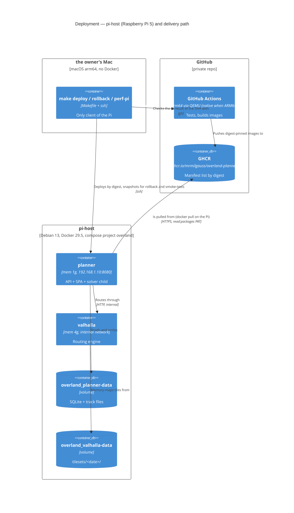

# Architecture Brief — Overland Route Planner

SSOT for architecture. Sections are owned by architect roles: `## System Architecture` (nw-system-designer, not present), `## Domain Model` (nw-ddd-architect, not present), `## Application Architecture` (nw-solution-architect, this wave). First written 2026-11-01 in the DESIGN wave of `overland-route-planner-mvp`; **Revision 1** on 2026-11-01, after review iteration 1 and user decisions N1-N4. **Final-gate pass** on 2026-11-02 (review-gate fix list R-01..R-21, UD-1..UD-4, OD-1..OD-9; decisions D121-D136, listed in feature-delta "DESIGN / [REF] DDD list").

Source of truth for requirements: `REQUIREMENTS.md` (HC-1..HC-5 non-negotiable; HC-1 retrace bullet, FR-5.5 revised, FR-5.8, FR-8.2 revised, A-7). Feature context: `docs/feature/overland-route-planner-mvp/feature-delta.md`. Diagrams: `c4-diagrams.md`. Decisions: `adr-001` .. `adr-018` (index in §14).

## Application Architecture

### 1. System context and capabilities

A single-user, self-hosted web application on a Raspberry Pi 5 on the home LAN:
- hardware: 16 GB RAM (about 11 GB free next to existing workloads), 4 cores, aarch64, 239 GB NVMe free;
- software: Debian 13, Docker 29.5.3 / Compose v5.1.4;
- host: `pi.example`.

Marco (planner, desktop) and Giulia (viewer, 390 px iPhone) use it from a browser. The app turns imported off-road tracks (GPX) and POIs into a direction-safe, fixed-anchor itinerary and exports it as GPX 1.1.

MVP capabilities: projects; GPX import with stats and warnings; POIs by coordinates and map click; anchors; consideration list; optimisation (OR-Tools) with road-leg confidence levels and out-and-back retrace; persistent leg cache with incremental recalculation; plan-run history and diff; direction map; full-trip GPX export.

Routing is done by **self-hosted Valhalla in the same compose stack** (ADR-013). External services:
- raster tile server: OpenTopoMap by default, OSM Standard as alternative;
- Nominatim for geocoding (Phase 2);
- a hosted routing adapter such as OpenRouteService (possible later).

### 2. Quality attributes (ranked)

| # | Attribute (ISO 25010) | Scenario / measure | Primary tactic |
|---|---|---|---|
| 1 | Functional correctness (HC-1..HC-5, FR-5.8) | 0 reversed, cut, dropped or mis-anchored items (K2, K3); every compromise leg visible | Directional node model; retrace only as a guarded leg; `InvariantGuard` on every run (ADR-009); version-addressed track files (ADR-018); property tests over 1,000 random (including sparse) projects |
| 2 | Testability | Full suite offline, no keys (NFR-8); A-1..A-7 automated | Ports and adapters; `MockRoutingProvider` with scripted levels, snap classes and faults; `FixedClock`; deterministic budget (ADR-014); scripted-incumbent solver stub |
| 3 | Performance efficiency | 60 items p95 <= **180 s end to end** including the cold leg fetch; feasibility 10 min; optimisation 30 min; Stop (FR-5.5); idle app RAM < 300 MB (NFR-5) | Stage budget (ADR-014); batched Valhalla matrix; cache-first; solver child process streaming incumbents (ADR-015) |
| 4 | Reliability / recoverability | Engine failure never corrupts data (NFR-6); restarts lose nothing (FR-1.2); non-persistent volume detected (US-01b S4); historical exports immutable | One-transaction runs; versioned files + crash-safe ordering; single SQLite writer + busy_timeout; pre-migration DB copy (ADR-018); probes -> degraded mode (ADR-011) |
| 5 | Modifiability | Provider/geocoder swap = config; Phase 2 time dimension, pinning, CLI reuse the core; solver swap after a spike kill | Driven ports with registry-selected adapters; `TourSolver` port with a pre-named heuristic fallback |

Also covered: security (LAN only, opt-in Basic auth with a warning when off, no routing key needed, keyed tile URLs rejected, upload caps, hardened XML); observability (JSON logs, `/healthz`); portability (`linux/arm64` + `linux/amd64`).

Requirement interpretations recorded here:
- **A-4**: "routing requests" = distinct legs (ordered pairs) requested at the RoutingProvider port during a Recalculate job. Geometry, snapping and probes are counted separately.
- **FR-5.6**: "fixed seed" = a canonical model + deterministic search budget. OR-Tools routing has no seed to fix.
- **FR-5.8 / FR-5.1 optimisation order (UD-4, D125)**: (1) fewest Unconfirmed legs (a retrace leg counts as one), (2) fewest retraces, (3) the objective: road km of Valhalla's fastest routes (D75) or road time, plus retrace km/time. `RETRACE_PENALTY` is a solver-internal tie-break only and never appears in any reported value; the itinerary and Totals show real road km and off-road km (tracks + retraces, D57) (ADR-016/017 amendments).
- **"60 items" and the size limit (OD-2, D126, D131)**: items = Included non-anchor items. The 180 s claim covers up to 60 items + Start + End (62 nodes, as measured; k² + k = 3,660 one-way pairs). 61-70 items are allowed and never refused; the UI warns "large project - calculation may take longer than 3 minutes" until slice 03 re-calibrates at 70 items (ADR-014 amendment).
- **K5 population (UD-3, D127)**: every cold 60-item plan counts toward p95 <= 180 s, including retried jobs, P2 > 700 and jobs that waited for the solver slot; those counts are reported separately, not excluded.

### 3. Architectural style

Modular monolith with dependency inversion (ports and adapters), OOP (ADR-001). The compose stack has three parts:
- `planner` (app + SPA);
- `valhalla` (routing engine);
- a one-shot `valhalla-build` (tile build, profile `valhalla-build`).

The team is one implementer and one user. Microservices, a worker container and a broker are rejected.

| Module | Responsibility |
|---|---|
| `catalog` | Projects, items, anchors, inclusion, track import/stats, Reverse (versioned), history, import warnings, project revision (Stale) |
| `routing` | Point snapping, the leg ladder (Confirmed/Unconfirmed/None), leg and point caches, distinct-pair counting, lazy geometry |
| `planning` | Plan jobs (limits, Stop), reachability check, solver model (lexicographic, forbidden arcs, retrace arcs), `TourSolver` port, `InvariantGuard`, itinerary/totals/report/warnings, fingerprint memo, numbering, diff, history |
| `export` | GPX 1.1 writer (report embedded, Unconfirmed and retrace naming) |
| `platform` | Config (validated), composition root, probes, health, logging (`EventLog` port), Basic auth |

Module boundaries:
- Each application module exposes `application/<module>/facade.py`. Cross-module calls go only through facades, and import-linter forbidden contracts enforce it (§11).
- Domain modules may not import each other except as listed in §11.
- `planning` reads `catalog` through the read-only `ProjectSnapshotReader` port, so runs freeze their inputs.

### 4. Components and code layout

```
src/overland_planner/
  domain/       catalog/ routing/ planning/ export/      # pure; entities, value objects, invariants
  application/  ports/                                   # Protocols incl. Probeable, EventLog
                catalog/ routing/ planning/ export/ platform/   # use cases; facade.py per module
  adapters/     http/ routing/ solver/ persistence/ files/ gpx/ geocoding/ clock/ logging/
  bootstrap/    app_factory.py (composition root), registry.py, probes.py
migrations/     # Alembic
web/            # Svelte 5 + Vite SPA (Node build stage only)
tests/          # unit, property, integration (mock), gold (probe faults), contract (port parity), e2e
```

| Component | Layer | Responsibility |
|---|---|---|
| `ProjectService`, `TrackImportService`, `PoiService`, `AnchorService`, `SelectionService`, `ReverseTrackService` | application/catalog | Catalog use cases; each change increments the project revision. Reverse writes version n+1 files, then commits (ADR-018) |
| `TrackStatsCalculator`, `ImportValidator` | domain/catalog | Length, entry/exit, elevation (n/a when absent), loop (200 m), jump (5 km), single-point and duplicate warnings |
| `PointSnapper` | application/routing | Locates new points once; classifies them on_network (<= 250 m), near (<= 1,500 m, link) or far (ADR-016) |
| `LegResolver` (ladder) | application/routing | Missing pairs only: Confirmed -> U1 permissive -> U2 off-network link -> None; caches all outcomes including None; retrace pairs entry(t)->entry(j) on demand (ADR-017) |
| `CountingRoutingProvider` | adapters/routing | Counts distinct pairs per job ("legs requested") and points located; probes bypass it |
| `PlanJobRegistry` / `PlanRequestJob` | application/planning | Job state machine, limits, Stop, progress, incumbent handling (ADR-015) |
| `ReachabilityChecker` | domain/planning | FR-8.2: names items that cannot be connected at any level |
| `SolverModelBuilder` | domain/planning | Canonical nodes, lexicographic weights W1/W2, forbidden None arcs, retrace arcs, explicit start/end, mandatory nodes |
| `TourSolver` port / `OrToolsTourSolver` | application / adapters/solver | Child process, streams incumbents, deterministic budget (ADR-014/015) |
| `HeuristicTourSolver` (pre-named fallback) | adapters/solver | Deterministic cheapest insertion + 2-opt/Or-opt honouring forbidden arcs and lexicographic costs; built only if SPIKE-1R kills OR-Tools |
| `FingerprintMemo` | application/planning | Reuses the order of an identical successful run |
| `InvariantGuard` | domain/planning | HC-1..HC-5, report completeness, leg-snapshot consistency, retrace form, reachability claims (ADR-009 + Amendment 1) |
| `PlanRunAssembler` | domain/planning | Itinerary (D11 cumulative), totals (retrace = ordinary off-road km/time, D57), report, warnings (import + Unconfirmed legs + retrace) |
| `RunDiffCalculator` | domain/planning | Added / removed / moved / signed deltas |
| `LegGeometryService` | application/routing | Lazy geometry from the same provider_id; retrace geometry from versioned points; links as straight segments |
| `GpxExportService` + `GpxWriter` | application/export / adapters/gpx | GPX 1.1, ADR-010 + Amendment 1 |
| `HealthService` | application/platform | Probe aggregation; `/healthz`; home-page banner |
| `FilePinRegistry` | application/platform | In-memory `(track_id, direction_version)` pins of live jobs; registered together with the snapshot read under the write lock, released at job end; consulted by the orphan sweep (ADR-018, D65, D123) |
| `OrphanSweep` | application/catalog | Deletes version files only if unreferenced, unpinned and older than 1 h, under the write lock (ADR-018 Rev 2) |
| Solver slot | application/planning (inside `PlanJobRegistry`) | One solver child at a time; a second job waits in `waiting_for_optimizer` (ADR-015 amendment D133) |

### 5. Driving ports

1. **Browser UI**: Svelte SPA at `http://pi.example:8080/` (`PLANNER_PORT`, default 8080).
2. **HTTP JSON API** (`/api`): the DISCUSS paths, plus the additions marked (+).
   - `GET /healthz`: 200 `{"status":"ok"}`, or 503 `{"status":"unhealthy","reason":...}`. (+) `GET /api/health` gives detail.
   - Projects: `GET|POST /api/projects`, (+) `GET|PATCH /api/projects/{project_id}`, (+) `GET /api/projects/{project_id}/history`.
   - Items: (+) `GET /api/projects/{project_id}/items?type=`, `POST .../tracks` (multipart, capped), `POST .../tracks/merge`, `POST .../tracks/{track_id}/reverse`, `POST .../pois`, `PUT .../anchors`, `PATCH|DELETE .../items/{item_id}`, `POST .../items/bulk`.
   - Planning:
     - `POST /api/projects/{project_id}/plan-runs` -> 202 `{job_id}`, or 422 (missing anchor) / 409 (job active) / 503 (engine not ready or optimizer unavailable);
     - (+) `POST /api/projects/{project_id}/plan-runs?ignore_memo=true` ("Re-optimise (ignore previous result)", D74): same lifecycle and the same status and error codes, skips the fingerprint memo;
     - (+) `GET /api/plan-jobs/{job_id}` (500 ms polling);
     - (+) `POST /api/plan-jobs/{job_id}/stop` ("Stop and use best so far");
     - `GET /api/projects/{project_id}/plan-runs`, `GET /api/plan-runs/{plan_run_id}`, `GET /api/plan-runs/{plan_run_id}/diff`;
     - (+) `GET /api/plan-runs/{plan_run_id}/geometry`;
     - `GET /api/plan-runs/{plan_run_id}/export.gpx`.
   - Cache: `DELETE /api/projects/{project_id}/leg-cache`, `DELETE /api/leg-cache`.
   - (+) `GET /api/config/map`.
   - **HTTP contract (D130, ratifies DISTILL D107; review R-10/R-21, UI-3):**
     - JSON field names are **snake_case** everywhere (resources, poll payload, diagnostics).
     - Statuses: 201 create, 200 read/update/action, 202 plan job accepted, 204 delete.
     - **Error envelope** for every non-2xx response under `/api`: `{"code": "<code>", "message": "<user-facing text>"}`. Enumerated codes:

       | Status | `code` |
       |---|---|
       | 422 | `validation_error`, `missing_anchor` |
       | 409 | `job_active` |
       | 503 | `routing_engine_not_ready`, `routing_engine_unreachable` (slice 06a, D248), `optimizer_unavailable` |
       | 413 | `upload_too_large` (file size, request size or file count cap) |
       | 401 | `unauthorized` (+ `WWW-Authenticate: Basic`) |
       | 404 | `not_found` (unknown project, item, run or job id; added for completeness) |
       | 500 | `internal_error` |

       A `RequestValidationError` handler maps FastAPI's default `{"detail": [...]}` body to the envelope with `validation_error`. New codes are added only through this table.

       A Failed run's export and an inconsistent track file both answer 422 `validation_error` (D203).
     - Item `anchor` enum: `start` | `end` | `start_end` | `null`. Item resource per D107: `id`, `type` (`track` | `poi`), `name`, `included`, `anchor`, `location {lat, lon}` (POI), `entry {lat, lon}`, `exit {lat, lon}`, `length_m` (track).
     - **One field-name table** for the poll payload (`GET /api/plan-jobs/{job_id}`) and `plan_job_log`: `state`, `reason`, `legs_new`, `legs_cached`, `legs_total`, `points_new`, `second_pass_pairs`, `retried`, `memo_hit`, `ignore_memo`, `elapsed_s`, `solver_wait_s`, `stage_ms`, `items_included`, `notices`, `incumbent {unconfirmed_legs, retraces, objective, found_at_s}`, `stoppable`, `plan_run_id`, `message` (ADR-015 amendment); the plan-run detail (`GET /api/plan-runs/{id}`) adds `messages`, `not_fully_optimised`, `reproducible` and `memo_hit`. One name each: the poll keeps `elapsed_s`, the job log `elapsed_ms`; `notices` is on Calculate's answer too.
     - **Stop fields added by slice 03b** (plan-run detail `stops`; `domain/planning/plan_run.py` `PlanStop`, ADR-009 Amendment 4, ADR-017 Amendment 2):

       | Field | Meaning |
       |---|---|
       | `type` | `poi` \| `track` \| `retrace` (the retrace is a row of the stops list, with the `item_id` of its track) |
       | `confidence` | `confirmed` \| `unconfirmed` of a retrace row (always Unconfirmed); null on other rows |
       | `reason` | a retrace row's reason: "retraces the trail backwards; check it is drivable in reverse" |
       | `leg_confidence` | the level of the road leg into the stop |
       | `leg_reason` | that leg's reason when Unconfirmed |

       `retrace_sha256` (on a retrace row: SHA-256 of the canonical serialisation of the track's reversed points of the same direction version) is a stored field of the stop (guard and GPX export check it) but is **not** exposed over HTTP (`PlanStopResource`).

       The report adds `items`: the names of the items a Failed run with reason `unreachable` is about (empty otherwise; a report stored before step 07-05 has none).
     - **Added by slice 06a (ADR-013 Amendment 4):** the project resource has `objective` (`distance` \| `time`) and `PATCH /api/projects/{id}` takes `objective` and/or `offroad_speed_kmh`; the plan-run detail has `provider_header` ("Provider: Valhalla (map data 2026-11-01) / profile: 4x4"), `objective` and `objective_label`; the poll payload has `retried` and `second_pass_pairs`; `/api/diagnostics` fills `g4.engine_refusals_30d`.
     - `POST /api/plan-jobs/{job_id}/stop` is idempotent: always 200 with the current payload (D136).
     - `/healthz` keeps its own body (`{"status":"ok"}` / 503 `{"status":"unhealthy","reason":...}`), not the envelope.
     - **OpenAPI snapshot in CI**: the generated `openapi.json` is committed; a CI test fails when the generated schema differs from the snapshot, so contract changes are deliberate.
3. **CLI**: Phase 2, over the same application facades.

### 6. Driven ports and adapters

Every driven port extends `Probeable`.

| Port | Contract (behavioural) | Adapters | Probe and fault catalogue |
|---|---|---|---|
| `RoutingProvider` | **As built in slice 06a (ADR-013 Amendment 4, D243): `provider_id`, `profile`, `matrix(sources, targets, observer)` with a measure, `None` or `OFF_NETWORK` per cell, typed errors `ProviderUnreachable`, `ProviderUnavailable`, `ProviderRejected`; the rest of this cell arrives with slices 06b and 09.** `provider_id`, `profile`, `display_name`; `locate(points) -> snap results`; `matrix(sources, targets, mode=legal\|permissive)` with `None` cells; `route_many(pairs, mode)`; typed errors `ProviderUnreachable`, `ProviderUnavailable`, `ProviderQuotaExceeded` (for future hosted adapters), `ProviderRejected` | `ValhallaRoutingProvider` (MVP real), `MockRoutingProvider` (tests/dev), `CountingRoutingProvider` (wrapper) | `/status` + 2x2 Torino <-> Susa matrix. Catalogue: connect refused, timeout, 5xx then success (retry), 5xx persistent, error 171 for one location, error 442, null cells, wrong shape, zero distance for distinct points, `/status` version not `VALHALLA_EXPECTED_VERSION` (`routing_engine_version_mismatch`, D128). Degraded-healthy; re-probed every 60 s and before each job. `provider_id` = `valhalla:<version>:<tileset_last_modified>`; all Valhalla calls share one process-wide semaphore of 2 (D133) |
| `TourSolver` | `solve(model, budget, on_incumbent, *, deadlines, stop) -> typed outcome`, the incumbents streamed to `on_incumbent` | `OrToolsTourSolver` (child process); `HeuristicTourSolver` (fallback, only if built); `ScriptedTourSolver` (tests) | Fixed 6-node asymmetric instance with one track node and one forbidden arc, solved twice: known optimum, identical orders. Failure -> degraded, unhealthy (`optimizer_unavailable`) |
| Repositories + `UnitOfWork` + `ProjectSnapshotReader` | One transaction per use case; run + number + snapshot (incl. leg snapshot, track versions) atomic; single writer lock | SQLAlchemy 2 / SQLite | Round-trip row, WAL active, busy_timeout set, quick_check, Alembic head. Fatal |
| `FileStore` | Originals by sha256; versioned canonical/display points; atomic writes; sweep-only deletion (ADR-018 Rev 2, D65); orphan sweep | `LocalFileStore` | Write-fsync-rename-read round trip (fatal); filesystem type holding `DATA_DIR` (longest-prefix mount entry, via `MountTable`) is overlay/tmpfs/ramfs -> degraded, unhealthy; other -> ok; non-Linux -> not_applicable (ADR-011 amendment D121) |
| `MountTable` (external, non-deterministic; D105) | `entries() -> [(mount_point, fstype)]`, or unavailable | `ProcMountTable` (`/proc/self/mountinfo`), `FakeMountTable` (tests, via `ExternalPorts` on `create_app`, D106) | Readable and parsable, has an entry for `/`; parse failure on Linux -> degraded (`data_dir_persistence_unknown`) |
| `TrackFileParser` | `parse(bytes, name)` or `InvalidTrackFile`; rejects DTD/entities | `GpxpyParser` (defusedxml pre-parse, then gpxpy) | Embedded GPX; plus an XXE/billion-laughs sample that must be rejected. Fatal |
| `GpxWriter` | GPX 1.1 bytes, no extensions | `GpxpyWriter` | Write + re-parse. Fatal |
| `EventLog` | Structured application events | `StructlogEventLog` | - |
| `Geocoder` (Phase 2) | `search(query, bias_bbox?, limit)` | `NominatimGeocoder` | Phase 2 |
| `Clock` | `now()`, `monotonic()` | `SystemClock`, `FixedClock` | monotonic increases |

**MockRoutingProvider configuration** (review B4; YAML/JSON fixture or `MOCK_PLAN` path). It covers both normal behaviour and scripted faults:
- `detour_factor` (1.3);
- per-point snap class and distance (`on_network`, `near:<m>`, `far`);
- per-pair level (`confirmed`, `unconfirmed:<reason>`, `none`), with a default of Confirmed haversine x 1.3;
- `unreachable_points` (all pairs None);
- fault plan: `fail_after_pairs: N`, `fail_on_call: k` with `kind: unreachable|unavailable|quota`, `latency_ms` per call;
- straight-line geometry; request counters.

This makes D29 (partial legs kept), US-10 refusals, FR-5.8, FR-8.2 and A-7 testable offline. A **port contract suite** (`tests/contract/routing_port/`) runs the same assertions against Mock and Valhalla to keep their error and partial-result semantics identical:
- Valhalla side: recorded fixtures via respx in CI, plus a scheduled live run against the Pi.

Contract tests (handoff annotation): **Valhalla** (self-hosted, pinned image) via recorded fixtures plus a scheduled live smoke test; **Nominatim** (Phase 2) via pact-python or recorded fixtures; any later hosted routing adapter (e.g. OpenRouteService) gets the same port suite.

**As built in slice 06a (2026-11-17; ADR-013 Amendment 4).** The port contract suite runs the same checks against the recorded answers, the offline road map and, with `--valhalla-url`, the live engine through `ValhallaRoutingProvider` (`make contract-live` runs both layers: the raw recorded questions and the adapter checks; D235). The live adapter checks are the Torino to Susa leg, the island row and the batch with a place far from any road; the failures, the hiccup and the 2,500-leg batching need a scripted engine and run on the recordings only. Three `@pi @real_provider` acceptance scenarios (the Valhalla header and the Torino to Susa leg, a trail entry on a forest track, the 3-minute 60-item trip) run through `make acceptance-pi` in `__demo` projects of their own; the last reads the report of `make perf-pi MODE=e2e` named by `PERF_REPORT`. Slice 06a blocks in CI job 2 with `--run-pending=slice-06a`; the live scenarios never run in GitHub CI.

### 7. Composition root, probes and Earned Trust

The composition root is `bootstrap/app_factory.py::create_app()` (Uvicorn factory mode). Its invariant: **wire, then probe, then use** (ADR-011 + Amendment 1).

1. Validate the config (pydantic-settings).
   - Fatal: invalid limits, keyed `MAP_TILE_URL`, bad upload caps.
   - Warning `security.auth.disabled` when Basic auth is off.
2. Wire the adapters by `ROUTING_PROVIDER=valhalla|mock`.
3. Database, in this order (D129): read the revision read-only; newer than the image -> `health.startup.refused` (`db_newer_than_app`) with nothing copied or written; older -> pre-migration copy, then `alembic upgrade head`; at head -> nothing.
4. Probe every adapter:
   - fatal (DB, files, parser, writer) -> `health.startup.refused`, exit non-zero;
   - non-persistent `DATA_DIR` -> degraded, `/healthz` 503 + banner. Rule (D121): the filesystem type of the longest-prefix `MountTable` entry for the resolved `DATA_DIR` is overlay/tmpfs/ramfs -> degraded; any other type -> ok; no mount table (macOS) -> `not_applicable`. The root filesystem is never checked on its own and "not a mount point" is not a criterion. Tests and the walking skeleton never use the OS temp directory as `DATA_DIR`;
   - solver probe failure -> degraded, `/healthz` 503 `optimizer_unavailable`; plan requests refused;
   - Valhalla not ready, or its `/status` version is not `VALHALLA_EXPECTED_VERSION` (D128) -> degraded, `/healthz` ok; re-probe every 60 s; plan requests refused (503 `routing_engine_not_ready`) until it passes. **[Slice 06a, D247: probed before each plan request and when `/api/health` is read with a result older than 60 s; no background thread. Unreachable is refused with 503 `routing_engine_unreachable`.]**
5. Log `app.started` as one structured line.

Probe enforcement: two layers, **mypy strict** (every port Protocol extends `Probeable`; typed registry) and **CI gold tests** (a fault catalogue per adapter, including the environment lies: `DATA_DIR` on overlay/tmpfs/ramfs (also via symlink or bind mount), WAL silently off, Valhalla 171/442/null cells, solver child crash). The earlier AST hook and meta-test were dropped after review.

### 8. Planning pipeline

```
POST plan-runs -> pre-checks (anchors, active job, engine ready, optimizer ready) else refuse (no job, no run)
 -> job: snapshot (included items, anchors, track versions + sha256, objective, settings, revision) and pin track versions,
    both in one critical section under the write lock (D123); pins released at job end
 -> PointSnapper (new points only; cached)            [state: snapping]
 -> LegResolver ladder for missing pairs (+ retrace pairs); cache all outcomes  [computing_legs]
    engine failure / Stop / feasibility limit here -> job ends, no run, legs kept
 -> numbered run created from here on:
    ReachabilityChecker -> unreachable items -> Failed run naming them
    FingerprintMemo hit -> reuse order
    else SolverModelBuilder (lexicographic, forbidden arcs, retrace arcs) -> wait for the solver slot (D133) -> TourSolver child
         streams incumbents; ends on budget | optimisation limit | Stop | feasibility limit
         (no valid incumbent at the feasibility limit -> Failed "timeout"; Stop without one -> Failed "stopped ...";
          child finishes with none -> Failed no_valid_route_found at once; child crashes -> Failed optimizer_failed,
          or with an incumbent: labelled "not fully optimised (optimizer_failed)" (D122))
 -> InvariantGuard (on the chosen order) -> violation -> Failed run "internal invariant violation"
 -> PlanRunAssembler -> one transaction (run number, snapshots incl. leg snapshot, results, flags)
 -> UI polls, shows itinerary, then requests geometry (lazy)
```

**As built in slice 03b (2026-11-11; ADR-016 Amendment 2, ADR-017 Amendment 2, ADR-015 Amendment 3).**
- The retrace is a **row of the stops list** (`type` `retrace`, `item_id` of its track, directly after the track row), not a road leg and not a track traversal. The pipeline stage names are `snapshot`, `matrix`, `reach_model`, `solve`, `guard_persist`; reachability runs in `reach_model` before the memo lookup and the solver slot.
- Weighting is single-phase until slices 06a/06b (accepted risk, Decision 18); the third criterion is road km only; the fingerprint scheme is `fp2`.
- A complete valid final from the solver child always wins; the child's own time limit is the optimisation time left at spawn plus 30 s.
- UI-DELIVER-7 items, handled where they live: item 3 (the leg cache is in process memory only) is persisted by slice 05; item 4 (the `run_messages.py` docstring on `run_time_ms`) was corrected in step 07-05. Items 1 and 2 (diagnostics page `#/diagnostics`, K2 banner deferred to slice 12) are in ADR-003 Amendment 1 and `kpi-contracts.yaml`.

Pins are deferred past slice 01b (D204): the job takes the snapshot without pinning track versions. Pins must land before or with the orphan sweep (ADR-018).

Required pair set (ADR-013; one definition, D131): k = Included non-anchor items.
- one-way and round trip: k² + k (Start -> items, items -> End, item -> item; a round-trip S/E counts as both). Run #4 (9 items + S/E) gives 90 pairs. **60 items = 62 nodes = 3,660 pairs** (as measured by the spikes).
- k = 0 (Start and End only, OD-4): the single pair Start -> End.
- plus entry(t)->entry(j) only where exit(t)->entry(j) is None.

**End-to-end budget** (ADR-014, 60 items, cold, p95 on the Pi):

| Stage | Budget |
|---|---|
| snapshot + pre-checks | 1 s |
| snapping | 5 s |
| cold Confirmed matrix | 75 s |
| ladder + retrace pairs | 15 s |
| reachability + model | 1 s |
| child spawn | 3 s |
| solve | 55 s |
| guard + persist | 3 s |
| geometry | 12 s |
| UI | 2 s |
| reserve | 8 s |
| **Total** | **180 s** |

Measured sum on the Pi: 63.7 s (73.7 s with UI and reserve; ADR-014 §1). The claim covers up to 60 items (61-70 allowed with a "may take longer" notice, D126) and counts every cold plan, including retried jobs and P2 > 700 (D127).

Limits (configurable, measured from job start): `FEASIBILITY_LIMIT_S=600`, `OPTIMISATION_LIMIT_S=1800`; Stop is always available.

Run flags:
- `reproducible` (false on Stop or a limit hit);
- `not_fully_optimised` with reason (`stopped` | `time_limit` | `optimizer_failed`);
- `memo_hit`;
- `unconfirmed_legs`, `retraces`.

Stale = project revision != the revision stored on the latest run.

**As built in slice 06a (2026-11-17; ADR-013 Amendment 4).** The pipeline above runs unchanged on the Valhalla adapter: `matrix` stage legs come from the engine one origin per call (D246), an engine failure ends the job with no run and keeps the answered legs, a place the engine cannot snap fails the reachability check and is named, and each run stores its road map's `provider_id` and `profile` for the results header. The 3-minute figure is measured cold by `make perf-pi MODE=e2e`; whether the one-origin call shape keeps the slowest of 10 under 150 s is the gate's answer, not this paragraph's.

### 9. Data and volume layout

Volumes:
- `planner-data` -> `/data` (app; Docker name `overland_planner-data`, compose project `overland`, §15);
- `valhalla-data` -> `/custom_files` (tiles, extract, `valhalla.json`).

```
/data/
  db/planner.sqlite                                   # WAL, foreign_keys=ON, busy_timeout=5000
  db/backups/planner-{rev}-{ts}.sqlite                # pre-migration copies (last 3)
  files/originals/{sha256}.gpx                        # byte-identical uploads
  files/tracks/{track_id}/canonical.v{n}.json         # full resolution, canonical order of direction_version n
  files/tracks/{track_id}/display.v{n}.json           # simplified
  tmp/                                                # atomic writes (same filesystem)
```

Tables (Alembic):
- `projects` (name, objective, settings, revision, start_item_id, end_item_id)
- `items` (type, name, included, notes)
- `tracks` (original_sha256, segment label, direction_version, canonical_sha256, point_count, entry/exit, length_m, elevation nullable, is_loop, duration override, difficulty)
- `pois`
- `import_warnings`
- `project_history` (append-only)
- `plan_runs` (project_id, number, status, failure_reason, created_at, revision, provider_id, profile, objective, fingerprint, the run flags above, leg/point counts, solver stats; JSON snapshots of inputs incl. track versions, leg snapshot, itinerary, totals, report, warnings)
- `leg_cache` (quantised from/to, provider_id, profile, level, reasons, distance_m, duration_s, link_m, levels_tried, geometry nullable, fetched_at)
- `point_cache` (quantised point, provider_id, profile, snap_class, snap_distance_m, road point)
- `leg_cache_project` (usage, for per-project clearing)

Writes:
- single process-wide write lock;
- files are written before the DB commit. They are deleted **only by the orphan sweep**: unreferenced by the DB and by any live-job pin (`FilePinRegistry`), and older than 1 h (ADR-018 Revision 2);
- orphan sweep by DB reference **and** age > 1 h (ADR-018).

Backup/restore: **rollback snapshot only; see D91** (no backups by user decision: the ADR-018 pre-migration copy and the predeploy volume snapshot, current + previous; accepted risk of device loss). The ADR-018 tar procedure is a reference, not a routine.

### 10. Technology stack

Versions are minimums believed current as of 2026-11. They were **not verified against package indexes in this wave**. Exact versions are chosen and locked (`uv.lock`, `package-lock.json`, image digests) at DELIVER, slice 01a.

| Concern | Choice | Version | Licence | ADR |
|---|---|---|---|---|
| Runtime | CPython (`python:3.12-slim`, Debian base matching prod; SPIKE-1R runs in it) | 3.12 | PSF | - |
| Web | FastAPI + Uvicorn; FastAPI `HTTPBasic` for auth | >= 0.115 / >= 0.30 | MIT / BSD-3 | - |
| Config | pydantic-settings | 2.x | MIT | ADR-011 |
| ORM / migrations | SQLAlchemy / Alembic | 2.0.x / >= 1.13 | MIT | ADR-006/018 |
| Solver | OR-Tools | >= 9.12, aarch64 wheel; pinned after SPIKE-1R | Apache-2.0 | ADR-014/015/016 |
| GPX | gpxpy | 1.6.x | Apache-2.0 | ADR-010 |
| XML hardening | defusedxml | 0.7.x | PSF | brief §12 |
| HTTP client | httpx | >= 0.27 | BSD-3 | ADR-013 |
| Logging | structlog | >= 24 | MIT / Apache-2.0 | - |
| Routing engine | Valhalla (`ghcr.io/valhalla/valhalla-scripted`), osmium-tool for extract merge | tag pinned after SPIKE-2R | MIT / BSL-1.0; data ODbL | ADR-013 |
| Tests | pytest 8, Hypothesis 6, respx, xmlschema 3, Playwright, Vitest | pin at DELIVER | MIT / MPL-2.0 / BSD-3 / MIT / Apache-2.0 / MIT | - |
| Architecture rules | import-linter 2, mypy strict | pin at DELIVER | BSD-2 / MIT | - |
| Frontend | Svelte 5 + Vite (static SPA) | 5.x / >= 6 | MIT | ADR-003 |
| Map | MapLibre GL JS | 5.x | BSD-3 | ADR-003 |
| Tiles | OpenTopoMap (default), OSM Standard | - | CC-BY-SA style; ODbL data | ADR-004 |
| Geocoding (Phase 2) | Nominatim public | - | ODbL; usage policy | - |

No proprietary components. No routing API key in the MVP.

### 11. Enforced layer and module rules (import-linter)

Contracts in `pyproject.toml`, run in pre-commit and CI:

1. **Layers**: `bootstrap` > `adapters` > `application` > `domain`.
2. **Forbidden for `domain`**: `sqlalchemy`, `alembic`, `fastapi`, `starlette`, `pydantic`, `httpx`, `ortools`, `gpxpy`, `defusedxml`, `structlog`, `logging`.
3. **Forbidden for `application`**: `sqlalchemy`, `fastapi`, `starlette`, `httpx`, `ortools`, `gpxpy`, `structlog` (logging goes through the `EventLog` port).
4. **Adapter independence**: `adapters.http`, `adapters.routing`, `adapters.solver`, `adapters.persistence`, `adapters.files`, `adapters.gpx`, `adapters.geocoding`, `adapters.logging`.
5. **Domain module rules**:
   - `domain.catalog` must not import `domain.planning`, `domain.export` or `domain.routing`;
   - `domain.routing` must not import `domain.planning` or `domain.export`;
   - `domain.planning` must not import `domain.export`;
   - `domain.export` may import `domain.planning` (read-only value objects).
6. **Application facades**: for each module X, a forbidden contract stops other application modules from importing `application.X`, with `ignore_imports` allowing only `application.X.facade`.
7. `ortools` only in `adapters.solver`.

### 12. Security, resources, observability, deployment (for platform-architect)

- **LAN only**: `${PLANNER_PORT:-8080}` published; no tunnel or UPnP; the Valhalla port is **not** published (internal compose network only).
- **Basic auth**: opt-in via `PLANNER_BASIC_AUTH_USER` / `_PASSWORD`, using FastAPI `HTTPBasic` with a constant-time compare. It covers the SPA, the API and `/api/health`; `/healthz` stays open with no project data. When off, `security.auth.disabled` is logged at warning level.
- **Secrets**: the basic-auth password only (no routing key in the MVP); runtime environment only; redacted by a structlog processor; never in the image (`.dockerignore`), browser, results or exports. A `MAP_TILE_URL` with key-like query parameters is rejected at start-up.
- **Uploads**:
  - `MAX_UPLOAD_FILE_MB=25`, `MAX_UPLOAD_REQUEST_MB=100`, `MAX_UPLOAD_FILES=50`;
  - GPX is pre-parsed with defusedxml (DTDs and entities rejected) before gpxpy;
  - originals are stored by hash, never by user-supplied path.
- **Resources** (Pi 16 GB, about 11 GB free):
  - `planner` `mem_limit: 1g` (idle main process < 300 MB per NFR-5, **measured in slice 01a** with `docker stats` after 10 min idle and recorded in README; the solver child **measured at 55–59 MB** peak RSS in SPIKE-1R, one child at a time (D133), container peak <= 55 MB of 1 GiB, 0 OOM);
  - `valhalla` `mem_limit: 4g` (target <= 2 GB idle), `server_threads: 2`;
  - `valhalla-build` capped at `--memory 9g`, run with serving stopped;
  - steady-state planned use is <= 5 GB, leaving >= 6 GB headroom.
- **Logs**: JSON lines to stdout. Events: `app.started`, `health.startup.refused`, `health.startup.degraded`, `security.auth.disabled`, `plan.job.refused`, `plan.job.stopped`, `plan.job.timed_out`, `plan.job.finished` (one per terminal job, mirrors the `plan_job_log` row, DV-2/DV-6), `plan.run.completed` (number, status, `legs_new`/`legs_cached`, `points_new`, unconfirmed legs, retraces, solver wall s, flags, invariants), `plan.run.geometry_served` (DV-6), `invariant.violation`, `routing.engine.error`, `export.gpx`, `import.track`. Field names follow the §5 field-name table (D130).
- **Images**:
  - multi-stage: a `node` build stage for `web/`, then `python:3.12-slim` runtime;
  - `linux/arm64` + `linux/amd64`;
  - one Uvicorn worker;
  - healthcheck = Python one-liner on `/healthz`.
- **Compose services**:
  - `planner` (no `depends_on`: it starts and deploys whether or not the engine is up, ADR-013 Amendment 3, D234);
  - `valhalla` (profile `routing`, on whenever `routing.env` exists; `restart: unless-stopped`, volume `valhalla-data`);
  - `valhalla-build` (profile `valhalla-build`, one-shot).
- **`.env` keys** (indicative):
  - server and auth: `PLANNER_PORT`, `PLANNER_BASIC_AUTH_USER`, `PLANNER_BASIC_AUTH_PASSWORD`, `DATA_DIR=/data`, `LOG_LEVEL`;
  - routing: `ROUTING_PROVIDER=valhalla|mock`, `VALHALLA_URL=http://valhalla:8002`, `VALHALLA_MAX_MATRIX_PAIRS=2500`, `VALHALLA_CONCURRENCY=2` (process-wide, D133), `VALHALLA_EXPECTED_VERSION=3.9.1` (D128), `CONFIRMED_SNAP_M=250`, `OFFNETWORK_LINK_MAX_M=1500`, `RETRACE_PENALTY_M=10000`, `RETRACE_PENALTY_S=1800`, `MOCK_PLAN`;
  - solver: `SOLVER_BUDGET`, `FEASIBILITY_LIMIT_S=600`, `OPTIMISATION_LIMIT_S=1800`;
  - map: `MAP_TILE_URL`, `MAP_TILE_ATTRIBUTION`, `MAP_TILE_MAX_ZOOM`;
  - import defaults: `JUMP_THRESHOLD_KM=5`, `DEFAULT_OFFROAD_SPEED_KMH=15`, `LOOP_DISTANCE_M=200`, `DUPLICATE_POI_RADIUS_M=50`;
  - upload caps (listed above);
  - Phase 2: `NOMINATIM_CONTACT_EMAIL`.

### 13. Spikes gating DELIVER

- **SPIKE-1R**: solver gate before slice 03. **Done 2026-11-01: WORKS** (D78; `spike/findings.md`).
- **SPIKE-2R**: Valhalla on the Pi, mandatory before slice 06. **Done 2026-11-01: WORKS** (D76, D77, D79).
- Remaining measurements moved to slices: 70-item re-calibration (D126), guard with 20,000-point tracks (D135), permissive `/locate` timing (D132) and solve p95 under `cpus 1` (OD-9) at slice 03 / 06a.

Full plans, commands for `deploy@pi.example` and kill criteria are in `feature-delta.md` ("DESIGN / [REF] Open questions and pre-requisites").

### 14. Decision index

| ADR | Topic | Status |
|---|---|---|
| ADR-001 | Modular monolith + ports and adapters | Accepted |
| ADR-002 | Routing: ORS now, Valhalla later | **Superseded by ADR-013** |
| ADR-003 | Frontend Svelte 5 + MapLibre | Accepted |
| ADR-004 | Map tiles | Accepted |
| ADR-005 | Budget + 30 s ceiling + fingerprint | **Superseded by ADR-014** |
| ADR-006 | Persistence SQLAlchemy + Alembic | Accepted, **partly superseded by ADR-018** |
| ADR-007 | Lazy leg geometry, leg-level counting | Accepted + Amendment 1 (field names D130) |
| ADR-008 | Plan run as async job + polling | **Superseded by ADR-015** |
| ADR-009 | HC invariant guard | Accepted + Amendments 1-3 (3: final gate D134/D135) |
| ADR-010 | Consideration report in GPX 1.1 | Accepted + Amendment 1 |
| ADR-011 | Composition root, probes, degraded mode | Accepted + Amendment 1, DEVOPS amendment, final gate D121 |
| ADR-012 | Solver port in a child process | **Superseded by ADR-015** |
| ADR-013 | Valhalla self-hosted, only MVP provider | Accepted; parameters validated by SPIKE-2R (D76); final gate D127/D128/D131/D133; Amendment 3 slice 06a-ops (D234-D242); Amendment 4 slice 06a (D243-D250) |
| ADR-014 | End-to-end budget, limits, determinism | Accepted; stage budget measured by the spikes (D77); final gate D124/D126/D127/D131/D132/D135 |
| ADR-015 | Plan job lifecycle, Stop, incumbents | Accepted; measured by SPIKE-1R; final gate D122/D130/D133/D136 |
| ADR-016 | Confidence levels + lexicographic optimisation | Accepted; amended after the spikes (D78, D79); final gate D125 |
| ADR-017 | Out-and-back retrace (exit side only) | Accepted; penalty measured by SPIKE-1R; final gate D125/D134; Amendment 2 slice 03b as built (2026-11-11) |
| ADR-018 | Versioned track files + SQLite hardening | Accepted; DEVOPS amendment D90/D91; final gate D123/D129 |

### 15. Deployment topology (added by DEVOPS, 2026-11-02)

Owner: nw-platform-architect. Details: `docs/feature/overland-route-planner-mvp/feature-delta.md` "## Wave: DEVOPS" (D80-D102, D160-D179) and `devops/environments.yaml`. This section adds deployment-level containers and networks to the L2 view; it changes no application component.

- Compose project `overland` in `~/apps/overland-planner/` on `pi.example`, next to the household stacks (`vlc-pi-prod`, `fate-ledger`), which it never touches.
- Always on: `planner` (published on `192.168.1.10:8080`, networks `edge` + `routing`) and, from slice 06a, `valhalla` (network `routing`, `internal: true`, never published). `valhalla` is in compose profile `routing`, which the Pi tooling turns on whenever `routing.env` exists; the planner has no `depends_on` (D234).
- On demand (compose profiles): `valhalla-build` (network `egress`, tile build with serving stopped); `planner-perf` (same image, own volume `overland_perf-data`, loopback 18080, for `make perf-pi` / `make acceptance-pi`); `valhalla-tunnel` (socat on loopback 18002, for `make contract-live`). Both join `edge` + `routing`, because Docker publishes no port of a container on an internal-only network (D164).
- Runtime limits and hardening: planner `cpus 1`, `mem 1g`, `cap_drop ALL`, `no-new-privileges`, read-only root fs with a 64 MB `/tmp` tmpfs (the app writes only to `/data` and `/tmp`); valhalla `cpus 2` (`server_threads 2`), `mem 4g` (D167, D173). The planner port is `${PLANNER_BIND:?}` (fail closed, D174).
- Release state on the Pi: `release.env` (planner digest only, two rollback pointers) and `routing.env` (`VALHALLA_TILESET` only) are separate, so an app rollback never changes the tileset (D166, D176). A deploy starts the new planner on 127.0.0.1, smoke-tests it, and only then publishes it on the LAN (publish = write gate, D165).
- Volumes: `overland_planner-data` (`/data`), `overland_valhalla-data` (`tilesets/<date>/` served by subpath, `build/` scratch).
- Delivery: GitHub Actions builds arm64 + amd64 images (amd64 native; **arm64 via QEMU by default, native when `ARM64_RUNNER` is set**) into one digest-pinned GHCR manifest list. `make deploy` on the Mac pulls it onto the Pi over ssh (Recreate). The Pi has no CI runner and no inbound exposure.
- **Accepted by the user (2026-11-02), recorded as DEVOPS amendments** (`devops/upstream-changes.md`; ADR-006, 011, 013, 015, 018 amendment notes): DV-1 manual `make contract-live` instead of a scheduled live run (D95); DV-2 append-only `plan_job_log` table (D93); DV-3 `GET /api/diagnostics` + `/diagnostics` page (D93); DV-4 `created_at`/export/geometry timestamp columns (D94); DV-5 tested downgrades and a fatal `db_newer_than_app` probe (D90). Clarifications: DV-6 events `plan.job.finished`, `plan.run.geometry_served` and version fields on `app.started` (§12); DV-7 `/data` probe `not_applicable` on macOS, subsumed by DV-11 (ADR-011 UI-1 amendment: longest-prefix fstype rule; CI mapping D168). Final review gate: DV-9 (writes only to `/data` and `/tmp`, D173), DV-10/DV-12 (K5 claim wording, D177).
- **Data safety (D91, user decision):** no backups. Only the ADR-018 pre-migration copy and the predeploy snapshot (current + previous) on the Pi, for rollback. Accepted risk: device/NVMe loss = data loss. This replaces the operated backup routine referenced in §9 and ADR-018.
- CI on a personal free GitHub plan (private repo): amd64 native on `ubuntu-24.04`, arm64 under QEMU by default (native `ubuntu-24.04-arm` opt-in), no branch protection (the deploy preflight, including `gh attestation verify`, is the gate; D171). Owner `MrMilgauss`; image `ghcr.io/mrmilgauss/overland-planner`.



## Review — nw-solution-architect-reviewer (2026-11-01)

Verdict: NEEDS_REVISION (iteration 1). Blocking: 4 (2 critical, 2 high). Non-blocking: 2 high, 11 medium, 5 low. Re-review after B1-B4 are closed.

Blocking:
- B1 (critical): FR-5.5 is budgeted for the solver only. The 30 s ceiling excludes cold ORS fetch, process spawn, guard and persist. Decide whether FR-5.5 is end to end; if so, reserve the budget, add cold-fetch timing to SPIKE-2, and add a cold real-provider scenario to US-06. Correct the claim in feature-delta.
- B2 (critical): `canonical.json` is rewritten in place on Reverse, so exports of historical or stale runs would emit the reversed track (HC-1). Fix: version-addressed track files (`canonical.v{direction_version}.json`), plan-run snapshot holds direction_version and sha256, crash-consistency test, stale-export-after-reverse test.
- B3 (high): the outcome of a solver ceiling kill is undefined. Fix: the child streams incumbents; the parent keeps the last one; zero incumbents = failed run with a named reason; the child dies with its parent; gold test.
- B4 (high): MockRoutingProvider has no failure injection, so D29 and US-10 S4/S5 cannot be tested offline. Fix: scripted fault plan (fail after N pairs, unreachable or quota on call k, latency), plus a Mock/ORS error-parity test.

Non-blocking (close before the affected slice):
- High: SPIKE-1 kill criterion measures the wrong thing; use p95 > 20 s at the budget, or quality > 10% worse; pre-name a 2-opt/Or-opt fallback; run in the prod base image. SQLite needs busy_timeout, a single writer, a pre-migration DB copy, and a referenced-file orphan sweep.
- Medium: NFR-5 idle RSS unmeasured (add mem_limit); NFR-4 gaps (auth-off warning, tile-URL key leak, ORS key in header and redacted, upload cap and XML hardening); module-boundary wording; logging port for the guard; Reuse rows (pydantic-settings, HTTPBasic, atomic-write, probe runner); probe enforcement over-engineered (drop the AST hook and meta-test); solver probe failure should be degraded, not fatal; ADR-002 "12 items → 90" wording; ADR status "Accepted; parameters pending spikes"; REQUIREMENTS A-4 / FR-5.6 interpretation notes missing; no rate-limit/retry policy (exclude probes from A-4 counting).
- Low: C4 edges and labels; composition-root location wording; TourSolver probe phrase; backup restore procedure; version-pin claims unverified.

Praise: the directional node model makes HC-1 structural; the upstream-changes quotes are verbatim-accurate; ADR-005 openly reverses D15; ADR-011's fatal/degraded split matches US-01b S4.

### Revision 1 (nw-solution-architect, 2026-11-01)

User decisions N1-N4 were applied together with the findings. In the table, a parenthesised D-number is a DESIGN decision (D40-D55) from feature-delta.

| Finding | Resolution | Where |
|---|---|---|
| B1 | FR-5.5 was revised by the user: 180 s p95 **end to end** including the cold fetch, 10 min feasibility limit, 30 min optimisation limit, Stop. A stage budget covers snapping, cold matrix, ladder, spawn, solve, guard, persist, geometry and UI. The false "always within 30 s" claim is withdrawn. SPIKE-2R adds cold 60x60 Valhalla timing on the Pi (K4). The US-06 end-to-end cold scenario moves to slice 06 (upstream U12). | ADR-014; brief §8; feature-delta spikes; upstream U12 |
| B2 | `canonical.v{n}.json` / `display.v{n}.json`. The snapshot records track_id, direction_version, point_count and sha256. Guard, map, export and retrace read by version. Old versions are deleted only after commit and when unreferenced. Crash-consistency and stale-export-after-Reverse tests added. | ADR-018; ADR-009/010 Amendment 1 |
| B3 | The child streams incumbents; the parent keeps the last one; Stop, the optimisation limit or the feasibility limit kills the child. Zero incumbents at 10 min -> Failed "timeout"; Stop with none -> Failed "stopped before a valid route was found". PDEATHSIG + pipe-EOF watchdog. Gold tests. | ADR-015 |
| B4 | Mock fault plan (fail after N pairs, unreachable/unavailable/quota on call k, latency) + per-pair levels, per-point snap classes, unreachable points. A port contract suite gives Mock/Valhalla parity. | brief §6; ADR-013 |
| High: SPIKE-1 | SPIKE-1R kill criteria: no budget value with solve p95 <= 55 s on the Pi **and** quality <= 10% worse than a 30-min PC reference, or no valid route within 10 min on the sparse instance. Runs in the prod base image. Pre-named fallback `HeuristicTourSolver` (insertion + 2-opt/Or-opt). | feature-delta SPIKE-1R |
| High: SQLite | busy_timeout 5000, single writer lock, pre-migration copy, orphan sweep by reference + age. | ADR-018 |
| Medium: NFR-5 | Measured in slice 01a; `mem_limit` 1g planner / 4g Valhalla in the DEVOPS handoff. | brief §12 |
| Medium: NFR-4 | Auth-off warning; keyed tile URLs rejected; no routing key exists in the MVP; upload caps; defusedxml pre-parse. | brief §12; ADR-011 Amendment 1 |
| Medium: module wording | Facades + explicit import-linter contracts (§11 items 5-6). | brief §3, §11 |
| Medium: guard logging | `EventLog` port; logging done by the application layer. | ADR-009 Amendment 1 |
| Medium: Reuse rows | pydantic-settings, FastAPI HTTPBasic, stdlib atomic write (`os.replace` + fsync), probe runner (small, in-house) added. | feature-delta Reuse |
| Medium: probe enforcement | AST hook and meta-test dropped; mypy + gold tests remain. | ADR-011 Amendment 1 |
| Medium: solver probe | Degraded, unhealthy (`optimizer_unavailable`). | ADR-011 Amendment 1 |
| Medium: "12 items -> 90" | Erratum in ADR-002; precise pair-set formulas in ADR-013 and §8. | ADR-002, ADR-013 |
| Medium: ADR status | New ADRs "Accepted; parameters pending spike". | §14 |
| Medium: A-4 / FR-5.6 notes | Interpretations recorded. | brief §2 |
| Medium: retry policy | Valhalla: concurrency 2, retry only on 5xx/connect/timeouts (3 attempts with backoff); probes excluded from counting. | ADR-013 §6 |
| Low: C4 | Edges re-labelled; reverse edge removed; tiles from the SPA; Valhalla internal. | c4-diagrams.md |
| Low: composition root wording | `bootstrap/app_factory.py::create_app()`. | brief §7 |
| Low: TourSolver probe phrase | Corrected. | brief §6; ADR-011 Amendment 1 |
| Low: backup/restore | Procedure added. | ADR-018 |
| Low: version pins | Stated as unverified minimums; locked at DELIVER. | brief §10 |
| N1 | Valhalla is the only MVP provider (ADR-013); ADR-002 superseded; SPIKE-2R mandatory before slice 06 with kill criteria and fallbacks (PC tile build, then the ORS adapter as a last resort). | ADR-013 |
| N3 | Confidence ladder, point snapping, negative caching, lexicographic weights, forbidden arcs, reachability check. D39 superseded. | ADR-016 |
| N4 | Exit-side retrace arcs, guard form, map/GPX/Warnings presentation. | ADR-017 |

The user's answers to Q-U1..Q-U7 are recorded as D56-D62 (slice split and probe enforcement as D63) in the feature-delta D-list. No user question remains open.

### Iteration 2 — re-review (2026-11-01)

Verdict: NEEDS_REVISION (iteration 2 of 2; a further non-approved pass escalates). Critical 0; high 2 (blocking); medium 6; low 8.

B-status:
- B1 (FR-5.5 end to end): PARTIAL. The budget is end to end and sums to 180 s (§8; ADR-014 §1). Residual: H-1.
- B2 (versioned track files): RESOLVED (ADR-018; ADR-009 Amendment 1). Residuals: H-2 and M-6.
- B3 (solver kill outcome): RESOLVED (ADR-015 state table; gold tests).
- B4 (Mock fault injection): RESOLVED (§6 Mock configuration; ADR-013 Testing).

Findings 5-22: all RESOLVED, except the residuals in M-3 and M-6.

Blocking:
- H-1: only the 75 s Confirmed-matrix stage is validated. Locate, the ladder and retrace pairs (second-pass count unbounded), geometry and spawn/model/persist are unmeasured. Fix: extend the SPIKE-2R stage timings, bound the second-pass pair count, and correct the "validated by the spikes" wording.
- H-2: a Reverse committed during a running plan job can delete the job's pinned track version. Fix: add a job-scoped pin, or defer deletion to the age-guarded sweep; add the interleaving test.

Non-blocking:
- M-1: retrace arc objective and the max_c definition.
- M-2: guard proof depth (per-stop sequence hash).
- M-3: per-call deadline versus stage budget.
- M-4: Valhalla page faults under mem_limit; solver child RSS against the planner cgroup.
- M-5: spike statistics (30+ repetitions or report the max; a real cold cache).
- M-6: superseded text in the bodies of ADR-006, 007 and 011.
- Low: L-1 to L-8. These cover wording, missing state-table rows, the reachability arcs, the matrix call count, memo reuse of stopped runs (to confirm with the user), FR-5.5/D58 drift, upstream gaps for failure reasons and the US-19 slice location, and ADR status lines.

Upstream coverage: U1-U42 covers every requirement change; the L-7 gaps are noted.

### Revision 2 (nw-solution-architect, 2026-11-01)

New DESIGN decisions: D64-D68 (feature-delta D-list). Q-U8 resolved afterwards as D74: memo reuse kept, plus a "Re-optimise (ignore previous result)" action.

| Finding | Resolution | Where |
|---|---|---|
| H-1 | ADR-014 now says "matrix validated by K4; other rows pending SPIKE-2R/SPIKE-1R stage timings", with a "Measured by" column per row. SPIKE-2R gains steps 6b-6f: locate about 120 points; a >= 10-near-endpoint fixture plus restricted pairs through the second pass; single and 61-leg `/route`; snapshot/persist; reachability + model in SPIKE-1R. Each reports p95 vs its row. Second pass bounded: P2 = N_none + N_retrace, budgeted at <= 700 pairs in the 15 s row; P2 > 700 is outside the p95 claim and logged (D66). | ADR-014 §1; feature-delta SPIKE-2R |
| H-2 | Reverse never deletes. Live jobs pin `(track_id, version)` in `FilePinRegistry`. The orphan sweep deletes only files that are unreferenced, unpinned and older than 1 h, under the write lock (D65). New test "Reverse during a live job". | ADR-018 Revision 2; brief §8-9 |
| M-1 | `c` = the full arc cost (retrace: track length + penalty + onward leg); `max_c` is taken over all arcs; the objective = road + retrace distance (or time); track off-road km stay outside it (D64). | ADR-016 §4; ADR-017 §1 |
| M-2 | The itinerary snapshot holds `canonical_sha256` per track stop and `retrace_sha256` per retrace leg; guard checks 4 and 6, the map and the export verify full-sequence hashes (D68). | ADR-009 Amendment 2 |
| M-3 | Per-call deadline = min(read timeout, time left to the feasibility limit); stage budgets are targets, not deadlines; ~~retried jobs `retried=true` are outside the p95 claim (D67)~~ superseded by D127: retried jobs count in the p95 claim and are reported separately. | ADR-013 §6; ADR-014 §1 |
| M-4 | SPIKE-2R measures major page faults (`pgmajfault`) and cold-matrix latency **under the 4g Valhalla cgroup cap**. SPIKE-1R (f) measures solver-child RSS plus main RSS against the 1g planner `mem_limit`. | feature-delta spikes |
| M-5 | >= 30 repetitions for any p95 (otherwise report the max). "Cold" = `drop_caches` after user consent; a container restart alone is not cold. D62: the orchestrator asks the user for a start time before any Pi run. | feature-delta spikes |
| M-6 | Inline "superseded" markers added in ADR-006 (layout lines, deletion), ADR-007 (ORS framing, `skip_segments`), ADR-011 (`ORS_API_KEY` fatal, AST hook). | ADRs 006, 007, 011 |
| L-1 | "normally" removed; the departure point is decided per arc. | ADR-017 §1 |
| L-2 | State rows added: feasibility limit with an incumbent -> continue; Stop while finalising -> ignored; guard failure on the last incumbent -> Failed "internal invariant violation", no fallback. | ADR-015 |
| L-3 | Start needs an out-arc only; End needs an in-arc only. | ADR-016 §3 |
| L-4 | ">= 2 calls depending on Valhalla's location/pair limits", checked in SPIKE-2R step 5. | ADR-013 §5 |
| L-5 | Memo reuse of stopped or limited runs kept; a "Re-optimise (ignore memo)" action is proposed; Q-U8 pending user. | ADR-014 §5; feature-delta open questions |
| L-6 | Already done by the orchestrator (FR-5.5 / D58). No change. | - |
| L-7 | U43-U45 added (failure reasons, "not fully optimised" flag, "Unconfirmed legs: N" line, Re-optimise for US-07b/US-17); U31 aligned to "next to slices 02/03". | upstream-changes.md |
| L-8 | ADR-009 and ADR-011 status lines reference their Amendments. | ADRs 009, 011 |

### Iteration 3 — re-review (2026-11-01, final)

Verdict: NEEDS_REVISION, with 1 blocking issue that is text only. By the handoff rule, a NEEDS_REVISION at the final iteration escalates to the user. Counts: critical 0, high 1, medium 9, low 10.

- H-1: RESOLVED. ADR-014 has a "Measured by" column; P2 is capped at 700 pairs within 15 s; SPIKE-2R steps 6b-6f run with at least 30 repetitions. H-2: PARTIAL; the mechanism is resolved (FilePinRegistry, sweep-only deletion). M-1, M-2, M-3, M-5, M-6 and L-1..L-8: RESOLVED. M-4: PARTIAL (see F-6).
- F-1 (blocking): delete-after-commit was still written in brief §6, D47 and the feature-delta file-store row. **Applied by the orchestrator (2026-11-01):** all three now read "sweep-only deletion (ADR-018 Rev 2, D65)", and D47's deletion clause is marked superseded by D65.
- Non-blocking, to carry into DISTILL/DELIVER:
  - F-2: the job's snapshot and pin must be atomic with the sweep.
  - F-3: "validated" means "to be validated".
  - F-4: K4 vs ADR-014 on what to do when the matrix overruns.
  - F-5: guard hashing cost and the 6f fixture.
  - F-6: two concurrent solver children vs the 1 g mem_limit.
  - F-7: ADR-009 check 5 needs the retrace exception.
  - F-8: `ignore_memo` is missing from the driving ports.
  - F-9: the distance objective uses the distance of time-optimal paths (user decision).
  - F-10: FilePinRegistry is missing from the component tables.
  - F-11..F-20: low/nit. F-16 was applied by the orchestrator in REQUIREMENTS FR-5.6/A-6.

**DESIGN gate closed by the user (2026-11-01).** The F-1 fix is accepted. F-2..F-20 carry into DISTILL/DELIVER.
**D75 (user, F-9):** a road leg's distance is the km of Valhalla's normal (fastest) route; "minimise road distance" minimises the sum of those km. A true shortest-distance routing mode is not used.
