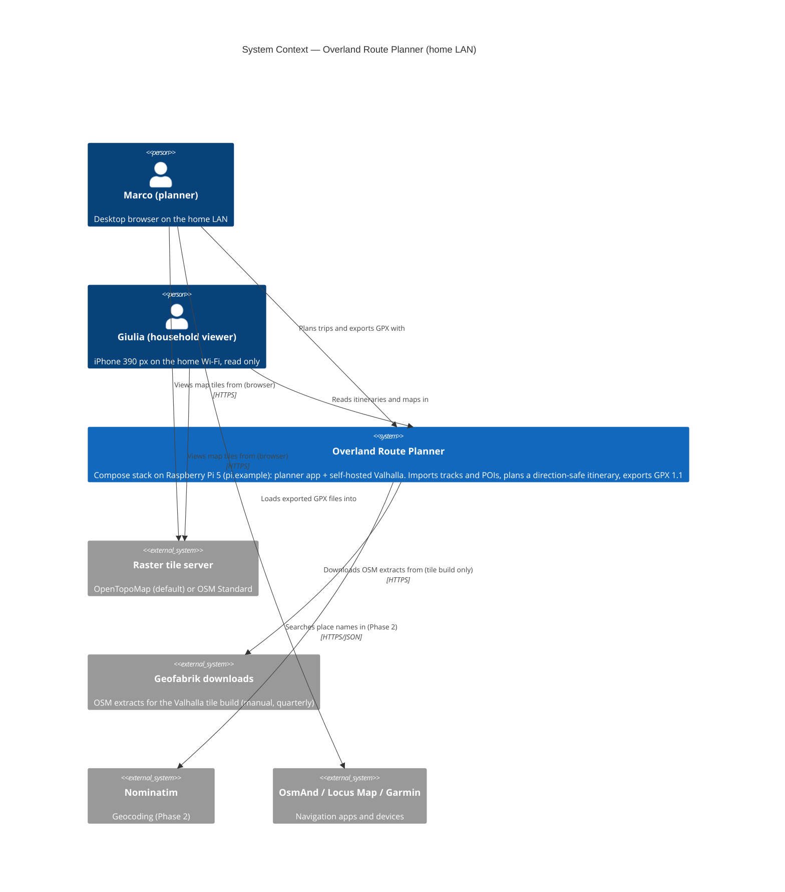
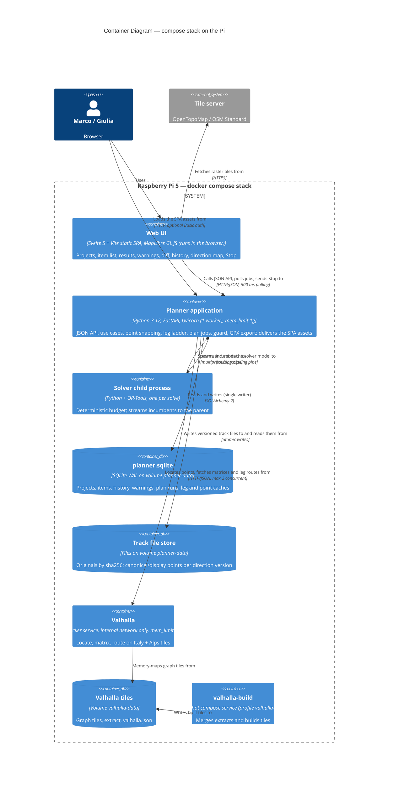
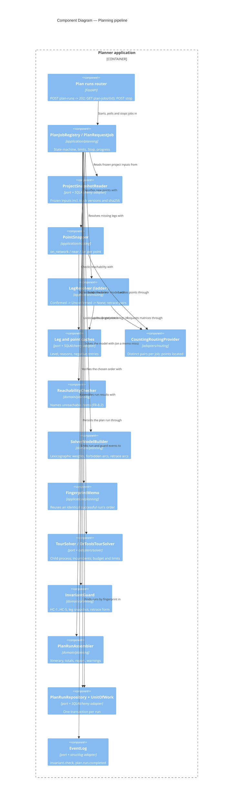
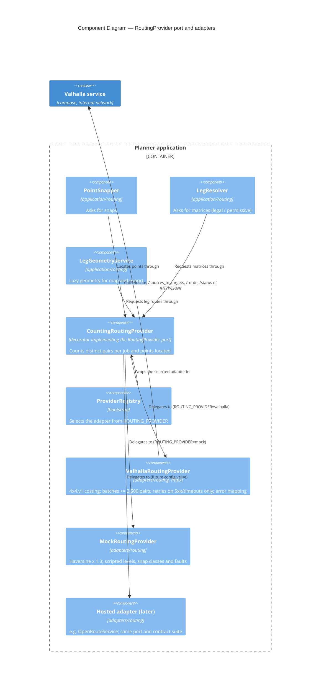

# C4 Diagrams — Overland Route Planner

Companion to `brief.md` (## Application Architecture), Revision 1. Mermaid C4 syntax. Every relationship is labelled with a verb.

## L1 — System Context

## L2 — Container

## L3 — Component: planning pipeline (inside "Planner application")

## L3 — Component: RoutingProvider adapters

The application sees only the `RoutingProvider` port; `CountingRoutingProvider` implements it and wraps one concrete adapter. Probe calls go straight to the adapter and are never counted.
